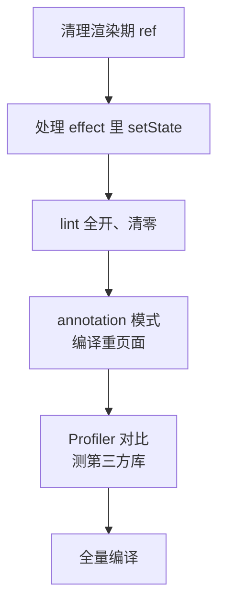

# React Compiler

第 2 章讲过，父组件一渲染，子组件默认跟着渲染，想跳过就得 `memo` 加稳定的 props，于是代码里堆满了 `useMemo` 和 `useCallback`。掌柜眼的网页端里 `useMemo` 两百多处、`useCallback` 八十多处，每一处都要人判断依赖写没写全、值不值得包。**React Compiler** 是一个构建期插件，自动替你完成这些记忆化，而且粒度比手写更细。本章讲它做了什么、依赖什么前提、怎么接进 Vite、它的 lint 规则抓的是什么，最后给出掌柜眼接入 Compiler 的迁移清单。

> [!WARNING]
> 本章按 React Compiler 1.0（2025 年 10 月发布稳定版）和 `@vitejs/plugin-react` 6.x 整理，截至 2026-11；接入方式在 `@vitejs/plugin-react` 6.x 起有变化，后续版本可能再调整，编译产物的具体形态属于实现细节。以 react.dev 的 React Compiler 文档和 `@vitejs/plugin-react` 的 changelog 为准。

## 它做了什么

Compiler 是一个 Babel 插件。它把每个组件和 hook 解析成中间表示，分析数据流：哪些值依赖哪些 props / state，哪些 JSX 依赖哪些值。然后把它们分成一个个「响应式作用域」，每个作用域的结果缓存起来，依赖没变就直接复用。

```tsx
// 源码
function ItemRow({ item, onEdit }: { item: Item; onEdit: (id: string) => void }) {
  const price = formatCents(item.priceCents);
  return (
    <li>
      <span>{item.name}</span>
      <span>{price}</span>
      <button onClick={() => onEdit(item.id)}>编辑</button>
    </li>
  );
}
```

```js
// 编译后（大幅简化，示意）
import { c as _c } from "react/compiler-runtime";

function ItemRow({ item, onEdit }) {
  const $ = _c(7); // 这个组件实例的缓存槽，存在 hook 链表里
  let price;
  if ($[0] !== item.priceCents) {
    price = formatCents(item.priceCents);
    $[0] = item.priceCents;
    $[1] = price;
  } else {
    price = $[1];
  }
  let t0;
  if ($[2] !== item.id || $[3] !== onEdit) {
    t0 = () => onEdit(item.id);
    $[2] = item.id; $[3] = onEdit; $[4] = t0;
  } else {
    t0 = $[4];
  }
  // ……JSX 同理：依赖没变就返回上次的元素对象
}
```

`_c(n)` 本质上是一个 hook，在第 3 章那条链表上占一个槽位，里面是一个长度为 n 的数组。编译后的代码用 `!==` 比较依赖，变了才重算。

这带来两个效果：

1. **值和回调自动稳定**：传给子组件的对象、函数在依赖不变时保持同一引用
2. **JSX 自动稳定**：返回的元素对象在依赖不变时是同一个，根据第 2 章的 bailout 条件「props 引用相同」，**子组件即使没有 `memo` 也会被跳过**

第 2 点是手写 `useMemo` 很难做到的。手写时你得把每一段 JSX 都包起来，没人这么干。

### 比手写更细的粒度

```tsx
function StockPanel({ rows, loading }: Props) {
  if (loading) return <Skeleton />;          // 提前 return
  const total = useMemo(() => sum(rows), [rows]); // 错误：hook 不能在 return 之后
  // ...
}
```

手写 `useMemo` 受 hooks 规则限制，不能放在条件分支和提前 return 之后。Compiler 生成的缓存不是 hook 调用（整个组件只有一个 `_c`），所以可以在任何分支里缓存，包括提前 return 之后的部分。

## 它依赖的前提：React 的规则

Compiler 的所有优化都建立在一个假设上：**你的代码遵守 React 的规则**。它不验证运行时行为，只做静态分析，如果代码违反了规则，缓存就可能返回错误的结果。

| 规则 | 违反的例子 | 为什么会出错 |
|---|---|---|
| 组件和 hook 是纯的 | 渲染时调用 `Date.now()`、`Math.random()`，修改外部变量 | 缓存后不会再执行，值被「冻住」 |
| props 和 state 不可变 | `props.items.push(x)`、`state.list.sort()` | 引用没变，Compiler 认为内容没变 |
| 渲染时不读写 ref | `ref.current = value`、`if (ref.current) ...` | ref 的变化不触发渲染，缓存不知道它变了 |
| hooks 按规则调用 | 条件调用、在普通函数里调用 | 和第 3 章的链表一样会错位 |

Compiler 遇到它能识别的违规时，会**跳过这个组件**，不做优化但也不改变行为。危险的是它识别不了的违规（比如通过多层函数间接修改了 props），那时编译后的代码行为会和原来不同。所以接入 Compiler 之前，lint 必须先清干净。

## ESLint 规则

> [!WARNING]
> 规则名、起始版本（v6）和预设名（`configs.flat.recommended` 等）按 `eslint-plugin-react-hooks` v7 整理，各版本的预设名和默认开启的规则有过调整；以插件的 README 和 changelog 为准。

`eslint-plugin-react-hooks` 从 v6 起带了一批由 Compiler 驱动的规则，它们用同一套分析器在编辑时就报出违规。较新的版本已经把它们放进推荐配置。掌柜眼用的是 v7 的 `configs.flat.recommended`：

```js
// eslint.config.mjs（节选）
{
  extends: [reactHooks.configs.flat.recommended],
  rules: {
    "react-hooks/exhaustive-deps": "error",
    "react-hooks/incompatible-library": "error",
    "react-hooks/unsupported-syntax": "error",
    "react-hooks/set-state-in-effect": "off",
  },
}
```

几条最常碰到的规则：

| 规则 | 抓什么 |
|---|---|
| `refs` | 渲染期间读写 `ref.current` |
| `purity` | 渲染期间调用不纯的函数（`Date.now()` 等） |
| `immutability` | 修改 props、state、hook 返回值 |
| `static-components` | 在组件内部定义组件（第 2 章） |
| `set-state-in-render` | 渲染期间无条件 setState |
| `set-state-in-effect` | effect 里同步 setState（常见于「effect 里取数」「订阅后写回 state」） |
| `incompatible-library` | 使用了已知与记忆化不兼容的库 API |
| `preserve-manual-memoization` | Compiler 无法保留你手写的 `useMemo` / `useCallback` 的语义 |

掌柜眼的配置注释说得很清楚：`refs`、`purity`、`immutability`、`static-components` 这几条留在 error，因为它们抓的是**不上 Compiler 也算 bug** 的东西；唯独 `set-state-in-effect` 关掉了，因为全仓 30 处命中都是「订阅外部源后写回 state」和「进页面取数」这两类正经写法，按规则改要换成 `useSyncExternalStore` 和 Suspense，而它的收益（自动记忆化）在没装 Compiler 时拿不到。

这是一个值得借鉴的姿态：**先开规则，把会出 bug 的写法清掉；Compiler 的接入作为单独的决定**。

## 接入 Vite

以 `@vitejs/plugin-react` 6.x 为例（掌柜眼当前就是 6.x）。6.0 去掉了内置的 Babel 选项，需要单独装 Babel 插件：

```bash
pnpm add -D babel-plugin-react-compiler @rolldown/plugin-babel
```

```ts
// vite.config.ts
import { defineConfig } from "vite";
import react, { reactCompilerPreset } from "@vitejs/plugin-react";
import babel from "@rolldown/plugin-babel";

export default defineConfig({
  plugins: [
    react(),
    babel({ presets: [reactCompilerPreset()] }),
  ],
});
```

`@vitejs/plugin-react` 5.x 及更早版本的写法是 `react({ babel: { plugins: ["babel-plugin-react-compiler"] } })`。

接入之后有一个直接代价：构建链路里多了 Babel，开发服务器冷启动和生产构建都会变慢一些，具体多少取决于项目规模，接入前后各测一次。

### 渐进接入

对一个已有项目，不必一次全开：

```ts
// 只编译显式标注的组件
babel({
  plugins: [["babel-plugin-react-compiler", { compilationMode: "annotation" }]],
})
```

```tsx
function DishRank(props: Props) {
  "use memo"; // annotation 模式下只编译带这个指令的组件
  // ...
}
```

反过来，全量模式下发现某个组件编译后出问题，可以临时加 `"use no memo"` 排除它，修好根本问题后再删掉。

### 验证是否生效

- **React DevTools**：被编译的组件名旁边会显示 「Memo ✨」 标记
- **构建产物**：搜索 `react/compiler-runtime` 的导入
- **Profiler**：对比接入前后同一交互的渲染次数（第 9 章）

## 已有的 useMemo / useCallback 怎么办

不要一接入就全删。官方的建议是：Compiler 会尽量保留手写记忆化的语义，新代码可以不写，旧代码保留，等有测试和 Profiler 数据支撑时再逐步清理。原因有两个：

- 有些 `useMemo` 不只是性能优化，它的结果被当作 effect 的依赖，删掉后如果 Compiler 由于某种原因跳过了这个组件，effect 就会每次渲染都跑
- `preserve-manual-memoization` 规则会告诉你哪些手写记忆化 Compiler 没法保留，那些地方本身可能就有依赖写错的问题

## 它解决不了什么

| 问题 | Compiler 能否解决 |
|---|---|
| 父组件渲染导致无关子组件渲染 | 能，这是它的主要收益 |
| 回调、对象引用不稳定导致 `memo` 失效 | 能 |
| 单次渲染本身很慢（几千行列表、复杂计算） | 不能，依赖变了照样全量算；要虚拟列表、拆分计算 |
| context 值变化导致所有消费者渲染 | 部分：消费者内部能跳过子树，但消费者本身仍会渲染 |
| 网络请求瀑布、包太大 | 不能 |
| 数据每次都是新对象（每次取数都 `JSON.parse`） | 不能，输入引用变了缓存就失效，需要结构共享（如 `replaceEqualDeep`） |

最后一行值得强调：Compiler 的缓存靠引用比较，**数据层每次给新引用，Compiler 再聪明也没用**。掌柜眼在 `useAsync` 里做结构共享，和 Compiler 是互补的两层。

## 掌柜眼的迁移清单

结合前几章的分析，掌柜眼网页端如果要上 Compiler，可以按这个顺序：

1. **替换渲染期写 ref 的几处**。`useLatest` 改用 React 19.2 的 `useEffectEvent`（第 3 章）；`useFrozenWhenClosed` 改为 state 实现或在关闭时由父组件保留选中项
2. **处理 `set-state-in-effect` 的 30 处命中**。订阅外部源再写回 state 的（`matchMedia`、窗口 focus），改成 `useSyncExternalStore`；进页面取数的 `useAsync`，要么保留并对这一个 hook 加 `"use no memo"`，要么换成数据请求库（第 8 章）
3. **打开 `set-state-in-effect`，lint 清零**
4. **annotation 模式先编译几个重页面**，如经营分析、库存盘点，用 Profiler 对比交互的渲染次数和耗时
5. **确认第三方库兼容**：`incompatible-library` 会标出已知问题；拖拽（dnd-kit）、图表（Recharts）这类会在内部持有可变状态的库要重点测
6. **切换到全量模式**，保留现有 `useMemo` / `useCallback`，新代码不再手写



第 1–3 步本身就有价值：即使最后决定不上 Compiler，代码也更符合并发渲染的要求。

## 本章要点

- React Compiler 是构建期 Babel 插件，自动缓存组件里的值、回调和 **JSX**，未变的 JSX 让子组件无需 `memo` 就能 bailout
- 编译产物用一个 `_c(n)` 缓存槽和 `!==` 比较依赖，可以在条件分支、提前 return 之后缓存，粒度比手写细
- 它**假设代码遵守 React 规则**：纯渲染、不可变数据、渲染期不碰 ref；识别出违规就跳过该组件
- `eslint-plugin-react-hooks` 的 Compiler 规则即使不上 Compiler 也值得开，它们抓的多是真实 bug
- `@vitejs/plugin-react` 6.x 用 `@rolldown/plugin-babel` + `reactCompilerPreset()` 接入；可用 annotation 模式和 `"use memo"` / `"use no memo"` 渐进推进
- 已有的手写记忆化先保留；Compiler 解决不了慢渲染本身、网络和「数据每次都是新引用」的问题
- 迁移顺序：清渲染期 ref → 处理 effect 里 setState → lint 清零 → 局部编译验证 → 全量
