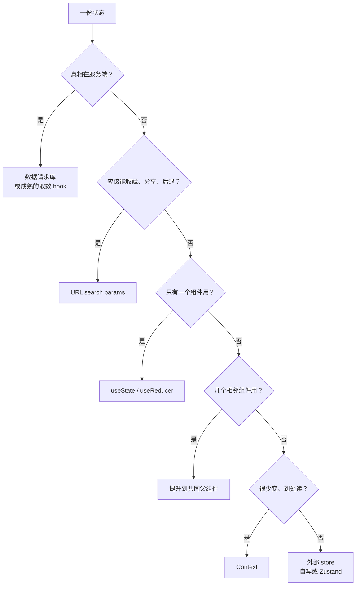

# 状态管理选型

「用什么状态管理库」是 React 社区争论最久的话题，但大部分争论的前提就错了：把所有状态当成同一种东西。服务端数据、URL 里的筛选条件、表单草稿、弹窗开关、跨页面共享的客户端数据，它们的生命周期、谁是真相、要不要持久化都不一样，不应该用同一个工具管。本章先给状态分类，再用前几章的原理看 Context、外部 store、数据请求库各自的代价，最后拿掌柜眼里自己写的几套机制对号入座，给出选型的判断顺序。

## 先给状态分类

| 类别 | 真相在哪 | 例子（掌柜眼） | 合适的工具 |
|---|---|---|---|
| 服务端缓存 | 服务端 | 菜品列表、库存、经营数据 | 数据请求库，或自写的取数 hook |
| URL 状态 | 地址栏 | 当前页面、选中的单据 `?id=`、筛选 `?sel=` | 路由的 search params |
| 表单 / 草稿 | 用户正在编辑的内容 | 记一笔账、导入核对到一半的表格 | 组件 state、表单库、专门的草稿 store |
| 界面局部状态 | 组件自己 | 弹窗开关、hover、展开态 | `useState` |
| 跨组件客户端状态 | 浏览器内存 | 当前门店、权限、主题、页面「看法」 | Context 或外部 store |
| 外部系统状态 | React 之外 | 推送连接是否连着、窗口尺寸、网络状态 | `useSyncExternalStore` |

分完类，大部分「状态管理」问题就消失了。一个典型 SaaS 前端里，服务端缓存占了绝大部分，真正需要全局客户端 store 的状态通常很少。

一个快速判断：**这份数据刷新页面后应该从哪来？** 从服务端重新取的是服务端缓存；应该还在的是 URL 状态或需要持久化的状态；丢了也无所谓的是界面状态。

## 组件 state 与提升

最简单的工具往往够用。两个兄弟组件要共享状态，就把它提升到最近的共同父组件。代价第 2 章讲过：父组件 setState 会让它下面整棵子树重新渲染（除非 bailout）。在提升的层级不高、子树不大时，这完全不是问题。

`useReducer` 适合状态更新逻辑复杂、多个字段要一起变的场景。它和 `useState` 用的是同一套更新队列（第 3 章），只是把「怎么从旧状态算出新状态」集中到一个纯函数里，便于测试。

## Context：传递，不是状态管理

Context 解决的是「跨很多层传值」，它本身不管理状态，状态还是放在某个组件的 `useState` 里，Context 只是把它广播下去。

它的渲染代价来自实现：Provider 的 `value` 变了（`Object.is` 比较），React 从 Provider 往下遍历，找到所有读了这个 context 的 Fiber，给它们标上更新。**每一个消费者都会重新渲染**，不管它用的是 value 里的哪个字段。

```tsx
// 每次 Shell 渲染，value 都是新对象，所有消费者跟着渲染
<PermsContext value={{ perms, can: (p: string) => perms.includes(p) }}>
  {children}
</PermsContext>
```

三个缓解办法：

1. **稳定 value**：用 `useMemo` 包住 value（上了 Compiler 会自动做）
2. **按变化频率拆分**：很少变的（权限、门店信息）和经常变的（实时状态）放进不同的 Context
3. **把状态和 dispatch 分开**：`dispatch` 永远稳定，只需要触发更新的组件只订阅 dispatch 的 Context，不会因为状态变化而渲染

掌柜眼的权限（`PermsProvider` / `usePerms`）就是 Context 的理想用例：登录后基本不变、几乎每个页面都要读、读的地方遍布各层。反过来，像推送连接状态这种会频繁变化、只有少数组件关心的东西，就不该放进一个大 Context。

## 外部 store：订阅加选择器

Zustand、Redux（react-redux）这类库把状态放在 React 之外的一个对象里，组件通过 `useSyncExternalStore`（第 4 章）订阅。它们和 Context 的关键区别是**选择器**：组件只订阅自己关心的那部分，其他字段变化时，选择器返回值没变，组件就不渲染。

一个外部 store 的核心只有十几行：

```ts
import { useSyncExternalStore } from "react";

export function createStore<S>(initial: S) {
  let state = initial;
  const listeners = new Set<() => void>();
  const subscribe = (l: () => void) => {
    listeners.add(l);
    return () => listeners.delete(l);
  };
  return {
    get: () => state,
    set(patch: Partial<S>) {
      state = { ...state, ...patch }; // 不可变：整体换新对象
      for (const l of listeners) l();
    },
    use<T>(selector: (s: S) => T): T {
      return useSyncExternalStore(subscribe, () => selector(state));
    },
  };
}
```

掌柜眼的导入草稿 `createSheetImport` 就是这个结构：模块级的 `state`、一个 `listeners` 集合、`set` 时整体替换对象并通知、`use()` 里调用 `useSyncExternalStore`。它服务于「核对页、按钮、弹窗、概览页的首次引导」这几个分散在不同路由里的组件共享同一份导入草稿，草稿在路由切换时不能丢。这正是外部 store 擅长的：**生命周期跟组件无关、多处读写的客户端状态**。

### 选择器必须返回稳定的值

```ts
// 错误：每次 getSnapshot 都返回新对象
const { step, reading } = importer.use((s) => ({ step: s.step, reading: s.reading }));
```

第 4 章说过，`getSnapshot` 两次调用的结果不 `Object.is` 相等，React 就认为数据一直在变，会无限重新渲染。选择器返回新对象、新数组都会触发这个问题。解决办法：分开选两个原始值；或者用库提供的浅比较工具（Zustand 的 `useShallow`、react-redux 的 `shallowEqual`）。掌柜眼的草稿 store 让 `use()` 直接返回整个 `state` 对象，它只在 `set` 时换新，所以是安全的；代价是任何字段变化，所有使用者都会渲染，对一个只有几个组件读的草稿来说可以接受。

### 什么时候值得引入 Zustand

自写 store 在需求简单时完全够用。当你需要这些时，再考虑库：中间件（持久化、devtools、撤销）、派生状态的缓存、选择器的浅比较、TypeScript 类型推导的便利。Redux Toolkit 在需要严格的单向数据流、时间旅行调试、多人协作约定时更有优势，对一人项目来说通常偏重。

## 服务端缓存：数据请求库

服务端数据是另一个物种。它的真相不在浏览器里，浏览器里的只是一份**可能过期的副本**。管理它要解决的问题：

| 问题 | 掌柜眼 `useAsync` 怎么做的 | TanStack Query 怎么做的 |
|---|---|---|
| 请求去重 | 无（同一 key 两个组件会各取一次） | 同 key 的进行中请求合并 |
| 过期响应 | 递增序号丢弃旧响应 | 内部处理 |
| 缓存与回访 | 按 key 的 LRU `Map`，回访先显示缓存 | `gcTime` / `staleTime` 控制 |
| 失效 | 推送到达时让所有挂着的实例静默重取 | `invalidateQueries`，按 key 前缀失效 |
| 结构共享 | `replaceEqualDeep` | 默认开启 |
| 离线 | 后台重取遇到断网保留旧数据 | `networkMode` 配置 |
| Suspense | 不支持 | `useSuspenseQuery` |

掌柜眼的 `useAsync` 在单个 hook 里实现了相当完整的服务端缓存语义，而且推送失效、离线保留这些行为都是按业务需求精确设计的。值得换成库的信号是：开始需要请求去重、需要更细的失效粒度（现在是推送一来所有挂着的实例都重取，靠服务端的读缓存兜住）、或者要走 Suspense 路线（第 5 章）。

如果迁移，推送失效那一层可以直接映射：

```ts
// 推送说「库存」这一块换版了
onLiveChanged(({ domains }) => {
  if (domains.length === 0) {
    void queryClient.invalidateQueries(); // 全部失效：刷新、换进程、跨天
    return;
  }
  for (const d of domains) {
    void queryClient.invalidateQueries({ queryKey: [d] });
  }
});
```

前提是 query key 按数据域开头组织，比如 `["stock", "overview", storeId, range]`。这也呼应了 `useAsync` 注释里对 key 的要求：key 说的是「这份数据是谁」，决定结果的参数一个都不能漏。

## URL 状态

当前在哪一页、选中了哪张单据、筛选条件，这些放在 URL 里有天然优势：可以收藏、可以分享、浏览器前进后退自动生效。掌柜眼的老路由重定向（`/stock/archive?id=...`、`/ingredients?sel=...`）就是把「选中项」放在 search params 里。

但掌柜眼也有一个有意的反例：`useViewState` 记的是页面的「看法」（看哪个月、筛了哪一类），只放在内存里，**刻意不进 URL、也不进 localStorage**。注释给的理由是：上周筛过一次、今天还筛着，店主会以为数据丢了。这说明选型不只是技术问题：同样是筛选条件，是否该持久、持久多久，取决于用户的预期。

## 选型的判断顺序



两条额外的经验：

- **不要把服务端数据复制进全局 store**。复制意味着要自己维护同步，迟早会出现两份数据对不上。掌柜眼「数据只在服务端一份」的原则在前端的对应就是这条
- **从最简单的开始，遇到具体痛点再升级**。痛点要具体到「这个组件因为 X 多渲染了」「这里两份数据不一致了」，而不是「大家都在用」

## Zustand 与 TanStack Query 最小对照

> [!WARNING]
> 本节代码按 2026 年 11 月两个库的当前大版本整理：Zustand 5（npm 上为 5.0.16，对照其 README）、TanStack Query 5（`@tanstack/react-query` 5.105，对照官方 Quick Start）。两者的 API 在大版本之间都有过破坏性变更（如 Query v5 把 `isLoading` 改名为 `isPending`、只接受对象参数），以各自官方文档为准。

判断顺序里最常被混用的两个终点是「外部 store」和「数据请求库」。把它们各写一段最小代码放在一起，差别一眼就能看出来：前者管**浏览器里自己就是真相**的状态，后者管**服务端那份数据的本地副本**。

客户端状态，用 Zustand：

```ts
import { create } from "zustand";
import { useShallow } from "zustand/react/shallow";

type ImportDraft = {
  step: number;
  rows: Row[];
  next: () => void;
  setRows: (rows: Row[]) => void;
};

export const useImportDraft = create<ImportDraft>()((set) => ({
  step: 1,
  rows: [],
  next: () => set((s) => ({ step: s.step + 1 })), // 返回部分字段，库负责浅合并
  setRows: (rows) => set({ rows }),
}));

// 组件里：选原始值，或者用 useShallow 选多个字段
const step = useImportDraft((s) => s.step);
const { rows, next } = useImportDraft(useShallow((s) => ({ rows: s.rows, next: s.next })));
```

服务端缓存，用 TanStack Query：

```tsx
import { QueryClient, QueryClientProvider, useMutation, useQuery, useQueryClient } from "@tanstack/react-query";

const queryClient = new QueryClient();
// 根组件：<QueryClientProvider client={queryClient}><App /></QueryClientProvider>

function StockList({ storeId }: { storeId: string }) {
  const qc = useQueryClient();
  const { data, isPending, error } = useQuery({
    queryKey: ["stock", "list", storeId], // key 以数据域开头，便于按前缀失效
    queryFn: () => api.stock.list(storeId),
    staleTime: 30_000,                    // 30 秒内回访直接用缓存，不重取
  });
  const adjust = useMutation({
    mutationFn: api.stock.adjust,
    onSuccess: () => qc.invalidateQueries({ queryKey: ["stock"] }),
  });
  if (isPending) return <Skeleton />;
  if (error) return <ErrorNote error={error} />;
  return <StockTable rows={data} onAdjust={(x) => adjust.mutate(x)} />;
}
```

两段代码放在一起对照：

| | Zustand | TanStack Query |
|---|---|---|
| 真相在哪 | store 自己 | 服务端；本地只是带过期时间的副本 |
| 状态怎么来 | 初始值加 `set` | `queryFn` 去取，库负责缓存和去重 |
| 怎么变 | 调用 action（`set`） | 调 `mutation`，成功后 `invalidateQueries` 让相关查询重取 |
| 组件订阅粒度 | 选择器，`Object.is` 比较，多字段用 `useShallow` | 按 `queryKey`；返回结果默认结构共享，没变的部分引用不变 |
| 加载 / 错误态 | 没有，需要就自己存 | 内建 `isPending`、`error`，可选 `useSuspenseQuery` |
| 和 React 的接口 | `useSyncExternalStore`（第 4 章） | 同样基于外部订阅，Suspense 版本走第 5 章的 `use` 语义 |

两者不是二选一，而是常常同时出现：TanStack Query 管所有从服务端来的数据，Zustand（或本章的自写 store）只留给导入草稿、当前选中的门店这类纯客户端状态。最常见的错误是反过来，把 `useQuery` 取回的数据再 `set` 进 Zustand，于是有了两份真相，失效时只更新了其中一份。

## 本章要点

- 先分类再选工具：服务端缓存、URL 状态、表单草稿、界面局部、跨组件客户端状态、外部系统状态
- **Context 是传递机制**，value 变化时所有消费者都会渲染；适合很少变、到处读的数据，可按变化频率拆分
- 外部 store 基于 `useSyncExternalStore` 加选择器，只在所选部分变化时渲染；**选择器必须返回稳定引用**
- 掌柜眼的导入草稿 store 是一个十几行的外部 store，适合生命周期跨路由、多处读写的状态
- 服务端数据用数据请求库管理，要解决去重、过期、缓存、失效、结构共享、离线等问题；推送失效可映射为按 key 前缀 `invalidateQueries`
- URL 适合可分享、可后退的状态；是否持久化要看用户预期，不只是技术选择
- Zustand 管浏览器里自己就是真相的客户端状态，TanStack Query 管服务端数据的本地副本；两者常常并用，但不要把查询结果再复制进 store
- 不要把服务端数据复制进全局 store；从最简单的方案开始，遇到具体痛点再升级

## 动手练习

1. **memo 挡不住 Context**：

   ```tsx
   const Perms = createContext<{ perms: string[] } | null>(null);

   const Reader = memo(function Reader() {
     const v = use(Perms)!;
     console.log("Reader render");
     return <i>{v.perms.length}</i>;
   });

   export default function App() {
     const [n, setN] = useState(0);
     const [perms] = useState(["stock"]);
     return (
       <Perms value={{ perms }}>
         <button onClick={() => setN(n + 1)}>{n}</button>
         <Reader />
       </Perms>
     );
   }
   ```

   关掉 StrictMode，点两次按钮，数 `Reader render`；再把 value 换成 `useMemo(() => ({ perms }), [perms])` 重试。

   验证：内联对象时共打印 3 次；用 `useMemo` 后只有挂载时的 1 次。

   参考答案：`memo` 只比较 props，`Reader` 没有 props 变化，但它读了 Context，Provider 的 value 每次都是新对象，React 会直接给所有消费者标上更新。稳定 value 之后，`App` 的重渲染就传不到 `Reader` 了。

2. **选择器只订阅自己那一块**：用本章的 `createStore` 建一个 `{ step: 1, reading: false }` 的 store，写两个组件，一个 `store.use((s) => s.step)`，一个 `store.use((s) => s.reading)`，各自在渲染时计数。挂载后调用两次 `store.set({ step: ... })`。

   验证：`step` 组件共渲染 3 次，`reading` 组件只渲染了挂载时的 1 次。如果把选择器改成 `(s) => ({ step: s.step })`，会得到第 4 章练习 3 那样的无限循环报错。

   参考答案：`useSyncExternalStore` 每次通知后重新调用选择器，结果 `Object.is` 相同就不渲染；`reading` 没变，组件就被跳过。这是外部 store 相对 Context 的主要优势，前提是选择器返回原始值或稳定引用。

3. **给状态分类（分析题）**：一个「采购单」页面有这些状态，按本章的判断顺序为每一项选工具，并说出理由：(a) 供应商列表；(b) 当前查看的采购单 id；(c) 正在编辑、还没提交的新采购单行项目，切到别的页面再回来要还在；(d) 「删除确认」弹窗是否打开；(e) 当前登录用户能否看到进价。

   验证：对照判断流程图逐项走一遍，每一项都能落到图中的某个终点上。

   参考答案：(a) 真相在服务端，用数据请求库或取数 hook，不要复制进全局 store；(b) 应该能收藏、分享、后退，放 URL search params；(c) 生命周期跨路由、组件卸载后仍需保留，用外部 store（类似本章的导入草稿）；(d) 只有一个组件关心，`useState`；(e) 登录后很少变、到处读，用 Context。
