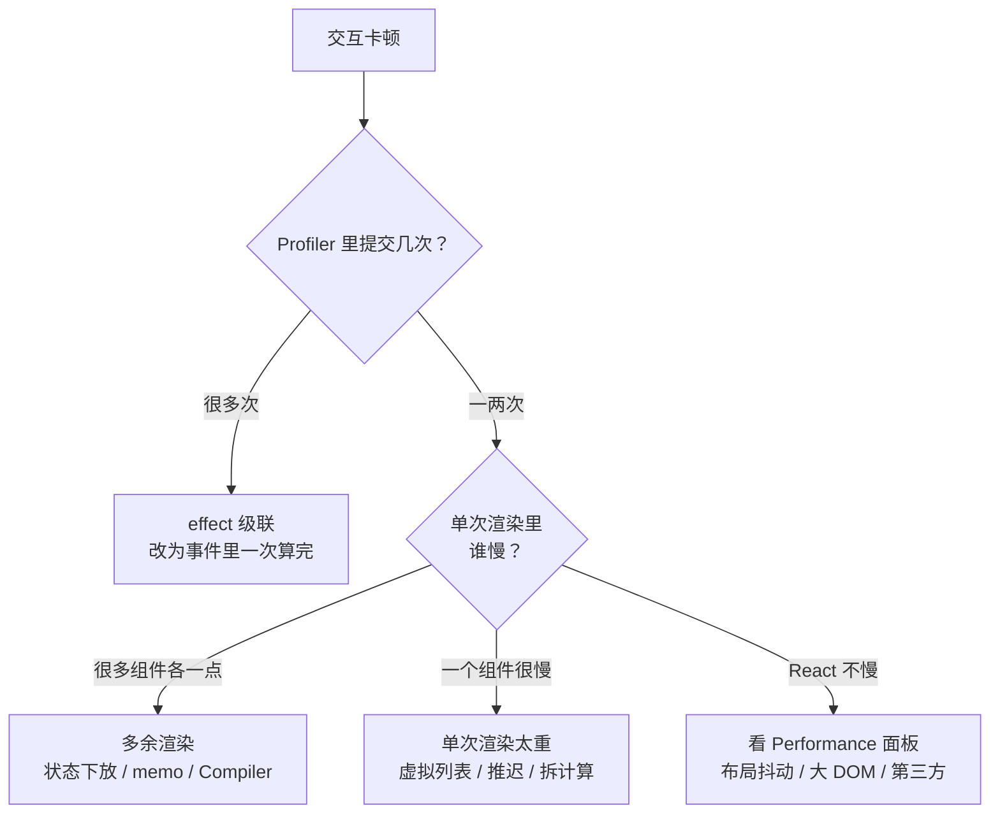

# 性能排查

前八章讲的机制最终要落到一个问题上：页面卡了，怎么找到原因、怎么改。React 的性能问题凭直觉去猜，十有八九猜错：以为是渲染次数太多，其实是某一个组件单次就要 80ms；以为是 React 慢，其实是一次布局抖动。本章给出一套排查流程：先用对指标和工具，再把问题归到几类典型根因上，每类对应前面章节里的机制和解法。最后是一份可以照着过的清单。

## 先确认在测什么

### 不要在开发模式下下结论

开发模式下 React 额外做了大量检查：StrictMode 的双重渲染和双重 effect、组件栈追踪、更多的警告逻辑。开发构建本身也没有压缩和摇树。开发模式下慢 3 倍、5 倍都很正常，**性能结论要在生产构建上得出**：

```bash
pnpm web build
pnpm web preview   # 本地起生产包，用 Chrome 打开测
```

### 用 INP 衡量交互

用户感受到的「卡」，主要是交互后界面迟迟不更新。Web Vitals 里对应的指标是 **INP**（Interaction to Next Paint）：一次点击、按键到下一帧绘制之间的延迟，取页面生命周期内较差的那些交互。React 能影响的部分，就是事件处理函数加上它触发的同步渲染和提交。

一个经验判断：一次交互的同步工作超过一帧（约 16ms）就可能掉帧，超过 50ms 在 Chrome 里会被标成长任务（long task），用户能明显感觉到。具体的「良好」阈值以 web.dev 上的最新定义为准。

### 把慢的场景固定下来

排查前先写下可复现的步骤：「库存盘点页，200 种食材，在搜索框连续输入『牛肉』两个字」。没有固定场景，前后对比就没有意义。CPU 太快时问题可能不明显，Chrome Performance 面板可以开 CPU 降速（4x / 6x）模拟店里的老电脑。

## 工具

### React DevTools Profiler

浏览器装上 React Developer Tools 后，「Profiler」标签页可以录制一段交互，按**提交**（commit）逐个查看：

| 视图 | 看什么 |
|---|---|
| Flamegraph | 这次提交中每个组件的渲染耗时，灰色表示没有渲染（bailout） |
| Ranked | 按耗时排序，直接找到最慢的组件 |
| 提交列表（顶部柱条） | 一次交互触发了几次提交；一次点击触发五六次提交通常意味着 effect 级联 |

在 DevTools 设置里打开「Record why each component rendered while profiling」，选中组件就能看到它这次为什么渲染：props 变了（哪个 prop）、state 变了、hooks 变了、父组件渲染了。这是定位「多余渲染」最直接的手段。

「Highlight updates when components render」开关会在组件渲染时闪框，适合快速发现「我只是在输入框里打字，为什么侧边栏也在闪」。

### 生产环境的 Profiler

默认的生产构建去掉了 Profiler 需要的计时代码。要在生产包里录制，可以把 `react-dom/client` 换成带计时的构建：

```ts
// vite.config.ts（只在需要排查时临时打开）
export default defineConfig({
  resolve: {
    alias: {
      "react-dom/client": "react-dom/profiling",
    },
  },
});
```

### Chrome Performance 面板与 React 轨道

Chrome DevTools 的 Performance 面板能看到 React 以外的一切：布局、样式计算、绘制、垃圾回收、长任务。React 19.2 起，录制结果里会多出 React 自己的轨道：

- **Scheduler 轨道**：按优先级（blocking、transition 等）显示 React 在做什么工作、什么时候在等待
- **Components 轨道**：显示正在渲染或执行 effect 的组件树

有了这两条轨道，就能在同一条时间线上看到「这个长任务里，React 渲染占了多少，布局占了多少」，以及 transition 渲染是不是真的被切片、被打断了（第 4 章）。

### 代码里埋点：Profiler 组件

```tsx
import { Profiler } from "react";

<Profiler
  id="StockCount"
  onRender={(id, phase, actualDuration, baseDuration) => {
    if (actualDuration > 16) console.warn(id, phase, actualDuration.toFixed(1), baseDuration.toFixed(1));
  }}
>
  <StockCountTable rows={rows} />
</Profiler>
```

`actualDuration` 是这次提交中这棵子树实际渲染花的时间，`baseDuration` 是假设全都不 bailout 时的估算耗时。两者差距大说明记忆化在起作用；`actualDuration` 接近 `baseDuration` 说明几乎每次都在全量渲染。

## 典型根因与解法

把 Profiler 和 Performance 面板看到的现象，归到下面几类：



### 1. 多余渲染

现象：Flamegraph 里大片组件在渲染，每个都不慢，但加起来很多；「why rendered」显示是「父组件渲染了」或某个函数 prop 变了。

| 解法 | 机制 | 章节 |
|---|---|---|
| 把状态下放到真正用它的组件 | 父组件不再因这个状态渲染 | 第 2 章 |
| 用 `children` 传入昂贵内容 | `children` 引用不变，子树 bailout | 第 2 章 |
| `memo` + 稳定 props | props 浅比较相同则跳过 | 第 2 章 |
| 拆分 Context | 不相关的消费者不被通知 | 第 8 章 |
| 外部 store 加选择器 | 只订阅关心的字段 | 第 8 章 |
| 数据结构共享 | 重取到相同数据时引用不变 | 第 2 章 |
| React Compiler | 自动稳定值、回调和 JSX | 第 7 章 |

掌柜眼的推送重取是一个现成的例子：推送一来，所有挂着的页面数据都在后台重取。如果没有 `replaceEqualDeep`，每次推送都会让整页的表格重新渲染，即使数据一行都没变；有了它，没变就是同一个引用，`setState` 直接跳过。

### 2. 单次渲染太重

现象：Ranked 视图里某个组件单次就几十毫秒，通常是长列表、大表格、复杂图表。

- **虚拟列表**：只渲染视口里的几十行，用 TanStack Virtual 这类库。几百行以上、每行有交互控件的表格基本都该虚拟化
- **推迟**：渲染结果不需要随每次按键立即更新的，用 `useDeferredValue` 或 `startTransition` 标为低优先级，让它可被打断（第 4 章）
- **把计算挪出渲染**：排序、分组、汇总这类计算用 `useMemo` 缓存，或者干脆在数据进来时算好；真正重的计算放到 Web Worker
- **拆组件**：一个巨大的组件里任何 state 变化都要重新执行全部逻辑，拆开后变化只影响其中一块

注意 Compiler 和 `memo` 对这一类帮助有限：依赖真的变了（用户确实输入了新关键词），该算的还是要算。

### 3. effect 级联

现象：一次点击，Profiler 里出现一连串提交。

```tsx
// 反模式：用 effect 同步派生状态
const [items, setItems] = useState<Item[]>([]);
const [filtered, setFiltered] = useState<Item[]>([]);
useEffect(() => {
  setFiltered(items.filter(match));     // 第二次提交
}, [items]);
useEffect(() => {
  setTotal(sum(filtered));              // 第三次提交
}, [filtered]);
```

每个 effect 里的 setState 都会在提交之后再触发一轮渲染和提交。派生数据应该在渲染中直接算（需要时 `useMemo`），响应用户操作的逻辑应该放在事件处理函数里一次完成。这也是 `set-state-in-effect` 这条 lint 规则想推动的方向（第 7 章）。合法的例外是订阅外部系统后写回当前值，那类场景更适合用 `useSyncExternalStore`。

### 4. React 之外的开销

现象：Performance 面板里长任务的大部分时间是紫色（布局、样式计算）或绿色（绘制），React 的轨道只占一小段。

- **布局抖动**：在循环里交替读布局（`offsetHeight`、`getBoundingClientRect`）和写样式，每次读都强制浏览器重新布局。读写要分批，读放在 `useLayoutEffect` 里集中进行
- **DOM 过大**：几千个节点本身就让样式计算和布局变慢，回到虚拟列表
- **昂贵的 CSS**：大面积的 `backdrop-filter`、阴影、频繁变化的 `filter`
- **第三方库**：图表库在每次数据变化时重建整个 SVG

### 5. 加载性能

首屏和页面切换慢，很多时候不是渲染问题，而是包太大、请求串行。掌柜眼在这方面的几个做法都可以照搬：

- 每个页面 `lazy()` 拆包，图表库只在进入对应页面时加载
- 落地页那一包在模块顶层就开始加载，和登录态检查并行（第 5 章）
- ExcelJS 这种九百多 K 的库只在点「导出」那一下 `await import()`，不进首屏
- Suspense 边界放在内容区里，导航用 transition 保持旧页面，避免整屏闪烁

## 排查清单

| 步骤 | 做什么 |
|---|---|
| 1 | 写下可复现的慢场景，在**生产构建**上复现，必要时开 CPU 降速 |
| 2 | Performance 面板录一次，确认长任务里 React 占多少、布局和绘制占多少 |
| 3 | React 占大头：Profiler 录制，看一次交互触发了几次提交 |
| 4 | 多次提交：找出 effect 里的 setState 级联，改为渲染中派生或事件里一次完成 |
| 5 | 单次提交：Ranked 视图找最慢的组件；打开「why rendered」看多余渲染的原因 |
| 6 | 多余渲染：状态下放、`children`、拆 Context、`memo`、结构共享，或评估 Compiler |
| 7 | 单个组件慢：虚拟列表、`useDeferredValue`、挪走计算、拆组件 |
| 8 | 改完在同一场景重新录制，用数字对比，而不是凭感觉 |

## 本章要点

- 性能结论要在**生产构建**上得出；用 INP 和长任务衡量交互卡顿，先把慢场景固定下来
- React DevTools Profiler 看提交次数、组件耗时和「为什么渲染」；Chrome Performance 面板看全局，React 19.2 起有 Scheduler 和 Components 轨道
- `<Profiler>` 的 `actualDuration` 与 `baseDuration` 对比能看出记忆化是否生效
- 根因分五类：多余渲染、单次渲染太重、effect 级联、React 之外的开销、加载性能；每类对应不同解法
- Compiler 和 `memo` 主要解决多余渲染，对「依赖真的变了」的重渲染帮助有限，那要靠虚拟化和推迟
- 改完用同一场景重新测量，用数字说话

## 接下来读什么

这本书讲的是 React 本身。React 跑在浏览器里，渲染之后的布局、绘制、合成，Vite 的构建和拆包，Web Vitals 的度量方式，这些属于平台和工程层面，接下来可以读[《前端工程化与 Web 平台》](../frontend-engineering/)。如果要把同样的 React 知识带到手机上，[《React Native 与 Expo》](../rn-expo/)会讲 Fabric 新架构如何复用本书的 Fiber 和并发机制，以及 Hermes、原生模块这些移动端特有的部分。
