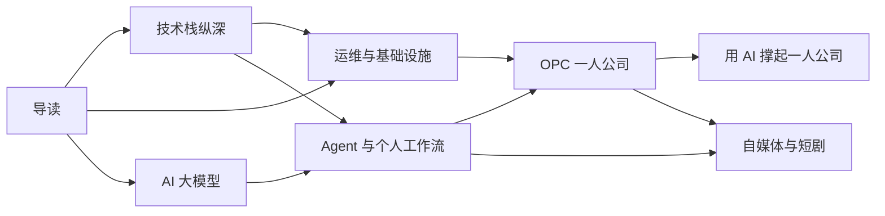

# 怎么用这套书

这套书只为一个目标服务：**一个人把一家公司做起来**。一人公司（One Person Company，下文简称 OPC）要求一个人同时是工程师、运维、产品经理、市场和财务。AI 让这件事第一次变得现实，但前提是你既懂技术栈的每一层，也懂怎么让 AI 替你干活，还懂生意本身。

这本导读是整套书的地图：每本书讲什么、为什么要读、该按什么顺序读。

## 七个系列

| 系列 | 本数 | 解决什么问题 |
|---|---|---|
| 导读 | 1 | 就是这本，告诉你该先读什么 |
| 技术栈纵深 | 9 | 把日常在用的技术从「会用」读到「懂原理」 |
| 运维与基础设施 | 11 | 一个人把服务稳稳地跑在线上 |
| AI 大模型 | 11 | 从科普到原理，再到把模型用进产品 |
| Agent 原理与个人工作流 | 9 | 理解 agent 怎么工作，并让它成为你的团队 |
| OPC 一人公司 | 17 | 产品、增长、定价、财务、合规，以及从副业走到全职的行动路线 |
| 自媒体与短剧 | 22 | 做账号、做 AI 短剧和漫剧，以及给创作者做工具 |

技术栈和运维让你**做得出来、跑得起来**，AI 和 Agent 让你**一个人顶一个团队**，OPC 系列让你**卖得出去、活得下去**。最后一本《用 AI 撑起一人公司》把所有系列收拢到一起。

## 难度标记

每本书的 `level` 字段标明了难度，书架上会显示：

- **入门**：零基础可读，重直觉、少术语
- **中级**：默认你已经在用这项技术，讲清楚原理和最佳实践
- **进阶**：深入实现细节、权衡与边界，适合想吃透的时候读

同一个主题的入门书和进阶书会成对出现，比如《大模型原理科普》和《大模型原理进阶》。第一遍读入门书建立整体认知，遇到具体问题时再翻进阶书。

## 案例从哪里来

书里的例子尽量取自三个真实项目，读起来更有体感：

- **hatch-shelf**：你正在用的这个书架，Expo + SQLite + WebView，完全离线
- **hatch-counter**：门店管理工具，NestJS + Postgres + Docker 部署，用视觉模型识别进货单
- **hatch-recordwall**：唱片墙播放器，Expo + Electron + Cloudflare Worker + R2

## 这套书怎么长出来

书由 AI 按写书规范生成，再推送到手机。规划和进度记在仓库的 `books/ROADMAP.md` 里。每写完一本，[写作进度](08-progress.md)一章就会更新，所以这本导读本身也会随着书单一起成长。

接下来五章分别介绍五个系列，之后是[阅读路线](07-reading-paths.md)。
