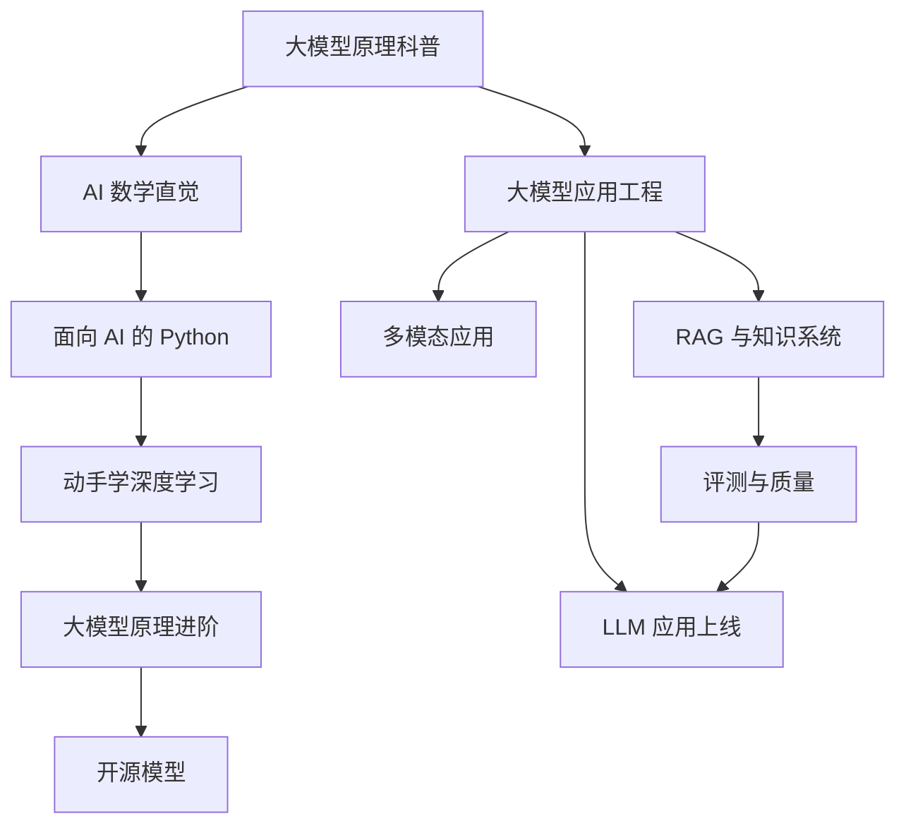

# AI 大模型

这个系列走两条线：

- **原理线**：从科普到数学、再到动手实现，让你真正理解模型在做什么
- **工程线**：把模型可靠、便宜、安全地用进产品

两条线不必读完一条再读另一条，但建议先读第一本科普，把整体图景建立起来。

## 原理线

### 大模型原理科普 · `llm-fundamentals`

不需要数学背景。讲 token、embedding、注意力和 Transformer，讲预训练、SFT、RLHF 各自在做什么，最后回答「大模型能做什么、不能做什么」。整个 AI 和 Agent 系列都建立在这本书之上。

### AI 数学直觉 · `math-for-ai`

只讲够用的数学：矩阵乘法的几何意义、概率与交叉熵、梯度与反向传播。重直觉、配图示，不讲证明。

### 面向 AI 的 Python · `python-for-ai`

写给 TS 开发者的 Python。用 TS 对照的方式速学语法，再讲 uv、Pydantic、NumPy、Pandas 和 Jupyter。AI 领域的大部分工具和资料都绕不开 Python。

### 动手学深度学习 · `deep-learning-basics`

用 PyTorch 从感知机一路写到一个能生成文字的 mini-GPT。亲手写过一遍注意力，再读论文和技术博客会轻松很多。

### 大模型原理进阶 · `llm-deep-dive`

讲 RoPE、KV Cache、MoE、长上下文、推理模型与思维链、对齐方法、量化和可解释性。读新闻时看到「某模型用了某技术」，你能判断它意味着什么。

## 工程线

### 大模型应用工程 · `llm-app-engineering`

用模型做产品的基本功：Prompt 工程、结构化输出、工具调用、流式输出、Prompt 缓存、成本与延迟、模型选型。

### 多模态应用 · `multimodal-ai`

视觉模型、OCR、文档理解、语音与图像生成。核心案例是 hatch-counter 的拍照识别进货单。

### RAG 与知识系统 · `rag-systems`

讲 embedding、pgvector、分块、混合检索和重排，也讨论在长上下文时代 RAG 还该不该用。

### 评测与质量 · `llm-evals`

没有评测，改 prompt 就是在碰运气。这本书讲怎么构建测试集、规则评分、LLM-as-judge 和回归测试。

### 开源模型：部署、量化与微调 · `open-models`

什么时候值得自己跑模型、怎么跑、要不要微调。内容涵盖 Ollama、vLLM、量化格式、GPU 租用、LoRA 和蒸馏。

### LLM 应用上线 · `llmops`

模型调用进了生产环境之后的事：模型网关、多供应商降级、限流、成本监控、Prompt 版本管理、注入防护和数据合规。
