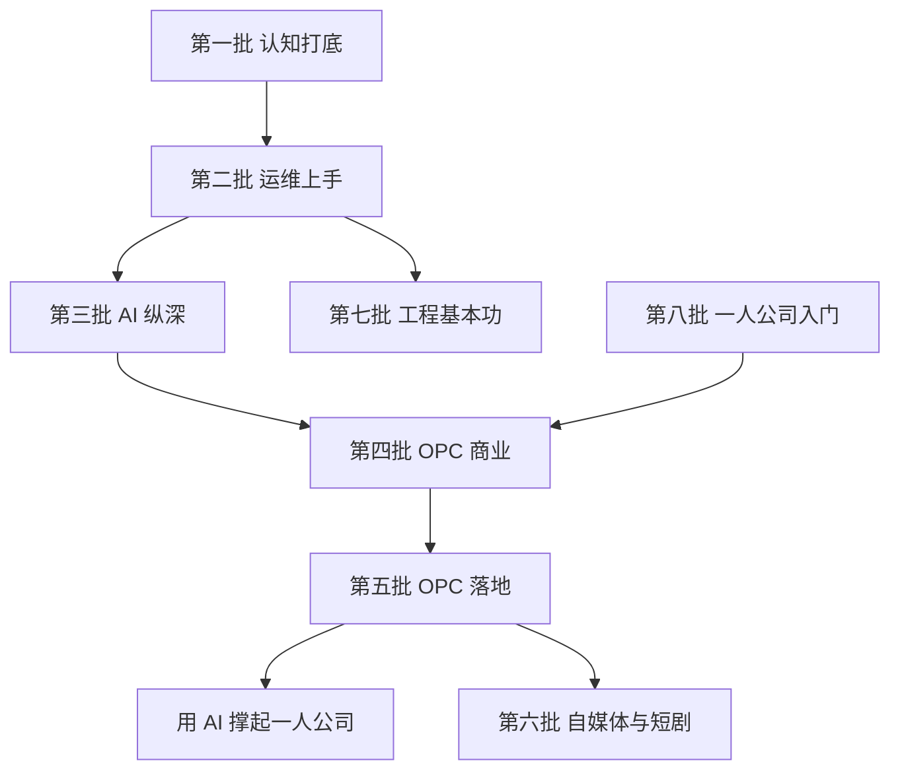

# 阅读路线

96 本书不可能、也不需要从头读到尾。这一章给出两种读法：按批次的默认路线，以及按眼前目标挑书的捷径。

## 默认路线：八批

不是程序员、对开公司和做生意还没有概念的读者，从[第八批](#第八批一人公司入门)开始，再接第四批。

### 第一批：认知打底

先建立对 AI 和 agent 的整体认知，同时补上运维最基础的两块。

1. 书架导读（就是这本）
2. [大模型原理科普](../llm-fundamentals/)
3. [大模型应用工程](../llm-app-engineering/)
4. [Agent 原理与设计](../agent-principles/)
5. [编码 Agent 实战](../coding-agents/)
6. [个人 Agent 工作流](../personal-agent-workflow/)
7. [一人公司方法论](../opc-playbook/)
8. [Linux 系统与命令行](../linux-essentials/)
9. [容器技术](../docker-containers/)

### 第二批：运维上手

把一个服务从部署到监控、再到出事故时的处理，完整走一遍。

1. [计算机网络](../networking/)
2. [Nginx 与反向代理](../nginx-gateway/)
3. [部署与 CI/CD](../deploy-release/)
4. [一人运维手册](../production-ops/)
5. [可观测性与性能](../observability-performance/)
6. [PostgreSQL 运维](../database-ops/)

### 第三批：AI 纵深

沿原理线读到底，再补上 agent 的两本核心原理书和 AI 工程的两本质量书。

1. [AI 数学直觉](../math-for-ai/)
2. [面向 AI 的 Python](../python-for-ai/)
3. [动手学深度学习](../deep-learning-basics/)
4. [大模型原理进阶](../llm-deep-dive/)
5. [上下文工程](../context-engineering/)
6. [工具设计与 MCP](../tools-and-mcp/)
7. [RAG 与知识系统](../rag-systems/)
8. [评测与质量](../llm-evals/)

### 第四批：OPC 商业

1. [产品思维](../product-thinking/)
2. [定价与商业模式](../pricing-monetization/)
3. [国内合规实务](../opc-compliance-cn/)
4. [获客与增长](../growth-marketing/)
5. [财务与税务](../opc-finance/)
6. [数据分析与埋点](../product-analytics/)

### 第五批：OPC 落地

1. [一人公司行动手册](../opc-action-plan/)（先读第 1 章总览，之后按自己所在的阶段读对应章节）
2. [销售与 To B 成交](../b2b-sales/)
3. [过渡期收入与个人保障](../opc-transition/)
4. [合同与法律文书](../contracts-legal/)
5. [国内私域与内容平台](../private-domain-cn/)
6. [一人公司案例库](../opc-cases/)

行动手册不必等前四批读完：任何时候都可以先读它的总览，确定自己在哪个阶段，再按附录去读当下需要的书。

### 第六批：自媒体与短剧

这一批是一个独立方向，不必等前五批读完。先读[《自媒体与短剧一人公司全景》](../media-opc-overview/)和[《自媒体与短剧行动手册》](../media-action-plan/)的总览，确定走账号线还是 AI 短剧线，再按行动手册里每个阶段的「这一阶段要读的」去读。

- 账号线：[账号定位与对标拆解](../account-positioning/) → [选题与爆款结构](../topic-and-hooks/) → [短视频脚本与分镜](../video-script-storyboard/) → [拍摄与剪辑实务](../shooting-editing/) → 所在平台那本 → 变现那几本（平台和变现各本的分工见[自媒体与短剧](09-media.md)一章）
- AI 短剧线：[微短剧行业全景](../micro-drama-industry/) → [短剧编剧](../drama-scriptwriting/) → [AI 短剧分镜与画面生成](../ai-drama-storyboard/) → [AI 短剧后期](../ai-drama-post/) → [短剧发行、投流与备案](../drama-distribution/)
- 两条线都要读：[自媒体与短剧合规财税](../media-compliance/)；想做工具的再读[《给创作者和短剧团队做工具》](../creator-tools/)

### 第七批：工程基本功与第二语言

读完第二批之后随时可以开始，不必等 AI 和 OPC 系列。

1. [计算机系统基础](../computer-systems/)
2. [Git 深入](../git-deep-dive/)
3. [测试工程](../testing-engineering/)
4. [调试与问题排查](../debugging-methods/)
5. [API 设计](../api-design/)
6. [账号与支付工程](../auth-payments/)
7. [Redis 与后台任务](../redis-jobs/)
8. [自托管工具栈](../self-hosting/)

第二语言按需选：想写 CLI 和运维小工具读[《Go 语言实战》](../go-practice/)，想做 Tauri 桌面应用或 WASM 读[《Rust 实用入门》](../rust-practice/)。

### 第八批：一人公司入门

写给还在上班、没开过公司也没做过生意的人，不要求会写代码。四本按顺序读，读完接[《一人公司方法论》](../opc-playbook/)和第四批。

1. [商业常识](../business-basics/)：用老板的眼光看懂一门生意怎么赚钱
2. [公司常识](../company-basics/)：开了公司要担哪些责任，以及怎么收场
3. [把职场技能变成生意](../skills-to-business/)：不写代码的服务型一人公司
4. [从员工到老板](../employee-to-owner/)：没人兜底之后怎么做决定、怎么照顾自己

不打算做软件产品的读者，读完这四本后，第四、五批里的[《财务与税务》](../opc-finance/)、[《合同与法律文书》](../contracts-legal/)、[《过渡期收入与个人保障》](../opc-transition/)仍然用得上，偏开发的几本可以跳过。

其余的书按需穿插阅读，最后读[《用 AI 撑起一人公司》](../ai-native-opc/)收尾。

## 按目标挑书

| 眼前的目标 | 先读这几本 |
|---|---|
| 准备上线第一个付费产品 | [一人运维手册](../production-ops/) · [应用安全](../app-security/) · [账号与支付工程](../auth-payments/) · [国内合规实务](../opc-compliance-cn/) · [定价与商业模式](../pricing-monetization/) |
| 产品里要加 AI 功能 | [大模型应用工程](../llm-app-engineering/) · [多模态应用](../multimodal-ai/) · [评测与质量](../llm-evals/) · [LLM 应用上线](../llmops/) |
| 想让 agent 多干点活 | [编码 Agent 实战](../coding-agents/) · [个人 Agent 工作流](../personal-agent-workflow/) · [上下文工程](../context-engineering/) · [工具设计与 MCP](../tools-and-mcp/) |
| 自己写一个 agent 产品 | [Agent 原理与设计](../agent-principles/) · [动手构建 Agent](../build-your-agent/) · [多 Agent 编排](../multi-agent/) · [Agent 安全](../agent-safety/) |
| 想了解 DeepSeek Harness | [DeepSeek Harness 入门](../deepseek-harness/) · [Agent 原理与设计](../agent-principles/) · [编码 Agent 实战](../coding-agents/) |
| 线上服务出了问题 | [调试与问题排查](../debugging-methods/) · [可观测性与性能](../observability-performance/) · [计算机网络](../networking/) · [PostgreSQL 运维](../database-ops/) |
| 改代码总怕改出问题 | [测试工程](../testing-engineering/) · [Git 深入](../git-deep-dive/) · [API 设计](../api-design/) |
| 想真正搞懂大模型 | [大模型原理科普](../llm-fundamentals/) · [AI 数学直觉](../math-for-ai/) · [动手学深度学习](../deep-learning-basics/) · [大模型原理进阶](../llm-deep-dive/) |
| 用户太少 | [产品思维](../product-thinking/) · [文案与内容](../copywriting-content/) · [获客与增长](../growth-marketing/) · [数据分析与埋点](../product-analytics/) |
| 不知道下一步该做什么 | [一人公司行动手册](../opc-action-plan/) · [一人公司方法论](../opc-playbook/) · [一人公司案例库](../opc-cases/) |
| 要开始卖给门店 | [销售与 To B 成交](../b2b-sales/) · [国内私域与内容平台](../private-domain-cn/) · [合同与法律文书](../contracts-legal/) |
| 准备辞职 | [一人公司行动手册](../opc-action-plan/) · [过渡期收入与个人保障](../opc-transition/) · [财务与税务](../opc-finance/) |
| 只上过班，想先懂生意和公司 | [商业常识](../business-basics/) · [公司常识](../company-basics/) · [把职场技能变成生意](../skills-to-business/) · [从员工到老板](../employee-to-owner/) |
| 想做自媒体账号 | [自媒体与短剧行动手册](../media-action-plan/) · [账号定位与对标拆解](../account-positioning/) · [选题与爆款结构](../topic-and-hooks/) · [短视频脚本与分镜](../video-script-storyboard/) |
| 想做 AI 短剧 / 漫剧 | [微短剧行业全景](../micro-drama-industry/) · [短剧编剧](../drama-scriptwriting/) · [AI 短剧分镜与画面生成](../ai-drama-storyboard/) · [AI 短剧后期](../ai-drama-post/) |
| 想给创作者做工具 | [给创作者和短剧团队做工具](../creator-tools/) · [自媒体与短剧一人公司全景](../media-opc-overview/) · [AI 内容生产工具链](../ai-content-pipeline/) |
| 考虑做海外市场 | [出海实务](../going-global/) · [云与边缘](../cloud-and-edge/) · [定价与商业模式](../pricing-monetization/) |

## 读法建议

- **入门书读全，进阶书查着读**：入门书负责建立地图，进阶书在遇到具体问题时再翻
- **边读边用**：每读完一本，在自己的项目里找一个地方用上它
- **让 agent 陪读**：读到不懂的地方，把段落丢给 AI 追问。这本身就是[《个人 Agent 工作流》](../personal-agent-workflow/)会讲的一种用法
