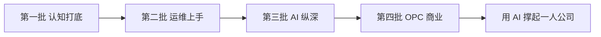

# 阅读路线

52 本书不可能、也不需要从头读到尾。这一章给出两种读法：按批次的默认路线，以及按眼前目标挑书的捷径。

## 默认路线：四批

### 第一批：认知打底

先建立对 AI 和 agent 的整体认知，同时补上运维最基础的两块。

1. 书架导读
2. 大模型原理科普
3. 大模型应用工程
4. Agent 原理与设计
5. 编码 Agent 实战
6. 个人 Agent 工作流
7. 一人公司方法论
8. Linux 系统与命令行
9. 容器技术

### 第二批：运维上手

把一个服务从部署到监控、再到出事故时的处理，完整走一遍。

1. 计算机网络
2. Nginx 与反向代理
3. 部署与 CI/CD
4. 一人运维手册
5. 可观测性与性能
6. PostgreSQL 运维

### 第三批：AI 纵深

沿原理线读到底，再补上 agent 的两本核心原理书和 AI 工程的两本质量书。

1. AI 数学直觉
2. 面向 AI 的 Python
3. 动手学深度学习
4. 大模型原理进阶
5. 上下文工程
6. 工具设计与 MCP
7. RAG 与知识系统
8. 评测与质量

### 第四批：OPC 商业

1. 产品思维
2. 定价与商业模式
3. 国内合规实务
4. 获客与增长
5. 财务与税务
6. 数据分析与埋点

其余的书按需穿插阅读，最后读《用 AI 撑起一人公司》收尾。

## 按目标挑书

| 眼前的目标 | 先读这几本 |
|---|---|
| 准备上线第一个付费产品 | 一人运维手册 · 应用安全 · 国内合规实务 · 定价与商业模式 |
| 产品里要加 AI 功能 | 大模型应用工程 · 多模态应用 · 评测与质量 · LLM 应用上线 |
| 想让 agent 多干点活 | 编码 Agent 实战 · 个人 Agent 工作流 · 上下文工程 · 工具设计与 MCP |
| 自己写一个 agent 产品 | Agent 原理与设计 · 动手构建 Agent · 多 Agent 编排 · Agent 安全 |
| 线上服务出了问题 | 可观测性与性能 · 计算机网络 · PostgreSQL 运维 |
| 想真正搞懂大模型 | 大模型原理科普 · AI 数学直觉 · 动手学深度学习 · 大模型原理进阶 |
| 用户太少 | 产品思维 · 文案与内容 · 获客与增长 · 数据分析与埋点 |
| 考虑做海外市场 | 出海实务 · 云与边缘 · 定价与商业模式 |

## 读法建议

- **入门书读全，进阶书查着读**：入门书负责建立地图，进阶书在遇到具体问题时再翻
- **边读边用**：每读完一本，在自己的项目里找一个地方用上它
- **让 agent 陪读**：读到不懂的地方，把段落丢给 AI 追问。这本身就是《个人 Agent 工作流》会讲的一种用法
