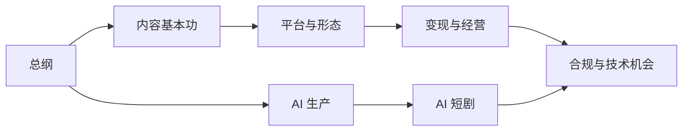

# 自媒体与短剧

一人公司系列讲的是把产品卖出去，这个系列讲的是把内容本身当成生意：账号就是产品，流量和变现就是收入。它分两条线，一条是自己做账号，一条是做 AI 短剧和漫剧；另外也写给想给创作者和短剧团队做工具的开发者。

## 总纲

### 自媒体与短剧一人公司全景 · `media-opc-overview`

整个系列的入口：行业地图、钱怎么流、各类收入的结构、平台格局、赛道选择，以及个人 IP、矩阵号、AI 短剧工作室三种形态各自的门槛和天花板。最后一章是这个系列的阅读路线。

### 自媒体与短剧行动手册 · `media-action-plan`

这个系列的执行层，写法同《一人公司行动手册》。账号线和 AI 短剧线各分几个阶段，每个阶段有进入条件、按周拆好的任务、量化的退出条件和止损线，另有周计划、周复盘和时间预算。

### 自媒体与短剧案例库 · `media-cases`

30 个国内案例：知识博主、垂类博主、带货与直播、矩阵号、短剧公司、AI 短剧，以及 8 个失败、封号与翻车。数字都标了出处，最后一章落到在职开发者能借鉴什么。

## 内容基本功

### 账号定位与对标拆解 · `account-positioning`

选赛道和人设、找对标、用两张拆解表拆对标账号、包装主页、排好冷启动前 30 条，以及什么时候该换方向。

### 选题与爆款结构 · `topic-and-hooks`

选题库和打分、追热点的边界、14 种开头钩子、情绪曲线与留存、8 种结构模板、标题封面，以及用数据倒推选题。

### 短视频脚本与分镜 · `video-script-storyboard`

口播稿、剧情脚本、镜头语言，以及分镜表逐列讲解。附五个完整示例，每个都有脚本、分镜表和拍摄清单。

### 拍摄与剪辑实务 · `shooting-editing`

从一部手机起步：设备、布光、收音、机位、现场流程、剪映工作流、字幕与音乐版权、剪辑节奏、调色，以及模板化批量出片。

## 平台与形态

### 抖音与快手 · `douyin-kuaishou`

推荐机制（区分官方说法和行业经验）、核心指标和后台、发布实操、搜索流量、权限解锁、违规申诉，以及多账号的合规边界。

### 小红书、视频号与 B 站 · `xhs-channels-bilibili`

三个平台的推荐与搜索逻辑、内容做法和变现入口，B 站技术区与知识区的打法，一份内容怎么多平台分发。

### 直播实战 · `live-streaming`

一个人下班开播：搭直播间、话术模块、两份完整的 60 分钟脚本、排品、一人兼任场控、复盘和切片，以及违规风险。

## 变现与经营

### 广告商单与品牌合作 · `brand-deals`

星图、蒲公英等接单平台，接到第一单，按 CPM / CPE 倒推报价，读 brief、做提案、过审交付、合同结算，以及签不签 MCN。

### 带货与选品 · `ecommerce-selling`

橱窗与精选联盟、选品打分、利润测算、带货内容结构、团购与本地生活、自营小店，以及售后与口碑分。

### 知识付费与私域变现 · `knowledge-products`

课程、训练营、社群、咨询的产品设计，验证需求、课程设计、平台选择、发售、交付和退款。

### 投流与数据分析 · `paid-traffic`

保本 ROI 怎么算、DOU+ 和千川、小红书薯条与聚光、视频号加热、快手投放、小预算测试的样本量和止损线，以及自建数据看板。

## AI 生产

### AI 内容生产工具链 · `ai-content-pipeline`

文案、图像、视频、配音、数字人的选型标准，一条有人工把关的自动化流水线（附 TS 代码骨架），矩阵批量、成本核算，以及平台对 AI 内容的标识规则。

## AI 短剧

### 微短剧行业全景 · `micro-drama-industry`

付费、免费、品牌定制、漫剧四种模式，平台格局、产业链与分账，成本与回收测算，AI 短剧的现状，以及一个人从哪个环节切入。

### 短剧编剧 · `drama-scriptwriting`

题材与红线、人物、故事骨架、开篇三集、钩子与付费卡点、剧本格式、改编与卖剧本。附一部原创 AI 漫剧的 60 集分集大纲和前三集完整剧本。

### AI 短剧分镜与画面生成 · `ai-drama-storyboard`

这个系列里最核心的落地书。内容包括镜头语言、从剧本拆成 AI 分镜表、风格与场景设定、角色一致性、图像和视频提示词、动态漫。附一集 19 个镜头的完整示例。

### AI 短剧后期 · `ai-drama-post`

配音与音色授权、口型同步、音乐音效与响度、字幕、剪辑节奏、调色、成片规格与质检，以及一集从零到成片的全流程演练和成本。

### 短剧发行、投流与备案 · `drama-distribution`

按《微短剧发展管理办法》讲分类审核与备案、AI 短剧的特别要求、上线与分账、投流回收测算、版权、合同和出海。

## 合规与技术机会

### 自媒体与短剧合规财税 · `media-compliance`

广告标注、需要资质的领域、版权与肖像、AI 生成标识、未成年人保护、MCN 合同、平台收入怎么交税、何时注册公司，以及账号资产。

### 给创作者和短剧团队做工具 · `creator-tools`

给开发者的一本：痛点地图、12 个产品机会、平台开放接口能做什么不能做什么、三套技术方案、验证与定价、不要碰的灰产，以及 90 天起步计划。
