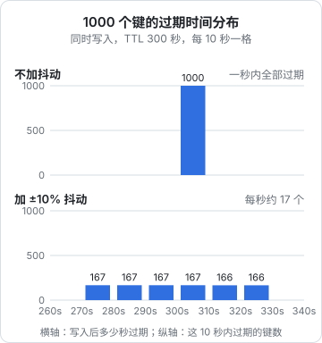

# 缓存实战

缓存值不值得做、放哪一层、cache-aside 为什么删而不更新，这些在[《软件架构与系统设计》的缓存策略](../system-design/03-caching.md)里已经讲过。这一章假设你已经决定「这份数据放 Redis」，讲具体代码：一个能在 NestJS 里到处复用的缓存服务，怎么在 Redis 上处理穿透、击穿、雪崩，怎么批量失效，Redis 挂了怎么办，以及进程内缓存和 Redis 两层叠起来时怎么保持一致。

## 从单实例的 Map 出发

hatch-counter 现在的配置缓存是进程内的 `TtlCache`：十秒 TTL，改动时 `invalidate`，并发未命中合并成一次加载。它在单实例时完全够用。开第二个实例时，问题出在 `invalidate` 只清自己那份（[去掉单实例假设](../system-design/09-evolution.md#去掉单实例假设)里列过）。

换成 Redis 之后，**所有实例读同一份**，失效一次就对所有实例生效。下面的 `CacheService` 就是把那个 `TtlCache` 的语义搬到 Redis 上，同时补上多实例才需要的东西。

## 一个够用的 CacheService

`src/cache/cache.service.ts` 完整文件分 3 段给出，从上到下拼起来就是整个文件。第一段是选项类型、「不存在」标记，以及类的字段和构造函数：

```typescript
// src/cache/cache.service.ts
import { Inject, Injectable, Logger } from "@nestjs/common";
import type Redis from "ioredis";
import { REDIS } from "../redis/redis.provider";

type Loader<T> = () => Promise<T>;

export interface CacheOptions {
  ttlSec: number;
  /** 查不到时缓存一个「不存在」标记多久，0 表示不缓存 */
  negativeTtlSec?: number;
}

const NULL_MARK = "__null__";

@Injectable()
export class CacheService {
  private readonly logger = new Logger(CacheService.name);
  private readonly inflight = new Map<string, Promise<unknown>>();

  constructor(@Inject(REDIS) private readonly redis: Redis) {}
```

第二段是核心方法 `getOrLoad`：先读 Redis，未命中时合并同一实例内的并发加载，加载结果连同「不存在」一起写回缓存：

```typescript
  async getOrLoad<T>(key: string, load: Loader<T | null>, opts: CacheOptions): Promise<T | null> {
    const cached = await this.safeGet(key);
    if (cached === NULL_MARK) return null;
    if (cached !== undefined) return JSON.parse(cached) as T;

    // 同一实例内的并发未命中合并成一次加载
    const pending = this.inflight.get(key) as Promise<T | null> | undefined;
    if (pending) return pending;

    const p = (async () => {
      const value = await load();
      if (value === null) {
        if (opts.negativeTtlSec) await this.safeSet(key, NULL_MARK, opts.negativeTtlSec);
      } else {
        await this.safeSet(key, JSON.stringify(value), jitter(opts.ttlSec));
      }
      return value;
    })().finally(() => this.inflight.delete(key));

    this.inflight.set(key, p);
    return p;
  }
```

第三段是删除方法和两个吞掉 Redis 故障的读写包装，类到这里结束；最后是给 TTL 加随机浮动的 `jitter`：

```typescript
  async del(...keys: string[]) {
    if (keys.length === 0) return;
    try {
      await this.redis.unlink(...keys); // UNLINK：后台释放内存，大值也不阻塞
    } catch (err) {
      // 删除失败比读失败严重：会留下旧数据。记错误，靠 TTL 兜底
      this.logger.error(`缓存删除失败 ${keys.join(",")}: ${String(err)}`);
    }
  }

  private async safeGet(key: string): Promise<string | undefined> {
    try {
      return (await this.redis.get(key)) ?? undefined;
    } catch (err) {
      this.logger.warn(`缓存读取失败，直接查库：${String(err)}`);
      return undefined;
    }
  }

  private async safeSet(key: string, value: string, ttlSec: number) {
    try {
      await this.redis.set(key, value, "EX", ttlSec);
    } catch (err) {
      this.logger.warn(`缓存写入失败：${String(err)}`);
    }
  }
}

/** TTL 上下浮动 10%，避免同一批写入的键同时过期 */
export function jitter(ttlSec: number) {
  return Math.max(1, Math.round(ttlSec * (0.9 + Math.random() * 0.2)));
}
```

用起来是这样：

```typescript
@Injectable()
export class MenuService {
  constructor(
    private readonly cache: CacheService,
    private readonly repo: MenuRepository,
  ) {}

  getMenu(storeId: number) {
    return this.cache.getOrLoad(
      `cache:store:${storeId}:menu:v1`,
      () => this.repo.findMenu(storeId),
      { ttlSec: 300, negativeTtlSec: 30 },
    );
  }

  async updateDish(storeId: number, dish: DishUpdate) {
    await this.repo.updateDish(storeId, dish);
    await this.cache.del(`cache:store:${storeId}:menu:v1`); // 先写库，再删缓存
  }
}
```

这几十行里每一处都对应一个问题，下面逐个说。

## 穿透：把「不存在」也缓存

查一个不存在的 id，每次都未命中、每次都查库。被人拿随机 id 刷的时候，缓存形同虚设。

对策是 `negativeTtlSec`：查不到时写一个 `__null__` 标记，30 秒内同样的查询直接返回 `null`。TTL 要比正常数据短得多，因为这个 id 随时可能被创建出来；创建时也顺手 `del` 一下这个键，就不用等 30 秒。

标记用一个特殊字符串而不是空串或 `"null"`：`JSON.stringify(null)` 就是 `"null"`，如果业务里本来就可能缓存 `null` 值，两者会混在一起。

如果被刷的 id 空间很大（比如随机 UUID），负缓存会把 Redis 撑满。这时候真正的问题是**没有限流**，第 3 章处理。

## 击穿：一个热键过期时

一个热键过期的瞬间，几十个请求同时去查库。`inflight` 那张表把**同一个实例内**的并发合并成一次加载。

多实例时还剩一个缝：三个实例各自合并，最多三次查库。对绝大多数一人项目，**三次就是三次**，不值得为它做更多。真有一个昂贵到不能接受重复计算的键（比如一次要跑十秒的报表），有两种做法：

| 做法 | 原理 | 代价 |
|---|---|---|
| 加载时抢锁 | `SET lock:<key> NX PX 10000`，抢到的实例去算，其他实例等一小会儿再读缓存 | 等待逻辑、锁超时的处理（第 3 章） |
| 提前刷新（逻辑过期） | 值里带一个「软过期时间」，过了软过期就由一个请求在后台刷新，其他请求继续拿旧值；物理 TTL 设得更长 | 会读到稍旧的数据 |

提前刷新的写法：

```typescript
interface Envelope<T> {
  v: T;
  softExpireAt: number; // 毫秒时间戳
}

async getWithRefresh<T>(key: string, load: Loader<T>, softTtlSec: number, hardTtlSec: number): Promise<T> {
  const raw = await this.safeGet(key);
  if (raw) {
    const env = JSON.parse(raw) as Envelope<T>;
    if (env.softExpireAt < Date.now()) {
      // 只放一个请求去刷新：抢一个短锁，抢不到就直接用旧值
      const got = await this.redis.set(`refresh:${key}`, "1", "EX", 30, "NX");
      if (got === "OK") void this.refresh(key, load, softTtlSec, hardTtlSec);
    }
    return env.v;
  }
  return this.refresh(key, load, softTtlSec, hardTtlSec);
}

private async refresh<T>(key: string, load: Loader<T>, softTtlSec: number, hardTtlSec: number) {
  const v = await load();
  const env: Envelope<T> = { v, softExpireAt: Date.now() + softTtlSec * 1000 };
  await this.safeSet(key, JSON.stringify(env), hardTtlSec);
  return v;
}
```

这里的刷新锁过期了也没关系，最坏情况是多刷一次，所以不需要第 3 章那套安全释放。

## 雪崩：给 TTL 加抖动

同一时刻写入的一批键（部署后预热、凌晨批量任务）如果 TTL 完全相同，就会在同一秒全部过期。`jitter` 把 TTL 上下浮动 10%，过期时间就被摊开了。



图里的数是这样算的：1000 个键，TTL 300 秒。不抖动时第 300 秒同时过期 1000 个；抖动后过期时间均匀落在 270–330 秒，每秒约 $1000 / 60 \approx 17$ 个。数据库从「一秒内来 1000 次查询」变成「每秒 17 次」。

另一种雪崩是 **Redis 整个挂了**，所有请求一起落到库上。这时候抖动没用，靠的是下一节的降级，以及容量上算过「不走缓存时库能不能扛住」。

## Redis 挂了怎么办

`safeGet` / `safeSet` 把 Redis 的错误吞掉、记一条日志，然后直接查库。原则是：**缓存是加速器，不是依赖**。缓存挂了应该变慢，不应该变成报错。

要让这个原则成立，还有两个配置要配合：

- 第 1 章的 `maxRetriesPerRequest: 3`：Redis 连不上时命令尽快失败，而不是挂住请求
- 加一个命令超时：ioredis 的 `commandTimeout`（毫秒），比如 200ms。Redis 正常时一条命令不到 1ms，200ms 还没回来就当它挂了

```typescript
new Redis(process.env.REDIS_URL!, {
  maxRetriesPerRequest: 3,
  commandTimeout: 200,
  retryStrategy: (times) => Math.min(times * 50, 2000),
});
```

`del` 失败要特别对待。读失败只是慢，**删失败意味着缓存里留着旧数据**，要等 TTL 才会过去。所以删除失败打 `error` 级别日志，并且所有缓存都必须有 TTL，这就是 TTL 兜底的意义。

## 失效：知道写影响了哪些键

cache-aside 最难的不是代码，是**写一处数据时知道要删哪些键**。改了一道菜，菜单缓存要删，「按分类的菜品列表」要删，「今日推荐」也要删。漏一个就是一处页面一直旧着。

### 做法一：粗粒度的版本键

不去逐个删，而是给一组缓存挂一个版本号：

```typescript
async storeVersion(storeId: number): Promise<number> {
  const v = await this.redis.get(`ver:store:${storeId}:menu`);
  return v ? Number(v) : 0;
}

async getMenuByCategory(storeId: number, categoryId: number) {
  const ver = await this.storeVersion(storeId);
  return this.cache.getOrLoad(
    `cache:store:${storeId}:menu@${ver}:cat:${categoryId}`,
    () => this.repo.findByCategory(storeId, categoryId),
    { ttlSec: 600 },
  );
}

async onMenuChanged(storeId: number) {
  await this.redis.incr(`ver:store:${storeId}:menu`); // 一次 INCR，整组缓存作废
}
```

旧版本的键不用删，没人再读它们，TTL 到了自然消失。代价是每次读多一次 `GET`（可以用 pipeline 合并），以及一次失效会让这家店所有菜单相关的缓存都重新加载。

这和 hatch-counter「把一家店的数据分成八块、每块一个版本号」是同一个思路，只是版本号放在 Redis 而不是 Postgres 触发器里。**块分得粗，漏的风险就小**，偶尔多加载一次的代价远小于一页永远不刷新。

### 做法二：集合记下属于一组的键

```typescript
async setTagged(key: string, value: string, ttlSec: number, tag: string) {
  await this.redis
    .multi()
    .set(key, value, "EX", ttlSec)
    .sadd(`tag:${tag}`, key)
    .expire(`tag:${tag}`, ttlSec + 60)
    .exec();
}

async invalidateTag(tag: string) {
  const keys = await this.redis.smembers(`tag:${tag}`);
  if (keys.length) await this.redis.unlink(...keys, `tag:${tag}`);
}
```

比版本号精确，但 tag 集合本身也要维护，集合里会残留已过期的键名。除非一组缓存很大、全部重建很贵，否则版本号更省心。

### 删除放在事务提交之后

```typescript
await this.db.transaction(async (tx) => {
  await tx.update(dishes).set(dish).where(eq(dishes.id, dish.id));
});
await this.cache.del(key); // 事务提交后再删
```

如果在事务里删缓存，事务还没提交时另一个请求未命中，读到的是旧数据（新数据还没提交），又写回了缓存。删除必须放在提交之后。即便如此，「删除之后、旧读请求写回」的缝依然存在，概率很低，靠 TTL 兜底。真要严丝合缝，用版本号：读的时候带着版本，写回时版本对不上就不写。

## 序列化的坑

`JSON.stringify` 之后再 `JSON.parse`，会丢掉一些东西：

| 原来 | 缓存回来 | 后果 |
|---|---|---|
| `Date` | ISO 字符串 | `row.createdAt.getTime()` 报错 |
| `bigint` | `JSON.stringify` 直接抛错 | Postgres 的 `bigint` 列在 Drizzle 里可能是 `bigint` 或 `string`，看配置 |
| `undefined` 字段 | 字段消失 | 一般无害 |
| `Map` / `Set` | `{}` | 数据没了 |

最省事的做法是**缓存 DTO，不缓存实体**：先把数据库行映射成只含字符串、数字、布尔、数组的响应对象，再缓存。这正好也是接口要返回的形状，缓存回来直接用。

## 缓存键里的维度

[缓存策略](../system-design/03-caching.md#三个经典问题)说过，比击穿雪崩更危险的是**缓存键漏了维度**。在 Redis 里这个风险更大：进程内缓存至少只在一个实例里错，Redis 里的错数据会被所有实例读到。

一个简单的检查：**缓存的加载函数用到的每个参数，都必须出现在键里**。`findMenu(storeId)` 的键里有 `storeId`；如果某天加载函数变成 `findMenu(storeId, userRole)`（员工看不到成本价），键里就必须加上角色。可以把键和加载函数绑在一起，让它们没法分开改：

```typescript
const menuCache = (storeId: number, role: Role) => ({
  key: `cache:store:${storeId}:menu:v2:role:${role}`,
  load: () => repo.findMenu(storeId, role),
});
```

## 两层缓存：进程内 + Redis

热点数据每次都去 Redis 取，也有一次网络往返（同机房约 0.2–0.5ms）。读得极多、变得极少的数据（配置、字典）可以在进程内再缓存一层，几秒 TTL。

问题是失效：一个实例改了配置，别的实例的进程内缓存还是旧的。用 Pub/Sub 广播一下：

```typescript
@Injectable()
export class LocalCacheBus implements OnModuleInit, OnModuleDestroy {
  private sub!: Redis;
  private readonly local = new Map<string, { v: unknown; exp: number }>();

  constructor(@Inject(REDIS) private readonly redis: Redis) {}

  async onModuleInit() {
    this.sub = this.redis.duplicate(); // 订阅要用单独的连接
    await this.sub.subscribe("cache-invalidate");
    this.sub.on("message", (_ch, key: string) => this.local.delete(key));
  }

  async invalidate(key: string) {
    this.local.delete(key);
    await this.redis.del(key);
    await this.redis.publish("cache-invalidate", key);
  }

  async onModuleDestroy() {
    await this.sub.quit();
  }
}
```

Pub/Sub 不保证送达：订阅连接恰好断开的那几秒发出的消息就丢了。所以进程内这一层的 TTL 要短（几秒），丢一条通知的后果只是这几秒读到旧值。

这层值不值得加，取决于你的 Redis 往返在请求耗时里占多少。大多数时候不值得：先看[瓶颈定位](../observability-performance/08-bottleneck-analysis.md)的数据再说。

## 关于 @nestjs/cache-manager

> [!WARNING]
> `@nestjs/cache-manager` 的底层依赖在 2024 年有过大改：v3 起基于 cache-manager v6 和 Keyv，Redis 存储改为 `@keyv/redis`，TTL 单位是毫秒，旧版的 `cache-manager-redis-store` 写法不再适用。本节按 v3 整理，与 NestJS 12 配套的版本未逐一核对，以 NestJS 官方文档的 Caching 一节为准。

NestJS 官方有一个缓存模块，提供 `CacheInterceptor` 和 `@CacheKey` / `@CacheTTL` 装饰器，挂在 GET 接口上自动缓存响应。

它适合「整个 GET 响应按 URL 缓存」的公开接口。对需要按租户、按权限区分的接口要非常小心：`CacheInterceptor` 默认按 URL 生成键，**不包含当前用户和租户**，直接挂上去就是数据串号。需要自定义键时要继承 `CacheInterceptor` 重写 `trackBy`。

对业务数据，本章这种显式的 `getOrLoad` 更好：键怎么拼、什么时候删，都在代码里看得见。

## 本章要点

- 把进程内 `TtlCache` 的语义搬到 Redis：所有实例共享一份，失效一次全局生效
- 穿透用短 TTL 的「不存在」标记；击穿先在实例内合并加载，昂贵的键再加锁或提前刷新
- 雪崩：TTL 加正负 10% 抖动；Redis 整个挂了靠降级查库，缓存是加速器不是依赖
- 命令要有超时、快速失败；删除失败打 error，所有键都有 TTL 兜底
- 失效优先用粗粒度版本键，一次 `INCR` 作废一组；删除放在事务提交之后
- 缓存 DTO 不缓存实体；加载函数用到的每个参数都要进键名
- 两层缓存用 Pub/Sub 广播失效，本地 TTL 要短；`CacheInterceptor` 默认不分租户

## 动手练习

环境：`docker run --rm -d --name r2 -p 6379:6379 redis:7.4-alpine`，把本章的 `CacheService` 去掉 Nest 装饰器，改成一个普通类在 Node 脚本里用。

1. **合并并发加载**：给 `getOrLoad` 传一个会 `await` 200ms 再返回、并对调用次数计数的 `load`，同时发起 50 个对同一个键的 `getOrLoad`。然后把 `inflight` 相关的三行注释掉再跑一次。

   验证：有 `inflight` 时计数是 `1`；注释掉后计数接近 `50`。

   参考答案：第一个未命中把 Promise 放进 `inflight`，其余请求在 `load` 完成前都拿到同一个 Promise；去掉后每个请求都看到未命中，各自查一次。

2. **Redis 挂了只变慢**：用 `commandTimeout: 200` 的连接跑一个循环，每秒调一次 `getOrLoad` 并打印耗时和结果；运行中执行 `docker pause r2`，十几秒后 `docker unpause r2`。

   验证：暂停期间日志出现「缓存读取失败，直接查库」，结果照常返回，每次耗时大致在几百毫秒内（命令超时加上 `load` 的时间）；恢复后耗时回到个位数毫秒、警告消失。

   参考答案：`safeGet` / `safeSet` 吞掉超时错误后走 `load`，请求不报错；`commandTimeout` 决定了单次最多被拖慢多久。如果去掉 `commandTimeout`，暂停期间请求会一直挂住，可以对比看看。

3. **版本键一次作废一组**：用「做法一」的写法为同一家店缓存 3 个分类，`redis-cli --scan --pattern 'cache:store:42:*'` 看键名；再调 `onMenuChanged(42)`，重新读这 3 个分类。

   验证：第二次扫描出现 6 个键，`menu@0` 和 `menu@1` 各 3 个；`TTL` 查看 `@0` 的键仍在倒计时，不再被读到。

   参考答案：版本号进了键名，`INCR` 之后读路径拼出的是新键，全部未命中重新加载；旧键没人读，靠 TTL 自然消失。
