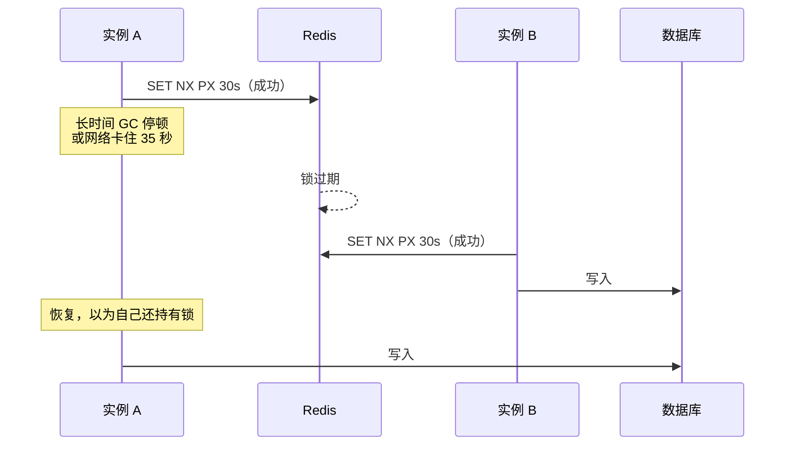

# 限流与分布式锁

限流和锁是 Redis 最常见的两个「非缓存」用途。两者都依赖同一件事：**多个实例对同一个计数或同一个键的原子操作**。这一章先讲三种限流算法在 Redis 上的写法，以及怎么挂进 NestJS；再讲分布式锁的正确写法，然后花同样多的篇幅讲为什么锁要慎用、大多数时候该用什么代替它。

## 先确认限流放在哪一层

[《Nginx 与反向代理》的限流一章](../nginx-gateway/05-rate-limit.md)讲过 `limit_req`：按 IP 限速、挡住暴力尝试，在请求进入应用之前就拒掉，最便宜。应用层限流解决的是 nginx 看不到的东西：

| 维度 | nginx 能做吗 | 应用层 |
|---|---|---|
| 按 IP | 能，而且最好在 nginx 做 | 可以，但更贵 |
| 按登录用户、按租户 | 看不到用户身份 | 适合 |
| 按业务对象（同一手机号、同一订单） | 看不到请求体 | 适合 |
| 按套餐配额（免费版每月 100 次导出） | 不行 | 适合，而且多半该放 Postgres |

最后一行是一个分界：**配额是业务数据，限流是保护措施**。配额要准确、要跨月统计、要能给用户看，放 Postgres；限流丢了几秒的计数无所谓，放 Redis 或内存。

单实例时，应用层限流用进程内计数就够了。多实例时每个实例各数各的，实际限额翻倍，这时候才需要 Redis。

## 固定窗口：INCR + EXPIRE

最简单的算法：每个时间窗口一个计数器，超过上限就拒绝。

```typescript
async function fixedWindow(redis: Redis, key: string, limit: number, windowSec: number) {
  const window = Math.floor(Date.now() / 1000 / windowSec);
  const k = `rl:${key}:${window}`;
  const [[, count]] = (await redis.multi().incr(k).expire(k, windowSec + 1).exec()) as [[null, number]];
  return { allowed: count <= limit, count };
}
```

`MULTI` 把 `INCR` 和 `EXPIRE` 放在一个事务里，保证不会出现「`INCR` 成功、进程崩了、`EXPIRE` 没执行」导致计数器永不过期。键名带窗口编号，每个窗口一个新键，旧键过期自动消失。

它的问题在窗口边界：限额每分钟 10 次，有人在 0:59 发 10 次、1:01 再发 10 次，两秒内通过了 20 次，是限额的两倍。


对「防暴力尝试」来说这无所谓：攻击速度只是翻倍，量级不变。对「保护下游的第三方 API」就不行了，对方的限额可能是严格的滑动窗口，边界一冲就 429。

## 滑动窗口：Sorted Set + Lua

用 Sorted Set 记下每次请求的时间戳，每次检查「过去 60 秒内有几条」：

```lua
-- KEYS[1] 限流键；ARGV: 当前毫秒、窗口毫秒、上限、本次请求的唯一 id
local key    = KEYS[1]
local now    = tonumber(ARGV[1])
local window = tonumber(ARGV[2])
local limit  = tonumber(ARGV[3])

redis.call('ZREMRANGEBYSCORE', key, 0, now - window)
local count = redis.call('ZCARD', key)
if count >= limit then
  -- 返回最早那条何时滑出窗口，告诉客户端多久后再试
  local oldest = redis.call('ZRANGE', key, 0, 0, 'WITHSCORES')
  return {0, tonumber(oldest[2]) + window - now}
end
redis.call('ZADD', key, now, ARGV[4])
redis.call('PEXPIRE', key, window)
return {1, 0}
```

为什么要 Lua：「删旧的、数一下、没超就加一条」是三步，中间如果插进别的客户端的请求，两个请求可能都看到 9 条、都加进去，变成 11 条。Redis 执行 Lua 脚本时不会穿插其他命令，**整段脚本是原子的**。

在 ioredis 里注册成一个自定义命令：

```typescript
// src/rate-limit/scripts.ts
import type Redis from "ioredis";
import { readFileSync } from "node:fs";
import { join } from "node:path";
import { randomUUID } from "node:crypto";

declare module "ioredis" {
  interface RedisCommander<Context> {
    slidingWindow(key: string, now: number, windowMs: number, limit: number, id: string): Result<[number, number], Context>;
  }
}

export function registerScripts(redis: Redis) {
  redis.defineCommand("slidingWindow", {
    numberOfKeys: 1,
    lua: readFileSync(join(__dirname, "sliding-window.lua"), "utf8"),
  });
}

export async function slidingWindow(redis: Redis, key: string, limit: number, windowMs: number) {
  const [allowed, retryAfterMs] = await redis.slidingWindow(key, Date.now(), windowMs, limit, randomUUID());
  return { allowed: allowed === 1, retryAfterMs };
}
```

`defineCommand` 内部用 `EVALSHA`：脚本只上传一次，之后按哈希调用；Redis 重启丢了脚本缓存时自动回退到 `EVAL`。

时间戳由应用传入而不是在脚本里调 `TIME`，好处是好测试；坏处是多个实例的时钟要基本一致。云服务器都跑 NTP，毫秒级的偏差对限流无所谓。

代价是内存：每个请求一条记录。限额每分钟 1000 次的键就有 1000 个成员。限额大的场景用下面的令牌桶。

## 令牌桶：Hash + Lua

令牌桶允许短时突发，长期平均速率受限。桶里最多 `capacity` 个令牌，每秒补 `rate` 个，每个请求拿走一个。只需要存两个数：当前令牌数和上次补充的时间。

```lua
-- KEYS[1] 桶；ARGV: 当前毫秒、容量、每秒补充数、本次消耗
local key      = KEYS[1]
local now      = tonumber(ARGV[1])
local capacity = tonumber(ARGV[2])
local rate     = tonumber(ARGV[3])
local cost     = tonumber(ARGV[4])

local b = redis.call('HMGET', key, 'tokens', 'ts')
local tokens = tonumber(b[1]) or capacity
local ts     = tonumber(b[2]) or now

-- 按流逝的时间补充令牌，不超过容量
tokens = math.min(capacity, tokens + (now - ts) / 1000 * rate)

local allowed = 0
local wait = 0
if tokens >= cost then
  tokens = tokens - cost
  allowed = 1
else
  wait = math.ceil((cost - tokens) / rate * 1000)
end

redis.call('HSET', key, 'tokens', tokens, 'ts', now)
-- 桶从空补到满所需的时间之后，键就没意义了
redis.call('PEXPIRE', key, math.ceil(capacity / rate * 1000) + 1000)
return {allowed, wait}
```

三种算法怎么选：

| 算法 | 存储 | 边界突发 | 适合 |
|---|---|---|---|
| 固定窗口 | 每窗口一个整数 | 最多 2 倍 | 防暴力尝试、粗略保护 |
| 滑动窗口（日志） | 每请求一条 | 无 | 限额小、要求准（发验证码） |
| 令牌桶 | 两个数 | 可控的突发 | 限额大、允许短时突发（API 调用） |

## 挂进 NestJS：一个守卫

```typescript
// src/rate-limit/rate-limit.decorator.ts
import { SetMetadata } from "@nestjs/common";

export interface RateLimitRule {
  name: string;
  limit: number;
  windowMs: number;
  /** 从请求里取限流维度，比如用户 id、手机号 */
  by: (req: any) => string | undefined;
}

export const RATE_LIMIT = "rate_limit";
export const RateLimit = (...rules: RateLimitRule[]) => SetMetadata(RATE_LIMIT, rules);
```

```typescript
// src/rate-limit/rate-limit.guard.ts
import { CanActivate, ExecutionContext, HttpException, HttpStatus, Inject, Injectable, Logger } from "@nestjs/common";
import { Reflector } from "@nestjs/core";
import type Redis from "ioredis";
import { REDIS } from "../redis/redis.provider";
import { RATE_LIMIT, RateLimitRule } from "./rate-limit.decorator";
import { slidingWindow } from "./scripts";

@Injectable()
export class RateLimitGuard implements CanActivate {
  private readonly logger = new Logger(RateLimitGuard.name);

  constructor(
    private readonly reflector: Reflector,
    @Inject(REDIS) private readonly redis: Redis,
  ) {}

  async canActivate(ctx: ExecutionContext) {
    const rules = this.reflector.get<RateLimitRule[]>(RATE_LIMIT, ctx.getHandler());
    if (!rules?.length) return true;

    const req = ctx.switchToHttp().getRequest();
    const res = ctx.switchToHttp().getResponse();

    for (const rule of rules) {
      const dim = rule.by(req);
      if (!dim) continue;
      try {
        const r = await slidingWindow(this.redis, `rl:${rule.name}:${dim}`, rule.limit, rule.windowMs);
        if (!r.allowed) {
          res.setHeader("Retry-After", Math.ceil(r.retryAfterMs / 1000));
          throw new HttpException("操作太频繁，请稍后再试", HttpStatus.TOO_MANY_REQUESTS);
        }
      } catch (err) {
        if (err instanceof HttpException) throw err;
        // Redis 不可用时放行：限流是保护措施，不该因为它挂了让正常用户用不了
        this.logger.warn(`限流检查失败，放行：${String(err)}`);
      }
    }
    return true;
  }
}
```

以发验证码为例，同一手机号 60 秒一条、一天 10 条，同一 IP 一小时 30 条：

```typescript
@Post("sms-code")
@UseGuards(RateLimitGuard)
@RateLimit(
  { name: "sms:phone:1m", limit: 1, windowMs: 60_000, by: (r) => r.body?.phone },
  { name: "sms:phone:1d", limit: 10, windowMs: 86_400_000, by: (r) => r.body?.phone },
  { name: "sms:ip:1h", limit: 30, windowMs: 3_600_000, by: (r) => r.ip },
)
sendCode(@Body() dto: SendCodeDto) { /* ... */ }
```

注意守卫在管道之前执行（顺序见[请求生命周期](../nestjs-backend/02-request-lifecycle.md)），这时 `body.phone` 还没校验过。用它做限流键之前至少做一次规范化（去空格、去 `+86`），否则同一个号码换个写法就绕过去了。`req.ip` 要在配置好信任代理之后才是真实客户端 IP，否则所有请求都是 nginx 的地址。

「Redis 挂了放行」这个选择要按场景想：对验证码短信，放行意味着这几分钟可能被刷短信费。如果这笔钱不能接受，就改成拒绝，并让监控尽快把你叫醒。

### 也可以用 @nestjs/throttler

> [!WARNING]
> 本小节按 `@nestjs/throttler` v5 / v6 整理（与 NestJS 12 配套的版本未逐一核对）：v5 起配置格式改为多个命名限流器的数组；多实例需要换成 Redis 存储，社区有若干 storage 实现，各自支持的 throttler 版本不同。选用前以 NestJS 官方文档的 Rate Limiting 一节和对应 storage 包的说明为准。

NestJS 官方的 `@nestjs/throttler` 提供了现成的守卫和装饰器，按 IP 或自定义键限流。本章自己写守卫，是为了让限流维度（手机号、租户）和 Redis 脚本都看得见；如果你的需求只是「每个 IP 每分钟 N 次」，用它更省事，但那种需求更适合在 nginx 做。

## 分布式锁：正确的最小写法

锁要解决的是：**同一时刻只能有一个实例做这件事**。比如同一家店的整店导出只能跑一个、同一个第三方令牌只能由一个实例去刷新。

### 加锁

```typescript
const token = randomUUID();
const ok = await redis.set(`lock:export:store:${storeId}`, token, "PX", 30_000, "NX");
if (ok !== "OK") throw new ConflictException("这家店正在导出，请稍后");
```

三个要素缺一不可：

- **`NX`**：不存在才设，这是「互斥」本身
- **`PX`**：过期时间。持锁进程崩了，锁自己会过期，否则永远没人能再拿到
- **随机 token**：用来证明「这把锁是我加的」，释放时要用

### 释放

```lua
-- 只有值等于自己的 token 才删
if redis.call('GET', KEYS[1]) == ARGV[1] then
  return redis.call('DEL', KEYS[1])
end
return 0
```

为什么不直接 `DEL`：进程 A 拿了锁，做得太慢超过了 30 秒，锁过期了；进程 B 拿到了锁；然后 A 做完了，`DEL` 一下，删掉的是 **B 的锁**。现在 C 也能拿到锁，B 和 C 同时在做。比较 token 再删，A 就只会删掉自己的。比较和删除必须在一个 Lua 里，分成 `GET` 再 `DEL` 两步，中间锁可能恰好过期又被别人拿走。

### 封装成 withLock

```typescript
export async function withLock<T>(
  redis: Redis,
  key: string,
  ttlMs: number,
  fn: (signal: AbortSignal) => Promise<T>,
): Promise<T | undefined> {
  const token = randomUUID();
  if ((await redis.set(key, token, "PX", ttlMs, "NX")) !== "OK") return undefined;

  const ac = new AbortController();
  // 续租：每过三分之一租期续一次；续不上说明锁已经丢了，通知任务停下
  const timer = setInterval(async () => {
    try {
      const renewed = await redis.eval(
        `if redis.call('GET', KEYS[1]) == ARGV[1] then return redis.call('PEXPIRE', KEYS[1], ARGV[2]) end return 0`,
        1, key, token, ttlMs,
      );
      if (renewed !== 1) ac.abort(new Error("锁已丢失"));
    } catch (err) {
      ac.abort(err);
    }
  }, Math.floor(ttlMs / 3));

  try {
    return await fn(ac.signal);
  } finally {
    clearInterval(timer);
    await redis.eval(
      `if redis.call('GET', KEYS[1]) == ARGV[1] then return redis.call('DEL', KEYS[1]) end return 0`,
      1, key, token,
    ).catch(() => undefined); // 释放失败也没关系，锁会过期
  }
}
```

续租解决了「任务比租期长」的问题，但 `fn` 必须真的检查 `signal`，在锁丢了之后停下来。不检查的话，续租只是让问题出现得少一点。

## 为什么锁要慎用

上面的写法是「正确的最小写法」，但它**仍然不能保证互斥**。看这个时序：



A 停顿期间，续租的定时器也一起停了，它根本不知道锁已经过期。恢复之后接着写，B 也在写。**任何基于租约的锁，在持锁方可能暂停的系统里，都不能单靠自己保证互斥。**

Redis 主从切换会让情况更糟：A 在主库上加了锁，主库还没同步给从库就挂了，从库被提升为主库，B 在新主库上又加到了同一把锁。Redlock 算法试图用多个独立 Redis 解决这个问题，它是否安全有过很有名的争论（Martin Kleppmann 和 Redis 作者之间），结论大致是：对「只是为了效率、偶尔重复也无所谓」的场景，单 Redis 的锁就够了；对「重复执行会出错」的场景，Redlock 也不够，需要下面的 fencing token。

### 先问：锁是为了效率还是为了正确

| 锁的目的 | 偶尔失效的后果 | 怎么办 |
|---|---|---|
| 效率：避免重复计算、避免重复调第三方 | 多算一次、多花一点钱 | 单 Redis 锁足够 |
| 正确：两个同时做就会把数据写坏 | 数据错误 | **不要只靠 Redis 锁**，让数据库来保证 |

### fencing token：让存储拒绝过期的持锁者

每次加锁时拿一个递增的号码，写数据时带上它，存储层只接受比上次大的号：

```typescript
const fence = await redis.incr(`fence:export:store:${storeId}`);
// ... 加锁、做事 ...
await sql`
  UPDATE store_exports SET status = 'done', file_key = ${fileKey}, fence = ${fence}
  WHERE store_id = ${storeId} AND fence < ${fence}`;
```

A 恢复后拿着旧号码去写，`fence < 旧号` 不成立，写入被拒。注意真正保证正确的是**数据库里那个条件**，Redis 锁只是减少冲突的发生次数。

### 大多数时候不需要 Redis 锁

一人项目里，绝大多数「要加锁」的需求，Postgres 都能直接给出更强的保证：

| 需求 | 不用 Redis 锁的做法 |
|---|---|
| 同一任务不能被两个 worker 取走 | `FOR UPDATE SKIP LOCKED`（第 6 章） |
| 每天的定时任务只跑一次 | `job_runs` 唯一约束（第 7 章） |
| 同一家店同一时刻只能有一个导出 | 部分唯一索引：`UNIQUE (store_id) WHERE status IN ('queued','running')` |
| 两个人同时改一张单 | 乐观并发：`WHERE version = $old`，见[乐观并发控制](../system-design/06-idempotency-consistency.md#乐观并发控制) |
| 一段逻辑同一时刻只跑一份 | `pg_try_advisory_xact_lock(key)`，事务结束自动释放 |

最后一行的 advisory lock 值得记住：

```typescript
await sql.begin(async (tx) => {
  const [{ ok }] = await tx`SELECT pg_try_advisory_xact_lock(${hashKey("refresh-token:wechat")}) AS ok`;
  if (!ok) return; // 别人正在刷
  // ... 刷新令牌并写库，事务提交时锁自动释放
});
```

`hashKey` 把字符串映射成一个 bigint，例如取 SHA-256 的前 8 字节。它的锁和事务绑定：进程崩了、连接断了，事务回滚，锁就没了，不存在「锁忘了释放」也不存在「租期过了还以为持有」。代价是持锁期间占着一个数据库连接，所以只适合短事务。

上表右列的做法适合 hatch-counter 这类场景：单实例、只有 Postgres，左列的需求都能这样接住，不必引入 Redis 锁。这也是本章想说明的：**锁是最后的手段**，能用唯一约束和条件更新表达的互斥，就不要用锁。

## 本章要点

- 按 IP 限流交给 nginx；按用户、租户、业务对象限流放应用层；配额是业务数据，放 Postgres
- 固定窗口 `INCR` + `EXPIRE` 放在 `MULTI` 里，边界最多两倍突发；滑动窗口用 Sorted Set + Lua；限额大用令牌桶
- 多步判断必须写在一个 Lua 脚本里才是原子的；ioredis 用 `defineCommand` 注册
- 限流守卫要规范化维度、信任代理配置正确；Redis 挂了放行还是拒绝按场景定
- 锁的最小写法：`SET NX PX` + 随机 token + Lua 比较后删除；长任务续租并检查 `signal`
- 租约锁在持锁方暂停时不能保证互斥；为了正确性必须让存储层用 fencing token 或条件更新兜底
- 大多数互斥需求用唯一约束、`SKIP LOCKED`、乐观并发或 advisory lock 解决，不需要 Redis 锁

## 动手练习

环境：`docker run --rm -d --name r3 -p 6379:6379 redis:7.4-alpine`，需要 Postgres 的题再起 `docker run --rm -d --name p3 -e POSTGRES_PASSWORD=pw -p 5432:5432 postgres:17`。

1. **固定窗口的边界突发**：用本章的 `fixedWindow`（上限 10、窗口 60 秒），先等到某一分钟的第 58 秒左右连发 10 次，再在下一分钟的第 1 秒连发 10 次，统计通过次数。

   验证：两批共 20 次全部 `allowed: true`；`redis-cli --scan --pattern 'rl:*'` 能看到两个窗口编号不同的键。

   参考答案：计数器按窗口编号分键，跨过边界就是一个全新的计数器，所以 3 秒内放过了两倍限额。换成滑动窗口脚本重复同样的操作，第二批应全部被拒。

2. **不用 Lua 的滑动窗口会超发**：把滑动窗口脚本拆成三条独立命令（`ZREMRANGEBYSCORE`、`ZCARD`、`ZADD`），在 Node 里用 `Promise.all` 同时发 50 个请求，上限设 10；再换回 `defineCommand` 注册的 Lua 版本跑一遍。

   验证：拆开的版本通过数大于 10（每次运行不同），`ZCARD` 也大于 10；Lua 版本通过数恰好是 `10`。

   参考答案：拆开后多个请求都在别人 `ZADD` 之前执行了 `ZCARD`，都看到「还没满」；Lua 脚本执行期间 Redis 不穿插其他命令，判断和写入是一步。

3. **直接 DEL 删掉别人的锁**：用 redis-cli 模拟两个进程：A 执行 `SET lock:x A PX 3000 NX`，等 4 秒，B 执行 `SET lock:x B PX 30000 NX`；然后 A 执行 `DEL lock:x`，再看 `GET lock:x`。接着重做一遍，A 改用 `EVAL "if redis.call('GET', KEYS[1]) == ARGV[1] then return redis.call('DEL', KEYS[1]) end return 0" 1 lock:x A`。

   验证：第一遍 `GET lock:x` 返回 `(nil)`，B 的锁没了；第二遍 `EVAL` 返回 `(integer) 0`，`GET lock:x` 仍是 `"B"`。

   参考答案：A 的锁过期后 B 加上了自己的锁，A 不比较 token 就删，删的是 B 的锁；比较 token 的 Lua 只会删自己加的。
