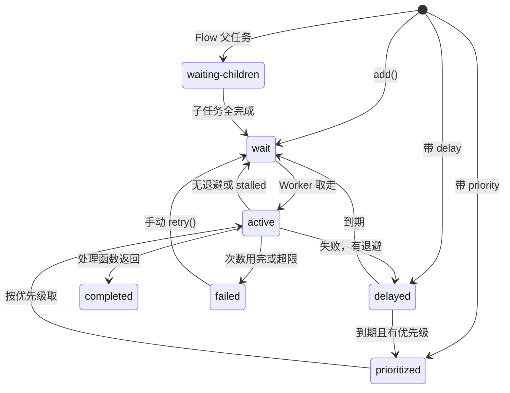

# BullMQ 队列

[队列与异步任务](../system-design/04-queues-jobs.md#实现方式的光谱)把实现方式排成一条光谱，BullMQ 在 Postgres 表队列的右边：多一个 Redis，换来更高的吞吐和更丰富的调度功能（优先级、限速、进度、父子任务、可视化面板）。这一章讲决定用它之后的落地写法：核心概念、连接配置、在 NestJS 里怎么组织、任务保留多少、卡住的任务怎么回收，以及一个独立的 worker 进程。重试、死信和幂等放到第 8 章，定时任务放到第 7 章。

> [!WARNING]
> 本章正文按 BullMQ 5.x 和 `@nestjs/bullmq` 10.x / 11.x 的 API 整理。2026 年 7 月发布的 BullMQ 6.0 有一批破坏性变化，见本章末尾[「BullMQ 6 改了什么」](#bullmq-6-改了什么)；`@nestjs/bullmq` 12.x 同时支持 BullMQ 5 / 6 和 NestJS 10–12（按 npm 上的 peerDependencies），具体 API 未逐一核对。BullMQ 迭代很快，选项名和默认值在小版本之间也会变化（例如重复任务在 5.16 起改为 Job Scheduler 写法）。写代码前以 docs.bullmq.io 和 NestJS 官方文档的 Queues 一节为准。

## 核心概念

| 概念 | 是什么 | 在哪里运行 |
|---|---|---|
| `Queue` | 往队列里加任务、查询任务、管理队列 | API 进程 |
| `Worker` | 从队列里取任务并执行 | worker 进程（也可以在 API 进程里） |
| `Job` | 一个任务：名字、数据、选项、状态、尝试次数、返回值或错误 | 存在 Redis 里 |
| `QueueEvents` | 订阅整个队列的事件（完成、失败、进度） | 任意进程，需要时才用 |
| `FlowProducer` | 一次创建一棵父子任务树，子任务都完成后父任务才执行 | 需要时才用 |

一个任务在 Redis 里的完整生命周期（状态名按 BullMQ 文档）：



几个状态的含义：

- `wait`：普通的待执行队列，先进先出
- `prioritized`：带 `priority` 的任务进这里，按优先级而不是入队时间出队；从 `delayed` 到期或重试回来的任务，有优先级的也回到这里而不是 `wait`
- `delayed`：还没到执行时间，包括带 `delay` 加入的任务和**等待退避的重试**
- `waiting-children`：用 `FlowProducer` 建的父任务，等全部子任务完成后才进入 `wait`（父任务本身带延迟或优先级时进 `delayed` / `prioritized`）
- `active`：正在被某个 Worker 执行，持有锁；锁过期就是下文的「卡住的任务」（stalled），被放回 `wait`，超过 `maxStalledCount` 则直接进 `failed`；没有退避的重试也直接回到 `wait`
- `completed` / `failed`：终态，按 `removeOnComplete` / `removeOnFail` 保留；`failed` 的任务可以手动 `retry()` 回到 `wait`

> [!WARNING]
> `prioritized` 是 BullMQ 4.0 起才有的独立状态，更早的版本里带优先级的任务也在 `wait` 里，监控和查询代码要按所用版本写。另外文档图里的状态叫 `wait`，而 `job.getState()`、`getJobCounts()` 等 API 里用的名字是 `waiting`。BullMQ 已有 6.x，本章内容按 5.x 核对，状态迁移细节以 docs.bullmq.io 的 Architecture 一节为准。

## 连接：两条规矩

```bash
pnpm add bullmq
```

```typescript
import { Queue, Worker } from "bullmq";
import Redis from "ioredis";

const connection = new Redis(process.env.REDIS_QUEUE_URL!, {
  maxRetriesPerRequest: null, // Worker 必须
});

const smsQueue = new Queue("sms", { connection });

const worker = new Worker(
  "sms",
  async (job) => {
    await sendSms(job.data.phone, job.data.template, job.data.params);
  },
  { connection, concurrency: 5 },
);
```

**规矩一：Worker 的连接 `maxRetriesPerRequest` 必须是 `null`。** Worker 用阻塞命令等任务，Redis 短暂断开时，ioredis 默认重试 20 次就让命令失败，Worker 会因此报错退出循环。设成 `null` 是让它无限重试、等 Redis 回来。这和第 2 章缓存连接「尽快失败」的配置正好相反，所以**缓存和队列用两个连接**。

**规矩二：队列用的 Redis 必须是 `maxmemory-policy noeviction`**，理由在[第 4 章](04-persistence-memory.md#队列必须是-noeviction)。

传入同一个 ioredis 实例时，BullMQ 会在需要阻塞命令的地方自动复制出新连接。一个 Worker 大约占 2 个连接，一个 Queue 占 1 个，规模小时不用关心。

## 加任务的选项

```typescript
await smsQueue.add(
  "verify-code",                      // 任务名：同一个队列里区分不同种类
  { phone: "13800000000", template: "verify", params: { code: "123456" } },
  {
    attempts: 5,                      // 总共最多执行 5 次
    backoff: { type: "exponential", delay: 10_000 }, // 10s、20s、40s、80s
    removeOnComplete: { age: 24 * 3600, count: 1000 },
    removeOnFail: { age: 7 * 24 * 3600 },
    jobId: `verify-${requestId}`,     // 自定义 id：同 id 的任务不会重复添加
  },
);
```

常用选项一览：

| 选项 | 作用 | 建议 |
|---|---|---|
| `attempts` | 最大执行次数（含第一次） | 调第三方的任务 3–5 次；**默认是 1，即不重试** |
| `backoff` | 重试间隔 | `exponential`，见第 8 章 |
| `delay` | 延迟多少毫秒才可执行 | 见第 7 章 |
| `priority` | 优先级，数字越小越优先，1 最高 | 少用，用多个队列代替更清楚 |
| `jobId` | 自定义任务 id | 用来去重，见第 8 章 |
| `removeOnComplete` / `removeOnFail` | 完成或失败后保留多少 | **一定要设**，见下一节 |

`attempts` 默认是 1 这一点很容易漏：不设的话，一次失败就直接进 `failed`，不会重试。建议在 Queue 上统一设默认值：

```typescript
const smsQueue = new Queue("sms", {
  connection,
  defaultJobOptions: {
    attempts: 5,
    backoff: { type: "exponential", delay: 10_000 },
    removeOnComplete: { age: 24 * 3600, count: 1000 },
    removeOnFail: { age: 7 * 24 * 3600 },
  },
});
```

## 任务保留多少

BullMQ 默认**保留所有完成和失败的任务**。每天几千个任务、几个月下来，Redis 内存就满了，`noeviction` 下所有写入报错，整个队列停摆。

`removeOnComplete` / `removeOnFail` 的取值：

| 取值 | 含义 |
|---|---|
| `true` | 完成后立即删除 |
| `1000`（数字） | 只保留最近 1000 个 |
| `{ age: 86400, count: 1000 }` | 保留 24 小时内、最多 1000 个 |

建议：完成的保留一天、最多一千个，用来排查「刚才那个任务的返回值是什么」；失败的保留七天，给自己时间去看、去重放。**失败的任务是排障的入口，不要删得太快。**

如果任务的执行结果需要长期留存（谁在什么时候导出了什么），写进 Postgres，不要指望 BullMQ 的 completed 集合。

## 卡住的任务

Worker 取走一个任务后，会在 Redis 里给它加一把锁（默认 30 秒），并定期续期。如果 Worker 进程被杀了，锁就不会再续，到期之后 BullMQ 的检查器会发现这个任务「卡住了」（stalled），把它放回 `wait` 让别的 Worker 重新执行。

这和[《软件架构与系统设计》里 Postgres 队列的租约](../system-design/04-queues-jobs.md#取任务)是同一个机制，同样带来同一个后果：**同一个任务可能被执行两次**。

| 选项（Worker） | 默认 | 含义 |
|---|---|---|
| `lockDuration` | 30000 ms | 锁的时长，Worker 每隔一半时间续一次 |
| `stalledInterval` | 30000 ms | 多久检查一次卡住的任务 |
| `maxStalledCount` | 1 | 一个任务最多被回收几次，超过就直接失败 |

续期是在 Node 的事件循环里做的。如果处理函数里有长时间的同步 CPU 计算（大 JSON 解析、图片处理），事件循环被堵住，续期定时器跑不了，锁过期，任务被另一个 Worker 拿走，**两边同时在执行**。对策：

- CPU 密集的处理放到 worker_threads 或 sandboxed processor（把处理函数写在单独的文件里，BullMQ 用子进程执行）
- 或者调大 `lockDuration`，但这也会让真正崩溃的任务更晚被回收

## 在 NestJS 里组织

```bash
pnpm add @nestjs/bullmq bullmq
```

### 注册

```typescript
// src/queue/queue.module.ts
import { BullModule } from "@nestjs/bullmq";
import { Module } from "@nestjs/common";

@Module({
  imports: [
    BullModule.forRoot({
      connection: { url: process.env.REDIS_QUEUE_URL, maxRetriesPerRequest: null },
      prefix: "counter", // 键名前缀，默认是 bull
      defaultJobOptions: {
        attempts: 5,
        backoff: { type: "exponential", delay: 10_000 },
        removeOnComplete: { age: 24 * 3600, count: 1000 },
        removeOnFail: { age: 7 * 24 * 3600 },
      },
    }),
    BullModule.registerQueue({ name: "sms" }, { name: "export" }),
  ],
  exports: [BullModule],
})
export class QueueModule {}
```

### 生产者

```typescript
// src/sms/sms.service.ts
import { InjectQueue } from "@nestjs/bullmq";
import { Injectable } from "@nestjs/common";
import type { Queue } from "bullmq";

export interface SmsJob {
  phone: string;
  template: "verify" | "receipt";
  params: Record<string, string>;
}

@Injectable()
export class SmsService {
  constructor(@InjectQueue("sms") private readonly queue: Queue<SmsJob>) {}

  async sendVerifyCode(phone: string, code: string, requestId: string) {
    await this.queue.add("verify", { phone, template: "verify", params: { code } }, {
      jobId: `verify-${requestId}`,
      attempts: 3, // 验证码过几分钟就没意义了，不用重试太多次
    });
  }
}
```

给队列和数据定义类型（`Queue<SmsJob>`），处理函数里拿到的 `job.data` 就有类型。

### 消费者

```typescript
// src/sms/sms.processor.ts
import { OnWorkerEvent, Processor, WorkerHost } from "@nestjs/bullmq";
import { Logger } from "@nestjs/common";
import type { Job } from "bullmq";
import type { SmsJob } from "./sms.service";
import { SmsGateway } from "./sms.gateway";

@Processor("sms", { concurrency: 5 })
export class SmsProcessor extends WorkerHost {
  private readonly logger = new Logger(SmsProcessor.name);

  constructor(private readonly gateway: SmsGateway) {
    super();
  }

  async process(job: Job<SmsJob>) {
    const { phone, template, params } = job.data;
    const result = await this.gateway.send(phone, template, params);
    return { bizId: result.bizId }; // 返回值存进 job.returnvalue，方便排查
  }

  @OnWorkerEvent("failed")
  onFailed(job: Job<SmsJob> | undefined, err: Error) {
    if (!job) return;
    const final = job.attemptsMade >= (job.opts.attempts ?? 1);
    this.logger[final ? "error" : "warn"](
      `短信任务 ${job.id} 第 ${job.attemptsMade} 次失败${final ? "，不再重试" : ""}：${err.message}`,
    );
  }
}
```

一个队列里有多种任务时，在 `process` 里按 `job.name` 分派：

```typescript
async process(job: Job) {
  switch (job.name) {
    case "store-export": return this.exportStore(job);
    case "cleanup":      return this.cleanup(job);
    default: throw new Error(`未知任务 ${job.name}`);
  }
}
```

### 进度

整店导出这种长任务，可以把进度写回任务上，前端轮询显示：

```typescript
private async exportStore(job: Job<{ storeId: number; exportId: number }>) {
  const tables = await this.exporter.listTables(job.data.storeId);
  for (const [i, table] of tables.entries()) {
    await this.exporter.writeTable(job.data.exportId, table);
    await job.updateProgress(Math.round(((i + 1) / tables.length) * 100));
  }
}
```

不过前端要的进度更适合写进 Postgres 的 `store_exports` 表：任务被清理之后进度和结果都还在，前端也不需要知道 BullMQ 的任务 id。BullMQ 的进度适合在面板里看。

## 一个独立的 worker 进程

一开始 Worker 和 API 在同一个进程里没问题。任务开始影响 API 响应时间时，拆成独立进程（理由见[要不要单独起一个 worker 进程](../system-design/04-queues-jobs.md#要不要单独起一个-worker-进程)）。

在 NestJS 里，做法是两个入口、两个根模块，共享业务模块：

```typescript
// src/worker.module.ts
@Module({
  imports: [ConfigModule, DatabaseModule, QueueModule, SmsWorkerModule, ExportWorkerModule],
})
export class WorkerModule {}
```

```typescript
// src/worker.ts
import { NestFactory } from "@nestjs/core";
import { WorkerModule } from "./worker.module";

async function bootstrap() {
  // 不起 HTTP 服务，只要依赖注入容器
  const app = await NestFactory.createApplicationContext(WorkerModule);
  app.enableShutdownHooks();
}
void bootstrap();
```

`@Processor` 所在的模块只导入到 `WorkerModule`，不导入到 API 的 `AppModule`，API 进程就不会消费任务，只负责 `add`。

```yaml
services:
  api:
    image: registry.example.com/counter/server:${TAG}
    command: ["node", "dist/main.js"]
    depends_on:
      redis-queue: { condition: service_healthy }

  worker:
    image: registry.example.com/counter/server:${TAG}
    command: ["node", "dist/worker.js"]
    stop_grace_period: 60s
    depends_on:
      redis-queue: { condition: service_healthy }
```

## 优雅退出

> [!WARNING]
> NestJS 12 调整了生命周期钩子的调用顺序（见[《NestJS 后端架构》第 1 章](../nestjs-backend/01-di-modules.md#生命周期钩子)），`@nestjs/bullmq` 关闭 Worker 与其他模块关闭 Redis 连接的先后可能和旧版本不同；以 NestJS 官方迁移指南和 `@nestjs/bullmq` 的发布说明为准，上线前实测一次 SIGTERM。

`enableShutdownHooks()` 之后，收到 SIGTERM 时 `@nestjs/bullmq` 会调用 Worker 的 `close()`：停止取新任务，等正在处理的任务做完。`stop_grace_period` 要大于你最长任务的时间，否则 Docker 到时发 SIGKILL，正在跑的任务会被当作卡住、过一会儿重新执行。

不用 NestJS 时自己写：

```typescript
async function shutdown() {
  await worker.close(); // 等手上的任务做完
  await connection.quit();
  process.exit(0);
}
process.on("SIGTERM", () => void shutdown());
process.on("SIGINT", () => void shutdown());
```

## 限速

调第三方 API 时常有速率限制，比如短信服务商每秒最多 10 条。在 Worker 上设：

```typescript
@Processor("sms", { concurrency: 5, limiter: { max: 10, duration: 1000 } })
```

这个限制是**全局的**（所有 Worker 加起来每秒 10 个），靠 Redis 计数实现，开多少个 worker 进程都一样。

对方返回 429 时，可以让整个队列暂停一段时间：

```typescript
import { Worker } from "bullmq";

async process(job: Job<SmsJob>) {
  try {
    return await this.gateway.send(job.data.phone, job.data.template, job.data.params);
  } catch (err) {
    if (err instanceof ProviderRateLimitError) {
      await this.worker.rateLimit(err.retryAfterMs); // 整个队列暂停这么久
      throw Worker.RateLimitError();                 // 这个任务回到等待，不算一次失败
    }
    throw err;
  }
}
```

按租户分别限速（每家店每分钟最多发 N 条）BullMQ 开源版不直接支持，可以在处理函数开头用第 3 章的限流脚本判断，超了就延后。

## 管理面板

Bull Board 是常用的可视化面板：看各状态的任务数、查看任务数据和错误栈、手动重试或删除。

```bash
pnpm add @bull-board/api @bull-board/express @bull-board/nestjs
```

```typescript
import { BullBoardModule } from "@bull-board/nestjs";
import { ExpressAdapter } from "@bull-board/express";
import { BullMQAdapter } from "@bull-board/api/bullMQAdapter";

@Module({
  imports: [
    BullBoardModule.forRoot({ route: "/admin/queues", adapter: ExpressAdapter }),
    BullBoardModule.forFeature(
      { name: "sms", adapter: BullMQAdapter },
      { name: "export", adapter: BullMQAdapter },
    ),
  ],
})
export class QueueBoardModule {}
```

> [!CAUTION]
> 面板能看到任务数据（手机号、订单内容），还能删除和重试任务。必须放在鉴权后面：最简单的是 nginx 对 `/admin/queues` 加 basic auth 并限制来源 IP，或者只在内网端口暴露、通过 SSH 隧道访问。不要裸挂在公网上。

## BullMQ 6 改了什么

> [!WARNING]
> 本节按 2026 年 11 月 [docs.bullmq.io 的 Changelog](https://docs.bullmq.io/changelog) 中 6.0.0（2026-07-30）的 BREAKING CHANGES 和 PostgreSQL backend 指南整理，没有在本书示例上实际升级验证。升级前以官方 Changelog 和迁移说明为准。

本章的代码按 5.x 写。5.x 仍在维护分支上发补丁，老项目不急着升；新项目或决定升级时，下面这些地方会碰到：

| 变化 | 对本书代码的影响 |
|---|---|
| ioredis 不再是 BullMQ 的直接依赖，改为可选的 peer 依赖 | 要自己 `pnpm add ioredis`。本章本来就显式安装了它，不受影响 |
| 旧的重复任务（`queue.add(.., { repeat })`、`getRepeatableJobs`、`removeRepeatable`）**被删除** | 只能用 Job Scheduler（`upsertJobScheduler`），[第 7 章](07-scheduled-delayed.md)已经按新写法写 |
| 去掉了 `paused` 任务状态：队列暂停时，任务算在 `waiting` 里 | 监控里按状态分组统计的代码少一类；[第 9 章](09-ops-monitoring.md)的积压告警不用改 |
| `Queue#client`、`Queue#redisVersion`、`Worker#blockingClient` 等直接暴露 Redis 的属性被删除 | 要拿底层 Redis 客户端，改用 `getBackend()` 返回的 Redis 后端对象 |
| `debounce` 选项删除；`Job#discard()` 删除 | 去重统一用 `deduplication`；「这个任务别再重试了」统一抛 `UnrecoverableError`（[第 8 章](08-retry-dlq-idempotency.md)） |
| `Worker#resume()` 改为异步，要 `await` | 有暂停 / 恢复 worker 逻辑的地方加 `await`；开了 `no-floating-promises` 的项目会直接报出来 |

6.0 最大的新东西不是删了什么，而是多了一层**后端抽象**：同一套 `Queue` / `Worker` / `QueueEvents` / `FlowProducer` API，可以跑在 Redis 上，也可以跑在 PostgreSQL 上（需要 Postgres 13 及以上，自己安装 `pg`，表建在独立的 `bullmq` schema 里）。按官方指南，限速、优先级、延迟任务、去重、指标和事件在 Postgres 后端上都支持，只有 Redis 专属的东西（原始客户端、`redisVersion`）不可用。

这让[第 6 章](06-postgres-queue.md)的取舍多了一个选项：「想要 BullMQ 的 API 和面板，又不想多维护一个 Redis」。不过它的历史只有几个月，性能、和业务数据同事务入队这类细节，官方文档之外的一手资料还很少；对一人项目，**先等它在 6.x 里稳定几个小版本，再考虑拿它替换 pg-boss 或手写队列**。

## 本章要点

- `Queue` 在 API 里加任务，`Worker` 取任务执行；任务状态和数据都在 Redis 里
- Worker 连接 `maxRetriesPerRequest: null`，队列 Redis 必须 `noeviction`；缓存和队列分开连接
- `attempts` 默认是 1，不重试；在 `defaultJobOptions` 里统一设重试、退避和保留策略
- 一定要设 `removeOnComplete` / `removeOnFail`，否则内存会被历史任务撑满；失败的多留几天
- 卡住的任务会被回收重跑；同步 CPU 计算会堵住续期，导致同一任务并发执行
- NestJS 里用 `@Processor` + `WorkerHost`；独立 worker 用 `createApplicationContext`，同一镜像不同命令
- `stop_grace_period` 大于最长任务；第三方限速用 `limiter`，429 时 `rateLimit` 暂停队列
- 需要长期留存的结果和进度写进 Postgres；Bull Board 必须放在鉴权后面

## 动手练习

环境：`docker run --rm -d --name r5 -p 6379:6379 redis:7.4-alpine redis-server --maxmemory-policy noeviction`，新建一个目录 `pnpm add bullmq ioredis`，脚本用 `.mjs` 直接 `node` 运行。

1. **默认不重试**：写一个处理函数每次都 `throw new Error("boom")` 的 Worker，加一个不带任何选项的任务，再加一个带 `attempts: 3, backoff: { type: "fixed", delay: 1000 }` 的任务，在 `failed` 事件里打印 `job.id` 和 `job.attemptsMade`。

   验证：第一个任务只打印一次，`attemptsMade` 为 `1`；第二个任务大约每秒打印一次，最后一次 `attemptsMade` 为 `3`。`redis-cli ZCARD bull:<队列名>:failed` 返回 `2`。

   参考答案：`attempts` 默认是 1，失败一次就进 `failed`；重试要显式设，最好放在 `defaultJobOptions` 里。

2. **进程被杀后任务重跑**：Worker 的处理函数先打印「开始 job.id」，再 `await` 60 秒。加一个任务，看到「开始」后对 worker 进程 `kill -9`，立刻再启动一个新的 worker 进程。

   验证：新进程不会马上拿到任务；大约 30 秒（`lockDuration` 默认值）到一分钟后，新进程打印出同一个 `job.id` 的「开始」，并触发 Worker 的 `stalled` 事件（可以监听打印出来）。

   参考答案：被杀的进程不再续锁，锁过期后检查器把任务放回 `wait`，所以同一个任务执行了两次，处理函数必须幂等（第 8 章）。

3. **保留策略**：一个队列不设 `removeOnComplete`，另一个设 `removeOnComplete: 10`，各加 100 个立即成功的任务，跑完后对比。

   验证：`redis-cli ZCARD bull:<不设的队列>:completed` 是 `100`，设了的是 `10`；`redis-cli --scan --pattern 'bull:<不设的队列>:*' | wc -l` 明显多于另一个。

   参考答案：BullMQ 默认保留全部完成的任务，每个任务一个 Hash 加集合里的成员，长期运行会撑满 `noeviction` 的 Redis。
