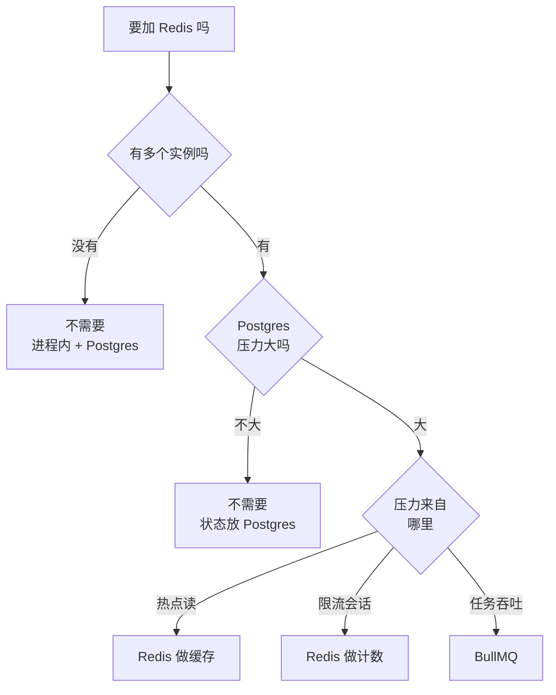

# 用 Postgres 做队列

上一章讲了 BullMQ 怎么用，这一章讲怎么不用它。[队列与异步任务](../system-design/04-queues-jobs.md#postgres-当队列)已经给出了一个几十行的 `SKIP LOCKED` 队列：表结构、取任务的 SQL、worker 循环、和业务写在同一个事务里。这里不再重复，而是接着往下走：手写版缺的东西怎么补（降低延迟、清理、膨胀），什么时候换成 pg-boss、怎么在 NestJS 里用，最后回答本书最重要的一个问题：**一个人的项目，什么时候根本不需要 Redis**。

## 先看 hatch-counter 的做法

按《软件架构与系统设计》里记录的做法，hatch-counter 的后台任务可以分成三类，都用不到 Redis：

| 任务 | 现在的做法 | 光谱上的位置 |
|---|---|---|
| 整店导出 | 进程内队列，一次跑一家；状态记在 `job_runs`，进程起来时捡回没跑完的 | 第二档 |
| 每日体检、清理过期导出包 | 进程内 `setInterval`，「过点且今天没跑」用 `job_runs` 唯一约束判断 | 第二档 |
| 清理验证码、过期幂等回执 | 不起任务，下一次写入时顺手删 | 不需要队列 |

它能这样做，是因为只有一个实例，任务又少。开第二个实例时，导出那一类要换成 `SKIP LOCKED` 表队列（定时任务那一类靠唯一约束，已经是多实例安全的）。这一步换的是**同一个数据库里的一张表**，不需要新服务。

## 补上手写版缺的东西

### 用 LISTEN/NOTIFY 降低延迟

手写版的 worker 没活时每秒查一次，新任务最多要等一秒才开始。大多数后台任务不在乎这一秒；在乎的话（用户点了「发送」等着看结果），加一个通知：

```sql
CREATE OR REPLACE FUNCTION jobs_notify() RETURNS trigger AS $$
BEGIN
  PERFORM pg_notify('jobs_new', NEW.kind);
  RETURN NULL;
END $$ LANGUAGE plpgsql;

CREATE TRIGGER jobs_notify_after_insert
  AFTER INSERT ON jobs
  FOR EACH ROW EXECUTE FUNCTION jobs_notify();
```

```typescript
let wake: (() => void) | undefined;

await sql.listen("jobs_new", () => wake?.());

function idle(ms: number) {
  return new Promise<void>((resolve) => {
    const t = setTimeout(resolve, ms);
    wake = () => {
      clearTimeout(t);
      resolve();
    };
  });
}

export async function workLoop() {
  while (!stopping) {
    const job = await claim();
    if (!job) {
      await idle(5000); // 有通知立刻醒，没有通知最多睡 5 秒
      continue;
    }
    await runOne(job);
  }
}
```

`NOTIFY` 在事务提交时才发出，所以 worker 被唤醒时任务一定已经可见。通知可能丢（监听连接断开的那一刻），所以**轮询不能去掉**，只是间隔可以拉长。这和[实时推送](../system-design/05-realtime-push.md)里「通知只是提示，状态以库为准」是同一个原则。

`sql.listen` 会独占一个连接。经过 PgBouncer 的事务模式时 `LISTEN` 不能用，这个连接要直连 Postgres，见[《PostgreSQL 运维》的连接池一章](../database-ops/05-pgbouncer.md#事务模式下会出问题的写法)。

### 做完的任务去哪

`status = 'done'` 的行不删，表会一直长。部分索引 `WHERE status IN ('queued','running')` 让取任务的查询不受影响，但表本身的体积、备份的体积、`VACUUM` 的工作量都会涨。两种处理：

```sql
-- 做法一：定期删（顺手在 worker 里做，不另起定时任务）
DELETE FROM jobs
WHERE id IN (
  SELECT id FROM jobs
  WHERE status = 'done' AND updated_at < now() - interval '3 days'
  LIMIT 1000
);

-- 做法二：做完直接删，需要留痕的写进业务表
DELETE FROM jobs WHERE id = $1;
```

分批删（`LIMIT 1000`）是为了不在一个事务里删几十万行、长时间持锁。`failed` 的行留着，等人看。

### 队列表的膨胀

队列表是 Postgres 里最「不像 Postgres」的表：每一行插进来、更新两三次、然后删掉。MVCC 下每次更新和删除都留下死元组，靠 autovacuum 回收。默认参数是按「死元组超过表的 20%」触发，对一张常驻行很少、进出很快的表来说太迟钝了。

```sql
ALTER TABLE jobs SET (
  autovacuum_vacuum_scale_factor = 0.01,
  autovacuum_vacuum_threshold = 1000,
  autovacuum_vacuum_cost_delay = 0
);
```

另一个更隐蔽的问题：**长事务会让队列表的死元组无法回收**。一个跑了两小时的报表查询，期间队列表产生的所有死元组都清不掉，取任务的查询要扫过越来越多的死行，越来越慢。所以队列和报表最好不要跑在同一个库的同一时段，或者报表走只读副本。原理见[《PostgreSQL 运维》的 VACUUM 与膨胀](../database-ops/07-vacuum-bloat.md)。

### 吞吐的边界

`SKIP LOCKED` 队列在一台普通云服务器上，每秒处理几百个短任务通常没有压力；每个任务至少有「取」和「完成」两次写，会和业务写入争同一份 WAL 和磁盘带宽。具体上限和你的机器、任务形状有关，**用自己的任务压一次再下结论**，压测方法见[《可观测性与性能》的 k6 一章](../observability-performance/07-load-testing-k6.md)。

对一人项目，每秒几百个后台任务意味着每天几千万个，远在你需要担心之前，业务的其他部分早就先出问题了。

## pg-boss

手写版加上面几项补丁，再加上 cron、优先级、去重、死信、批量取任务，就是 pg-boss 做的事。它是一个 Node 库，在你的 Postgres 里建一个 `pgboss` schema，思路和手写版一样是 `SKIP LOCKED`。

> [!WARNING]
> 本节按 pg-boss 10.x 整理。v10 相比 v9 有破坏性变化：队列要先 `createQueue` 才能用，`work` 的处理函数收到的是任务数组，部分选项改名。之后的大版本可能还有调整（包括导入方式）。写代码前以 pg-boss 仓库的 README 和 releases 说明为准。

### 启动和建队列

```bash
pnpm add pg-boss
```

```typescript
import PgBoss from "pg-boss";

const boss = new PgBoss({
  connectionString: process.env.DATABASE_URL,
  schema: "pgboss",
  max: 5, // pg-boss 自己的连接池大小
});

boss.on("error", (err) => logger.error(`pg-boss: ${err.message}`));

await boss.start(); // 首次启动会建 schema 和表

await boss.createQueue("send-receipt-dlq");
await boss.createQueue("send-receipt", {
  retryLimit: 5,
  retryDelay: 10,       // 秒
  retryBackoff: true,   // 指数退避
  expireInSeconds: 300, // 单次执行超过 5 分钟算超时
  deadLetter: "send-receipt-dlq",
});
```

`createQueue` 是幂等的，每次启动调用一遍没问题。

pg-boss 用自己的连接池（基于 `pg`），和应用的 Drizzle / postgres.js 连接池是两套。算总连接数的时候两边都要算上。

### 发和收

```typescript
await boss.send("send-receipt", { orderId: 9001 });

await boss.send("send-receipt", { orderId: 9001 }, { startAfter: 60 }); // 60 秒后
await boss.send("send-receipt", { orderId: 9001 }, { singletonKey: "order:9001" }); // 去重

await boss.work("send-receipt", { batchSize: 1 }, async ([job]) => {
  await receipts.send(job.data.orderId);
});
```

`work` 的处理函数正常返回即完成，抛错即失败并按队列的重试配置重来。`batchSize` 大于 1 时一次拿一批，适合「攒一批一起调第三方的批量接口」，但要注意一批里只要处理函数抛错，整批都算失败，除非你自己逐个标记。

### 队列策略

`createQueue` 的 `policy` 决定同一时刻允许几个相同任务存在：

| policy | 行为 | 例子 |
|---|---|---|
| `standard`（默认） | 不限制 | 普通任务 |
| `short` | 同一 `singletonKey` 最多一个在排队 | 「刷新某店的统计」，排队中的那个会读到最新数据，不用排两个 |
| `singleton` | 同一 `singletonKey` 最多一个在执行 | 同一个第三方账号的令牌刷新 |
| `stately` | 排队和执行各最多一个 | 同时满足上面两条 |

这几个策略覆盖了第 3 章里大部分「要加锁」的需求，而且是在数据库层面用唯一约束保证的，没有租约锁的那些问题。

### 和业务写在同一个事务里

手写版最大的好处是入队和业务数据能在同一个事务里。pg-boss 的 `send` 支持传入一个 `db` 适配器，让它用你的事务连接执行插入：

```typescript
await sql.begin(async (tx) => {
  const [order] = await tx`INSERT INTO orders ${tx(newOrder)} RETURNING id`;
  await boss.send("send-receipt", { orderId: order.id }, {
    db: { executeSql: (text: string, values: unknown[]) => tx.unsafe(text, values as any[]) },
  });
});
```

适配器要求 `executeSql` 返回带 `rows` 的结果，不同客户端的返回形状不一样，接之前写个测试确认事务回滚时任务也跟着消失。这个能力正是 Postgres 队列相对 Redis 队列的核心优势，值得花这点功夫。

### 放进 NestJS

```typescript
// src/jobs/boss.provider.ts
import { Inject, Injectable, Logger, OnApplicationBootstrap, OnApplicationShutdown } from "@nestjs/common";
import PgBoss from "pg-boss";

@Injectable()
export class BossService implements OnApplicationBootstrap, OnApplicationShutdown {
  readonly boss: PgBoss;
  private readonly logger = new Logger("pg-boss");

  constructor() {
    this.boss = new PgBoss({ connectionString: process.env.DATABASE_URL, schema: "pgboss" });
    this.boss.on("error", (err) => this.logger.error(err.message));
  }

  async onApplicationBootstrap() {
    await this.boss.start();
  }

  async onApplicationShutdown() {
    // graceful：等正在执行的任务完成，最多等 timeout 毫秒
    await this.boss.stop({ graceful: true, timeout: 50_000 });
  }
}
```

各业务模块在自己的 `onApplicationBootstrap` 里 `createQueue` 和 `work`。要拆独立 worker 进程时，和第 5 章一样：worker 入口里注册 `work`，API 入口里只 `send`。

## 什么时候不需要 Redis

把前五章的用途一项项对过来：

| 用途 | 不用 Redis 的做法 | 什么时候才需要 Redis |
|---|---|---|
| 缓存 | 进程内 `TtlCache`；Postgres 自己的缓冲区 | 多实例、且缓存不一致不能等 TTL；或缓存数据大到进程内存放不下 |
| 会话 | 签名令牌（JWT）；或 Postgres 表 | 每个请求都要查会话、且 Postgres 已经很忙 |
| 限流 | nginx `limit_req`；进程内计数 | 多实例、按用户或业务对象限流 |
| 锁 | 唯一约束、`SKIP LOCKED`、advisory lock | 几乎不需要 |
| 队列 | `SKIP LOCKED` 手写或 pg-boss | 每秒上千个任务；或者需要 BullMQ 特有的功能（父子任务树、全局限速、成熟的面板） |
| 定时任务 | `job_runs` + 进程内循环；pg-boss `schedule` | 不需要 |
| 跨实例广播 | Postgres `LISTEN/NOTIFY` | 不需要 |

用一张图串起来：



几条判断的理由：

- **单实例时，进程内存就是最快、最简单的共享状态**。Redis 能做的，单实例时进程内都能做，还少一次网络往返
- **多实例时，先问 Postgres 能不能接住**。大多数一人项目的 Postgres 远没到瓶颈，多几百 QPS 的限流计数或会话查询无所谓
- **Redis 是又一个要部署、监控、备份、升级、考虑许可证的服务**（第 4、9 章）。它挂了要有降级，它满了要有告警，它的数据要想清楚丢了怎么办

反过来，如果你已经有一个 Redis（比如托管平台送的、或者别的组件本来就要它），用它做缓存和限流的边际成本很低，那就用。但队列仍然值得认真比较：**能和业务数据在同一个事务里提交**，是 Postgres 队列一个 Redis 给不了的保证，这个保证省掉的是第 8 章里大量的补偿逻辑。

## 两者怎么选

| | Postgres 队列（pg-boss / 手写） | BullMQ |
|---|---|---|
| 新增服务 | 无 | Redis |
| 入队和业务同事务 | 能 | 不能，需要 outbox |
| 持久性 | 和业务数据一样（WAL、备份、PITR） | AOF `everysec`，最多丢约一秒 |
| 吞吐 | 每秒几百，够一人项目用很久 | 高一到两个数量级 |
| 延迟 | 轮询或 `NOTIFY`，几十毫秒到一秒 | 毫秒级 |
| 生态 | 面板和工具少 | Bull Board、成熟的限速、父子任务 |
| 排查 | 一条 SQL 查任务 | 面板或 `redis-cli` |

一人项目的默认选择是左边。等你真的需要右边那几项（通常是吞吐或全局限速），再迁移：把 `send` 换成 `add`，处理函数基本不用改，因为两边的任务都应该是幂等、只带 id 的小任务（第 8 章）。

## 本章要点

- hatch-counter 这类单实例项目，后台任务靠进程内队列、`job_runs` 和顺手清理就能接住，开多实例时换成同库的 `SKIP LOCKED` 表，不需要新服务
- 手写队列加 `LISTEN/NOTIFY` 降低延迟，但不能去掉轮询；做完的任务分批删；给队列表调激进的 autovacuum，避免长事务
- pg-boss 是现成的 Postgres 队列：先 `createQueue`，`send` / `work`，内置重试、退避、死信、去重策略
- pg-boss 的 `singleton` / `short` / `stately` 策略在数据库层面实现互斥，替代大部分锁
- 能和业务数据同事务入队是 Postgres 队列的核心优势；pg-boss 通过 `db` 适配器做到
- 单实例不需要 Redis；多实例先看 Postgres 能不能接住；真到吞吐瓶颈或要 BullMQ 特有功能时再上
