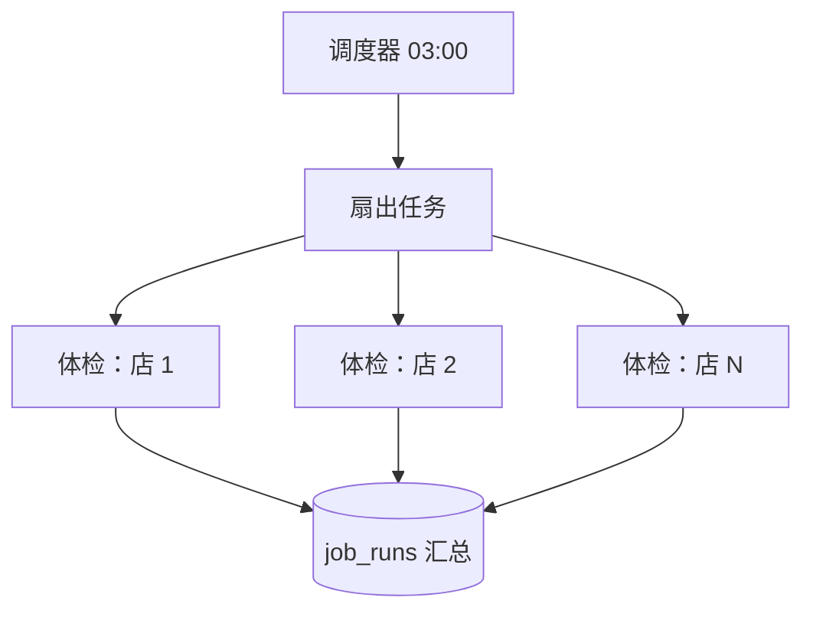

# 定时任务与延迟任务

「按时间触发」的任务有三种形状，常被混在一起：

| 形状 | 例子 | 关键问题 |
|---|---|---|
| 周期任务 | 每天凌晨 3 点给每家店做体检 | 错过了补不补；多实例时只跑一次 |
| 短延迟的一次性任务 | 下单 15 分钟未付款自动取消；验证码 5 分钟后作废 | 取消、改期 |
| 长延迟的业务到期 | 会员 30 天后到期前 3 天提醒；试用期结束 | 业务数据会变，任务里的信息会过时 |

[定时任务](../system-design/04-queues-jobs.md#定时任务)一节讲了 hatch-counter 的做法：进程内每分钟看一眼「过没过点、本周期跑没跑」，用 `job_runs` 的唯一约束防重。这一章讲用 BullMQ 和 pg-boss 怎么做同样的事，三种形状各自该用什么，以及时区、扇出这些细节。

## 周期任务

### 先回顾：为什么 hatch-counter 不用 cron

`@nestjs/schedule` 的 `@Cron('0 3 * * *')` 写法最简洁，但它有两个问题：

- **到点进程不在就错过了**。凌晨 3 点恰好在部署，这一天就没跑
- **多实例时每个实例各跑一遍**。它只是进程内的定时器，不知道别的实例存在

hatch-counter 用「过点且本周期没跑」的状态判断解决了第一个问题，用 `job_runs` 唯一约束解决了第二个。这个方案没有任何外部依赖，**只要你还没有引入队列库，它就是最好的方案**。

引入了 BullMQ 或 pg-boss 之后，它们自带的调度器也能解决这两个问题，下面看怎么用、和自己写的有什么差别。

### BullMQ 的 Job Scheduler

> [!WARNING]
> BullMQ 5.16 起推荐用 `upsertJobScheduler` 管理周期任务，旧的 `repeat` 选项（`queue.add(name, data, { repeat })`）被标为弃用。本节按 5.x 新写法整理，以 docs.bullmq.io 的 Job Schedulers 一节为准。

```typescript
await healthQueue.upsertJobScheduler(
  "daily-health-check",                 // 调度器 id：同 id 再调用就是更新，不会重复创建
  { pattern: "0 3 * * *", tz: "Asia/Shanghai" },
  {
    name: "health-check",
    data: {},
    opts: { attempts: 3, backoff: { type: "exponential", delay: 60_000 } },
  },
);

// 固定间隔：每 10 分钟
await syncQueue.upsertJobScheduler("sync-rates", { every: 10 * 60_000 });

// 删除
await healthQueue.removeJobScheduler("daily-health-check");
```

调度器的工作方式：BullMQ 在 Redis 里放一个**下一次执行的延迟任务**；这个任务被取走执行时，再放下一次的。几个推论：

- **多实例安全**：调度器以 id 为准存在 Redis 里，每个实例启动时都调一次 `upsertJobScheduler` 也只有一份
- **Worker 不在时不会错过，但只补一次**：凌晨 3 点 worker 在部署，那个延迟任务留在 Redis 里，worker 回来后立刻执行。但如果 worker 停了三天，回来只会执行一次，不会补三次
- **Redis 丢了数据，调度器也丢了**：所以每次启动都调用 `upsertJobScheduler`，而不是只在某个迁移脚本里调一次

第二条和上面那段「本周期没跑就补」的写法行为一致：停了三天，补的也只是今天这一次，因为体检这种任务只关心最新状态。如果你的任务每个周期都必须跑（比如每天的对账，三天就要对三次），要在任务里自己检查「上次成功的周期」，把漏掉的补上。这时 `job_runs` 依然有用。

### pg-boss 的 schedule

```typescript
await boss.createQueue("health-check");
await boss.schedule("health-check", "0 3 * * *", {}, { tz: "Asia/Shanghai" });

await boss.work("health-check", async ([job]) => {
  await runHealthCheck();
});

await boss.unschedule("health-check");
```

pg-boss 的调度信息存在 `pgboss.schedule` 表里，每个实例定期检查一次「有没有到点的」，用数据库锁保证同一个时刻只有一个实例真正去发任务。调度精度在半分钟左右，具体以文档为准，对日常任务足够。

### 三种方案对比

| | `job_runs` + 进程内循环 | BullMQ Job Scheduler | pg-boss schedule |
|---|---|---|---|
| 依赖 | 无 | Redis | Postgres（已有） |
| 多实例只跑一次 | 唯一约束 | 调度器 id | 数据库锁 |
| 错过了补跑 | 补本周期 | 补一次 | 补一次（视版本） |
| 能看到「昨晚跑没跑」 | 直接查表，区分没跑和跑挂了 | 看 completed / failed | 查 `pgboss.job` |
| 改时间 | 改代码 | 再调一次 `upsert` | 再调一次 `schedule` |

无论用哪种，**`job_runs` 那张表都值得留着**。调度器负责「到点把任务发出去」，`job_runs` 负责回答「昨天到底跑成没有、处理了几家、哪几家失败」，这是后台首页和告警要读的东西，不应该依赖队列库的内部表。

## 扇出：一个周期任务拆成很多小任务

「每天给每家店做体检」如果写成一个任务循环 500 家店，会有三个问题：一家店出错整个任务失败重来；中途 worker 重启从头再跑；500 家串行太慢。

正确的做法是**周期任务只负责扇出**：



```typescript
async process(job: Job) {
  if (job.name === "health-fanout") {
    const day = businessDay(); // 按业务时区算的日期，见下文
    const storeIds = await this.stores.activeIds();
    await this.healthQueue.addBulk(
      storeIds.map((id) => ({
        name: "health-store",
        data: { storeId: id, day },
        opts: { jobId: `health-${day}-${id}` }, // 同一天同一家店只会有一个
      })),
    );
    return { stores: storeIds.length };
  }

  if (job.name === "health-store") {
    await this.health.check(job.data.storeId, job.data.day);
  }
}
```

`jobId` 带上日期和店 id，扇出任务本身重跑（卡住被回收、手动重试）也不会给同一家店加两个体检任务。每家店独立重试、独立失败，Bull Board 里一眼能看出哪几家没过。

pg-boss 的写法相同，用 `boss.insert(name, jobs[])` 批量插入，`singletonKey` 起 `jobId` 的作用。

## 短延迟任务

「15 分钟未付款就取消订单」是典型的短延迟任务：

```typescript
// 下单时
await this.orderQueue.add(
  "auto-cancel",
  { orderId },
  { delay: 15 * 60_000, jobId: `auto-cancel-${orderId}` },
);

// 付款成功时：把这个延迟任务删掉
const job = await this.orderQueue.getJob(`auto-cancel-${orderId}`);
await job?.remove();
```

```typescript
// 处理函数：执行时再确认一次状态
async autoCancel(orderId: number) {
  await this.db
    .update(orders)
    .set({ status: "cancelled", cancelledAt: new Date() })
    .where(and(eq(orders.id, orderId), eq(orders.status, "pending")));
}
```

注意处理函数里的 `WHERE status = 'pending'`。**删除延迟任务只是优化，不是保证**：付款和取消可能恰好同时发生，`remove` 可能在任务已经被取走之后才调用。真正的保证是条件更新，已付款的订单不会被取消。这是第 8 章「任务必须幂等」的一个具体例子。

pg-boss 对应的是 `startAfter` 和 `cancel`：

```typescript
const id = await boss.send("auto-cancel", { orderId }, { startAfter: 15 * 60 });
// 付款时
if (id) await boss.cancel("auto-cancel", id);
```

### 更简单的选择：不要延迟任务

很多「N 分钟后检查」的需求，可以改成**读的时候判断**：

```sql
-- 不取消，只是在读的时候把超时的当作已取消
SELECT *,
  CASE WHEN status = 'pending' AND created_at < now() - interval '15 minutes'
       THEN 'expired' ELSE status END AS effective_status
FROM orders WHERE id = $1;
```

验证码 5 分钟作废就是这样：表里存 `expires_at`，校验时比一下时间，从来不需要一个「5 分钟后把它标记为作废」的任务。这种写法适合 hatch-counter 这类场景：验证码表的旧行本来就在下次建码时顺手删，校验时再比一下过期时间就够了。**能用一个时间戳和一个比较表达的，就不要用一个任务。**

只有「到期时必须**做一件事**」（释放库存、通知用户、调第三方退款）才需要延迟任务。

## 长延迟：存到期时间，定期扫描

「会员到期前 3 天发提醒」看起来也是延迟任务：开通时加一个 `delay: 27 天` 的任务。不要这么做：

| 问题 | 后果 |
|---|---|
| 业务数据会变 | 用户续费了、改了到期日、退款了，每一种都要记得去改那个延迟任务 |
| 规则会变 | 「提前 3 天」改成「提前 7 天」，已经排进队列的几千个任务都是旧规则 |
| 看不见 | 「下周有哪些人要被提醒」没法用 SQL 查 |
| Redis 不是数据库 | 27 天里 Redis 出任何事，任务就没了，而且没人知道 |

正确的做法是**把到期时间存在业务表里，用一个周期任务扫描**：

```sql
-- 业务表里本来就有到期时间
ALTER TABLE subscriptions ADD COLUMN reminded_at timestamptz;
CREATE INDEX subscriptions_remind_idx ON subscriptions (expires_at) WHERE reminded_at IS NULL;
```

```typescript
// 每小时跑一次的周期任务
async remindExpiring() {
  const due = await this.db
    .select({ id: subscriptions.id })
    .from(subscriptions)
    .where(and(
      isNull(subscriptions.remindedAt),
      lte(subscriptions.expiresAt, sql`now() + interval '3 days'`),
      gt(subscriptions.expiresAt, sql`now()`),
    ))
    .limit(500);

  for (const { id } of due) {
    await this.notifyQueue.add("expire-reminder", { subscriptionId: id }, {
      jobId: `expire-reminder-${id}`,
    });
  }
}
```

处理函数发完提醒后写 `reminded_at`。续费时把 `reminded_at` 清空、`expires_at` 改掉，下一轮扫描自然按新日期处理。规则改成提前 7 天，改一行代码，所有人立即按新规则走。

经验上的分界：**延迟超过一两个小时、或者到期前业务数据可能变化的，都用「到期时间 + 扫描」**；短的、到期前基本不会变的，用延迟任务。

## 时区

定时任务里最常见的 bug 都和时区有关。三个地方的时区可能各不相同：

| 地方 | 常见值 | 影响 |
|---|---|---|
| 服务器 / 容器 | UTC（大多数镜像的默认） | `new Date().getHours()`、cron 默认时区 |
| Postgres 会话 | 看 `timezone` 参数 | `now()::date`、`date_trunc('day', ...)` |
| 业务 | 门店所在地，比如 `Asia/Shanghai` | 「今天」「凌晨 3 点」的真实含义 |

规矩：

- **存储一律 `timestamptz`**，它存的是绝对时刻，和时区无关
- **cron 显式写 `tz`**，不依赖容器的时区
- **「今天是哪一天」用一个函数统一算**，不要到处 `toISOString().slice(0, 10)`（那是 UTC 日期，北京时间早上 8 点前会算成昨天）

```typescript
export function businessDay(at = new Date(), tz = "Asia/Shanghai") {
  // en-CA 的日期格式恰好是 YYYY-MM-DD
  return new Intl.DateTimeFormat("en-CA", { timeZone: tz }).format(at);
}
```

如果门店分布在多个时区，「凌晨 3 点体检」就不是一个时刻，而是每个时区一个。简单做法是每小时跑一次扇出，只挑「当地时间现在是 3 点」的那些店。

## 本章要点

- 时间触发的任务分三种：周期任务、短延迟一次性任务、长延迟业务到期，各用不同做法
- 没引入队列库时，`job_runs` + 进程内循环是最好的周期任务方案；引入后可用 BullMQ `upsertJobScheduler` 或 pg-boss `schedule`，都多实例安全、错过只补一次
- 每次启动都调用 `upsert`，`job_runs` 继续留着做「昨晚跑没跑」的记录
- 周期任务只负责扇出，每个对象一个小任务，`jobId` 带周期和对象 id 防重
- 短延迟用 `delay` / `startAfter`，取消只是优化，处理函数里用条件更新兜底；能用时间戳比较表达的不要起任务
- 长延迟不要排进队列：到期时间存业务表，周期任务扫描
- 存 `timestamptz`，cron 写 `tz`，业务日期用一个函数按业务时区统一计算

## 动手练习

环境：沿用第 5 章的 Redis 容器和 `bullmq` 依赖；第 1 题只需要 Node。

1. **UTC 日期算错一天**：在 Node 里对 `const at = new Date("2026-11-04T23:30:00Z")` 分别打印 `at.toISOString().slice(0, 10)` 和本章的 `businessDay(at)`。再用 `TZ=UTC node -e 'console.log(new Date(2026, 10, 5, 3).toISOString())'` 看「凌晨 3 点」在 UTC 容器里是哪个时刻。

   验证：第一个是 `2026-11-04`，第二个是 `2026-11-05`；第二条命令输出 `2026-11-05T03:00:00.000Z`，即北京时间上午 11 点。

   参考答案：`toISOString` 永远是 UTC 日期，北京时间早上 8 点前会落到前一天；不写 `tz` 的「3 点」按进程时区解释，容器默认 UTC，就差了 8 小时。

2. **调度器 id 保证只有一份**：写一个脚本连续调用 3 次 `queue.upsertJobScheduler("daily", { pattern: "0 3 * * *", tz: "Asia/Shanghai" })`，模拟 3 个实例各自启动，然后打印 `(await queue.getJobSchedulers()).length` 和 `await queue.getDelayedCount()`。

   验证：调度器数量是 `1`，延迟任务数也是 `1`。

   参考答案：调度器以 id 为键存在 Redis 里，重复 `upsert` 只是更新同一份，并且只放一个「下一次执行」的延迟任务。

3. **取消只是优化**：加一个 `delay: 5000`、`jobId: "auto-cancel-1"` 的任务，立刻 `getJob` 并打印 `await job.getState()`，然后 `remove()`，再打印 `await queue.getJob("auto-cancel-1")`。另写一版：把 `delay` 改成 0 并先启动 Worker，再去 `remove()`。

   验证：第一版状态是 `delayed`，删除后 `getJob` 返回 `undefined`，Worker 从未执行；第二版里 Worker 已经执行了任务（处理函数的日志先出现），`remove()` 来得太晚。

   参考答案：任务一旦被取走，删除就拦不住了，所以处理函数要用 `WHERE status = 'pending'` 这样的条件更新兜底。
