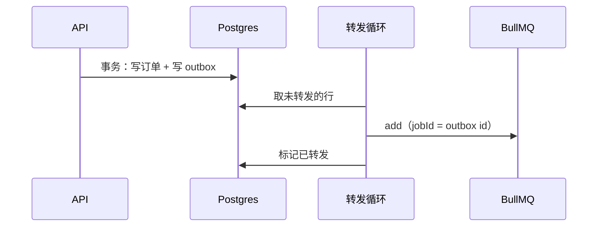

# 重试、死信与幂等

后台任务一定会失败：第三方超时、数据库连接被重置、worker 被部署打断。队列库给你的是「失败了再来一次」，它给不了的是「来一次不出事」。这一章是前面几章所有「任务必须幂等」的落地：怎么区分该重试和不该重试的错误、退避怎么配、重试用完的任务去哪里（死信）、怎么一键重放，以及在 BullMQ 和 Postgres 队列上分别怎么保证同一个任务执行两次也不出错。

幂等键、重试的放大效应、outbox 的原理在[《软件架构与系统设计》的幂等、重试与一致性](../system-design/06-idempotency-consistency.md)里讲过，这里只讲任务队列这一侧的写法。

> [!WARNING]
> 本章的 BullMQ 写法（`UnrecoverableError`、自定义 `backoffStrategy` 的参数、`retryJobs`、`deduplication`）按 BullMQ 5.x 整理（6.0 删除了旧的 `debounce` 选项和 `Job#discard()`，本章用的 `UnrecoverableError` 和 `deduplication` 不受影响），pg-boss 部分按 10.x 的 API 写、在 12.x 里同样可用（导入方式见[第 6 章](06-postgres-queue.md#pg-boss)），选项名和行为在版本之间会变化。以 docs.bullmq.io 和 pg-boss 仓库的说明为准。

## 任务为什么会执行不止一次

先把来源列全，才知道幂等要防什么：

| 来源 | 发生在什么时候 |
|---|---|
| 主动重试 | 处理函数抛错，按 `attempts` 再来 |
| 卡住被回收 | worker 被杀、事件循环被堵住导致锁过期（第 5 章） |
| 租约过期 | Postgres 队列的 `locked_until` 到了，任务还在跑 |
| 重复入队 | 用户点了两次、API 请求被客户端重试、扇出任务自己重跑 |
| 人工重放 | 你在面板上点了「重试全部失败任务」 |
| 从备份恢复 | 队列回到了一天前（第 4 章） |

最后一种最极端，但它说明了一件事：**不能假设「任务成功了就不会再来」**。处理函数必须能面对「这件事其实已经做过了」的情况。

## 哪些错误该重试

不是所有错误都值得重试。参数错了、数据不存在、权限不够，重试一万次也是同样的结果，还会占着 worker、刷满日志。

| 错误 | 重试吗 | 例子 |
|---|---|---|
| 网络超时、连接重置 | 重试 | `ETIMEDOUT`、`ECONNRESET` |
| 对方 5xx、429 | 重试（429 按 `Retry-After`） | 短信服务商偶尔 503 |
| 数据库死锁、序列化失败 | 重试 | Postgres `40P01`、`40001` |
| 对方 4xx（非 429） | 不重试 | 手机号格式错、签名错误 |
| 业务对象不存在或状态不对 | 不重试，直接成功返回 | 订单已被删除、已经付款了 |
| 代码 bug | 不重试，修好后人工重放 | `TypeError` |

倒数第二行容易做错：**订单已经付款了，「自动取消」任务应该成功结束**，而不是抛错。它不是失败，是「不需要做了」。

### BullMQ：UnrecoverableError

```typescript
import { UnrecoverableError } from "bullmq";

async process(job: Job<SmsJob>) {
  try {
    return await this.gateway.send(job.data.phone, job.data.template, job.data.params);
  } catch (err) {
    if (err instanceof ProviderError && err.status >= 400 && err.status < 500 && err.status !== 429) {
      // 直接进 failed，不再消耗剩余的重试次数
      throw new UnrecoverableError(`服务商拒绝：${err.code} ${err.message}`);
    }
    throw err; // 其他错误按 attempts 重试
  }
}
```

### Postgres 队列：同样的分类

手写队列（[Worker 循环](../system-design/04-queues-jobs.md#worker-循环)）在 `catch` 里多判断一下：

```typescript
const giveUp = err instanceof PermanentError || job.attempts >= job.max_attempts;
```

pg-boss 没有专门的「不可重试」错误类型，可以在处理函数里捕获后调用 `boss.fail(name, job.id, data)` 并正常返回，或者对这类任务把 `retryLimit` 设低。具体以你所用版本的 API 为准。

## 退避

### 指数退避加抖动

BullMQ 内置的 `exponential` 是 `delay × 2^(attemptsMade - 1)`：10 秒、20 秒、40 秒……它没有抖动。一批任务因为同一个原因（第三方宕机）一起失败，就会在同一时刻一起重试，又一起打到刚恢复的第三方上。

用自定义退避加上抖动和上限：

```typescript
@Processor("sms", {
  concurrency: 5,
  settings: {
    backoffStrategy: (attemptsMade: number, type?: string, err?: Error) => {
      // 对方告诉了要等多久，就听它的
      if (err instanceof ProviderRateLimitError) return err.retryAfterMs;
      const base = Math.min(10_000 * 2 ** (attemptsMade - 1), 3_600_000);
      return Math.round(base * (0.5 + Math.random() * 0.5)); // 抖动：50%–100%
    },
  },
})
export class SmsProcessor extends WorkerHost { /* ... */ }
```

```typescript
await queue.add("verify", data, { attempts: 5, backoff: { type: "custom" } });
```

抖动的原理和取值见[退避与抖动](../system-design/06-idempotency-consistency.md#退避与抖动)。

### 总时限比次数更重要

`attempts: 5` 配上指数退避，最后一次重试大约在第一次之后 2–3 分钟。`attempts: 10` 就是一个多小时以后。想清楚这个任务**过了多久就没有意义了**：

| 任务 | 有意义的时限 | 配置 |
|---|---|---|
| 发验证码 | 1 分钟（用户早就重新点了） | `attempts: 2`，短退避 |
| 发收据 | 一天 | `attempts: 8`，封顶 1 小时 |
| 同步到第三方记账系统 | 几天，晚了也要同步 | `attempts: 15`，进死信后人工处理 |

过了时限还在重试的任务，不仅没用，还可能有害：验证码在用户已经换了一个新码之后才发出去，用户会被搞糊涂。必要时在处理函数开头检查任务的年龄：

```typescript
if (Date.now() - job.timestamp > 2 * 60_000) return { skipped: "过期" };
```

## 死信

重试用完、或者遇到不可重试错误的任务，叫死信。死信的处理原则：**不自动删除、能看到、能重放、会告警**。

### BullMQ：failed 集合就是死信

BullMQ 没有单独的死信队列，`failed` 状态的任务就是死信，保留时间由 `removeOnFail` 决定（第 5 章建议保留七天）。

光留着不够，你得知道它们存在。在 `failed` 事件里，只对**最终失败**的任务做两件事：记一条到 Postgres、发一个告警：

```typescript
@OnWorkerEvent("failed")
async onFailed(job: Job | undefined, err: Error) {
  if (!job) return;
  const final = err instanceof UnrecoverableError || job.attemptsMade >= (job.opts.attempts ?? 1);
  if (!final) return;

  await this.db.insert(deadJobs).values({
    queue: job.queueName,
    jobId: job.id!,
    name: job.name,
    data: job.data,
    error: err.message.slice(0, 2000),
    attempts: job.attemptsMade,
  });
  this.alerts.notify(`任务进入死信：${job.queueName}/${job.name} ${job.id}：${err.message}`);
}
```

```sql
CREATE TABLE dead_jobs (
  id          bigint GENERATED ALWAYS AS IDENTITY PRIMARY KEY,
  queue       text        NOT NULL,
  job_id      text        NOT NULL,
  name        text        NOT NULL,
  data        jsonb       NOT NULL,
  error       text        NOT NULL,
  attempts    int         NOT NULL,
  created_at  timestamptz NOT NULL DEFAULT now(),
  resolved_at timestamptz,
  note        text
);
```

为什么还要写一份到 Postgres：BullMQ 的 failed 任务七天后就清了，Redis 也可能丢；死信是「有一件事没做成」的证据，它的生命周期应该和业务数据一样长，直到你处理并写上 `resolved_at` 和处理说明。

告警要合并：第三方宕机时会有几百个任务同时进死信，不要发几百条消息。告警设计见[《可观测性与性能》的告警一章](../observability-performance/04-alerting.md)。

### pg-boss：deadLetter

pg-boss 在 `createQueue` 时指定 `deadLetter`（[第 6 章](06-postgres-queue.md#启动和建队列)），重试用完的任务会被复制到那个队列。可以给死信队列也注册一个 `work`，做的事和上面一样：记录、告警。它们本来就在 Postgres 里，查起来只是一条 SQL。

### 重放

修好了 bug 或者第三方恢复了，要把死信重新跑一遍。

```typescript
// 单个
const job = await queue.getJob(jobId);
await job?.retry(); // 回到 waiting，attemptsMade 清零

// 一个队列里所有失败的
await queue.retryJobs({ state: "failed", count: 1000 });
```

批量重放前想三件事：

1. **bug 真的修好了吗**：先挑一个重放，看结果
2. **这些任务现在还有意义吗**：三天前的验证码不该再发
3. **处理函数是幂等的吗**：重放的任务里可能有一部分其实已经做成了（做成了、记录完成状态时失败）

第三条引出了本章最重要的部分。

## 幂等：入队这一侧

### BullMQ：jobId 去重

```typescript
await queue.add("send-receipt", { orderId }, { jobId: `receipt-${orderId}` });
```

同一个 `jobId` 的任务**在 Redis 里还存在时**，再次 `add` 会被忽略。注意这个前提：任务完成后被 `removeOnComplete` 删掉了，同一个 `jobId` 就能再次加入。所以 `jobId` 防的是「短时间内重复入队」，不是「这件事永远只做一次」。后者要靠处理函数。

BullMQ 5.x 还有 `deduplication` 选项，可以给去重设一个 TTL，或者在已有任务时用新数据替换旧任务（防抖）。以官方文档的 Deduplication 一节为准。

自定义 `jobId` 建议用带前缀、短横线分隔的格式，如 `receipt-9001`：纯数字会和 BullMQ 的自增 id 冲突而被拒绝，冒号是 BullMQ 键名的分隔符，部分版本对含冒号的 id 有限制。

### Postgres 队列：唯一约束

```sql
ALTER TABLE jobs ADD COLUMN dedupe_key text;
CREATE UNIQUE INDEX jobs_dedupe_idx ON jobs (dedupe_key)
  WHERE dedupe_key IS NOT NULL AND status IN ('queued', 'running');
```

```sql
INSERT INTO jobs (kind, payload, dedupe_key)
VALUES ('send_receipt', '{"orderId": 9001}', 'receipt:9001')
ON CONFLICT DO NOTHING;
```

部分唯一索引只约束还没做完的任务，和 BullMQ 的 `jobId` 语义一样。pg-boss 的 `singletonKey` 是同一个东西。

## 幂等：处理这一侧

处理函数的幂等，按副作用的类型有三种写法。

### 写自己的数据库：条件更新

最简单的情况。把「检查状态」和「改状态」放在一条 SQL 里：

```typescript
// 不幂等：先查再改，两次执行之间状态可能变；执行两次会扣两次
const sub = await repo.find(id);
await repo.update(id, { balance: sub.balance - amount });

// 幂等：状态作为条件，已经处理过的不会再匹配
await sql`
  UPDATE subscriptions SET status = 'expired', expired_at = now()
  WHERE id = ${id} AND status = 'active'`;
```

涉及「加减」的操作（扣余额、加积分），条件更新不够，要记一笔带唯一键的流水：

```sql
INSERT INTO points_ledger (member_id, delta, reason, source_key)
VALUES ($1, 10, 'order', 'order:9001')
ON CONFLICT (source_key) DO NOTHING;
```

余额由流水汇总，同一个 `source_key` 只会记一次。

### 调第三方：把幂等键传给对方

发短信、扣款、调别人的 API，副作用在别人的系统里，你的数据库事务管不到。如果对方支持幂等键（支付接口大多支持，短信服务商通常有一个「外部流水号」字段），就**用任务的稳定标识当幂等键**：

```typescript
await this.gateway.send({
  phone,
  template,
  params,
  outId: `receipt-${orderId}`, // 对方按 outId 去重，同一个只发一次
});
```

不要用 `job.id` 当幂等键，人工重放、重新入队时 id 会变；用业务含义的标识（订单号 + 动作）。

### 对方不支持幂等：先记后做，接受极小的缝

对方不支持幂等键时，没有办法做到严格的「恰好一次」。能做的是把重复的窗口缩到最小：

```typescript
async sendReceipt(orderId: number) {
  // 1. 先占位：唯一约束保证只有一个执行者能占到
  const [claimed] = await sql`
    INSERT INTO side_effects (key, status) VALUES (${`receipt:${orderId}`}, 'started')
    ON CONFLICT (key) DO UPDATE SET status = side_effects.status
    RETURNING status, (xmax = 0) AS inserted`;

  if (!claimed.inserted && claimed.status === "done") return; // 做过了

  // 2. 做
  const res = await this.gateway.send(/* ... */);

  // 3. 记完成
  await sql`UPDATE side_effects SET status = 'done', detail = ${res.bizId}
            WHERE key = ${`receipt:${orderId}`}`;
}
```

`(xmax = 0) AS inserted` 是 Postgres 的一个惯用写法，区分这一行是刚插入的还是冲突更新的。

剩下的缝在第 2 步和第 3 步之间：发出去了，记完成之前进程死了。下次执行看到 `started`，不知道发没发出去。这个缝没法消除，只能选择：

| 看到 `started` 时 | 结果 | 适合 |
|---|---|---|
| 再做一次 | 可能重复 | 重复无害或代价小：收据短信多发一条 |
| 不做，报警等人确认 | 可能漏 | 重复代价大：打款、退款 |
| 去对方系统查一下 | 准确 | 对方有查询接口时最好 |

这就是[最难的那个缝](../system-design/06-idempotency-consistency.md#最难的那个缝)在任务里的样子。选哪一种是业务决定，不是技术决定，写进代码注释里。

## BullMQ 和业务数据的一致性：outbox

用 Postgres 队列时入队和业务写入在同一个事务里，用 BullMQ 时做不到：

```typescript
await db.transaction(async (tx) => {
  await tx.insert(orders).values(order);
});
await receiptQueue.add("send", { orderId: order.id }); // 这里失败，订单有了、任务没了
```

反过来先入队再提交事务，事务回滚了任务还在。标准解法是 outbox：任务先写进 Postgres 的 outbox 表（和订单同一个事务），再由一个转发循环把它搬到 BullMQ。



```typescript
async relayOutbox() {
  const rows = await sql`
    SELECT id, queue, name, payload FROM outbox
    WHERE relayed_at IS NULL
    ORDER BY id LIMIT 100
    FOR UPDATE SKIP LOCKED`;
  for (const row of rows) {
    await this.queues.get(row.queue).add(row.name, row.payload, { jobId: `outbox-${row.id}` });
    await sql`UPDATE outbox SET relayed_at = now() WHERE id = ${row.id}`;
  }
}
```

`add` 成功、标记失败时，下一轮会再 `add` 一次，但 `jobId` 相同，被 BullMQ 忽略（只要任务还没被清理）。outbox 原理见[Outbox 模式](../system-design/06-idempotency-consistency.md#outbox-模式)。

写到这里你会发现：outbox 表、转发循环、`SKIP LOCKED`，这已经是一个 Postgres 队列了。**如果你需要的一致性保证必须靠 outbox 才能拿到，那很可能直接用 Postgres 队列更简单**，这是第 6 章推荐它作为默认选择的另一个理由。

## 本章要点

- 任务会因为重试、卡住回收、租约过期、重复入队、人工重放、备份恢复而执行多次；处理函数必须能面对「已经做过了」
- 区分可重试和不可重试的错误；BullMQ 用 `UnrecoverableError`；「不需要做了」应当成功返回
- 指数退避加抖动、尊重 `Retry-After`；按「多久之后就没意义」定次数，必要时检查任务年龄
- 死信不自动删、要告警、写一份到 Postgres 留档；重放前先确认 bug 修好、任务还有意义、处理函数幂等
- 入队侧去重：BullMQ `jobId`（只在任务存在期间有效）、Postgres 部分唯一索引、pg-boss `singletonKey`
- 处理侧幂等：自己的库用条件更新和带唯一键的流水；第三方用业务标识当幂等键；不支持时先记后做，缝怎么处理是业务决定
- BullMQ 要和业务数据一致就得 outbox；需要 outbox 时，多半直接用 Postgres 队列更简单

## 动手练习

环境：沿用第 5 章的 Redis 容器和 `bullmq` 依赖，第 6 章的 Postgres 容器。

1. **UnrecoverableError 不消耗重试**：队列默认 `attempts: 5`，处理函数在 `job.data.kind === "bad"` 时抛 `new UnrecoverableError("4xx")`，否则抛普通 `Error`；两种任务各加一个，在 `failed` 事件里打印 `job.data.kind`、`job.attemptsMade`。

   验证：`bad` 只打印一次，`attemptsMade` 为 `1`；另一个最终打印到 `attemptsMade` 为 `5`。两者最后都处在 `failed` 状态。

   参考答案：`UnrecoverableError` 让任务直接进入 `failed`，剩余的重试次数不再使用；普通错误按 `attempts` 走完全部重试。

2. **jobId 去重有前提**：加一个 `jobId: "receipt-9001"`、`removeOnComplete: true` 的任务，任务还在 `wait`（先不启动 Worker）时再 `add` 同一个 `jobId`，看 `getWaitingCount()`；然后启动 Worker 让它完成，再 `add` 一次同一个 `jobId`。

   验证：第一次重复 `add` 后等待数仍是 `1`；任务完成并被删除后再 `add`，处理函数又执行了一次。

   参考答案：`jobId` 只在任务还存在于 Redis 时起去重作用，任务被 `removeOnComplete` 删掉后就能再次加入，「只做一次」要靠处理函数的幂等。

3. **流水唯一键挡住重复扣减**：在 Postgres 里建 `CREATE TABLE points_ledger (member_id int, delta int, source_key text UNIQUE);`，把本章那条 `INSERT ... ON CONFLICT (source_key) DO NOTHING` 连续执行 3 次（`member_id = 1`），再查 `SELECT sum(delta) FROM points_ledger WHERE member_id = 1`。

   验证：第一次 psql 显示 `INSERT 0 1`，后两次显示 `INSERT 0 0`；汇总结果是 `10`。

   参考答案：同一个 `source_key` 只能记一笔，任务重复执行时插入被唯一约束忽略，余额由流水汇总，自然不会加两次。
