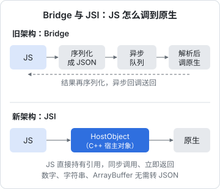
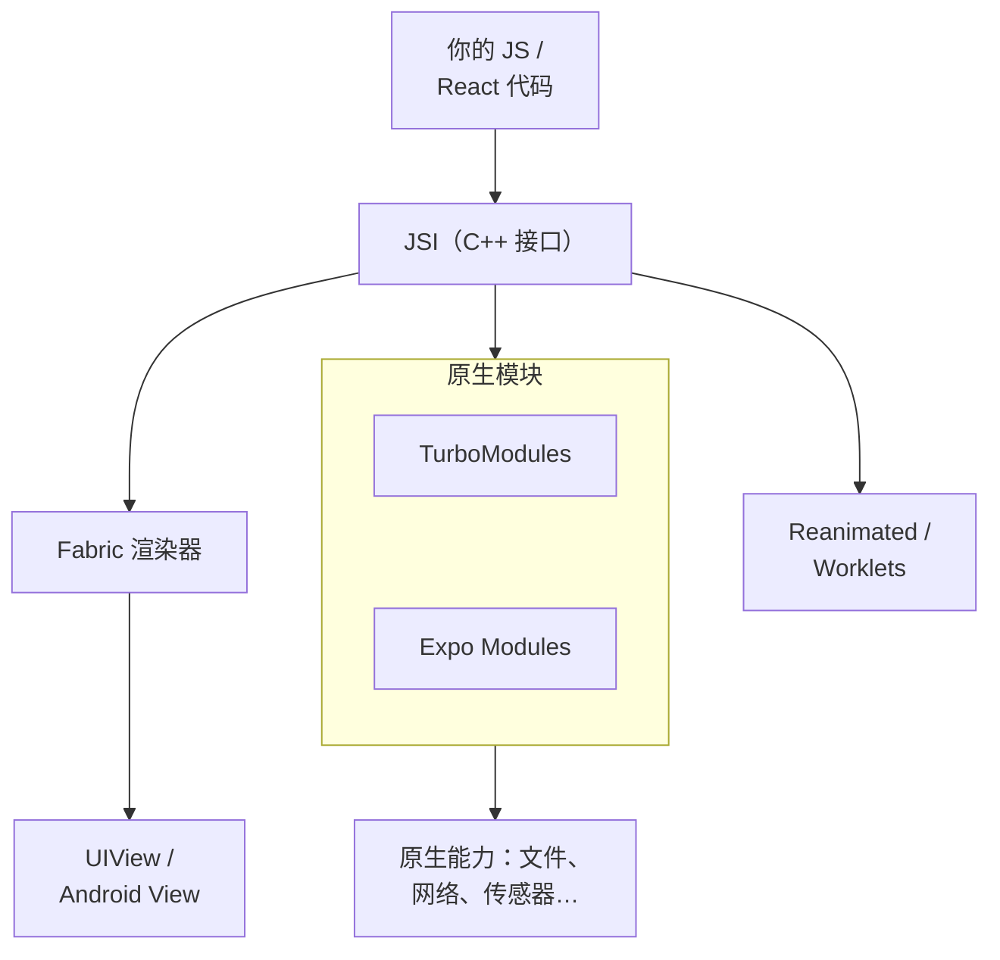

# RN 新架构：JSI、Fabric 与 TurboModules

这本书讲 React Native 和 Expo 在一个真实 App 里怎么用：从运行时怎么工作，到路由、原生工程、原生模块、WebView、本地存储、动画，最后签名出包。贯穿全书的案例是你正在用来读这本书的**书架 App**（hatch-shelf：Expo SDK 58、React Native 0.88、expo-router、SQLite、WebView 阅读器），补充案例是**唱片墙**的移动端（Expo SDK 57，自己写了两个原生模块和一个锁屏小组件扩展，走 TestFlight 分发）。

**适合谁**：会 React 和 TypeScript，写过或者跑过 Expo 项目，想知道「为什么要这样配」、遇到原生层的问题不再只会删 `node_modules`。不讲 JSX 和 Hooks 入门。

**怎么读**：第 1–2 章是运行时原理，看懂后面的很多「坑」都能自己推出来；第 3–6 章是工程链路（路由 → 原生工程 → config plugin → 原生模块），建议按顺序读；第 7–9 章按需看；第 10 章在第一次出包前读；第 11 章讲 Android 与国内分发，要在国内安卓上发时再读。

> [!WARNING]
> **版本说明**：Expo 每个 SDK 都有破坏性变更。本书的 API 以 **Expo SDK 58** 为准（React Native 0.88、React 19.3、最低 iOS 16.4、Xcode 26.4 及以上、Node 22.13 及以上）。这组版本号按 2026 年 11 月 Expo 文档首页的 SDK 版本对照表核对过；全书各章的 API 名按 2026 年 11 月的 Expo SDK 58 changelog 和 `docs.expo.dev/versions/v58.0.0/` 逐条核对。用其他版本时，请对照 Expo 官网对应版本的文档，以官方最新文档为准。

这一章先回答一个问题：一行 JS 里写的 `<View>`，是怎么变成屏幕上的 `UIView` 的？「新架构」改的就是这条路。

## 旧架构的问题：一座异步的桥

React Native 最早的设计里，JS 和原生是两个世界，中间隔着一座 **Bridge**：

- JS 想调原生（比如读文件），要把调用序列化成 JSON，放进队列，**异步**送到原生侧，原生解析后执行，结果再序列化成 JSON 送回来
- 渲染也走这座桥：React 算出要创建哪些视图、改哪些属性，全部变成 JSON 消息批量发过去
- 所有原生模块在启动时**全部初始化**，不管这次用不用得上

这带来三个具体问题：

| 问题 | 表现 |
|---|---|
| 只能异步 | JS 没法「同步拿到一个视图的尺寸」，只能等回调；列表快速滚动时，JS 来不及算，出现白块 |
| 序列化开销 | 大数据（比如一张图片的字节）要先转字符串，过桥后再转回来 |
| 启动慢 | 几十个原生模块启动时一次性初始化 |



## JSI：让 JS 直接摸到原生对象

**JSI**（JavaScript Interface）是新架构的地基。它是一层 C++ 接口，让 JS 引擎（Hermes）里的对象可以直接引用一个 C++ 的「宿主对象」（HostObject），调用它的方法就像调普通 JS 函数：

- **可以同步**：JS 调用后立刻拿到返回值，不用排队
- **不用序列化**：数字、字符串、`ArrayBuffer` 直接在两侧之间传递
- **引擎无关**：JSI 抽象了 JS 引擎，理论上可以换引擎（实际上现在只有 Hermes，见[第 2 章](02-hermes.md)）

你平时不会直接写 JSI 代码，但几乎所有东西都建立在它上面：



## Fabric：新的渲染器

**Fabric** 是用 JSI 重写的渲染系统。React 在 JS 里算出组件树之后，Fabric 在 C++ 里维护一棵「影子树」（Shadow Tree），用 Yoga 算布局，再把变化提交到真正的原生视图。

和旧渲染器比，它带来的实际好处：

1. **同步布局读取**：`useLayoutEffect` 里可以同步拿到布局结果，不再先渲染一帧错的位置再跳过来。弹出层、Tooltip 这类「要根据别人的位置定自己位置」的组件，终于能不闪
2. **支持 React 的并发特性**：`useTransition`、`Suspense` 在原生上按 React 文档的语义工作。React 19 的特性默认可用
3. **多线程**：影子树可以在后台线程上计算，主线程只负责最后的提交

唱片墙的底部弹层就用了一个依赖同步布局的小技巧：卡片高度在 `onLayout` 里量到之前，先按一整屏高度把它放在屏幕外，量到之后再动画升起。这一套在新架构上第一帧就是对的。

## TurboModules 与 Codegen

**TurboModules** 是新的原生模块系统，替代旧的 NativeModules：

- **懒加载**：第一次用到某个模块时才初始化，启动不再为用不上的模块买单
- **类型化**：用 TypeScript 写一份接口规格（spec），**Codegen** 在构建时据此生成 C++ / ObjC / Java 的胶水代码，JS 传错类型在编译期就能发现
- **通过 JSI 调用**：可以同步，也可以返回 Promise

一份 TurboModule 的 spec 大致长这样（了解即可，Expo 项目里通常不手写）：

```ts
// NativeCalculator.ts —— Codegen 会读这个文件
import type { TurboModule } from 'react-native';
import { TurboModuleRegistry } from 'react-native';

export interface Spec extends TurboModule {
  add(a: number, b: number): number;
  fetchSomething(id: string): Promise<string>;
}

export default TurboModuleRegistry.getEnforcing<Spec>('Calculator');
```

在 Expo 项目里，写原生模块更常用 **Expo Modules API**：用 Swift / Kotlin 的 DSL 声明函数和事件，它同样建立在 JSI 上，不需要写 C++ 胶水，也不需要单独跑 Codegen。[第 6 章](06-native-module.md)会用唱片墙的锁屏按键模块完整走一遍。

## Bridgeless：桥彻底拆掉

新架构推进分了好几年：先是可选，然后默认开启，最后强制。

| 时间点 | 状态 |
|---|---|
| Expo SDK 52 | 新项目默认开启新架构 |
| Expo SDK 53 / 54 | 默认开启，仍可关闭；SDK 54 是最后一个能关的版本 |
| React Native 0.82 | 第一个去掉「关闭新架构」选项的 RN 版本 |
| Expo SDK 55 及以后 | 始终开启；`newArchEnabled: false` 会被忽略 |

所以在 SDK 58 上，**没有旧架构可选**。书架 App 的 `app.json` 里根本没写 `newArchEnabled`；唱片墙的 `app.json` 里还留着一行 `"newArchEnabled": true`，是从 SDK 5x 早期带过来的，现在写不写都一样，可以删。

现在的运行模式叫 **Bridgeless**：没有 Bridge 这个对象了，旧式原生模块靠一层兼容互操作层（interop layer）继续工作。大部分老库能跑，但如果一个库多年没更新、依赖旧架构的私有实现，可能在新架构上直接崩溃或者行为异常。

## 对日常开发意味着什么

**选库时多看一眼新架构支持**。React Native Directory 上每个库都标了是否支持新架构。像 Reanimated 4 就**只支持新架构**（[第 9 章](09-performance-reanimated.md)）。

**`expo-doctor` 是第一道检查**。它会检查依赖版本是否和 SDK 匹配、有没有已知不兼容新架构的库：

```bash
cd app
npx expo-doctor
```

**同步 API 不等于可以在渲染里做重活**。JSI 让同步调用成为可能，但 JS 线程仍然只有一个。在渲染路径上同步读一个大文件，照样卡掉帧。书架 App 的阅读页读章节内容用的是异步的 `await new File(dir, ch.file).text()`，就是这个原因。

**线程模型要心里有数**：

| 线程 | 跑什么 | 被堵住的表现 |
|---|---|---|
| JS 线程 | React 渲染、你的业务逻辑、事件处理 | 点按钮没反应、动画（如果在 JS 驱动）卡顿 |
| UI 主线程 | 原生视图的布局提交、手势、系统动画 | 整个 App 卡住、滚动掉帧 |
| 后台线程 | Fabric 影子树计算、原生模块的异步任务 | 通常不可见，表现为结果延迟 |

[第 9 章](09-performance-reanimated.md)讲性能时，基本就是围绕这张表展开。

## SDK 58 带来的其他变化

> [!WARNING]
> 本节按 2026 年 11 月 Expo 官网的 SDK 58 changelog（expo.dev/changelog/sdk-58）整理，补丁版本可能还会调整，升级前以官方 changelog 和升级指南为准。

和新架构无关、但升级到 SDK 58 时会碰到的几条（来自 Expo 官方的升级指南）：

- **Strict TypeScript API 默认开启**：从 `react-native/Libraries/*` 深层导入会报类型错误，ref 要用 `ViewInstance`、`TextInputInstance` 这样的实例类型
- **删掉了一些 API**：`InteractionManager`（改用 `requestIdleCallback`）、根导出的 `Touchable`、`Modal` 的 `animated` 属性、`StatusBar` 的 `backgroundColor` / `translucent` / `networkActivityIndicatorVisible` 属性；`ImageBackground` 标记为废弃。Strict TypeScript API 可以先在 `tsconfig.json` 里用 `customConditions` 暂时退出，官方说这个退路会在 RN 0.89 之后移除
- **iOS 场景生命周期**：`expo prebuild` 现在会生成 `SceneDelegate.swift`，窗口由场景代理创建。用 config plugin 和 Expo Modules 的项目基本无感，手改过 `AppDelegate` 的项目要迁移（[第 4 章](04-dev-client-prebuild.md)）
- **iOS 26 以上的导航栏**默认透明（Liquid Glass 风格），内容会延伸到导航栏下面（[第 3 章](03-expo-router.md)）
- **Android release 构建默认开启 R8**（`android.enableMinifyInReleaseBuilds` 默认为真）：用反射的库（推送、统计这类 SDK 常见）可能需要补 keep 规则，见[第 11 章](11-android-china.md)
- **`NODE_ENV` 由 Expo CLI 按命令设成 `development` 或 `production`**，会覆盖你自己设的值，进而影响加载哪个 `.env` 文件

书架 App 升 SDK 58 时还踩了一个 `expo-file-system` 的坑：`File.write()` 变成了异步，原子写入书籍时如果不 `await`，后面的 `rename` 可能抢在写入之前执行。修法是改用 `writeSync()`，并在 ESLint 里打开 `no-floating-promises`，让漏写的 `await` 过不了检查（[第 8 章](08-local-storage.md)）。

## 本章要点

- 旧架构靠一座**异步、序列化的 Bridge** 连接 JS 和原生，带来卡顿、序列化开销和慢启动
- **JSI** 让 JS 直接持有 C++ 宿主对象并同步调用，是新架构一切的地基
- **Fabric** 是新渲染器，支持同步布局读取和 React 并发特性；**TurboModules** 懒加载、靠 Codegen 类型化
- Expo SDK 55 起新架构**始终开启**，SDK 58 上没有旧架构可选；运行模式是 Bridgeless
- 同步能力不等于可以在 JS 线程做重活；选库先确认新架构支持，用 `expo-doctor` 做第一道检查

## 动手练习

1. **确认跑在 Bridgeless 上**：用 `pnpm app ios` 装好 dev client，Metro 里按 `j` 打开 React Native DevTools，在 Console 里执行 `global.RN$Bridgeless`。

   验证：输出 `true`。

   参考答案：SDK 58 上新架构始终开启，运行模式就是 Bridgeless，这个全局标记由 RN 在 Bridgeless 模式下设置。

2. **关掉新架构试试**：在一个练习用的 Expo 项目（`npx create-expo-app@latest`）的 `app.json` 里加 `"newArchEnabled": false`，执行 `npx expo prebuild --clean` 后重新构建，再重复第 1 题。

   验证：输出仍是 `true`，App 行为没有变化。

   参考答案：Expo SDK 55 起这个字段会被忽略，没有旧架构可选。练完把这一行删掉，免得以后的人误以为它有作用。

3. **堵住 JS 线程**：在一个页面上放一个长 `ScrollView` 和一个按钮，按钮的 `onPress` 里写一个跑 3 秒的忙循环（`const t = Date.now(); while (Date.now() - t < 3000) {}`）。点按钮后立刻滑动列表、再点其他按钮。

   验证：3 秒内列表仍能滑动，其他按钮点了没反应，3 秒后它们的回调一次性补上。

   参考答案：滚动由 UI 主线程处理，按钮回调在 JS 线程排队，对应本章「线程模型」那张表的前两行。JSI 让同步调用成为可能，但 JS 线程仍然只有一个。
