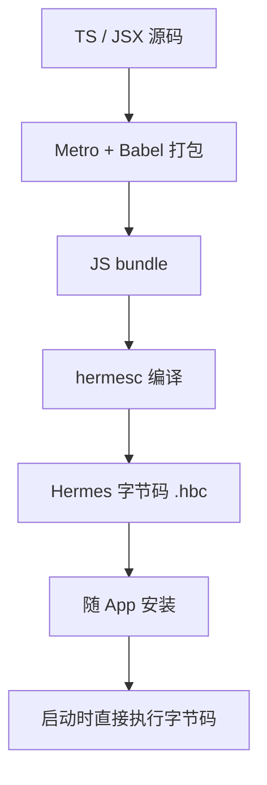

# Hermes：React Native 的 JS 引擎

上一章说 JSI 抽象了 JS 引擎。但在今天的 Expo 里，引擎实际上只剩一个：**Hermes**。它是 Meta 专门为 React Native 写的引擎，设计目标不是跑分快，而是**手机上启动快、内存小**。这一章讲 Hermes 和浏览器、Node 里的 V8 有什么不一样，这些不一样会在哪里咬你，以及怎么调试它。

## 为什么不用 V8 或 JavaScriptCore

浏览器和 Node 的引擎为长时间运行的大型程序优化：先解释执行，发现热点代码后用 JIT（即时编译）编成机器码。这在服务器上很划算，在手机上有两个问题：

1. **启动要先解析源码**。几 MB 的 JS bundle，每次冷启动都要词法分析、语法分析，用户看到的是更长的白屏
2. **iOS 不允许普通 App 做 JIT**。系统不给第三方 App 可写又可执行的内存页（Safari 自己的 WebKit 进程例外），所以 V8 那套热点编译在 iOS 上用不了

Hermes 的思路是**把解析和编译挪到构建时**：



Release 包里装的不是 JS 源码，而是已经编译好的字节码。启动时省掉了解析这一步，字节码还可以按需映射到内存，不用一次性全读进来。

开发模式下不一样：Metro 把 JS 源码通过网络发给 App，Hermes 在设备上现场编译执行。所以**开发包的启动速度和性能不代表 Release 包**，测性能一定要用 Release 构建（[第 9 章](09-performance-reanimated.md)）。

## SDK 58 的 Hermes：V1 成为默认

Hermes 本身也在换代。Expo SDK 55 开始可以选用新一代的 **Hermes V1**，到 SDK 58，`expo-build-properties` 文档里 `useHermesV1` 的默认值已经是 `true`，描述是能带来更快的启动。

| 配置 | SDK 58 的情况 |
|---|---|
| `useHermesV1` | 默认 `true` |
| 改回旧版 Hermes（`useHermesV1: false`） | 需要同时开 `buildReactNativeFromSource: true`，从源码编 React Native，构建时间显著变长 |
| app config 里的 `jsEngine` 字段 | SDK 58 的 app config 文档里已经没有这个字段，不再提供切到 JSC 的开关 |

结论很简单：**什么都不用配**。只有遇到 Hermes V1 的回归问题、需要临时退回时，才去碰 `expo-build-properties`：

```json
{
  "expo": {
    "plugins": [
      [
        "expo-build-properties",
        {
          "useHermesV1": false,
          "buildReactNativeFromSource": true
        }
      ]
    ]
  }
}
```

这是原生层的配置，改完要重新 prebuild 和构建（[第 4 章](04-dev-client-prebuild.md)），热重载不会生效。

## Hermes 不是浏览器，也不是 Node

这是最容易踩的坑。Hermes 实现的是 **ECMAScript 语言本身**，加上 React Native 补的一部分 Web API。浏览器里的 `window`、`document`，Node 里的 `fs`、`Buffer`、`process`，统统不存在。

| 你以为有的 | 在 RN 里 |
|---|---|
| `fetch`、`URL`、`TextEncoder`、`AbortController` | 有（RN 或 Hermes 提供），但个别细节和浏览器不完全一致 |
| `crypto.getRandomValues`、`crypto.subtle` | 没有 WebCrypto，需要 `expo-crypto` 或 polyfill |
| `structuredClone` | 不保证有 |
| `Buffer`、`fs`、`path`、`process.env.XXX`（运行时读取） | 没有。`process.env.EXPO_PUBLIC_*` 是构建时被 Babel 内联成字面量的，不是运行时读环境变量 |
| `Intl` | 有，但覆盖面随版本变化；用到日期格式化、复数规则等，要在真机上验证 |

唱片墙用了一个按浏览器 / Node 环境写的库（youtubei.js），于是专门写了一个 `polyfills.ts`，并且**必须是入口文件的第一行 import**：

```ts
// index.ts
// 补丁必须排第一：库的模块初始化就要用到 crypto
import "./src/polyfills";
import "./src/platform";

import { registerRootComponent } from "expo";
import App from "./App";

registerRootComponent(App);
```

```ts
// src/polyfills.ts（节选）
import { polyfillWebCrypto } from "expo-standard-web-crypto";

// Hermes 没有 WebCrypto，这份走原生随机源
polyfillWebCrypto();

// Hermes 未必带 structuredClone；对象里没有 Date / Map 时，JSON 往返够用
if (typeof globalThis.structuredClone !== "function") {
  globalThis.structuredClone = <T>(value: T): T => JSON.parse(JSON.stringify(value)) as T;
}

// 其余几样只查不补：缺了就在启动时明说是哪一样
const REQUIRED = ["TextEncoder", "TextDecoder", "URL", "AbortController", "atob", "btoa", "fetch"];
const missing = REQUIRED.filter((name) => !(name in globalThis));
if (missing.length) console.warn(`[polyfills] 运行环境缺 ${missing.join(" / ")}`);
```

这段代码有两个值得学的地方：

- **顺序是语义的一部分**。ES 模块的 import 会被提升并按顺序执行，第三方库在被 import 的那一刻就可能用到 `crypto`。polyfill 晚一行，就可能在库初始化时拿到 `undefined`
- **查不到就大声说**。缺一个全局对象的症状通常是某个深层函数里冒出一句 `ReferenceError`，和「接口改了」「数据坏了」长得一模一样。启动时列出缺了什么，能省掉很多排查时间

书架 App 走的是另一条路：把需要浏览器环境的东西（markdown-it、highlight.js、KaTeX、Mermaid）全部放进 WebView 里跑，RN 侧只传原文（[第 7 章](07-webview-bridge.md)）。WebView 里是真正的 WebKit，有完整的 DOM 和 Web API。

### 共享代码要守住边界

书架的 `@shelf/spec` 包同时给 App 和 Node CLI 用，所以规范里写死了一条：**不得依赖 Node 或 RN 专有 API**。解压用纯 JS 的 fflate 而不是 Node 的 `zlib`，哈希也用纯 JS 实现。这样同一份导入逻辑能在 Node 里跑单元测试，在 Hermes 里跑生产代码。

判断一个依赖能不能进共享包，看三点：

1. 有没有 `import 'node:*'` 或者 `require('fs')` 这类 Node 内置模块
2. 有没有读 `window`、`document`
3. 有没有依赖 `Buffer`（很多老 npm 包默认 `Buffer` 全局存在）

## 调试：React Native DevTools

Hermes 实现了 Chrome DevTools Protocol（CDP）的一部分，React Native 官方的调试器 **React Native DevTools** 就通过它连上设备：

```bash
cd app
pnpm start          # 书架 App 的脚本会先 build:assets 再启动 Metro
# Metro 终端里按 j 打开 React Native DevTools
```

能做的事：

| 面板 | 用途 |
|---|---|
| Console | 看日志、在 App 的 JS 上下文里执行表达式 |
| Sources | 断点、单步，基于 source map 显示 TS 源码 |
| Memory | 堆快照，查内存泄漏 |
| Performance | 录制 JS 执行的火焰图 |
| React Components / Profiler | 组件树和渲染耗时 |

唱片墙更进一步，把这条 CDP 通道用成了**自动化验证工具**：`pnpm eval '<js>'` 直接连 Metro 的 inspector 端点，在模拟器里运行着的 App 里执行任意表达式，比如调用某个模块的函数、触发导航，然后用 `xcrun simctl io <udid> screenshot` 截图检查。适合在没有图形界面、点不了模拟器的环境里让编码 agent 自己验证改动。实现时踩过两个点：

- Metro 只接受 Origin 是它自己的 WebSocket 连接，Node 内置的 `WebSocket` 设不了 Origin，要用 `ws` 包
- Hermes 的 `Runtime.evaluate` 不支持等待 Promise 结果，异步结果要先写到一个全局变量里，再轮询读回来

## 崩溃栈与 source map

Release 包里跑的是字节码，崩溃栈里的位置是字节码偏移，没法直接看。要还原成源码位置，需要构建时生成的 **source map**：

- `xcodebuild archive` 时，React Native 的构建脚本会生成 bundle 和对应的 source map
- 用 Sentry 这类服务时，要把 source map 和原生的 dSYM 一起上传，崩溃栈才能符号化
- 书架 App 不联网，也就不接崩溃上报；出问题时在 Xcode 的 Devices 窗口里看设备日志，或者用开发构建复现

## 本章要点

- Hermes 把解析和编译挪到**构建时**，Release 包里装的是字节码，启动快、内存小；iOS 不允许普通 App JIT，这是它适合手机的根本原因
- SDK 58 默认使用 **Hermes V1**，app config 里已经没有切换引擎的字段；一般什么都不用配
- Hermes 不是浏览器也不是 Node：WebCrypto、`Buffer`、`fs` 都没有；`EXPO_PUBLIC_*` 是构建时内联的
- 需要 polyfill 时放在入口**第一行**，缺什么在启动时明确报出来
- 开发包性能不代表 Release 包；调试用 React Native DevTools（Metro 里按 `j`）
