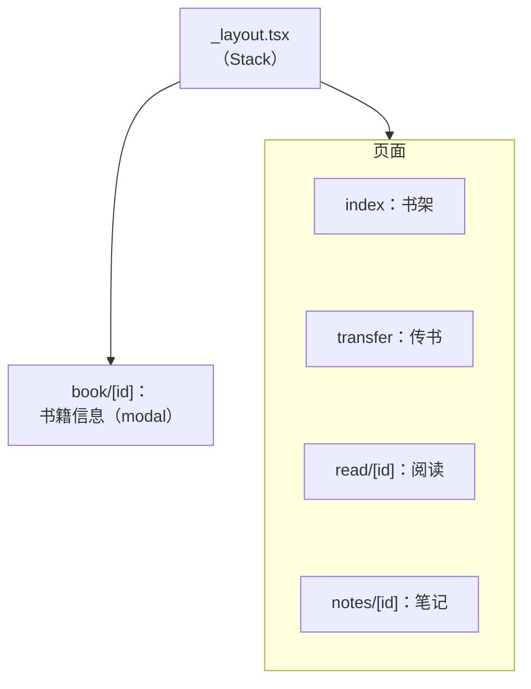
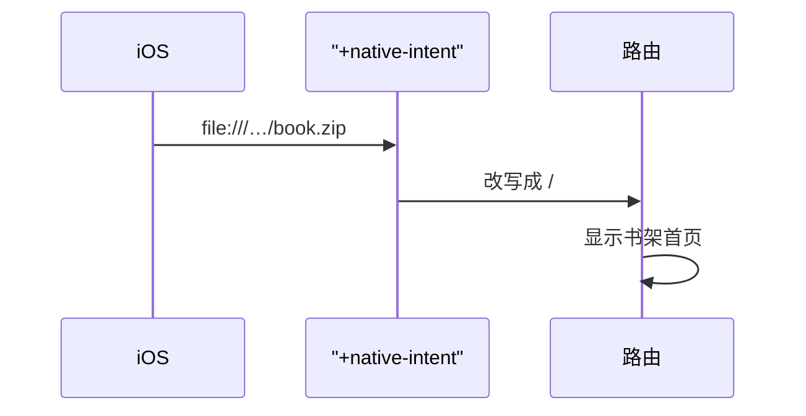
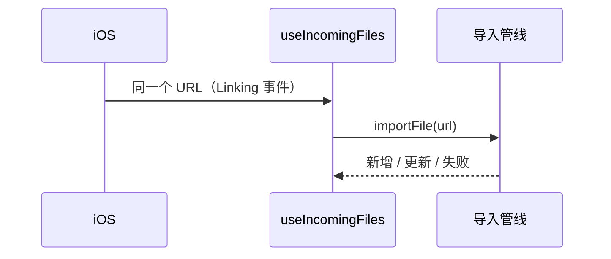

# expo-router：文件即路由

React Native 本身不带路由。过去的标准做法是 React Navigation：在代码里手写 `createNativeStackNavigator()`，一个个注册页面，再单独配置深链接映射。**expo-router** 建立在同一套原生导航能力上，但换了组织方式：**目录结构就是路由表**，一个文件就是一个页面，深链接自动可用。这一章用书架 App 的路由讲清楚它的模型，以及 SDK 58 上需要注意的变化。

## 书架 App 的路由树

书架 App 的路由放在 `app/src/app/` 下（expo-router 会自动识别 `src/app`，其他代码放 `src/` 下的其他目录）：

```text
app/src/app/
├── _layout.tsx         # 根布局：启动引导 + Stack 导航器
├── +native-intent.tsx  # 系统打开 App 时的 URL 改写
├── index.tsx           # /             书架首页
├── transfer.tsx        # /transfer     局域网传书
├── read/[id].tsx       # /read/:id     阅读页
├── book/[id].tsx       # /book/:id     书籍信息（模态）
└── notes/[id].tsx      # /notes/:id    笔记列表
```

规则只有几条：

| 文件 | 含义 |
|---|---|
| `index.tsx` | 所在目录的默认页面 |
| `[id].tsx` | 动态段，`/read/rn-expo` 里 `id` 是 `rn-expo` |
| `[...rest].tsx` | 捕获剩余所有段 |
| `_layout.tsx` | 包住同目录及子目录的所有页面，决定它们用什么导航器（Stack、Tabs…） |
| `(group)/` | 括号目录只用于组织，不出现在 URL 里 |
| `+not-found.tsx` | 匹配不到时显示 |
| `+native-intent.tsx` | 改写系统传入的 URL |



## 根布局：在路由之前做完启动

`_layout.tsx` 是整棵树的根，也是放「所有页面之前必须完成的事」的地方。书架 App 在这里跑 `bootstrap()`：打开数据库、执行迁移、把阅读器 HTML 拷到文档目录、写入示例书、重建索引。完成之前只显示一个转圈，完成后才渲染 Stack：

```tsx
// app/src/app/_layout.tsx（节选）
export default function RootLayout() {
  const [state, setState] = useState<'loading' | 'ready' | Error>('loading');

  useEffect(() => {
    bootstrap().then(
      () => setState('ready'),
      (e: Error) => setState(e),
    );
  }, []);

  if (state !== 'ready') return <Splash state={state} />;
  return <AppStack />;
}

function AppStack() {
  useIncomingFiles(); // AirDrop 进来的文件，必须在 bootstrap 之后才处理
  return (
    <Stack screenOptions={{ headerBackButtonDisplayMode: 'minimal' }}>
      <Stack.Screen name="index" options={{ title: '书架', headerLargeTitle: true }} />
      <Stack.Screen name="read/[id]" options={{ title: '' }} />
      <Stack.Screen name="book/[id]" options={{ presentation: 'modal' }} />
      <Stack.Screen name="transfer" options={{ title: '局域网传书' }} />
      <Stack.Screen name="notes/[id]" options={{ title: '笔记' }} />
    </Stack>
  );
}
```

两个细节：

- `useIncomingFiles()` 放在 `AppStack` 而不是 `RootLayout`，因为导入要写数据库，必须等 `bootstrap()` 完成。**挂载位置本身就表达了依赖顺序**
- `Stack.Screen` 在布局里写静态选项（标题、展示方式）；页面里还可以再写一个 `<Stack.Screen options={...} />` 覆盖动态选项，阅读页就是这样把标题设成当前章节名、把导航栏颜色设成阅读主题色

## 导航与参数

页面之间跳转用 `router` 对象或 `<Link>`：

```tsx
import { router, Link } from 'expo-router';

// 命令式：书架首页打开一本书
router.push({ pathname: '/read/[id]', params: { id } });

// 带更多参数：从笔记列表跳回原文的某条高亮
router.push({ pathname: '/read/[id]', params: { id, chapter: h.chapterFile, highlight: h.id } });

// 声明式
<Link href="/transfer">局域网传书</Link>;
```

在目标页面读参数：

```tsx
const { id, chapter, highlight } = useLocalSearchParams<{
  id: string;
  chapter?: string;
  highlight?: string;
}>();
```

| API | 用途 |
|---|---|
| `router.push` | 压入新页面 |
| `router.replace` | 替换当前页面（不能返回） |
| `router.back` | 返回 |
| `router.dismiss` / `dismissAll` | 关闭模态 / 回到栈底 |
| `useLocalSearchParams` | 当前页面的参数，页面不在前台时不会因为别的页面变化而重新渲染 |
| `useGlobalSearchParams` | 全局当前 URL 的参数，任何导航都会触发更新，慎用 |

参数会出现在 URL 里，所以**只传标识，不传数据**：传 `id` 和 `chapter`，让目标页面自己去 SQLite 查。传一整个对象既会被序列化成字符串，又会在深链接、返回、状态恢复时变得不可靠。

书籍信息页的「开始阅读」是先 `router.back()` 关掉模态，再 `router.push` 阅读页。如果直接在模态里 push，阅读页会叠在模态的导航栈里，返回时行为很别扭。

### 类型化路由

书架 App 在 `app.json` 里开了 `experiments.typedRoutes`：

```json
{
  "expo": {
    "experiments": { "typedRoutes": true }
  }
}
```

开启后，expo-router 根据文件结构生成 `.expo/types/` 下的类型声明（`tsconfig.json` 的 `include` 里要有 `.expo/types/**/*.ts`），`router.push('/raed/x')` 这种拼错的路径在 `tsc` 时就会报错。把文件改名或挪位置之后，所有引用旧路径的地方都会编译失败，这正是你想要的。

## +native-intent：处理系统传进来的 URL

iOS 会用 URL 打开 App：深链接 `shelf://read/rn-expo`，或者用户通过 AirDrop、「用书架打开」传来的文件，这时 URL 是 `file:///.../xxx.zip`。

expo-router 默认会拿这个 URL 去匹配路由。`file://` 显然匹配不上，用户会看到 404 页面。书架 App 用 `+native-intent.tsx` 在匹配之前改写：

```tsx
// app/src/app/+native-intent.tsx
/**
 * 系统以 file:// URL 打开 App（AirDrop、「用书架打开」）时，不让路由去匹配这个 URL，
 * 统一回到书架；文件本身由 useIncomingFiles 导入。
 */
export function redirectSystemPath({ path }: { path: string; initial: boolean }) {
  return path.startsWith('file://') ? '/' : path;
}
```

文件本身由另一个 Hook 处理：`useIncomingFiles()` 通过 `expo-linking` 的 `getInitialURL()`（冷启动时的 URL）和 `addEventListener('url')`（App 已在运行时收到的 URL）拿到文件地址，交给导入管线。**路由层只负责「别乱跳」，导入逻辑只负责「把文件交给管线」**，两件事分开。



同一个 URL 还会作为 Linking 事件交给 `useIncomingFiles`，由它把文件交给导入管线：



## 布局的其他形态

书架 App 只用了一个 Stack。其他常见的布局：

**标签页**。SDK 58 里原生标签页（系统 `UITabBarController`，iOS 26 上自带 Liquid Glass 效果）的导入路径从 `expo-router/unstable-native-tabs` 改成了 `expo-router/native-tabs`，升级时要改 import。也可以继续用 JS 实现的 `Tabs`（来自 `expo-router`），自定义能力更强。

**受保护的路由**。需要登录的 App，用 `Stack.Protected` 按条件包住一组页面，条件不满足时这些页面不可访问，会被重定向：

```tsx
<Stack>
  <Stack.Protected guard={isLoggedIn}>
    <Stack.Screen name="(app)" />
  </Stack.Protected>
  <Stack.Protected guard={!isLoggedIn}>
    <Stack.Screen name="sign-in" />
  </Stack.Protected>
</Stack>
```

书架 App 没有账号，用不上。

## SDK 58 的几个变化

- **iOS 26 以上，Stack 的导航栏默认透明**（Liquid Glass），内容延伸到导航栏下方。滚动视图通常会自动处理内边距，但自己用绝对定位或 WebView 的页面要检查一下。想恢复旧外观，在根 `_layout` 顶层调用 `enableLegacyHeaderAppearance()`。阅读页显式设置了 `headerStyle.backgroundColor`，不受透明默认值影响
- **导航内核重写**：自定义导航器、从 `expo-router/react-navigation` 导入的代码可能失效，新写的导航器要用 `createStandardRouterNavigator` 或 `integrateWithRouter`
- **Web 默认输出变成 `server`**、Web 路由默认分块。书架 App 不出 Web，无影响

升级 expo-router 时，先读官方的 Router 迁移指南，再跑一遍类型检查，类型化路由会帮你抓住大部分问题。

## 本章要点

- expo-router 的**目录结构就是路由表**：`[id]` 是动态段，`_layout` 决定导航器，括号目录不进 URL
- 根 `_layout` 适合放启动引导；依赖启动结果的 Hook 挂在引导完成之后渲染的组件里
- 参数**只传标识不传数据**；开启 `typedRoutes`，路径拼错在编译期报错
- `+native-intent` 的 `redirectSystemPath` 在路由匹配前改写系统传入的 URL，书架用它把 `file://` 导回首页
- SDK 58：原生标签页改从 `expo-router/native-tabs` 导入；iOS 26 以上导航栏默认透明
