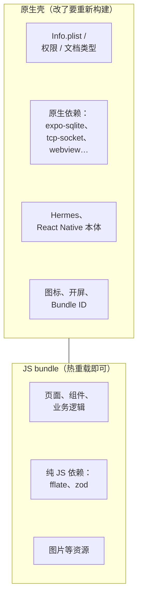
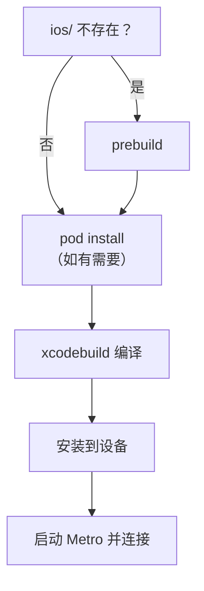

# dev client 与 prebuild

刚开始用 Expo 时，大多数人用的是 **Expo Go**：手机上装一个现成的 App，扫码就能跑你的 JS。但书架 App 第一天就放弃了它，用的是 **dev client**（开发构建），原生工程也不进仓库，每次由 `expo prebuild` 现生成。这一章讲这两件事背后的模型：**一个 RN App 由「原生壳」和「JS bundle」两部分组成**，搞清楚哪些改动属于哪一部分，大部分「改了怎么不生效」的问题就消失了。

## 原生壳与 JS bundle



| 改了什么 | 怎么生效 |
|---|---|
| 组件、样式、业务逻辑 | 保存即热重载 |
| 新增纯 JS 依赖（如 fflate） | 重启 Metro |
| `metro.config.js` | 重启 Metro |
| 新增**含原生代码**的依赖（如 react-native-tcp-socket） | 重新 prebuild + 构建 |
| `app.json` 里的原生配置（infoPlist、plugins、图标…） | 重新 prebuild + 构建 |
| 升级 Expo SDK | `--clean` 重新 prebuild + 构建 |

判断一个依赖是否含原生代码：看它的包里有没有 `ios/`、`android/` 目录或 `*.podspec`，或者安装说明里有没有「需要重新构建」。

## Expo Go 为什么不够用

Expo Go 是 Expo 团队预先构建好的一个原生壳，里面打包了 Expo SDK 的全部原生模块。你的 JS 跑在这个壳里，所以：

- **只能用壳里有的原生模块**。书架 App 的局域网传书用了 `react-native-tcp-socket`，Expo Go 里没有，跑不了
- **不能改 Info.plist**。书架要注册 `.zip` / `.md` 文档类型（AirDrop 导入的前提），要声明本地网络权限说明，Expo Go 都做不到
- **只支持当前 SDK**。新版 Expo Go 只支持 SDK 58；老项目要么升级，要么用开发构建

**dev client**（`expo-dev-client`）的思路是：用你自己项目的原生配置构建一个专属的「Expo Go」。它包含你项目的全部原生依赖和配置，同时保留开发体验：连接 Metro、热重载、开发菜单、切换 Metro 地址。

```bash
cd app
npx expo install expo-dev-client   # 书架 App 已经装了
```

书架 App 的 `start` 脚本带着 `--dev-client`，Metro 会提示用开发构建打开，而不是 Expo Go。

## prebuild：原生工程是生成物

`npx expo prebuild` 根据 `app.json`（或 `app.config.js`）和依赖里的 config plugin，生成 `ios/` 和 `android/` 两个完整的原生工程。Expo 把这种做法叫 **CNG**（Continuous Native Generation，持续原生生成）。

书架 App 的规范写得很明确：**`ios/` `android/` 由 `expo prebuild` 生成，不入库、不手改；原生配置写在 `app.json` 或 config plugin 中**。`.gitignore` 里忽略这两个目录。

为什么不直接把 `ios/` 提交进仓库、在 Xcode 里改？

1. **两份真相**。改了 `app.json` 却忘了重新生成，或者在 Xcode 里改了却没回写 `app.json`，二者就分家了。更糟的是，prebuild 在目录已存在时不会覆盖所有内容，改动可能安安静静地不生效
2. **升级 SDK 变得痛苦**。每个 SDK 的原生模板都在变（SDK 58 就新增了 `SceneDelegate.swift`）。手改过的工程要逐行对比模板差异；生成式的工程只要 `prebuild --clean` 一下
3. **配置可审查**。所有原生改动都在 `app.json` 和插件代码里，是能 diff、能 review 的文本，而不是 Xcode 工程文件里几千行的 pbxproj

`--clean` 会先删掉 `ios/`、`android/` 再生成，保证结果只由配置决定。书架 App 的 `prebuild` 脚本就是 `expo prebuild --clean`。

### 唱片墙踩过的两个坑

**原生工程过期**。唱片墙有一次 Xcode 链接报错 `facebook::react::Sealable::Sealable()`，看上去像代码问题，实际是依赖升级后原生工程没重新生成。重新 prebuild 就好了。遇到莫名其妙的原生编译、链接错误，**第一反应是 `prebuild --clean`**，而不是去改 Xcode 设置。

**中文 App 名**。prebuild 用 `app.json` 的 `name` 生成 Xcode 工程名和 scheme 名，会先过滤掉非 ASCII 字符。唱片墙的 `name` 是纯中文，过滤完是空串，于是退回默认的 `app`，生成的是 `ios/app.xcworkspace`、scheme 也叫 `app`。出包脚本里这两个名字是写死的，所以注释里提醒：哪天 `name` 改成英文，这两处要一起改。书架 App 的做法是 `name` 用英文 `Shelf`，中文显示名通过 `infoPlist.CFBundleDisplayName` 设成「书架」。

另外，唱片墙的 `native` 脚本是 `LANG=en_US.UTF-8 expo prebuild --clean`：prebuild 会跑 `pod install`，CocoaPods 在非 UTF-8 的终端环境下会报编码错误。

## 构建与安装

```bash
pnpm app ios              # 构建 dev client，装到模拟器
pnpm app ios --device     # 选一台连着的真机
```

书架 App 的 `ios` 脚本是 `pnpm build:assets && expo run:ios`。`expo run:ios` 做了这些事：



第一次构建要几分钟，之后只要原生部分没变，就只需要 `pnpm app start` 启动 Metro，手机上已装的 dev client 会连上来。

真机安装需要签名。在 `app.json` 里写上 `ios.appleTeamId`，prebuild 会把它设到所有原生 target 上，Xcode 自动签名就能工作。签名的细节见[第 10 章](10-signing-testflight.md)。

### 真机连 Metro

dev client 通过局域网连电脑上的 Metro。连不上时依次检查：

1. 手机和电脑在同一个 Wi-Fi，路由器没有开「客户端隔离」
2. 首次连接时 iOS 弹出的「本地网络」权限选了允许（设置 → 隐私与安全性 → 本地网络，可以补开）
3. 在 dev client 的启动页手动输入 `http://<电脑 IP>:8081`

## monorepo 里的 Metro

两个项目都是 pnpm monorepo，但处理方式不同：

| | 书架 | 唱片墙 |
|---|---|---|
| node_modules 布局 | `.npmrc` 里 `node-linker=hoisted`，平铺 | pnpm 默认的隔离布局 |
| Metro 配置 | 几乎默认，只加了一个 `html` 资源扩展名 | `watchFolders` 加上仓库根，`nodeModulesPaths` 加上根的 node_modules |

书架的选择更省心：RN 生态里仍有不少工具假设 `node_modules` 是平铺的，hoisted 布局能绕开大部分问题。唱片墙保留隔离布局，就要告诉 Metro 去仓库根找包，并且**不要**设 `disableHierarchicalLookup`，pnpm 的布局正依赖逐级向上查找。

书架 App 的 Metro 配置唯一的定制：

```js
// app/metro.config.js
const { getDefaultConfig } = require('expo/metro-config');

const config = getDefaultConfig(__dirname);

// 阅读器打包成 assets/reader/index.html，作为资源文件随 App 发布
config.resolver.assetExts.push('html');

module.exports = config;
```

改了这个文件要重启 Metro，热重载不会重新读它。

## 不用 EAS Update

Expo 提供 **EAS Update**：不发新版本，直接把新的 JS bundle 推到用户手机上。书架 App 的决策记录里写了不用它的理由：OTA 更新会把内容和 `runtimeVersion` 绑在一起，只能全量下发，而且 EAS 服务在国内连通性差；书架是纯单机 App，书的内容走 AirDrop 和局域网，App 本身更新频率很低，直接重新构建安装就行。

这也是 dev client + 本地构建这条路的好处：**整个链路不依赖任何云服务**。

## 升级 SDK 的流程

```bash
cd app
npx expo install expo@^58.0.0 --fix   # 升级 expo，并把其他依赖对齐到 SDK 匹配的版本
npx expo-doctor                        # 检查剩余的不匹配
pnpm prebuild                          # 即 expo prebuild --clean
pnpm ios
```

然后读官方升级指南里的破坏性变更，跑 `pnpm typecheck` 和 `pnpm test`。依赖一律用 `npx expo install <pkg>` 装，它会选与当前 SDK 匹配的版本，而不是 npm 上的最新版。

## 本章要点

- RN App = **原生壳** + **JS bundle**；改原生部分要重新 prebuild + 构建，改 JS 热重载即可
- Expo Go 只能用预置的原生模块、改不了 Info.plist；用到自定义原生能力就用 **dev client**
- **CNG**：`ios/` `android/` 是 prebuild 的生成物，不入库、不手改，原生配置写在 `app.json` 和 config plugin 里
- 莫名其妙的原生编译 / 链接错误，先 `prebuild --clean`
- 依赖用 `npx expo install` 安装；升级 SDK 用 `expo install expo@^<版本> --fix` + `expo-doctor`
