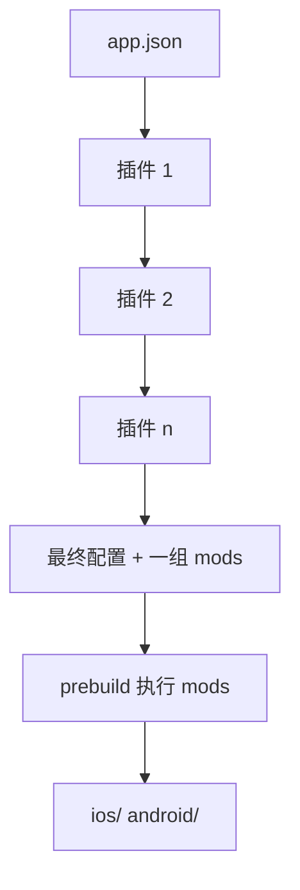

# config plugin：用代码改原生工程

上一章定了规矩：`ios/` `android/` 是生成物，不许手改。那原生工程里总有 `app.json` 字段覆盖不到的东西，比如给 Gradle 加一段签名配置、往 Xcode 工程里加一个小组件扩展，怎么办？答案是 **config plugin**：一个在 prebuild 时运行的 JS 函数，用代码描述「生成出来的工程要怎么改」。这一章讲它的模型、常用的 mod、怎么写得稳，以及什么时候根本不需要它。

## 先用 app.json，不够再写插件

很多原生配置 `app.json` 直接支持。书架 App 的全部原生配置都写在 `app.json` 里，没有一个自写的插件：

| 需求 | app.json 写法 |
|---|---|
| Bundle ID、显示名 | `ios.bundleIdentifier`、`ios.infoPlist.CFBundleDisplayName` |
| 注册 `.zip` / `.md` 文档类型（AirDrop 导入） | `ios.infoPlist.CFBundleDocumentTypes`、`UTImportedTypeDeclarations` |
| 本地网络权限说明（局域网传书） | `ios.infoPlist.NSLocalNetworkUsageDescription` |
| 出口合规声明 | `ios.infoPlist.ITSAppUsesNonExemptEncryption: false`（或 `ios.config.usesNonExemptEncryption`） |
| App Group 等能力 | `ios.entitlements` |
| 隐私清单 | `ios.privacyManifests` |
| 最低 iOS 版本 | `ios.deploymentTarget`（SDK 56 起内置，取代 expo-build-properties 里的同名项） |
| URL scheme | `scheme` |

`ios.infoPlist` 是一个「任意键值合并进 Info.plist」的出口，大部分 Info.plist 需求都能用它解决。所以顺序是：

1. 先查 app config 文档有没有对应字段
2. 再看依赖的库是否自带插件（`expo-sqlite`、`expo-router` 都有，写进 `plugins` 数组就行，可以带参数）
3. 都不行才自己写

## 插件是什么

一个 config plugin 就是一个函数：**输入 Expo 配置对象，返回修改后的配置对象**。



真正改原生文件的动作叫 **mod**。插件本身不直接读写磁盘，而是通过 `withXxx` 函数注册一个 mod，prebuild 在生成工程时统一执行。`plugins` 数组里的插件按顺序运行，前一个的输出是后一个的输入。

常用的 mod：

| mod | 改什么 | 拿到的 `modResults` |
|---|---|---|
| `withInfoPlist` | iOS `Info.plist` | 解析好的 plist 对象 |
| `withEntitlementsPlist` | iOS `.entitlements` | plist 对象 |
| `withXcodeProject` | `project.pbxproj` | xcode 工程对象 |
| `withPodfile` / `withPodfileProperties` | Podfile 相关 | 文本 / 键值 |
| `withAndroidManifest` | `AndroidManifest.xml` | 解析好的 XML 对象 |
| `withAppBuildGradle` | `android/app/build.gradle` | `{ contents: string }` |
| `withDangerousMod` | 任意文件 | 只给你平台目录路径，自己读写 |

能用结构化的 mod（plist、XML 对象）就不要用文本替换，能用文本替换就不要用 `withDangerousMod`。越往下，越依赖模板的具体写法，越容易在 SDK 升级时坏掉。

## 写一个插件：把文档类型收成一个开关

书架 App 注册文档类型那一段 `infoPlist` 有三十多行：`CFBundleDocumentTypes` 两项，`UTImportedTypeDeclarations` 一项（声明 Markdown 的 UTI）。如果以后要加 `.epub` 之类的格式，要在两个地方同步改。这是一个适合写插件的场景：把「支持哪些扩展名」作为参数，插件负责生成那堆样板。

```js
// app/plugins/with-document-types.js
const { withInfoPlist } = require('expo/config-plugins');

/** 系统已知的类型直接引用；Markdown 没有系统 UTI，要自己声明 */
const KNOWN = {
  zip: { name: 'Zip Archive', uti: 'public.zip-archive' },
  md: {
    name: 'Markdown',
    uti: 'net.daringfireball.markdown',
    declare: {
      UTTypeIdentifier: 'net.daringfireball.markdown',
      UTTypeDescription: 'Markdown',
      UTTypeConformsTo: ['public.plain-text'],
      UTTypeTagSpecification: {
        'public.filename-extension': ['md', 'markdown'],
        'public.mime-type': ['text/markdown'],
      },
    },
  },
};

/** @type {import('expo/config-plugins').ConfigPlugin<{ types: string[] }>} */
module.exports = function withDocumentTypes(config, { types }) {
  const unknown = types.filter((t) => !KNOWN[t]);
  if (unknown.length) throw new Error(`with-document-types 不认识：${unknown.join(', ')}`);

  return withInfoPlist(config, (cfg) => {
    const plist = cfg.modResults;
    plist.CFBundleDocumentTypes = types.map((t) => ({
      CFBundleTypeName: KNOWN[t].name,
      CFBundleTypeRole: 'Viewer',
      // Alternate：不抢默认打开方式，只出现在「用其他 App 打开」里
      LSHandlerRank: 'Alternate',
      LSItemContentTypes: [KNOWN[t].uti],
    }));
    const declares = types.map((t) => KNOWN[t].declare).filter(Boolean);
    if (declares.length) plist.UTImportedTypeDeclarations = declares;
    return cfg;
  });
};
```

在 `app.json` 里引用，参数写在数组第二项：

```json
{
  "expo": {
    "plugins": [
      "expo-router",
      "expo-sqlite",
      "expo-asset",
      ["./plugins/with-document-types", { "types": ["zip", "md"] }]
    ]
  }
}
```

几个要点：

- **直接赋值而不是追加**。`plist.CFBundleDocumentTypes = ...` 而不是 `push`。prebuild 可能在同一份配置上跑多次，追加会产生重复项
- **参数不对就抛**。插件里最危险的不是报错，而是「静默地什么都没做」，后者要到用户 AirDrop 一个文件、App 不出现在分享列表里时才发现
- **用 JS 写最省事**。插件在 Node 里运行，`app.json` 引用 `.js` 文件即可。想用 TypeScript 写，官方文档的方案是用 `app.config.ts` 并在第一行 `import 'tsx/cjs'`，多一层依赖，小插件不值得

## 文本 mod：签名插件的防御写法

hatch-counter 的安卓出包要把 release 构建的签名从调试钥匙换成正式钥匙。Expo 生成的 `build.gradle` 里 release 档默认用 `signingConfigs.debug`，`app.json` 没有字段能改它，只能做文本替换：

```js
// hatch-counter: apps/mobile/plugins/with-release-signing.js（节选）
const { withAppBuildGradle } = require('@expo/config-plugins');

function injectReleaseSigning(gradle) {
  // 已经改过就别再改：prebuild 在同一棵树上跑两次是常事
  if (gradle.includes('signingConfigs.release')) return gradle;

  const anchor = '    signingConfigs {\n';
  if (!gradle.includes(anchor)) {
    throw new Error('build.gradle 里找不到 signingConfigs 块，Expo 的模板变了');
  }
  // ……插入 release 签名配置，再把 buildTypes.release 里的 signingConfigs.debug 换掉
  // 定位靠代码结构（buildTypes → release），不靠模板里的注释措辞
}

module.exports = function withReleaseSigning(config) {
  // 只在 CI 提供了 keystore 时动手，本地开发照旧用调试签名
  if (!process.env.ANDROID_KEYSTORE_PATH) return config;
  return withAppBuildGradle(config, (cfg) => {
    cfg.modResults.contents = injectReleaseSigning(cfg.modResults.contents);
    return cfg;
  });
};
```

这个插件体现了文本 mod 的三条纪律：

1. **幂等**：先检查是否已经改过
2. **锚点找不到就抛**：模板升级后锚点可能消失，这时最坏的结果不是报错，而是安安静静出一个调试签名的包
3. **验结果不验手法**：CI 出包后再用 `apksigner` 检查证书，不管插件内部怎么实现。这条在[《部署与 CI/CD》](../deploy-release/)里讲过

另外，把替换逻辑写成纯函数 `injectReleaseSigning(gradle)`，就能拿一份真实模板做单元测试，不必每次跑 prebuild。

> 导入路径：Expo 文档用的是 `expo/config-plugins`（随 `expo` 包提供，版本自动匹配 SDK）；`@expo/config-plugins` 是底层包，hatch-counter 用的是它，效果相同。新写的插件建议用前者，少一个需要单独对齐版本的依赖。

## 重型插件：往 Xcode 工程里加 target

唱片墙有一个锁屏小组件扩展（实时活动、灵动岛、锁屏小组件），这是一个独立的 Xcode target，有自己的 Bundle ID、Info.plist、entitlements 和 Swift 源码。手工往 `project.pbxproj` 里加 target 极其繁琐，它用的是社区插件 `@bacons/apple-targets`：

```js
// 唱片墙：targets/now-playing/expo-target.config.js
/** @type {import('@bacons/apple-targets/app.plugin').ConfigFunction} */
module.exports = (config) => ({
  type: 'widget',
  name: 'NowPlaying',
  displayName: '唱片墙',
  bundleIdentifier: '.nowplaying', // 以 . 开头表示接在主 App 的 Bundle ID 后面
  deploymentTarget: '16.4',
  frameworks: ['SwiftUI', 'WidgetKit', 'ActivityKit', 'AppIntents'],
  entitlements: {
    // 与主 App 共用同一个 App Group，小组件才能读到 App 写进去的数据
    'com.apple.security.application-groups':
      config.ios.entitlements['com.apple.security.application-groups'],
  },
});
```

`app.json` 的 `plugins` 里加一行 `"@bacons/apple-targets"`，prebuild 时它扫描 `targets/` 目录，把每个子目录生成成一个 target。Swift 源码留在 `targets/` 下，**不在 `ios/` 里**，所以 `prebuild --clean` 不会把它删掉。

注意 App Group 的名字没有写两遍，而是从主 App 的 `config.ios.entitlements` 里读：两边对不上时，小组件读不到数据，表现是一片空白、哪儿都不报错。

## 调试插件

```bash
cd app
# 看插件全部运行后的最终配置（不生成工程）
npx expo config --type prebuild

# 生成工程但不装 pod，然后直接看结果文件
npx expo prebuild --clean --no-install
plutil -p ios/Shelf/Info.plist | grep -A3 CFBundleDocumentTypes
```

改插件后的验证顺序：先看 `expo config` 的输出对不对，再 prebuild 看生成的文件，最后构建安装验证行为（比如在「文件」App 里长按一个 `.md`，「共享」里有没有书架）。

## 本章要点

- 原生配置**先查 app.json 字段**，再看库自带的插件，都不行才自己写
- 插件是 `config → config` 的函数；真正改文件的是它注册的 **mod**，按 `plugins` 数组顺序执行
- 优先结构化 mod（`withInfoPlist`、`withAndroidManifest`），文本替换次之，`withDangerousMod` 最后
- 插件必须**幂等**、找不到锚点就抛错，把替换逻辑写成可测试的纯函数，出包后验证结果
- 重型需求（如新增小组件 target）用成熟的社区插件，源码放在 `ios/` 之外
