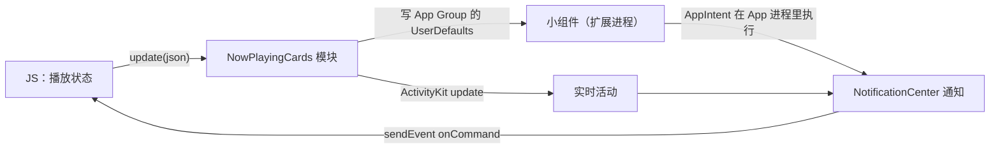

# 写一个原生模块

Expo SDK 和社区库覆盖了大部分原生能力，但总有覆盖不到的地方：某个系统 API 没人封装，或者现成的库只做了一半。这时就要自己写原生模块。在 Expo 项目里，最顺手的方式是 **Expo Modules API**：用 Swift / Kotlin 写一份声明式的模块定义，它底层走 JSI（[第 1 章](01-new-architecture.md)），不用写 C++ 胶水，也不用单独配置 Codegen。

这一章用唱片墙的**锁屏上一首 / 下一首**模块完整走一遍：为什么要自己写、目录怎么放、Swift 侧怎么定义、JS 侧怎么类型化，以及几个原生开发特有的坑。

## 为什么要自己写

唱片墙用 `expo-audio` 播放音乐，锁屏和控制中心上的播放控件也由它管理。但它只注册了播放、暂停、拖动进度这几个远程命令，**没有上一首 / 下一首**。它自带的播放列表倒是支持这两个键，可要求一开始就拿到每首歌的地址，而唱片墙的地址是临时的，要播到那首时现取。

查 `expo-audio` 的源码后发现一个关键事实：iOS 的 `MPRemoteCommandCenter` 是 App 全局单例，而 `expo-audio` 从头到尾没碰过 `nextTrackCommand` 和 `previousTrackCommand`。所以这两个键可以由一个独立的小模块全权管理，不用 fork 或 patch `expo-audio`，也不会被它覆盖。

**动手写原生模块之前，先读清楚现有库的边界**。能「旁路补上」就不要改别人的包。

## 创建本地模块

```bash
cd apps/mobile
npx create-expo-module@latest --local
# 或 pnpm create expo-module --local
```

它会在 `modules/` 下生成一个模块骨架：

```text
modules/lock-screen-keys/
├── expo-module.config.json   # 声明平台和模块类名
├── index.ts                  # JS 入口
├── ios/
│   ├── LockScreenKeys.podspec
│   └── LockScreenKeysModule.swift
└── android/                  # 只做 iOS 的话可以删掉
```

**目录位置是定死的**。Expo 的 autolinking 默认只扫描项目根下的 `modules/`。唱片墙在模块注释里专门记了一笔：挪进 `src/` 之后它就再也不会被链接进原生工程，而且**不报错**，表现只是锁屏上的按钮怎么都不出现。

`expo-module.config.json` 告诉 autolinking 这个模块支持哪些平台、入口类是哪个：

```json
{
  "platforms": ["apple"],
  "apple": {
    "modules": ["LockScreenKeysModule"]
  }
}
```

模块是原生代码，新建或修改 Swift 文件后都要**重新构建**（`npx expo run:ios`），Metro 热重载管不到。

## Swift 侧：模块定义

```swift
// modules/lock-screen-keys/ios/LockScreenKeysModule.swift
import ExpoModulesCore
import MediaPlayer

public final class LockScreenKeysModule: Module {
  /// addTarget 返回的凭据。留着既为了能拆掉，也为了认出「已经挂过了」
  private var nextTarget: Any?
  private var previousTarget: Any?

  public func definition() -> ModuleDefinition {
    Name("LockScreenKeys")

    Events("onNext", "onPrevious")

    // 不能点的时候要真的禁用，而不是收到了不响应：
    // 锁屏上按下去没反应，和 App 坏了一模一样
    Function("setEnabled") { (hasNext: Bool, hasPrevious: Bool) in
      self.onMain {
        self.attach()
        let center = MPRemoteCommandCenter.shared()
        center.nextTrackCommand.isEnabled = hasNext
        center.previousTrackCommand.isEnabled = hasPrevious
      }
    }

    OnDestroy {
      self.onMain { self.detach() }
    }
  }

  /// 只挂一次：addTarget 每调一次多一个 handler，挂两次的表现是按一下跳两首
  private func attach() {
    guard nextTarget == nil else { return }
    let center = MPRemoteCommandCenter.shared()
    nextTarget = center.nextTrackCommand.addTarget { [weak self] _ in
      self?.sendEvent("onNext")
      return .success
    }
    previousTarget = center.previousTrackCommand.addTarget { [weak self] _ in
      self?.sendEvent("onPrevious")
      return .success
    }
  }

  private func detach() { /* removeTarget 并置 nil，略 */ }

  private func onMain(_ work: @escaping () -> Void) {
    if Thread.isMainThread { work() } else { DispatchQueue.main.async(execute: work) }
  }
}
```

模块定义里常用的几个构件：

| 构件 | 作用 | JS 侧看到的 |
|---|---|---|
| `Name("X")` | 模块名 | `requireNativeModule('X')` |
| `Function("f") { ... }` | 同步函数 | 普通函数，直接返回值 |
| `AsyncFunction("f") { ... }` | 异步函数，可以用 Swift 的 `async` 闭包，也可以接收 `Promise` 参数手动 resolve | 返回 Promise |
| `Events("e1", "e2")` + `sendEvent` | 向 JS 发事件 | `addListener('e1', cb)` |
| `Constant("K") { ... }` | 常量 | 只读属性 |
| `Property("p")` | 可带 getter / setter 的属性 | 属性 |
| `OnCreate` / `OnDestroy` | 生命周期 | — |
| `View(UIView.self) { Prop(...) }` | 原生视图组件 | `requireNativeView` 得到的组件 |

参数类型直接写 Swift 类型（`Bool`、`String`、`Double`、可选类型、数组、字典，以及实现了 `Record` 的结构体），框架负责和 JS 值互转，传错类型会在 JS 侧抛出清楚的错误。

### 三个原生侧的坑

**线程**。`Function` 的闭包不保证在主线程执行，而 UIKit、`MPRemoteCommandCenter` 这类 API 要求在主线程调用。所以凡是碰系统 UI 或媒体中心的，都包一层 `onMain`。

**幂等**。原生 API 很多是「注册」语义：调一次多一个回调。JS 侧的 `useEffect` 在开发模式下会执行两次，组件也可能反复挂载，所以原生侧要自己保证重复调用无害。唱片墙用「凭据是否为 nil」判断是否已挂载。

**循环引用**。回调闭包里用 `[weak self]`，否则模块被闭包持有，永远不会释放，`OnDestroy` 里的清理也就形同虚设。

## JS 侧：类型化与可选加载

```ts
// modules/lock-screen-keys/index.ts
import { NativeModule, requireOptionalNativeModule } from 'expo';

/**
 * 写成 declare class 而不是 interface：NativeModule 是个构造器类型，
 * interface extends 它只继承到静态一侧，addListener 在实例上，拿不到。
 */
declare class LockScreenKeys extends NativeModule<{
  onNext: () => void;
  onPrevious: () => void;
}> {
  /** 这两颗现在能不能点。到队尾又不循环时，下一首应该是灰的 */
  setEnabled(hasNext: boolean, hasPrevious: boolean): void;
}

// 安卓上没有这个模块；requireNativeModule 会直接抛，Optional 版返回 null
export const lockScreenKeys = requireOptionalNativeModule<LockScreenKeys>('LockScreenKeys');
```

使用时判空，并在不需要时移除监听：

```ts
const keys = lockScreenKeys;
if (keys) {
  const subs = [
    keys.addListener('onNext', () => player.next()),
    keys.addListener('onPrevious', () => player.previous()),
  ];
  keys.setEnabled(queue.hasNext, queue.hasPrevious);
  // 播放器销毁时
  // subs.forEach((s) => s.remove());
}
```

在组件里也可以用 `expo` 包导出的 `useEventListener(module, 'onNext', cb)`，卸载时自动移除。

`requireOptionalNativeModule` 而不是 `requireNativeModule` 是一个重要选择：**一个只在 iOS 上有的加分功能，不应该让安卓启动就崩**。同理，没有重新构建的旧 dev client 里也没有这个模块，可选加载能让 JS 先跑起来，而不是红屏。

## 跨进程：模块作为扩展的桥

唱片墙的第二个模块 `now-playing-cards` 更复杂一些：锁屏小组件和实时活动跑在**另一个进程**（[第 5 章](05-config-plugins.md)里那个小组件扩展），和 App 之间不能直接调用。



这里的设计原则是**原生层只做搬运**：JS 把状态序列化成 JSON 交给模块，模块写进共享存储、刷新小组件；小组件上的按钮变成一条通知，模块再转成 `onCommand` 事件交回 JS。播放逻辑、队列全在 JS（实际在共享的 `core` 包里），原生侧不重复实现。

两侧共享的数据结构（Swift 的 `ContentState` 和 TS 的 `CardState`）各写了一份，注释里写明「改一边要改另一边」：字段对不上时解码失败，表现是实时活动一片空白、哪儿都不报错。

`startActivity` 是异步的，Swift 侧用 `async` 闭包写：

```swift
AsyncFunction("startActivity") { (json: String) in
  guard ActivityAuthorizationInfo().areActivitiesEnabled,
        var state = try? JSONDecoder.cards.decode(
          NowPlayingAttributes.ContentState.self, from: Data(json.utf8))
  else { return false }
  await self.endAll()
  // ……Activity.request(...)
  return true
}
```

## 安卓侧长什么样

如果要同时支持安卓，`android/` 下用 Kotlin 写对应的定义，DSL 几乎一样：

```kotlin
package expo.modules.lockscreenkeys

import expo.modules.kotlin.modules.Module
import expo.modules.kotlin.modules.ModuleDefinition

class LockScreenKeysModule : Module() {
  override fun definition() = ModuleDefinition {
    Name("LockScreenKeys")
    Events("onNext", "onPrevious")
    Function("setEnabled") { hasNext: Boolean, hasPrevious: Boolean ->
      // 接 MediaSession 的回调……
    }
  }
}
```

并在 `expo-module.config.json` 里加上 `"android": { "modules": ["expo.modules.lockscreenkeys.LockScreenKeysModule"] }`。两个平台的模块名必须一致，JS 侧才能用同一个 `requireNativeModule('LockScreenKeys')` 拿到。

## 什么时候不该写原生模块

- **现成的库能做**：先搜 Expo SDK 和 React Native Directory
- **只是要个 Info.plist 键或权限**：那是 config plugin 的事（[第 5 章](05-config-plugins.md)）
- **只是要跑一段浏览器里的代码**：考虑 WebView（[第 7 章](07-webview-bridge.md)）
- **一次性的、可以接受降级的功能**：评估一下维护成本。每升一次 SDK，自己的原生代码都要跟着验证

书架 App 至今没有自己的原生模块，用到的原生能力（文件、SQLite、WebView、TCP socket、屏幕常亮）都有现成的库。这是一件好事。

## 本章要点

- Expo 项目写原生模块首选 **Expo Modules API**：Swift / Kotlin 声明式定义，底层走 JSI
- `npx create-expo-module --local` 生成到 `modules/`，**目录不能挪**，否则 autolinking 静默失效；改原生代码要重新构建
- 原生侧注意**主线程**、**幂等**（注册类 API 重复调用会叠加）、`[weak self]`
- JS 侧用 `declare class X extends NativeModule<Events>` 类型化；平台独占的功能用 `requireOptionalNativeModule` 并判空
- 跨进程场景让原生层**只做搬运**，业务逻辑留在 JS；两侧共享的数据结构要互相注明
