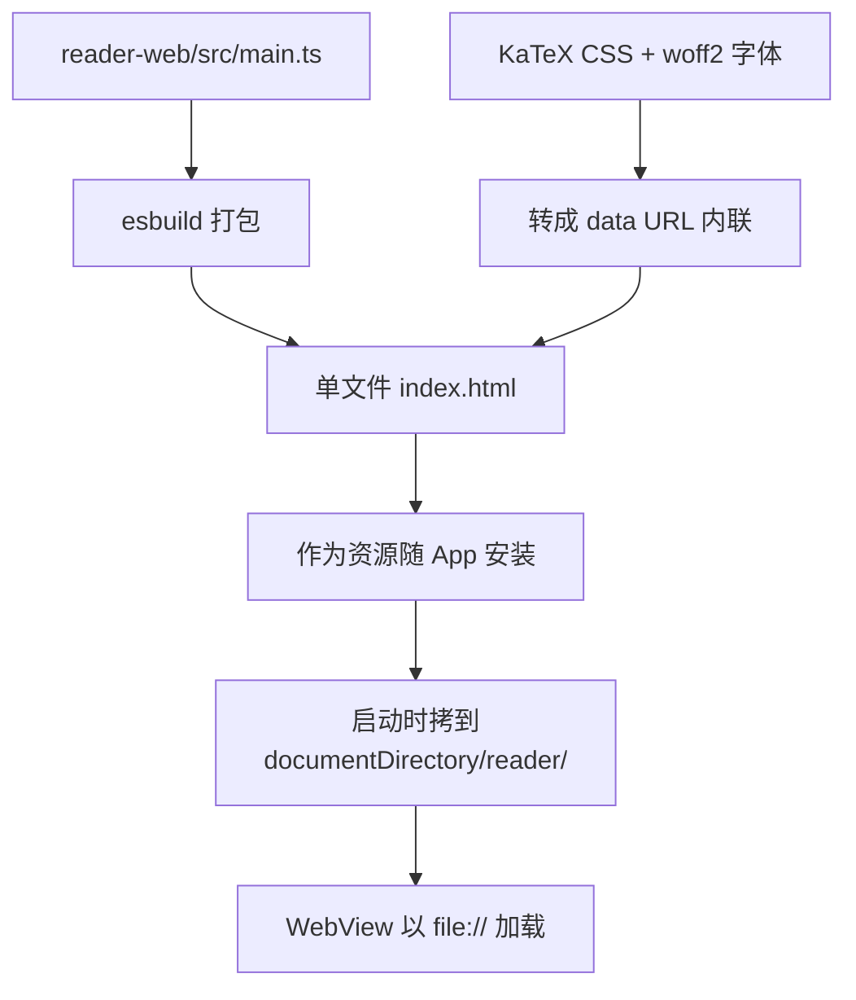
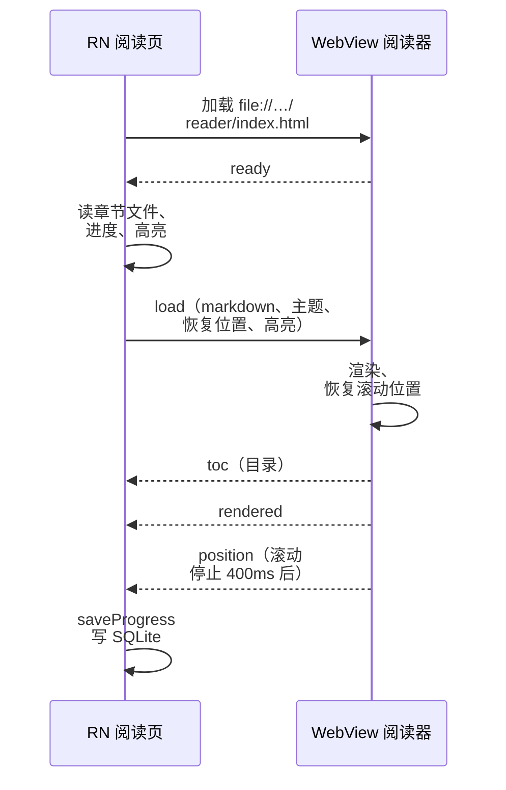

# WebView 与双向桥接

书架 App 最核心的界面，也就是你现在正在看的阅读页，不是用 RN 组件画的，而是一个 **WebView**。Markdown 渲染、代码高亮、KaTeX 公式、Mermaid 图表、高亮笔记，全部在 WebView 里完成。这一章讲为什么这么选、阅读器页面怎么加载、RN 和 WebView 之间的消息协议怎么设计才不会越写越乱，以及 WebView 特有的几个坑。

## 为什么用 WebView 渲染

书架的决策记录里写了两条：

| 决策 | 结论 | 理由 |
|---|---|---|
| 渲染方式 | WebView 而非 RN 原生 Markdown 组件 | 原生组件对代码高亮、公式、Mermaid、宽表格的支持弱 |
| Markdown 在哪渲染 | WebView 内（RN 只传原文） | 渲染库只打包一份；RN 侧不需要 DOM 环境 |

Mermaid 依赖 DOM 和 SVG 排版，KaTeX 依赖 CSS 和字体度量，highlight.js 输出的是带 class 的 HTML。在 RN 里重新实现这些等于重写一个浏览器的排版子集。而 WebView 里是系统的 WebKit，这些库开箱即用。

代价是：

- 两个运行时之间只能**异步传字符串消息**，没有共享内存
- WebView 有自己的进程，可能被系统回收
- 页面内的滚动、选择、手势是 WebKit 的，和 RN 的原生手感略有差异

对一个「以长文阅读为主」的 App，这个交换很划算。判断标准是：**界面的主体是不是「文档」**。是，就用 WebView；是列表、表单、导航这类 App 结构，就用 RN。书架的书架页、书籍信息、设置面板、目录面板都是 RN 写的，只有正文区域是 WebView。

## 阅读器页面怎么进 App

阅读器是一个独立的小前端工程 `app/reader-web/`，用 esbuild 打成**单个 HTML 文件**：JS、CSS、KaTeX 字体全部内联，输出到 `app/assets/reader/index.html`。



为什么不直接用 `source={{ html }}` 把 HTML 字符串塞给 WebView？决策记录的答案：那样页面拿不到本地文件的读权限，书里的配图（`assets/xxx.svg`）只能转 base64 再传进去。而把阅读器放在 `documentDirectory/reader/` 下，和 `documentDirectory/books/` 同在一个目录树里，就可以：

```tsx
<WebView
  source={{ uri: getReaderUri() }}            // file:///…/Documents/reader/index.html
  allowingReadAccessToURL={Paths.document.uri} // 允许读整个 documentDirectory
  allowFileAccess
  originWhitelist={['file://*']}
  onShouldStartLoadWithRequest={(req) => req.url === getReaderUri()}
  onMessage={onMessage}
/>
```

`allowingReadAccessToURL` 是 iOS 专有属性，对应 WKWebView 的 `loadFileURL(_:allowingReadAccessTo:)`。章节 Markdown 里的相对路径图片，阅读器用 `bookBaseUrl`（本书目录的 `file://` 地址）解析成绝对路径，就能直接显示。

`bootstrap()` **每次启动都覆盖一次**阅读器文件。否则 App 升级后，文档目录里还是旧版的阅读器，新旧协议对不上。

### 用 CSP 锁死网络

书架 App 的原则之一是「App 不联网」。阅读器 HTML 头部带了一条 Content Security Policy：

```text
default-src 'none'; img-src file: data: blob:; style-src 'unsafe-inline'; font-src data:; script-src 'unsafe-inline'
```

`default-src 'none'` 关掉一切，然后只放行本地文件和内联资源。就算某本书里写了远程图片，或者某个渲染库想偷偷拉 CDN，请求也会被浏览器拦下。再加上 `onShouldStartLoadWithRequest` 只允许加载阅读器自己，页面不可能被导航到别处。

## 消息协议：一个文件定义两端

RN 和 WebView 之间的通信只有两个原语：

| 方向 | 机制 |
|---|---|
| RN → WebView | `webRef.current.injectJavaScript(code)`，在页面里执行一段 JS |
| WebView → RN | 页面调用 `window.ReactNativeWebView.postMessage(string)`，RN 的 `onMessage` 收到 |

都是字符串，没有类型。项目一大，消息格式散落在两边，很快就对不上。书架的做法是：**所有消息类型只在 `app/src/reader/bridge.ts` 定义**，RN 和阅读器都引用这一个文件（阅读器用 `import type`，打包时不会带入任何运行时代码）：

```ts
// app/src/reader/bridge.ts（节选）

/** RN → WebView，通过 injectJavaScript 调用 window.__shelf.receive(msg) */
export type ToReader =
  | {
      type: 'load';
      markdown: string;
      bookBaseUrl: string;
      theme: ReaderTheme;
      restore?: ReaderPosition;
      hasPrev: boolean;
      hasNext: boolean;
      highlights: HighlightMark[];
    }
  | { type: 'setTheme'; theme: ReaderTheme }
  | { type: 'scrollTo'; anchor: string }
  | { type: 'captureSelection'; action: SelectionAction }
  | { type: 'setHighlights'; highlights: HighlightMark[] };

/** WebView → RN，通过 window.ReactNativeWebView.postMessage(JSON.stringify(msg)) */
export type FromReader =
  | { type: 'ready' }
  | { type: 'rendered' }
  | { type: 'toc'; items: TocItem[] }
  | { type: 'position'; position: ReaderPosition }
  | { type: 'navigate'; to: 'prev' | 'next' }
  | { type: 'link'; href: string }
  | { type: 'selection'; action: SelectionAction; quote: Quote | null }
  | { type: 'highlightTap'; id: string }
  | { type: 'error'; message: string };
```

两端各写一个很薄的收发函数：

```ts
// RN 侧：read/[id].tsx
const send = useCallback((msg: ToReader) => {
  webRef.current?.injectJavaScript(`window.__shelf.receive(${JSON.stringify(msg)});true;`);
}, []);
```

```ts
// WebView 侧：reader-web/src/main.ts
import type { FromReader, ToReader } from '../../src/reader/bridge';

function post(msg: FromReader) {
  window.ReactNativeWebView?.postMessage(JSON.stringify(msg));
}

window.__shelf = {
  receive(msg: ToReader) {
    switch (msg.type) {
      case 'load': void load(msg); break;
      case 'scrollTo': scrollToAnchor(msg.anchor); break;
      // ……
    }
  },
};
```

用**可辨识联合**（discriminated union）的好处是：`switch (msg.type)` 的每个分支里，TypeScript 都知道 `msg` 有哪些字段；新增一种消息而某一端没处理，配合 `never` 穷尽检查可以在编译期发现。

`injectJavaScript` 的字符串末尾加 `true;` 是 react-native-webview 文档建议的写法，避免某些情况下返回值无法序列化引发的静默失败。`JSON.stringify` 的输出本身就是合法的 JS 字面量，直接拼进去是安全的，不需要再手动转义。

## 握手与时序

WebView 加载页面需要时间。RN 在页面就绪之前发的消息会丢失（`window.__shelf` 还不存在）。所以协议的第一条消息是页面主动发的 `ready`：



RN 侧用 `webReady` 状态门控：只有收到 `ready` 之后，切章节的 effect 才会发 `load`。

两个容易出错的细节：

**消息归属**。用户快速切章时，旧章节的 `position` 消息可能在新章节加载之后才到。如果直接按「当前章节」保存，旧章节的滚动位置就写到了新章节上。书架用一个 `shownFile` ref 记录「WebView 当前显示的是哪一章」，在发 `load` 的那一刻更新，`position` 消息一律归给它。

**节流**。滚动事件每秒触发几十次，每次都过桥再写 SQLite 是浪费。阅读器在滚动停止 400ms 后才发一次 `position`；恢复位置期间（`restoring` 标志）不发，避免程序滚动被当成用户滚动。

## 请求-响应：系统选择菜单

高亮功能需要一次「RN 问、WebView 答」：用户在系统选择菜单里点了「高亮」，这个事件发生在原生侧，但选中的文字只有页面知道。

```tsx
<WebView
  menuItems={[
    { key: 'highlight', label: '高亮' },
    { key: 'note', label: '笔记' },
  ]}
  onCustomMenuSelection={(e) =>
    send({ type: 'captureSelection', action: e.nativeEvent.key as SelectionAction })
  }
/>
```

RN 发 `captureSelection`，阅读器读取当前选区，回 `selection` 消息带上原文和前后文。因为同一时刻只会有一个选择操作，用消息类型配对就够了。如果将来有并发的请求-响应（比如同时问好几个问题），要在消息里加一个 `requestId`，RN 侧用 `Map<id, resolve>` 把回复和 Promise 对上。

## 链接交给 RN 处理

页面里的链接如果让 WebView 自己跳，要么跳到一个不存在的页面，要么（外链）在 App 里打开网页。阅读器拦截所有非页内锚点的点击，发 `link` 消息让 RN 决定：

```ts
case 'link': {
  const m = /^(?:\.\/)?([a-z0-9-]+\.md)(?:#(.+))?$/.exec(msg.href);
  if (m) {
    // 本书其他章节：切章并定位锚点
    const target = chapters.findIndex((c) => c.file === m[1]);
    if (target >= 0) goTo(target, m[2] ? decodeURIComponent(m[2]) : undefined);
  } else if (/^https?:/i.test(msg.href)) {
    void Linking.openURL(msg.href); // 外链交给系统浏览器
  }
  break;
}
```

这也是为什么写书规范要求书内链接用相对路径 `02-xxx.md`：RN 侧按这个格式识别并切章。

## WebView 进程会被回收

WKWebView 的内容跑在独立的 Web 进程里。App 在后台久了、或者系统内存紧张时，这个进程会被系统杀掉，回到前台时看到的是一片白屏。处理方式：

```tsx
onContentProcessDidTerminate={() => {
  setWebReady(false);
  webRef.current?.reload();
}}
```

重新加载后页面会再发 `ready`，`webReady` 变回 `true`，加载章节的 effect 自动重跑，从 SQLite 里恢复阅读位置。因为**状态的真相在 RN 和 SQLite 里，WebView 只是渲染层**，所以它随时可以被重建。

## 本章要点

- 界面主体是「文档」时用 WebView，App 结构用 RN；书架只有正文区域是 WebView
- 阅读器打成**单文件 HTML**，启动时拷到 documentDirectory，用 `file://` 加载并通过 `allowingReadAccessToURL` 读取书中图片；用 **CSP** 锁死网络
- 消息类型**只在一个文件定义**，用可辨识联合，两端各一个薄收发函数
- 以页面发出的 `ready` 握手；用 ref 记录消息归属，滚动进度要节流
- WebView 进程可能被回收：`onContentProcessDidTerminate` 里重载，状态真相放在 RN 和 SQLite
