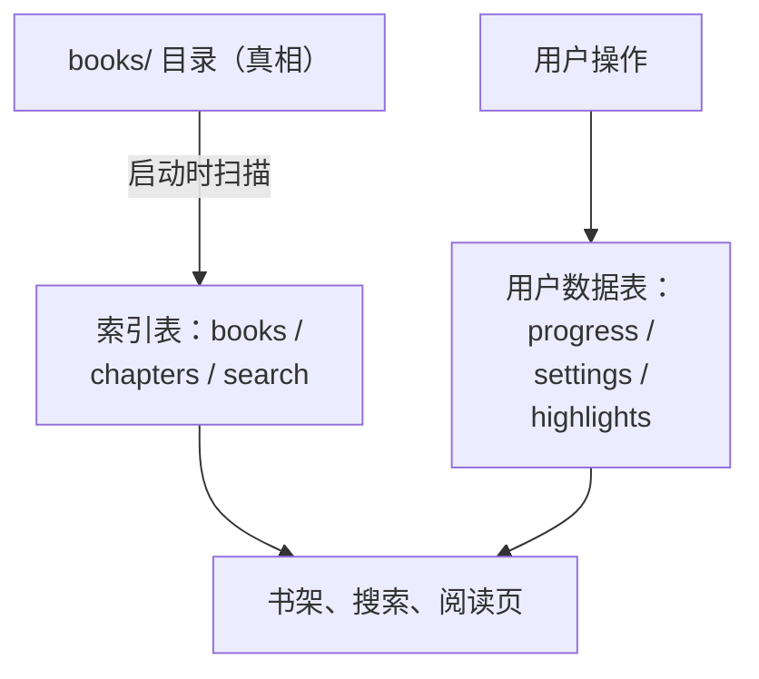

# 本地存储：文件系统与 SQLite

一个离线 App 的全部价值都存在手机本地。存储设计错了，后果不是「慢一点」，而是用户的阅读进度、高亮笔记丢了，或者书架和实际文件对不上。这一章用书架 App 讲本地存储的设计：数据放在哪、文件和数据库怎么分工、迁移怎么写、写入怎么保证原子，以及 SDK 58 的 `expo-file-system` 和 `expo-sqlite` 的用法和坑。

## 先分清数据的性质

设计存储前，先给每一类数据回答两个问题：**能不能重建？丢了谁来补？**

| 数据 | 放在哪 | 能否重建 | 说明 |
|---|---|---|---|
| 书籍原文、配图 | `documentDirectory/books/<id>/` | 不能（但电脑上有源） | **文件即真相** |
| 书目、章节、全文索引 | SQLite：`books` `chapters` `search` | 能：扫描 `books/` 重建 | 纯索引 |
| 阅读进度、设置、高亮笔记 | SQLite：`progress` `settings` `highlights` | **不能** | 用户数据，必须保住 |
| 导入临时文件 | `documentDirectory/inbox/` | 不需要 | 导入完即删 |
| 阅读器 HTML | `documentDirectory/reader/` | 能：每次启动从安装包覆盖 | 随 App 版本走 |
| 密钥、令牌 | 钥匙串（`expo-secure-store`） | 视情况 | 书架没有，唱片墙有 |

这张表直接决定了架构：

- **索引可以随时丢掉重来**。书架每次启动都执行 `rebuildIndex()`：扫描 `books/` 目录，清空三张索引表再重新写入。数据库和文件之间不可能长期不一致，因为每次启动都会以文件为准纠正一次
- **用户数据永远不在重建范围内**。`rebuildIndex()` 只删 `books`、`chapters`、`search`，`progress` 和 `highlights` 一行都不动
- 以后加任何同步通道（比如「文件」App 可见、外部修改文件），阅读器都不用改，重建一次索引就行



### 目录选择

iOS 给每个 App 几个沙盒目录，`expo-file-system` 用 `Paths` 暴露：

| 目录 | 特点 | 适合 |
|---|---|---|
| `Paths.document` | 不会被系统清理；默认参与 iCloud / 电脑备份 | 用户内容和数据库 |
| `Paths.cache` | 存储紧张时系统可能清理 | 可再下载、可再生成的东西 |

书架的书和数据库都在 `Paths.document` 下。所有路径集中在一个文件里定义，其他代码只从这里取：

```ts
// app/src/lib/paths.ts
import { Directory, Paths } from 'expo-file-system';

export const booksDir = new Directory(Paths.document, 'books');
export const inboxDir = new Directory(Paths.document, 'inbox');
/** 与 books/ 同在 documentDirectory 下，WebView 才能读到书里的图片 */
export const readerDir = new Directory(Paths.document, 'reader');
export const DB_NAME = 'shelf.db';

export function bookDir(id: string) {
  return new Directory(booksDir, id);
}
```

## expo-file-system：面向对象的新 API

SDK 58 的 `expo-file-system` 默认导出的是面向对象的 API：`File`、`Directory`、`Paths`。旧的函数式 API（`FileSystem.readAsStringAsync` 那一套）要从 `expo-file-system/legacy` 导入，否则直接调用会在运行时抛错。

```ts
import { File, Directory, Paths } from 'expo-file-system';

const dir = new Directory(Paths.document, 'books', 'rn-expo');
const file = new File(dir, '01-new-architecture.md');

file.exists;                          // boolean
const text = await file.text();       // 异步读
const text2 = file.textSync();        // 同步读
const bytes = await file.bytes();     // Uint8Array

file.create({ intermediates: true, overwrite: true });
file.writeSync('# 标题');             // 同步写
await file.write('# 标题');           // 异步写（SDK 58）
file.rename('new-name.md');
file.delete();

dir.create({ intermediates: true });  // intermediates 默认 false
dir.list();                           // (File | Directory)[]
```

选同步还是异步：

- **阅读页读章节**用异步 `text()`：在交互路径上，不能让一个大文件卡住 JS 线程
- **启动扫描、原子写入**用同步版本：逻辑上必须按顺序完成，书都不大，同步更简单也更不容易出错

### SDK 58 的坑：write 变成异步

书架 App 升级到 SDK 58 时撞上一个竞态：`File.write()` 变成了返回 Promise 的异步方法。原子写入的代码原本是这样的：

```ts
file.write(content);      // SDK 58 起这里只是「开始写」
// ……
tmp.rename(id);           // 可能在写入完成之前就执行了
```

没有任何报错，偶尔导入的书会缺内容。修复是改用 `writeSync()`，并且在 ESLint 里打开两条规则，让漏写的 `await` 根本过不了检查：

```js
// app/eslint.config.js（节选）
rules: {
  // SDK 58 的不少 API（如 File.write）是异步的，漏掉 await 会产生难查的竞态
  '@typescript-eslint/no-floating-promises': 'error',
  '@typescript-eslint/no-misused-promises': ['error', { checksVoidReturn: { attributes: false } }],
},
```

**升级 SDK 后，任何「从同步变异步」的 API 都是潜在的竞态**。`no-floating-promises` 是性价比最高的防线。

## 原子写入：任何时刻要么旧版要么新版

同一本书重新导入时，如果先删旧目录再写新目录，中途 App 被杀（用户划掉、系统回收），这本书就没了。书架的写法是先写临时目录，再整体替换：

```ts
// app/src/library/fs.ts（节选）
export function writeBookAtomically(id: string, files: BookFile[], hash?: string) {
  const tmp = new Directory(booksDir, `.tmp-${id}`);
  if (tmp.exists) tmp.delete();
  tmp.create();
  for (const f of files) {
    const file = new File(tmp, f.path);
    file.create({ intermediates: true, overwrite: true });
    if (f.bytes !== undefined) file.writeSync(f.bytes);
    else file.writeSync(f.text ?? '');
  }

  const target = bookDir(id);
  const old = new Directory(booksDir, `.old-${id}`);
  if (old.exists) old.delete();
  if (target.exists) target.rename(old.name); // 1. 旧的挪开
  tmp.rename(id);                             // 2. 新的就位
  if (old.exists) old.delete();               // 3. 删旧的
}
```

`rename` 在同一个文件系统内是原子操作。最坏情况下 App 在第 1、2 步之间被杀，留下一个 `.old-<id>` 和一个 `.tmp-<id>`。以点开头的目录在扫描时会被忽略，下次导入时也会先清掉。用户最多看到这本书暂时消失，重新导入一次即可，不会出现「半本书」。

## expo-sqlite：打开、迁移、查询

### 打开数据库

```ts
import { Paths } from 'expo-file-system';
import { openDatabaseSync } from 'expo-sqlite';

const db = openDatabaseSync('shelf.db', undefined, Paths.document.uri);
db.execSync('PRAGMA journal_mode = WAL; PRAGMA foreign_keys = ON;');
```

第三个参数是数据库所在目录，书架显式放在 `Paths.document` 下，和 README 里约定的存储布局一致。两条 PRAGMA：

- **WAL**：写入不阻塞读取，崩溃恢复也更可靠
- **foreign_keys**：SQLite 默认**不**执行外键约束，每个连接都要手动打开，`ON DELETE CASCADE` 才会生效

### 迁移：只追加，不修改

```ts
// app/src/db/index.ts（节选）
/**
 * 按顺序执行的迁移；user_version 记录已执行到第几条。
 * 只能追加，不能修改已发布的条目。
 */
const MIGRATIONS = [
  `CREATE TABLE books (...); CREATE TABLE chapters (...);
   CREATE TABLE progress (...); CREATE TABLE settings (...);`,
  `ALTER TABLE books ADD COLUMN content_hash TEXT;`,
  `CREATE VIRTUAL TABLE search USING fts5(
     book_id UNINDEXED, chapter_file UNINDEXED, anchor UNINDEXED, heading UNINDEXED, body,
     tokenize = 'trigram'
   );`,
  `CREATE TABLE highlights (...); CREATE INDEX highlights_by_chapter ON highlights (book_id, chapter_file);`,
];

const { user_version } = db.getFirstSync<{ user_version: number }>('PRAGMA user_version')!;
for (let v = user_version; v < MIGRATIONS.length; v++) {
  db.withTransactionSync(() => {
    db.execSync(MIGRATIONS[v]);
    db.execSync(`PRAGMA user_version = ${v + 1}`);
  });
}
```

`PRAGMA user_version` 是 SQLite 文件头里的一个整数，专门留给应用记版本号。这套方案没有任何依赖，几十行代码就够了：

- **每条迁移和版本号更新在同一个事务里**，迁移失败不会留下半截表结构
- **已发布的迁移永远不改**。用户手机上的数据库已经执行过它，改了也不会重跑，只会让新装和老用户的表结构分叉
- 要改表结构就追加一条新的 `ALTER TABLE`

如果用 React 的方式组织，`expo-sqlite` 也提供 `<SQLiteProvider databaseName onInit={migrate}>` 和 `useSQLiteContext()`，`onInit` 会在渲染子组件前执行。书架选择在 `bootstrap()` 里同步迁移，因为索引重建、导入管线这些非组件代码也要用数据库。

### 查询与事务

```ts
// 单行
const row = await db.getFirstAsync<{ value: string }>('SELECT value FROM settings WHERE key = ?', key);
// 多行
const rows = await db.getAllAsync<ChapterRow>('SELECT * FROM chapters WHERE book_id = ? ORDER BY idx', id);
// 写入：UPSERT 保存阅读进度
await db.runAsync(
  `INSERT INTO progress (book_id, chapter_file, scroll_ratio, anchor, updated_at)
   VALUES (?, ?, ?, ?, ?)
   ON CONFLICT (book_id, chapter_file) DO UPDATE SET
     scroll_ratio = excluded.scroll_ratio, anchor = excluded.anchor, updated_at = excluded.updated_at`,
  bookId, chapterFile, pos.scrollRatio, pos.anchor ?? null, Date.now(),
);
```

参数一律用 `?` 占位。`execAsync` / `execSync` **不转义参数**，只用来执行固定的 SQL（建表、PRAGMA）。

事务有一个重要区别：

| API | 行为 |
|---|---|
| `withTransactionAsync(fn)` | **不是排他的**：`fn` 执行期间，其他地方的异步查询可能插进这个事务里 |
| `withExclusiveTransactionAsync(fn)` | 只有通过 `fn` 收到的 `txn` 对象执行的查询才在事务里 |

书架的 `rebuildIndex()` 要先清空索引表再写入，期间如果阅读页的 `saveProgress` 插进来，可能被一起回滚，或者读到一半空的书目。所以它用的是排他版本，并且所有语句都通过 `txn` 执行：

```ts
await db.withExclusiveTransactionAsync(async (txn) => {
  await txn.execAsync('DELETE FROM chapters; DELETE FROM books; DELETE FROM search;');
  for (const b of scanned) {
    await txn.runAsync('INSERT INTO books (...) VALUES (...)', /* … */);
    // chapters、search 同理
  }
});
```

## 全文搜索：FTS5 trigram

`expo-sqlite` 的 config plugin 选项 `enableFTS` 默认为 `true`，FTS5 直接可用。书架的 `search` 表用 `tokenize = 'trigram'`：按三个字符一组建索引，**不需要中文分词词典**，中英文都能做子串匹配。

代价是查询至少要 3 个字符。两个汉字的查询（「架构」）走 trigram 匹配不到，书架退回 `LIKE` 扫描：个人书库就几十本书，全表扫描也很快。

```ts
const rows = [...q].length >= 3
  ? await db.getAllAsync(`${select} WHERE search MATCH ? ORDER BY rank LIMIT 100`,
      `"${q.replace(/"/g, '""')}"`)   // 整体作为短语，避免用户输入被当成 FTS 语法
  : await db.getAllAsync(`${select} WHERE s.body LIKE ? ESCAPE '\\' LIMIT 100`,
      `%${q.replace(/[\\%_]/g, (ch) => `\\${ch}`)}%`);
```

注意 `[...q].length` 而不是 `q.length`：前者按 Unicode 码点计数，后者按 UTF-16 码元，遇到 emoji 等字符会算错。

## 其他存储选项

| 需求 | 选择 |
|---|---|
| 少量键值（主题、开关） | `expo-sqlite/kv-store`（基于 SQLite，有同步 API）；书架直接用自己的 `settings` 表 |
| 令牌、口令等敏感数据 | `expo-secure-store`，存进系统钥匙串。唱片墙给共享核心包提供的 `secrets` 接口，手机端就是用它实现的 |
| 需要加密的整个数据库 | `expo-sqlite` 的 `useSQLCipher` 选项；注意二进制里没有 SQLCipher 时 `PRAGMA key` 不报错也不生效，要先查 `PRAGMA cipher_version` |
| 大量结构化数据 + 复杂查询 | 仍然是 SQLite，可以在上面加 Drizzle 这类 ORM |

**不要把敏感数据放进 SQLite 或普通文件**：文档目录会进入备份，越狱设备上也能直接读出来。

## 本章要点

- 先给数据分类：**能否重建、丢了谁来补**；书架是「文件即真相，SQLite 只做索引 + 用户数据」
- 索引可以每次启动重建，用户数据（进度、高亮）永远不在重建范围内
- SDK 58 的 `expo-file-system` 用 `File` / `Directory` / `Paths`；`write()` 是异步的，顺序敏感的地方用 `writeSync()`，并开 `no-floating-promises`
- 原子写入：写临时目录 → 旧的挪开 → 新的就位 → 删旧的
- 迁移用 `PRAGMA user_version` + 只追加的数组，每条迁移和版本号同一事务；需要隔离的批量写用 `withExclusiveTransactionAsync`
- 中文全文搜索可以用 FTS5 trigram，短查询退回 `LIKE`；敏感数据放钥匙串
