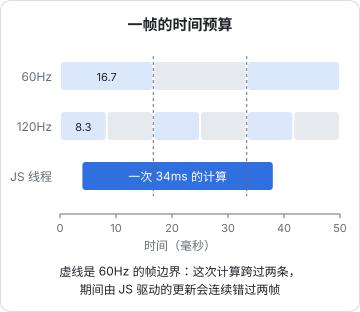
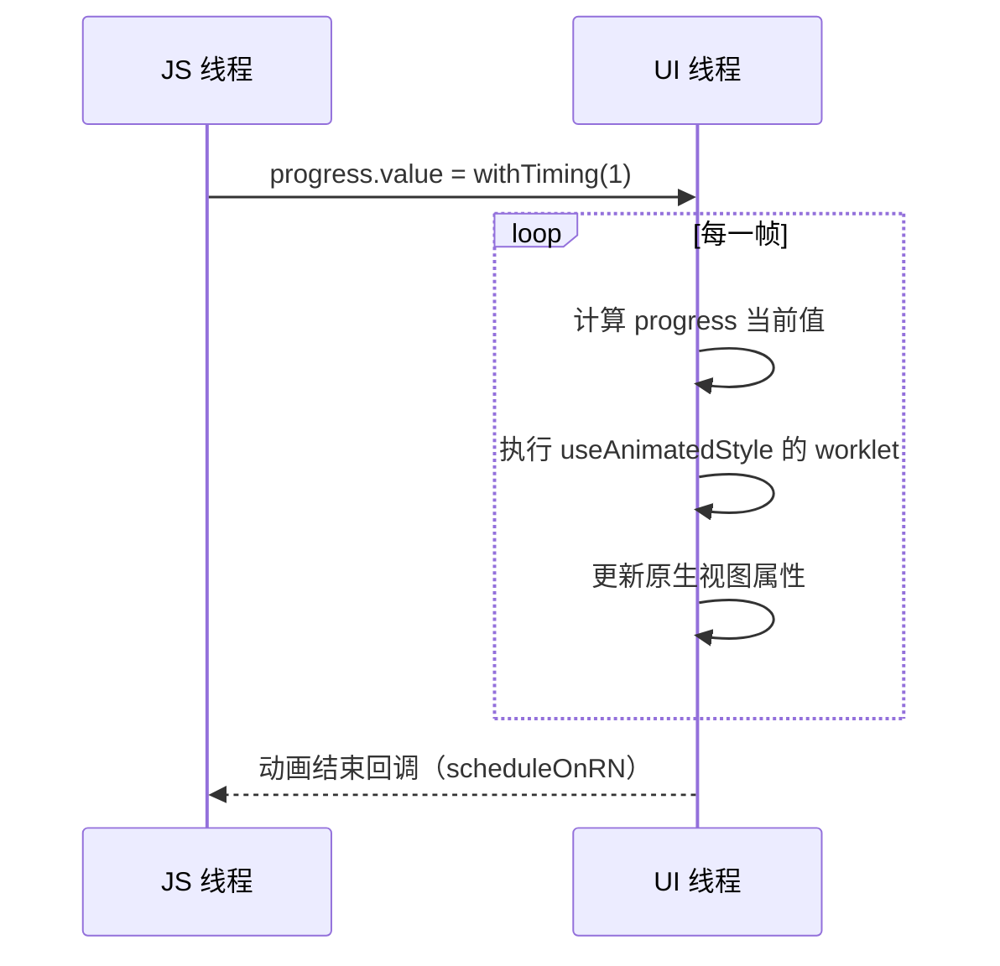

# 性能与动画：Reanimated

「RN 卡」几乎都能归结到一句话：**某个线程在一帧的时间里没干完活**。这一章先建立帧预算和线程的模型，再讲怎么测、常见的卡顿来源，最后重点讲 Reanimated：它为什么能让动画在 JS 线程忙的时候依然流畅，以及在 SDK 58 配套的 Reanimated 4 / Gesture Handler 3 上怎么写。

## 帧预算

屏幕按固定频率刷新。60Hz 的屏幕每 $1000 / 60 \approx 16.7$ 毫秒要交出一帧；支持 ProMotion 的 iPhone 最高 120Hz，预算只有 $1000/120 \approx 8.3$ 毫秒。任何一帧超时，用户看到的就是卡顿或掉帧。



[第 1 章](01-new-architecture.md)的线程表在这里变得具体：

| 线程 | 超时的后果 |
|---|---|
| UI 主线程 | 滚动、系统动画、原生手势全部卡住，最明显 |
| JS 线程 | 点击没反应、React 状态更新延迟；**由 JS 驱动的动画**跟着卡 |

关键洞察：滚动由原生处理，JS 线程卡的时候列表依然能滚（只是新内容来不及渲染、出现白块）。动画如果每一帧都要 JS 算位置，JS 一忙动画就卡。Reanimated 的价值就是把动画从 JS 线程挪到 UI 线程。

## 先测量，用 Release 包

[第 2 章](02-hermes.md)说过：开发包里 JS 是现场编译的，还开着各种开发检查，**性能比 Release 包差很多**。在开发包里看到的卡顿可能根本不存在，Release 包里的问题也可能被开发包的其他慢掩盖掉。

```bash
cd app
npx expo run:ios --configuration Release --device
```

测量工具：

| 工具 | 看什么 |
|---|---|
| 开发菜单 → Perf Monitor | UI 和 JS 两个线程的实时帧率 |
| React Native DevTools → Profiler | 哪些组件渲染了、花了多久、为什么渲染 |
| React Native DevTools → Performance | JS 执行的火焰图 |
| Xcode Instruments（Time Profiler） | 原生侧的 CPU 热点 |

## 常见卡顿来源

**不必要的重新渲染**。一个父组件状态变了，整棵子树都重新渲染。手动解法是 `React.memo`、`useMemo`、`useCallback`；更省事的是 **React Compiler**，它在编译期自动做记忆化。SDK 58 的 app config 里有 `experiments.reactCompiler` 开关，属于实验特性，开启后要完整回归一遍。

**长列表**。`ScrollView` 会一次渲染全部子元素，几百项就明显变慢。用 `FlatList`（虚拟化，只渲染可见区域附近的项），并且：

- 提供稳定的 `keyExtractor`
- 行组件用 `memo` 包住，`renderItem` 不要每次渲染都新建
- 行高固定时提供 `getItemLayout`，省掉测量

**桥上的高频消息**。WebView 和 RN 之间每条消息都要序列化。书架的阅读器在滚动停止 400ms 后才回报一次进度，而不是每个 scroll 事件都发（[第 7 章](07-webview-bridge.md)）。同样的道理适用于任何跨边界的高频事件：**在产生事件的那一侧节流**。

**在 JS 线程做重活**。解压一个 50MB 的 zip、给几千个小节建索引，都会占住 JS 线程几百毫秒。书架的做法是在导入时显示进度、把这些操作放在用户可以等待的时机（导入、启动）；如果某个计算必须在交互中进行，考虑挪到原生模块或分批执行（`requestIdleCallback`，SDK 58 里它取代了被删除的 `InteractionManager`）。

**图片**。大图解码在主线程上很贵。显示缩略图时用尺寸合适的图片，或者用 `expo-image` 这类带缓存和降采样的组件。

## Reanimated 的模型

Reanimated（SDK 58 配套版本 4.7）的核心思想：**动画的每一帧在 UI 线程上计算**，JS 线程只负责「启动」动画。



三个基本概念：

| 概念 | 是什么 |
|---|---|
| **Shared Value**（`useSharedValue`） | 一个两个线程都能读写的值，改它不会触发 React 重新渲染 |
| **Worklet** | 能在 UI 线程运行的 JS 函数。`useAnimatedStyle` 的回调、手势回调会被自动标记成 worklet |
| **动画函数**（`withTiming`、`withSpring`、`withDecay`） | 描述 Shared Value 如何随时间变化 |

Worklet 由 Babel 插件在构建时识别并处理。Reanimated 4 把这部分拆到了独立的 `react-native-worklets` 包（SDK 58 配套 0.13），Babel 插件也从 `react-native-reanimated/plugin` 改名为 `react-native-worklets/plugin`。Expo 的 Babel 预设会自动配置它：书架和唱片墙都没有 `babel.config.js`，唱片墙照样能用 Reanimated。

另外，**Reanimated 4 只支持新架构**。在 SDK 58 上这不是问题，因为没有旧架构可选。

## 实例：底部弹层

唱片墙的所有底部弹层都是同一个组件：暗色遮罩淡入，卡片从底边升起；关闭时等退场动画放完再卸载。用 SDK 58 配套的 API 写出来是这样：

```tsx
import { useEffect, useState } from 'react';
import Animated, { Easing, useAnimatedStyle, useSharedValue, withTiming } from 'react-native-reanimated';
import { scheduleOnRN } from 'react-native-worklets';

export function Sheet({ open, children }: { open: boolean; children: React.ReactNode }) {
  const { height } = useWindowDimensions();
  const [mounted, setMounted] = useState(open);
  const progress = useSharedValue(0);
  // 量到卡片真实高度前先按一整屏算，第一帧保证在屏幕外，不会闪
  const cardH = useSharedValue(height);

  useEffect(() => {
    if (open) {
      setMounted(true);
      progress.value = withTiming(1, { duration: 280, easing: Easing.out(Easing.cubic) });
    } else {
      progress.value = withTiming(0, { duration: 220, easing: Easing.in(Easing.cubic) }, (finished) => {
        // 这个回调在 UI 线程执行；要改 React 状态，得调度回 JS 线程
        // 关到一半又被打开时，动画被新的 withTiming 打断，finished 为 false，不会误卸载
        if (finished) scheduleOnRN(setMounted, false);
      });
    }
  }, [open, progress]);

  const scrimStyle = useAnimatedStyle(() => ({ opacity: progress.value }));
  const cardStyle = useAnimatedStyle(() => ({
    transform: [{ translateY: (1 - progress.value) * cardH.value }],
  }));

  if (!mounted) return null;
  return (
    <View style={StyleSheet.absoluteFill}>
      <Animated.View style={[styles.scrim, scrimStyle]} />
      <Animated.View
        onLayout={(e) => { cardH.value = e.nativeEvent.layout.height; }}
        style={[styles.card, cardStyle]}
      >
        {children}
      </Animated.View>
    </View>
  );
}
```

值得注意的点：

- **一个 progress 驱动多个属性**。遮罩透明度和卡片位移都从同一个 0→1 的值推导，保证两者严格同步，也只需要管理一个动画
- **退场要延迟卸载**。如果 `open` 一变成 `false` 就 `return null`，退场动画根本没机会播放。所以用 `mounted` 状态，等动画完成回调再卸载
- **UI 线程回调里不能直接调 React 的 setState**。Reanimated 3 时代用 `runOnJS(setMounted)(false)`，Reanimated 4 里 `runOnJS` 已标记为废弃，改用 `react-native-worklets` 的 `scheduleOnRN(fn, ...args)`，参数直接跟在函数后面。唱片墙的代码里还是 `runOnJS`，能跑，但升级时应该迁移

### 简单场景：CSS 过渡

Reanimated 4 新增了 CSS 风格的动画和过渡：状态驱动、不需要 Shared Value 的简单动画，直接在样式里声明：

```tsx
<Animated.View
  style={{
    width: expanded ? 240 : 120,
    transitionProperty: 'width',
    transitionDuration: 300,
  }}
/>
```

`expanded` 变化时宽度自动过渡。开关、展开收起这类「两个状态之间切换」的动画，用它比手写 `useSharedValue` + `withTiming` 简洁得多。需要跟随手势、可中断、多属性联动的，仍然用 Shared Value。

## 手势：Gesture Handler 3

动画最常见的驱动源是手势。SDK 58 配套的 `react-native-gesture-handler` 是 3.x，引入了**基于 Hook 的 API**：

| 2.x 写法 | 3.x Hook 写法 |
|---|---|
| `Gesture.Pan().onStart(...).onEnd(...)` | `usePanGesture({ onActivate, onUpdate, onDeactivate })` |
| `Gesture.Tap()` | `useTapGesture({...})` |
| `Gesture.Exclusive(a, b)` | `useExclusiveGestures(a, b)` |
| `Gesture.Simultaneous(a, b)` | `useSimultaneousGestures(a, b)` |
| 回调参数 `success` | 事件的 `canceled` 字段（含义相反） |

一个跟手拖动、松手回弹的例子：

```tsx
import { GestureDetector, usePanGesture } from 'react-native-gesture-handler';
import Animated, { useAnimatedStyle, useSharedValue, withTiming } from 'react-native-reanimated';

function Draggable() {
  const x = useSharedValue(0);
  const pan = usePanGesture({
    onUpdate: (e) => {
      x.value = e.translationX;          // 默认在 UI 线程执行，直接写 Shared Value
    },
    onDeactivate: () => {
      x.value = withTiming(0, { duration: 100 });
    },
  });
  const style = useAnimatedStyle(() => ({ transform: [{ translateX: x.value }] }));

  return (
    <GestureDetector gesture={pan}>
      <Animated.View style={[styles.box, style]} />
    </GestureDetector>
  );
}
```

手势回调默认在 UI 线程运行，所以能每帧更新 Shared Value 而不经过 JS。如果回调里要做的事本来就在 JS 侧（比如唱片墙的进度条拖动后调用播放器 `seek`），可以设 `runOnJS: true` 让回调在 JS 线程执行，这时就不要指望它驱动逐帧动画。

几点注意：

- 根组件外面仍需要 `GestureHandlerRootView`
- 同一组有关系的手势（互斥、同时）必须全部用 Hook API 或全部用旧的构建器 API，**不能混用**
- 迁移可以按组件逐个进行。唱片墙目前还是 2.x 的 `Gesture.Pan()` 写法（SDK 57），升级到 SDK 58 时再迁

## 本章要点

- 卡顿 = 某个线程一帧内没干完活；60Hz 预算约 16.7ms，120Hz 约 8.3ms
- **用 Release 包测性能**；工具有 Perf Monitor、DevTools Profiler、Instruments
- 常见来源：多余渲染（memo / React Compiler）、长列表（FlatList）、跨边界高频消息（在源头节流）、JS 线程重活
- Reanimated 在 **UI 线程**逐帧计算动画；Shared Value 改了不触发重渲染；UI 线程回调里用 `scheduleOnRN` 回到 JS
- 简单的状态切换用 Reanimated 4 的 **CSS 过渡**；手势用 Gesture Handler 3 的 Hook API，回调默认在 UI 线程
