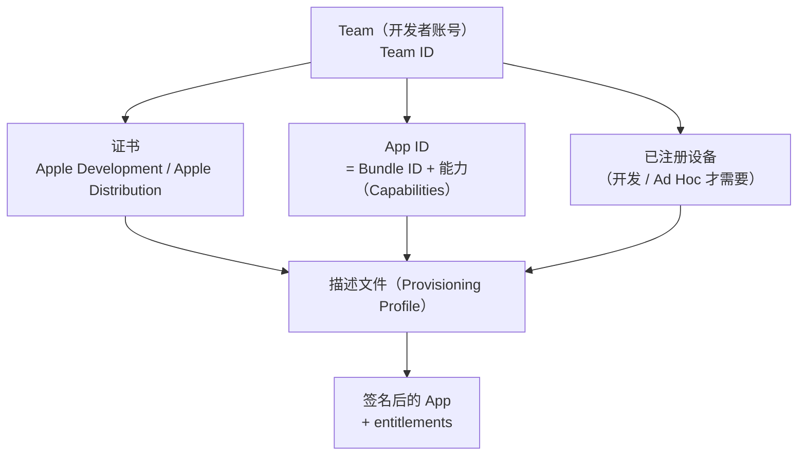
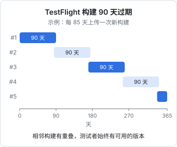

# 签名、TestFlight 与上架

前九章写出来的 App，最后都要过一道关：**签名**。iOS 不运行未签名的代码，签名决定了这个 App 是谁做的、能装到哪些设备上、能用哪些系统能力。这一章讲签名体系里每个概念是什么、它们之间怎么对上，Expo 项目里该在哪配置，以及 TestFlight 和上架审核的细节。

[《部署与 CI/CD》第 8 章](../deploy-release/08-mobile-desktop-release.md)已经讲过唱片墙的 `pnpm ship` 出包流水线（archive → 导出 ipa → 上传 → 轮询处理状态）、构建号用时间戳、为什么 iOS 出包留在本机。这里不重复那条流水线，而是讲它底下的签名模型，以及流水线之外要准备的东西。

## 签名体系的五个概念



| 概念 | 是什么 | 书架 App 里对应 |
|---|---|---|
| **Team** | 你的开发者账号，用 Team ID 标识 | `app.json` 的 `ios.appleTeamId` |
| **App ID** | 在 Apple 后台注册的 Bundle ID，附带这个 App 被允许使用的能力（App Groups、推送……） | `com.jarvis.shelf` |
| **证书** | 一对密钥里的公钥部分由 Apple 签发，私钥只在你的钥匙串里。开发用 Apple Development，分发用 Apple Distribution | Xcode 自动管理 |
| **设备** | 开发构建只能装在注册过的设备上 | 自己的 iPhone |
| **描述文件** | 把以上几样绑在一起：「这张证书签的、这个 App ID 的 App，可以装在这些设备上，可以用这些能力」 | Xcode 自动生成 |

最后签进 App 的还有一份 **entitlements**（权利声明）：App 实际申请使用的能力。**entitlements 里的每一项都必须被描述文件允许**，否则安装或启动时被系统拒绝。这是签名问题最常见的根源。

### 在 Expo 里，这些写在哪

- `ios.bundleIdentifier`：Bundle ID
- `ios.appleTeamId`：prebuild 会把它设到**所有**原生 target 上（包括扩展），自动签名就知道用哪个团队
- `ios.entitlements`：App Groups 等能力；prebuild 写进 `.entitlements` 文件
- 证书和描述文件：交给 Xcode 的**自动签名**（Automatic Signing），不在仓库里

书架 App 的 `ios/Shelf/Shelf.entitlements` 是 prebuild 生成的，不要手改；要加能力就改 `app.json` 再 prebuild（[第 4 章](04-dev-client-prebuild.md)）。

## 自动签名做了什么

打开自动签名后，Xcode（或者带 `-allowProvisioningUpdates` 的 `xcodebuild`）会：

1. 检查 Bundle ID 是否已在你的团队下注册为 App ID，没有就注册
2. 读 entitlements，把需要的能力在 App ID 上打开
3. 检查钥匙串里有没有可用的证书
4. 生成或更新描述文件，下载到本机

对个人开发者来说，自动签名几乎总是正确选择。手动签名适合多人团队统一管理证书，或者 CI 机器上不想让工具自动改后台配置的场景。

自动签名有一个盲区，唱片墙踩过：**用 App Store Connect API key 只能自动创建和续期描述文件，云端管理的分发证书要用 Apple ID 登录才能建**。表现是 archive 成功，导出 ipa 时报找不到 Distribution 证书。解法是第一次在 Xcode 的 Settings → Accounts → Manage Certificates 里手动建一张 Apple Distribution 证书，装进钥匙串，之后就不用管了。

### 有扩展时：每个 target 一套

唱片墙有一个锁屏小组件扩展（[第 5 章](05-config-plugins.md)），它是独立的 target，有自己的 Bundle ID：`com.hatch.recordwall.nowplaying`。于是：

- 两个 App ID，两份描述文件
- 两边的 entitlements 里都要有同一个 App Group，且这个 App Group 要在后台同时分配给两个 App ID
- 扩展的 Bundle ID 必须以主 App 的 Bundle ID 为前缀

自动签名会处理前两条，但前提是 `appleTeamId` 设到了扩展 target 上，这正是 `ios.appleTeamId`「设到所有 target」的意义。

## 装到自己手机上

书架 App 不上架、不走 TestFlight，用开发构建直接装到自己手机上：

```bash
pnpm app ios --device
```

第一次在真机上运行开发签名的 App，iOS 16 起需要打开**开发者模式**：设置 → 隐私与安全性 → 开发者模式，打开后重启。没打开时，App 图标出现了却点不开。

用免费的 Apple ID（个人团队）也能签名安装，但开发描述文件只有 7 天有效期，过期后 App 打不开，要重新构建安装；部分能力也不对免费账号开放。付费的 Apple Developer Program 没有这个 7 天限制，也是使用 TestFlight 和上架的前提。

## 版本号与构建号

| 字段 | Info.plist 键 | 用途 | 规则 |
|---|---|---|---|
| 展示版本 | `CFBundleShortVersionString` | 给人看，如 `1.2.0` | 你定 |
| 构建号 | `CFBundleVersion` | 给系统和 App Store Connect 比较 | 同一个展示版本下必须**递增**，同一组（版本，构建号）只能上传一次 |

Expo 里分别对应 `version` 和 `ios.buildNumber`。唱片墙在 `app.config.js` 里从 `package.json` 现算展示版本，构建号单独留一个环境变量的口子：

```js
// 唱片墙：apps/mobile/app.config.js（节选）
const pkg = require('./package.json');

module.exports = ({ config }) => ({
  ...config,
  version: pkg.version,
  // 传 TestFlight 时带上 MOBILE_BUILD=<比上次大的数>；本机 run:ios 不用管
  ios: { ...config.ios, buildNumber: process.env.MOBILE_BUILD ?? pkg.version },
});
```

注释里讲了为什么分开：上传失败要重传时，构建号必须变大；如果构建号就等于展示版本，每次重传都得升展示版本，而展示版本是给人看的，不该被「重传了一次」推着走。

## 上传前要准备好的 Info.plist

这些问题不会在本地构建时报错，而是在上传、审核或用户使用时才暴露。

**出口合规**。每次上传构建，App Store Connect 都会问 App 是否使用加密。只用系统提供的 HTTPS、没有自己实现加密算法的 App，通常可以声明为豁免。在 `app.json` 里写死，就不用每次在网页上回答：

```json
{ "ios": { "infoPlist": { "ITSAppUsesNonExemptEncryption": false } } }
```

书架和唱片墙都这么写了。是否符合豁免条件，以 Apple 的出口合规说明为准。

**权限说明文案**。用到相机、相册、麦克风、定位、本地网络等能力时，必须提供对应的 `NS…UsageDescription`。缺了文案，访问这些能力时 App 会直接崩溃；文案写得含糊（比如「需要此权限」）是常见的审核拒绝原因。书架的局域网传书写的是：

```json
"NSLocalNetworkUsageDescription": "用于在同一 Wi-Fi 下从电脑向书架传书"
```

讲清楚「用来做什么」，用户才会点允许。

**隐私清单**（`PrivacyInfo.xcprivacy`）。Apple 要求 App 声明使用了哪些「需要说明理由的 API」（比如读取文件时间戳、`UserDefaults`）以及收集了哪些数据。Expo 的 prebuild 会生成这个文件并合并依赖库声明的条目；你自己的代码或依赖漏报的部分，用 `ios.privacyManifests` 补充。具体要求 Apple 会调整，以官方文档为准。

**没用到的权限不要声明**。唱片墙用 `expo-audio` 的插件参数关掉了麦克风权限（`"microphonePermission": false`），因为它只播放不录音。声明了却不用的权限，同样会招来审核的询问。

## TestFlight 的细节

TestFlight 是 Apple 官方的测试分发渠道。上传的构建经过处理后，测试者用 TestFlight App 安装。

| | 内部测试 | 外部测试 |
|---|---|---|
| 测试者 | App Store Connect 里的团队成员 | 任何人，通过邮件邀请或公开链接 |
| 审核 | 不需要 | 每个版本的首个构建要过 Beta App Review |
| 需要填的信息 | 少 | 测试说明、反馈邮箱、隐私政策等 |

（人数上限和具体规则以 App Store Connect 当前说明为准。）

几个实用细节：

- **构建 90 天过期**。过期后测试者无法再打开这个构建，必须上传新的。唱片墙每个季度要重传一次
- **处理需要时间**。上传成功只是字节到了，构建状态变为可用之前测试者看不到。这也是唱片墙的流水线最后要轮询 App Store Connect API 的原因
- **测试者反馈**。测试者在 App 里截屏即可提交反馈，崩溃也会带日志回传，在 App Store Connect 的 TestFlight 页面查看。个人自用、不接崩溃上报服务的 App，这是最省事的崩溃收集渠道
- **「测试内容」**（What to Test）：每个构建可以写一段说明，告诉测试者这一版改了什么、重点测什么
- **测试组**：可以把测试者分组，不同的组拿到不同的构建



## 从 TestFlight 到 App Store

书架和唱片墙都不上架，但如果你的产品要上架，TestFlight 之后还要：

1. 在 App Store Connect 里完善 App 信息：名称、副标题、描述、关键词、分类、截图（按要求的设备尺寸）
2. 填**隐私「营养标签」**：App 收集哪些数据、是否用于追踪。要和隐私清单、实际行为一致
3. 需要登录的 App，在审核备注里提供演示账号
4. 选一个已处理好的构建，提交审核

审核依据是 Apple 的 App Store 审核指南。个人开发者最常遇到的几类问题：功能过于简单、崩溃或明显的 bug、权限说明不清、隐私声明和实际行为不符、引导用户到 App 外付费。条款会更新，提交前过一遍最新版指南。

## 签名问题排查

| 现象 | 常见原因 | 处理 |
|---|---|---|
| 真机上图标出现但打不开 | 未开开发者模式；免费账号描述文件过期 | 开开发者模式；重新构建安装 |
| 「Provisioning profile doesn't include the … entitlement」 | entitlements 里的能力没在 App ID 上开启 | 自动签名下重新构建让 Xcode 同步；手动签名去后台开能力并重新生成描述文件 |
| 导出 ipa 时找不到 Distribution 证书 | 只用 API key，分发证书没建 | 在 Xcode 账号设置里手动建一次 |
| 扩展签名失败 | 扩展 target 没有团队，或 App Group 没分配给扩展的 App ID | 确认 `ios.appleTeamId` 已设置，重新 prebuild |
| 上传被拒：构建号重复 | 同一版本下构建号没变大 | 用时间戳或递增数作为构建号 |
| 改了 `app.json` 的能力不生效 | 原生工程没重新生成 | `prebuild --clean` |

## 本章要点

- 签名体系：**Team、App ID（含能力）、证书、设备、描述文件**；签进 App 的 entitlements 必须被描述文件允许
- Expo 里配置 `bundleIdentifier`、`appleTeamId`（设到所有 target）、`entitlements`，证书和描述文件交给自动签名
- 自动签名的盲区：API key 建不了云端分发证书，第一次要在 Xcode 里手动建
- 构建号在同一版本下必须递增；出口合规、权限文案、隐私清单在 `app.json` 里提前写好
- TestFlight 构建 **90 天过期**；内部测试免审核，外部测试首个构建要过 Beta 审核

到这里，一个 Expo App 从运行时原理到装进别人手机的完整链路就走完了。接下来可以读[《Electron 桌面应用》](../electron-desktop/)，它和这本书是同一类问题在桌面端的版本：多进程、桥接、签名和分发；如果对 React 本身的调和与并发机制还想深入，读[《React 19 原理与模式》](../react-internals/)；移动端的密钥存储、传输安全等话题，在[《应用安全》](../app-security/)的移动端安全一章里展开。
