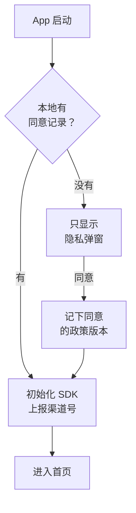
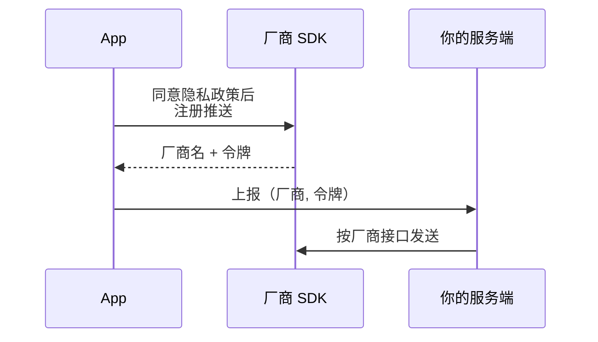

# Android 与国内分发

前十章几乎只讲 iOS：书架 App 只装在自己的 iPhone 上，唱片墙走 TestFlight。但如果做的是卖给国内用户的 App，安卓往往是大头。hatch-counter 的移动端「掌柜眼」就是这样：同一套 Expo 代码，安卓那条路先通，现在是出 APK 传到对象存储，店主在官网扫码下载安装。

这一章讲 Expo 项目走国内安卓分发时**工程上要做的事**：签名与 APK、渠道包、隐私合规弹窗、厂商推送、上架国内应用商店。资质手续（App 备案、软件著作权、各商店要的材料）在[《国内合规实务》](../opc-compliance-cn/)里讲，这里只在需要时链过去。

## 国内安卓和 Google Play 有什么不同

> [!WARNING]
> 本节的 SDK 版本线按 2026 年 11 月 Expo 文档首页的版本对照表核对（SDK 58：Android 7 及以上、compileSdk 37、targetSdk 36）；国内各应用市场的包格式、targetSdk 要求、审核规则按公开资料整理，变化频繁，以各平台开发者后台的最新规则为准。

Expo 和 React Native 的文档默认读者在 Google Play 生态里。到了国内，几处前提都不成立：

| 项 | 国内的情况 |
|---|---|
| 分发渠道 | 华为、荣耀、小米、OPPO、vivo 等厂商商店，加上应用宝等第三方商店，各自审核；也可以在官网自分发 APK |
| 包格式 | Google Play 收 AAB；国内商店普遍收 APK，所以出包命令是 `assembleRelease` |
| 推送 | 大多数手机没有 Google 服务，FCM 收不到，要接厂商通道 |
| 安装来源 | `expo-application` 的 `getInstallReferrerAsync()` 依赖 Google Play 的 Install Referrer，国内商店装的包拿不到，要靠渠道包 |
| 合规检查 | 商店会自动跑隐私行为检测，还要核对 App 备案、软著 |

还有一个变量：华为在 2024 年发布的 HarmonyOS NEXT 只安装鸿蒙原生的 HAP 包，**不再运行 APK**。Expo 不支持鸿蒙，React Native 的鸿蒙适配也不在 Expo 的模块和 prebuild 体系里。用户里鸿蒙新机占多少，决定了要不要单独投入，这是产品决策，不是本章能替你回答的。

## 签名：一把钥匙用到底

安卓认 App 的身份是「**包名 + 签名证书**」这一对。系统只允许同一把私钥签出来的新包覆盖旧包，对不上就拒装。私钥只在 keystore 文件里，从已发出去的 APK 里推不回来。所以 keystore 是整条链上**唯一没有补救办法的环节**：丢了，这个包名就再也发不出下一版，已装的用户只能卸载重装。

生成一把正式钥匙：

```bash
keytool -genkeypair -v -storetype PKCS12 \
  -keystore ~/myapp-release.jks -alias myapp \
  -keyalg RSA -keysize 2048 -validity 10000
```

掌柜眼的发布文档里记了几条经验：用 `PKCS12` 格式，库口令和私钥口令就是同一个；口令用 `openssl rand -base64 24` 先生成再粘贴，不要用 `-storepass` 写在命令行里（会进 shell 历史）；文件和口令一起进密码管理器，再在另一台设备放一份。CI 的 secret 写进去就读不出来，**不算备份**。

### 在 prebuild 体系里接正式签名

Expo 生成的 `android/app/build.gradle` 里，release 档默认用的是调试签名，`app.json` 没有字段能改它。`android/` 又不进仓库、每次现生成，所以只能用 config plugin 改，掌柜眼的 `with-release-signing` 插件就是干这个的，写法和三条纪律见[第 5 章](05-config-plugins.md#文本-mod签名插件的防御写法)。

出包与验包：

```bash
npx expo prebuild --platform android --clean
cd android && ./gradlew app:assembleRelease
# 产物在 android/app/build/outputs/apk/release/app-release.apk
apksigner verify --verbose --print-certs app/build/outputs/apk/release/app-release.apk
```

`apksigner` 的输出要看两处：哪几种签名方案验证通过，以及证书的 DN。看到 `CN=Android Debug` 就当场停住，那是调试钥匙签的包，一旦发出去，换钥匙就得让所有装过的人卸载重装。

签名方案有几代，国内工具链（渠道包、加固）都和它有关：

| 方案 | 引入版本 | 签的是什么 |
|---|---|---|
| v1（JAR 签名） | 最早 | 逐个文件签，ZIP 里的元数据不受保护 |
| v2 | Android 7.0 | 整个文件，**签名块本身除外** |
| v3 | Android 9 | 在 v2 基础上支持轮换签名密钥 |

签名证书的指纹（SHA-256 等）之后会被要很多次：App 备案要填（见[《国内合规实务》App 备案一章](../opc-compliance-cn/04-app-filing.md#要准备什么)），厂商推送、微信、地图这类 SDK 的后台也要登记。用 `keytool -list -v -keystore ~/myapp-release.jks` 读出来，记在发布文档里。

## 渠道包：一次构建，多个渠道

同一个 App 上了七八个商店，想知道用户从哪个商店来，只能在包里写一个渠道号，启动后（用户同意隐私政策之后）随统计上报。

两种做法：

- **Gradle 的 productFlavors**：每个渠道一个变体，每个都完整构建一次。渠道多了出包很慢，而且在 prebuild 体系里还得用插件改 `build.gradle`
- **签名后往签名块里写**：v2 签名的哈希覆盖「签名块之外的全部内容」，所以在签名块里追加一段自定义数据，不需要重新签名，签名依然有效。一次构建、几秒钟复制出几十个渠道包

第二种是国内的主流做法。腾讯开源的 VasDolly 支持 v1、v2、v3 三种签名方案，会自动识别 APK 用的是哪种，提供 Gradle 插件和独立的命令行工具；渠道列表是一个每行一个渠道名的文本文件：

```text
huawei
xiaomi
oppo
vivo
honor
yingyongbao
official
```

运行时读渠道号，要用它的 helper 库，Expo 里写一个本地模块（创建方法见[第 6 章](06-native-module.md#创建本地模块)）。模块的 `android/build.gradle` 里加依赖 `implementation "com.tencent.vasdolly:helper:3.0.6"`，Kotlin 侧：

```kotlin
package expo.modules.channel

import com.tencent.vasdolly.helper.ChannelReaderUtil
import expo.modules.kotlin.modules.Module
import expo.modules.kotlin.modules.ModuleDefinition

class ChannelModule : Module() {
  override fun definition() = ModuleDefinition {
    Name("Channel")
    // 没写渠道号的包（比如本地调试包）返回 null，JS 侧当作 official
    Function("get") {
      val context = appContext.reactContext ?: return@Function null
      ChannelReaderUtil.getChannel(context)
    }
  }
}
```

几个要注意的地方：

- **渠道号不是安全机制**，任何人都能改写。它只用于统计，不能用来决定功能或价格
- **加固、商店重签名可能把签名块里的数据丢掉**。每个商店上线后，从商店下载一次实际分发的包，用工具读一遍渠道号
- **只有 v1 签名时代的老办法**（往 `META-INF` 里塞一个空文件）在 v2 下会破坏签名，网上的旧教程别照抄

## 隐私合规：同意之前什么都不做

> [!WARNING]
> 个人信息保护的法律框架和商店的检测项见[《国内合规实务》个人信息保护一章](../opc-compliance-cn/06-pipl.md#工程上的落地)和[上架资质一章](../opc-compliance-cn/08-store-qualifications.md#审核在看什么)，那里按 2025–2026 年的规定整理；本节只讲 Expo 工程里怎么落地。具体检测口径各商店不一，以各平台最新规则为准。

国内商店会用自动化工具装上你的 App 跑一遍，最常见的驳回原因是**隐私弹窗出来之前，就有代码读了设备标识或调了敏感接口**。在 Expo 项目里，要守住的是这条时间线：



### 把门放在根布局

和[第 3 章](03-expo-router.md#根布局在路由之前做完启动)的启动引导一样，同意与否是「所有页面之前必须确定的事」，放在根 `_layout` 里：

```tsx
// 同意记录用 expo-sqlite 的 kv-store，有同步读写，启动时不用等
import Storage from 'expo-sqlite/kv-store';

const POLICY_VERSION = '2026-11';

export default function RootLayout() {
  const [agreed, setAgreed] = useState(
    () => Storage.getItemSync('privacy_consent') === POLICY_VERSION,
  );

  useEffect(() => {
    if (agreed) void initThirdPartySdks(); // 推送注册、统计、渠道号上报都在这里
  }, [agreed]);

  if (!agreed) {
    return (
      <ConsentScreen
        onAgree={() => {
          Storage.setItemSync('privacy_consent', POLICY_VERSION);
          setAgreed(true);
        }}
      />
    );
  }
  return <AppStack />;
}
```

存的是**政策版本**而不是布尔值：隐私政策改版后，旧版本的同意不算数，要重新弹一次。

### 哪些动作算「收集」

在同意之前，下面这些都不要做：

- 读设备标识：`expo-application` 的 `Application.getAndroidId()`（它的值因签名密钥、用户、设备组合而不同，正是检测工具盯着的那类标识）、IMEI、MAC 地址
- 读剪贴板：启动时读一下剪贴板看有没有口令或链接，是常被点名的行为
- 申请权限：相机、定位、通知都等用户用到时再申请，Android 13 起发通知也要运行时授权
- 发带标识的网络请求，包括统计和崩溃上报

**原生 SDK 是最难管的一层**。不少安卓 SDK 通过清单里的 `ContentProvider` 在 App 进程启动时自动初始化，比 JS 跑得还早，根布局里的门拦不住它。选 SDK 时看它的文档有没有「合规初始化」「延迟初始化」一类的说明，没有的就要慎用。

### 权限清单要自己核对

库会通过清单合并（manifest merge）往你的 App 里塞权限，最终的 APK 可能声明了你从没用过的权限。两个工具：

- **插件参数**：很多 Expo 库的插件能关掉不用的权限。掌柜眼的 `expo-camera` 只用来拍照，配了 `"microphonePermission": false` 和 `"recordAudioAndroid": false`
- **`android.blockedPermissions`**：在 `app.json` 里列出要从最终清单里删掉的权限，专门对付合并进来的那些

出包后用 Android SDK 里的 `apkanalyzer manifest permissions app-release.apk` 列一遍最终声明的权限，每一条都要能在隐私政策里找到对应的用途说明。

掌柜眼目前还没有隐私弹窗和隐私政策页，这是它上商店之前要补的第一件事。

## 厂商推送：在 Expo 里怎么接

为什么国内要接厂商通道、消息分类和限额是怎么回事，[《软件架构与系统设计》实时推送一章](../system-design/05-realtime-push.md#android-和国内厂商通道)已经讲过。这里接着讲 Expo 工程里怎么落地。

先认清 `expo-notifications` 的边界：在 Android 上，`getDevicePushTokenAsync()` 返回的是 **FCM 令牌**，Expo 的推送服务也是经 FCM 投递。没有 Google 服务的国内手机上，这条路不通。所以国内安卓要么直接接各厂商 SDK，要么接一家聚合服务的 React Native SDK，无论哪种都要原生依赖，也就意味着：

- **必须用 dev client**，Expo Go 里测不了（[第 4 章](04-dev-client-prebuild.md)）
- **原生配置全部写成 config plugin**：清单里的 `appId` / `appKey` 元数据、厂商要求放进 `android/app/` 的配置文件（如华为的 `agconnect-services.json`），都在 prebuild 时由插件写入（[第 5 章](05-config-plugins.md)）
- **Maven 仓库和混淆规则**用 `expo-build-properties` 配：`android.extraMavenRepos` 加厂商的仓库（华为是 `https://developer.huawei.com/repo/`），`android.extraProguardRules` 补 keep 规则。SDK 58 起 release 构建默认开 R8，推送 SDK 普遍用反射，漏了 keep 规则的表现是调试包正常、正式包收不到推送

令牌的流转：



服务端存的是「（厂商, 令牌）」而不只是令牌，发送时按厂商分流；接聚合服务时这一步由它做。通知点开后带的深链接，交给 expo-router 处理，和[第 3 章](03-expo-router.md#native-intent处理系统传进来的-url)的 `+native-intent` 是同一个入口。

两个调试时最容易卡住的地方：

- **签名指纹要对上**。厂商后台登记的是正式钥匙的 SHA-256 指纹，用调试钥匙签的开发包可能拿不到令牌。要么把调试指纹也登记上，要么用正式签名出一个测试包
- **每个品牌都要真机测**。厂商通道只在自家系统上生效，模拟器和别家手机上测不出来。手边没有那么多机型，就先接用户最多的一两家，其余的退回「回到前台时刷新」

## 上架国内应用商店

要准备哪些材料、审核看什么，[《国内合规实务》上架资质一章](../opc-compliance-cn/08-store-qualifications.md#国内安卓应用市场)有完整清单；软件著作权多数商店都要，登记要排队，最好在开发后期就提交，流程见[软著一章](../opc-compliance-cn/05-software-copyright.md#登记流程)。工程这一侧要保证的是**几处信息前后一致**：

| 信息 | 在 Expo 里的位置 | 要和谁一致 |
|---|---|---|
| 应用名称 | `expo.name` | App 备案、软著、商店后台 |
| 包名 | `android.package` | App 备案；备案之后改包名要办变更 |
| 签名证书 | 正式 keystore | App 备案登记的指纹、厂商推送后台 |
| 版本号 | `version` / `android.versionCode` | 每次上传必须比上一版大 |

掌柜眼的 `app.config.js` 从 `package.json` 的版本号现算 `versionCode`（`1.2.3` → `10203`），仓库里不存自增的数：存了的话，CI 里打包那步和提交那步各加一次，包里的号和仓库里的号就分家了。次版本号或补丁号超过 99 时直接抛错，不会静默算出一个更小的号。

### 不上商店：官网自分发

掌柜眼现在走的是这条路：CI 出 APK，传阿里云 OSS，官网放下载按钮和二维码。踩过的两个坑：

- **OSS 默认域名不许分发 APK**，取的时候直接返回 400，错误码 `ApkDownloadForbidden`，要求绑定自己的域名。绑的域名要先完成备案
- **下载链接要用 HTTPS**，HTTP 的安装包链接有被中途替换的风险

自分发的代价是用户安装时要手动允许「安装未知来源应用」，有的手机还会弹额外的安全提示。面向熟人和老客户可以，要让陌生用户自己搜到，还是得上商店。

## 本章要点

- 国内安卓没有 Google Play 和 FCM：出 APK、靠渠道包统计来源、接厂商推送，还要过商店的隐私检测
- 安卓的 App 身份是**包名 + 签名证书**；keystore 丢了无法补救，在 prebuild 体系里用 config plugin 接正式签名，出包后用 `apksigner` 验证
- 渠道包利用 v2 签名不覆盖签名块的特性，一次构建批量写入渠道号；渠道号只用于统计
- 隐私弹窗放在根布局，**同意之前不读标识、不读剪贴板、不申请权限、不初始化 SDK**；用 `blockedPermissions` 和 `apkanalyzer` 核对最终权限
- `expo-notifications` 在 Android 上走 FCM；厂商推送要原生 SDK、config plugin 和 dev client，R8 下记得补 keep 规则
- 应用名、包名、签名、版本号要和 App 备案、软著、商店后台保持一致

## 动手练习

1. **验一个 release 包的签名**：在练习项目（`npx create-expo-app@latest`）里运行 `npx expo prebuild --platform android`，然后 `cd android && ./gradlew app:assembleRelease`，对产物运行 `apksigner verify --verbose --print-certs`。

   验证：输出里能看到 v2（或 v3）方案验证通过，证书 DN 是 `CN=Android Debug`。

   参考答案：Expo 生成的工程里 release 档默认用调试签名，这正是第 5 章那个签名插件要解决的问题；这个包能装能跑，但绝不能发出去。

2. **找出多余的权限**：对第 1 题的 APK 运行 `apkanalyzer manifest permissions`，挑一条 App 用不到的权限，加进 `app.json` 的 `android.blockedPermissions`，重新 prebuild 并出包，再列一次。

   验证：那条权限从输出里消失了。

   参考答案：最终清单是所有库的清单合并出来的，`blockedPermissions` 在合并后把指定权限删掉。改的是原生配置，所以必须重新 prebuild。

3. **给练习项目加一道同意门**：照本章根布局的写法加一个同意页，在 `initThirdPartySdks()` 里只写一行 `console.log('sdk init')`。第一次启动不点同意，直接从后台划掉 App 再打开；然后点同意，再划掉重开。

   验证：点同意之前日志里始终没有 `sdk init`；点同意后立刻出现一次，之后每次冷启动都会出现，不再弹同意页。

   参考答案：同意记录存的是政策版本，把 `POLICY_VERSION` 改成新值再启动，会重新弹出同意页，模拟隐私政策改版。

到这里，一个 Expo App 从运行时原理到装进别人手机的完整链路就走完了，iOS 和国内安卓两条路都覆盖到了。接下来可以读[《Electron 桌面应用》](../electron-desktop/)，它和这本书是同一类问题在桌面端的版本：多进程、桥接、签名和分发；如果对 React 本身的调和与并发机制还想深入，读[《React 19 原理与模式》](../react-internals/)；移动端的密钥存储、传输安全等话题，在[《应用安全》](../app-security/)的移动端安全一章里展开。
