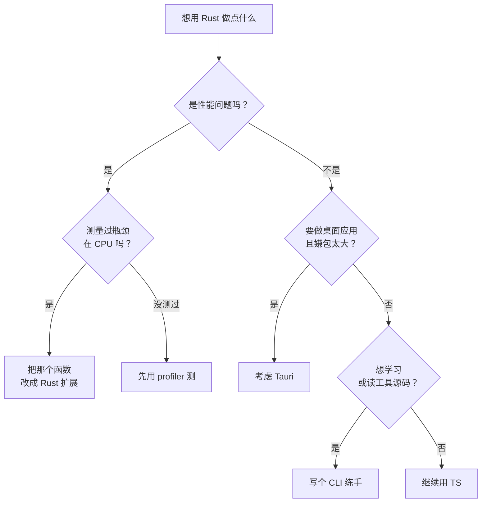

# 为什么学 Rust，什么时候不该用

你每天都在用 Rust 写的东西，只是没注意：Vite 背后的 Rolldown 和 Oxc、Next.js 的 SWC 和 Turbopack、Biome、Lightning CSS、Python 圈的 uv 和 ruff，还有 Tauri。前端工具链这几年的提速，很大一部分来自「把 JS 写的工具用 Rust 重写一遍」。

但这不等于你也该把自己的项目改成 Rust。一人公司最贵的是时间，多一门语言就多一套工具链、一套报错、一套依赖要维护。这一章先把「为什么学」和「什么时候不该用」讲清楚，再用对照的方式过一遍 Rust 的基本语法，让你能读懂后面各章的代码。

## 这本书讲什么、适合谁、怎么读

**讲什么**：一个 TS 全栈开发者实际用得上的那部分 Rust。前七章是语言本身：所有权与借用、生命周期、类型与 trait、错误处理、集合与迭代器、并发与 async；后三章是落地：用 clap 写 CLI、用 Tauri 做桌面应用、把 Rust 编译成 WASM 和 Node 原生扩展。不讲 unsafe、宏的编写、嵌入式，也不讲 Web 后端框架（axum 只在需要时提一句）。

**适合谁**：TypeScript 写得很熟（React、Expo、Electron、NestJS 都算），没写过 Rust 的开发者。全书默认你懂泛型、联合类型、`Promise`、事件循环、pnpm workspace。

**怎么读**：第 2、3 章是 Rust 和其他语言最不一样的地方，务必按顺序读，并且把代码敲一遍；第 4–7 章可以按需跳读；第 8–10 章围绕同一个示例项目展开，按顺序读最顺。

**贯穿全书的示例**：一个叫 `shelf-rs` 的小工具集，用 Rust 实现书巢（hatch-shelf）里 `shelf-pack check` 的一部分：读 `book.yaml`、检查每章是不是只有一个 H1、代码块有没有标语言。第 8 章把它做成 CLI，第 9 章套上 Tauri 界面，第 10 章编译成 WASM 和 Node 扩展。并发那一章则借用唱片墙（hatch-recordwall）的「从曲库批量下载歌曲」做例子。

### 版本约定

> [!WARNING]
> 本书按 2026 年 11 月的情况整理：Rust **edition 2024**（需要 Rust 1.85 及以上，写作时稳定版在 1.9x），主要 crate 的大版本为 serde 1、clap 4、tokio 1、thiserror 2、anyhow 1、tauri 2、wasm-bindgen 0.2、napi-rs 3。Rust 每六周发一个稳定版，crate 也会升级大版本，编译器行为和 API 以 [Rust 官方发布说明](https://blog.rust-lang.org/) 和各 crate 在 docs.rs 上的文档为准。本书的示例代码未在写作机器上实际编译，照抄遇到报错时，先看编译器的提示，它通常会直接告诉你怎么改。

## 为什么一个 TS 开发者要学 Rust

### 理由一：读懂你依赖的工具

当 Vite 构建报出一个奇怪的错误、当 Biome 的某条规则和你想的不一样，你会发现调用栈的另一头是 Rust。能读懂 Rust，意味着遇到工具链问题时可以直接去看源码和 issue，而不是只能等别人修。这一条不需要你写得多好，读得懂就够。

### 理由二：Node 不擅长的那一小块

Node 擅长 I/O：发请求、读写数据库、转发流。它不擅长的是**长时间占用 CPU 的计算**：解析几万个文件、图片和音频处理、压缩、哈希、大量数据的转换。在 [事件循环那一章](../ts-node-advanced/04-event-loop-libuv.md) 里你见过，CPU 密集任务会卡住主线程，只能挪到 `worker_threads`。

Rust 在这类任务上通常比 JS 快一个数量级，而且没有 GC 停顿，内存占用可预测。更重要的是，它可以**以库的形式**嵌进你现有的 TS 项目：编译成 Node 原生扩展（napi-rs），或者编译成 WASM 在浏览器和 Cloudflare Workers 里跑。你不需要把整个项目换成 Rust，只换掉最慢的那个函数。

### 理由三：Tauri

想做桌面应用又嫌 Electron 太重时，Tauri 是最常被考虑的替代品，它的后端就是 Rust。[《Electron 桌面应用》的最后一章](../electron-desktop/08-electron-vs-tauri.md) 从 Electron 的角度讲过两者的取舍，本书第 9 章从 Rust 的角度动手做一个。

### 理由四：编译器会教你写更好的代码

Rust 的所有权规则逼你想清楚「这份数据归谁、谁能改、什么时候释放」。这些问题在 TS 里同样存在，只是语言不管：两个模块同时持有并修改同一个对象、遍历数组时往里 `push`、闭包捕获了一个后来被改掉的变量。学过 Rust 之后，你写 TS 时也会更自然地避开这些坑。

## 什么时候不该用 Rust

| 场景 | 建议 | 原因 |
|---|---|---|
| CRUD 后端、管理后台 | 继续用 NestJS | 瓶颈在数据库和网络，不在语言；Rust 的 Web 生态够用，但写业务远不如 TS 快 |
| 移动端 App | 继续用 Expo | RN 里接 Rust 要走原生模块，链路很长，收益很少 |
| 一次性脚本、胶水代码 | TS（`node script.ts`）或 Python | 编译慢、代码量大，脚本不需要那点性能 |
| 业务规则经常变的代码 | TS | 改一个字段在 Rust 里要过一遍类型和借用检查，迭代速度慢 |
| 需要和 App 共享的逻辑 | TS | 比如书巢的 `@shelf/spec`，App 和 CLI 共用；用 Rust 写就得同时维护两份或引入跨语言桥 |
| 只是觉得「Rust 更快」 | 先测量 | 大部分慢是算法和 I/O 造成的，换语言救不了 |

一句话：**Rust 适合边界清楚、输入输出简单、计算重或要求可靠的那一小块**。如果你说不出那一块具体是哪个函数，就还没到用 Rust 的时候。



## 安装与工具链

Rust 的官方安装方式是 rustup，它管理编译器版本，相当于 Node 世界的 fnm / nvm：

```bash
curl --proto '=https' --tlsv1.2 -sSf https://sh.rustup.rs | sh
rustc --version          # 编译器
cargo --version          # 包管理 + 构建工具
rustup update            # 升级到最新稳定版
rustup component add clippy rustfmt   # 一般默认已装
```

编辑器装 **rust-analyzer** 插件（VS Code、Zed、RustRover 都支持），它对 Rust 的意义相当于 TS 的语言服务：类型提示、跳转、内联报错、自动补全 `match` 分支。

### Cargo 与 pnpm 对照

| 做什么 | pnpm / Node | Cargo |
|---|---|---|
| 新建项目 | `pnpm init` | `cargo new my-app`（可执行）/ `cargo new --lib my-lib`（库） |
| 清单文件 | `package.json` | `Cargo.toml` |
| 锁文件 | `pnpm-lock.yaml` | `Cargo.lock` |
| 加依赖 | `pnpm add zod` | `cargo add serde --features derive` |
| 运行 | `pnpm dev` / `node x.ts` | `cargo run` |
| 构建 | `pnpm build` | `cargo build`（调试）/ `cargo build --release`（优化） |
| 类型检查 | `tsc --noEmit` | `cargo check`（比 build 快，日常用它） |
| 测试 | `vitest` | `cargo test`（内置，不用装框架） |
| Lint | ESLint | `cargo clippy` |
| 格式化 | Prettier | `cargo fmt` |
| 依赖仓库 | npmjs.com | crates.io，文档统一在 docs.rs |
| monorepo | pnpm workspace | Cargo workspace |

Rust 的包叫 **crate**。和 npm 最大的不同是：**依赖在你的机器上从源码编译**，所以第一次构建会慢，之后有增量缓存。产物放在项目的 `target/` 目录，记得加进 `.gitignore`（`cargo new` 会自动加）。

一个最小的 `Cargo.toml`：

```toml
[package]
name = "hello"
version = "0.1.0"
edition = "2024"

[dependencies]
```

`edition` 是 Rust 的「语言版本」，每三年一次（2015、2018、2021、2024），可以理解为 `tsconfig` 里的 `target` 加上一部分 `strict` 选项。不同 edition 的 crate 可以互相依赖，所以升级 edition 不会让生态分裂。

## 第一个程序

```bash
cargo new hello
cd hello
cargo run
```

`src/main.rs` 里是：

```rust
fn main() {
    println!("Hello, world!");
}
```

`println!` 末尾的感叹号表示它是**宏**，不是函数。宏在编译期展开，能做到函数做不到的事，比如检查格式字符串和参数个数是否匹配。你会经常用宏，但很少需要自己写。

## 语法速览：对照 TS

下面快速过一遍基本语法，目的是让你能读懂后面的代码。真正难的部分（所有权、生命周期）从下一章开始。

### 变量：默认不可变

```typescript
const name = "hatch";
let count = 3;
count += 1;
```

```rust
let name = "hatch";        // 默认不可变，相当于 const
let mut count = 3;         // 要改就写 mut
count += 1;
let count = count * 2;     // 同名重新绑定（shadowing），这是新变量
println!("{name}: {count}");
```

Rust 的 `let` 相当于 TS 的 `const`，而且更严格：TS 的 `const obj` 仍然能改 `obj.x`，Rust 的不可变绑定连内部字段都不能改。Shadowing 在 TS 里会报「重复声明」，在 Rust 里是惯用法，常用在「把字符串解析成数字后沿用同一个名字」这种场景。

### 数字类型

TS 只有 `number`，Rust 要你选位宽：

| 类型 | 含义 | 常见用途 |
|---|---|---|
| `i32` / `i64` | 有符号整数 | 一般整数，默认推断为 `i32` |
| `u8` / `u32` / `u64` | 无符号整数 | 字节、计数 |
| `usize` | 和指针一样宽的无符号整数 | 下标、长度（`vec.len()` 返回它） |
| `f64` / `f32` | 浮点 | 默认推断为 `f64` |

```rust
let total: u64 = 1_000_000;
let ratio = 0.75;                 // f64
let n = 7 / 2;                    // 3，整数除法
let avg = total as f64 / 3.0;     // 不同类型不能直接运算，要用 as 显式转换
let parsed: u32 = "42".parse().unwrap();   // 解析字符串，unwrap 第 5 章讲
```

Rust **没有隐式类型转换**，`u32` 和 `u64` 相加也要先转。一开始会觉得啰嗦，但它消灭了一整类 bug。整数溢出在调试构建下会直接 panic（崩溃并报错），在 release 构建下默认回绕，需要明确语义时用 `checked_add`、`saturating_add` 这类方法。

### 函数与表达式

```rust
fn grade(score: u32) -> &'static str {
    if score >= 90 {
        "A"
    } else if score >= 80 {
        "B"
    } else {
        "C"
    }
}

fn add(a: i32, b: i32) -> i32 {
    a + b       // 最后一个表达式不加分号，就是返回值
}
```

Rust 里几乎一切都是**表达式**，`if`、`match`、代码块都有值。所以没有三元运算符，直接写 `let label = if ok { "pass" } else { "fail" };`。函数最后一行不加分号就是返回值，加了分号就变成语句，返回 `()`（相当于 `void`）。`return` 只在提前返回时用。

参数和返回值的类型**必须写**，函数体内部的局部变量大多可以推断。这和 TS 的惯例正好相反：TS 常常省略返回类型，Rust 要求函数签名完整，因为签名是编译器做借用检查的依据。

`&'static str` 先当成「字符串字面量的类型」看，第 3 章解释。

### 结构体和方法

```typescript
class Chapter {
  constructor(public file: string, public title: string, public bytes: number) {}
  isLong() { return this.bytes > 16_000; }
}
```

```rust
struct Chapter {
    file: String,
    title: String,
    bytes: usize,
}

impl Chapter {
    // 关联函数，没有 self，相当于静态方法；new 只是约定的名字，不是关键字
    fn new(file: &str, title: &str, bytes: usize) -> Self {
        Self { file: file.to_string(), title: title.to_string(), bytes }
    }

    // 方法，&self 相当于只读的 this
    fn is_long(&self) -> bool {
        self.bytes > 16_000
    }
}

fn main() {
    let ch = Chapter::new("01-why-rust.md", "为什么学 Rust", 14_000);
    println!("{} long? {}", ch.title, ch.is_long());
}
```

数据（`struct`）和行为（`impl`）分开写，没有类继承。代码复用靠 trait（第 4 章）和组合。

### 枚举和 match

Rust 的 `enum` 就是 TS 的**可辨识联合**，而且每个分支可以带不同的数据：

```typescript
type ImportResult =
  | { kind: "ok"; id: string; warnings: string[] }
  | { kind: "error"; message: string };
```

```rust
enum ImportResult {
    Ok { id: String, warnings: Vec<String> },
    Error(String),
}

fn describe(r: &ImportResult) -> String {
    match r {
        ImportResult::Ok { id, warnings } if warnings.is_empty() => format!("导入 {id}"),
        ImportResult::Ok { id, warnings } => format!("导入 {id}，{} 条警告", warnings.len()),
        ImportResult::Error(msg) => format!("失败：{msg}"),
    }
}
```

`match` 必须**穷尽**所有分支，漏一个就编译不过。TS 里要靠 `never` 技巧才能做到的穷尽检查，Rust 是默认行为。

### 没有 null：Option

Rust 没有 `null` 和 `undefined`，「可能没有值」用 `Option<T>` 表示，它就是一个普通的枚举：

```rust
enum Option<T> {   // 标准库里已经定义好了，不用自己写
    Some(T),
    None,
}
```

```rust
fn find_subtitle(id: &str) -> Option<String> {
    if id == "rust-practice" {
        Some("写给 TS 开发者".to_string())
    } else {
        None
    }
}

fn main() {
    match find_subtitle("rust-practice") {
        Some(s) => println!("副标题：{s}"),
        None => println!("没有副标题"),
    }
    // 相当于 subtitle ?? "（无）"
    let s = find_subtitle("x").unwrap_or_else(|| "（无）".to_string());
    println!("{s}");
}
```

你不可能「忘了判空」：`Option<String>` 和 `String` 是两个类型，不取出来就用不了里面的字符串。

### 循环

```rust
for i in 0..3 {                    // 0, 1, 2；0..=3 包含 3
    println!("{i}");
}

let files = vec!["01.md", "02.md"];
for (i, f) in files.iter().enumerate() {
    println!("{i}: {f}");
}

let mut n = 0;
let found = loop {                 // loop 是无限循环，break 可以带值
    n += 1;
    if n * n > 50 {
        break n;
    }
};
```

`vec![...]` 是创建 `Vec`（相当于数组）的宏。`iter()` 和 `enumerate()` 是迭代器，第 6 章讲。

## 编译器是你的同事

Rust 的报错信息是出了名的友好。比如在不可变变量上做修改：

```rust
fn main() {
    let count = 1;
    count += 1;
}
```

```text
error[E0384]: cannot assign twice to immutable variable `count`
 --> src/main.rs:3:5
  |
2 |     let count = 1;
  |         ----- first assignment to `count`
3 |     count += 1;
  |     ^^^^^^^^^^ cannot assign twice to immutable variable
  |
help: consider making this binding mutable
  |
2 |     let mut count = 1;
  |         +++
```

它不仅告诉你错在哪，还给出了改法。遇到看不懂的错误码，运行 `rustc --explain E0384` 会得到一篇带例子的说明。

学 Rust 的头两周，你的大部分时间会花在和编译器「吵架」上。这是正常的，而且这些时间不会白花：**在 Rust 里能编译通过的代码，运行时出错的概率比 TS 低得多**。在 TS 里要靠测试和线上报错发现的问题，Rust 在编译期就拦住了。

编码 agent 写 Rust 也受益于此：编译错误信息精确，agent 能根据报错自我修正。你可以放心让 agent 写，但要能读懂它写的东西，这正是本书的目标。

## 常见坑速查

| 现象 | 原因 | 做法 |
|---|---|---|
| `cannot assign twice to immutable variable` | 变量默认不可变 | 加 `mut` |
| `mismatched types: expected u64, found u32` | 没有隐式转换 | 用 `as` 或 `u64::from(x)` |
| 函数返回了 `()` 而不是预期的值 | 最后一行多了分号 | 去掉分号 |
| `non-exhaustive patterns` | `match` 漏了分支 | 补上，或用 `_ =>` 兜底 |
| 第一次 `cargo build` 很慢 | 依赖从源码编译 | 正常；日常用 `cargo check` |
| `target/` 有好几个 GB | 调试和 release 产物、增量缓存 | 偶尔 `cargo clean` |

## 本章要点

- Rust 适合边界清楚、计算重或要求可靠的那一小块；CRUD、移动端、经常变的业务逻辑继续用 TS
- 不需要整体改写：用 napi-rs 和 WASM 把最慢的函数换成 Rust，或用 Tauri 做桌面
- Cargo 一个工具包办构建、依赖、测试、lint、格式化；日常用 `cargo check`
- 变量默认不可变，没有隐式类型转换，函数签名必须写全类型
- 几乎一切是表达式，函数最后一个不加分号的表达式就是返回值
- `enum` + `match` 就是带穷尽检查的可辨识联合；没有 null，用 `Option`
- 编译器报错会给出改法，把它当同事

## 动手练习

1. **多一个分号**：`cargo new semi`，在 `src/main.rs` 里写下面的代码，运行前预测 `cargo check` 的结果，再按编译器提示改掉。

   ```rust
   fn add(a: i32, b: i32) -> i32 {
       a + b;
   }

   fn main() {
       println!("{}", add(1, 2));
   }
   ```

   验证：报 `error[E0308]: mismatched types`，指出函数声明返回 `i32` 却隐式返回了 `()`，并有一条 help 建议删掉分号。删掉后 `cargo run` 输出 `3`。

   参考答案：加了分号，`a + b` 就从表达式变成语句，函数体的值是 `()`，和签名对不上。

2. **给枚举加一个分支**：把本章的 `ImportResult` 和 `describe` 拷进项目，在 `enum` 里加一个 `Skipped` 分支，不改 `describe`，运行 `cargo check`。

   验证：报 `error[E0004]: non-exhaustive patterns`，指出 `ImportResult::Skipped` 没有被覆盖。给 `match` 补一个 `ImportResult::Skipped => "跳过".to_string(),` 后通过。

   参考答案：`match` 必须穷尽。这正是可辨识联合在 Rust 里比 TS 省心的地方：加了新状态，所有没处理它的地方都会编译失败。

3. **调试和 release 下的溢出**：用一个运行时才知道的值（避免编译期被常量检查拦下）：

   ```rust
   fn main() {
       let x: u8 = "255".parse().unwrap();
       println!("{}", x + 1);
   }
   ```

   先 `cargo run`，再 `cargo run --release`，比较结果；然后把 `x + 1` 改成 `x.checked_add(1)` 并用 `{:?}` 打印。

   验证：调试构建 panic，信息包含 `attempt to add with overflow`；release 构建打印 `0`；改用 `checked_add` 后两种构建都打印 `None`。

   参考答案：调试构建检查整数溢出，release 默认回绕。需要确定语义时用 `checked_*`、`saturating_*`、`wrapping_*` 系列方法明确写出来。
