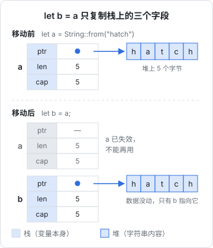

# 所有权与借用

所有权是 Rust 和你学过的其他语言最不一样的地方，也是它不需要垃圾回收就能保证内存安全的原因。这一章从「内存由谁释放」这个问题出发，讲清所有权的三条规则、移动和复制、借用的两种形式，以及最常见的几个编译错误该怎么读、怎么改。读完这一章，后面所有章节的代码你都能看懂它为什么要那样写。

## 内存由谁释放

所有语言都要回答同一个问题：堆上分配的内存，什么时候还回去？

| 方式 | 代表语言 | 谁来释放 | 代价 |
|---|---|---|---|
| 手动管理 | C | 程序员调用 `free` | 忘了释放会泄漏，释放两次或释放后再用会崩溃，而且是安全漏洞 |
| 垃圾回收 | JS、Java、Go | 运行时定期找出没人引用的对象 | 有 GC 停顿，内存占用偏高，运行时要带一个回收器 |
| 所有权 | Rust | **编译器**在变量离开作用域的地方插入释放代码 | 写代码时要遵守规则，编译器会检查 |

JS 开发者很少想这个问题，因为 V8 的 GC 替你做了。代价你在 [《TS 与 Node 进阶》的内存一章](../ts-node-advanced/06-memory-gc-leaks.md) 里见过：GC 停顿、闭包意外持有大对象导致泄漏。Rust 选了第三条路：在编译期就确定每块内存什么时候释放，运行时没有任何额外开销。

## 三条规则

1. 每个值都有一个**所有者**（owner），也就是一个变量
2. 同一时刻只能有**一个**所有者
3. 所有者离开作用域时，值被释放（Rust 里叫 drop）

```rust
fn main() {
    {
        let title = String::from("Rust 实用入门");   // title 拥有这个字符串
        println!("{title}");
    }   // title 离开作用域，字符串的堆内存在这里释放
    // println!("{title}");   // 编译错误：title 已经不存在
}
```

规则 3 你在 TS 里见过类似的东西：TS 5.2 的 `using` 声明会在离开作用域时调用 `[Symbol.dispose]()`。Rust 把这件事推广到了**所有值**，不只是文件句柄和连接，内存本身也是这样释放的。

## 移动：赋值会转移所有权

规则 2 带来了 Rust 最让人意外的行为：

```rust
fn main() {
    let a = String::from("hatch");
    let b = a;              // 所有权从 a 移动（move）到 b
    println!("{b}");
    // println!("{a}");     // 编译错误：borrow of moved value: `a`
}
```

在 TS 里，`const b = a` 之后 `a` 和 `b` 指向同一个对象，两个都能用。Rust 里，`let b = a` 之后 `a` 就**失效**了。原因看内存布局：



一个 `String` 由两部分组成：栈上的三个字段（指向堆的指针、长度、容量），和堆上的实际字节。`let b = a` 只复制栈上那三个字段，堆上的数据不动。如果 `a` 和 `b` 都还有效，它们离开作用域时会**各释放一次**同一块堆内存，这就是 C 里的 double free。Rust 的解决办法很直接：移动之后，旧变量不能再用。

### 函数传参也是移动

```rust
fn print_title(title: String) {
    println!("{title}");
}   // title 在这里被释放

fn main() {
    let t = String::from("Rust 实用入门");
    print_title(t);         // t 的所有权移进了函数
    // print_title(t);      // 编译错误：t 已经被移走
}
```

把值传给函数，就像把东西交给别人：交出去之后你手里就没有了。反过来，函数可以通过返回值把所有权交回来：

```rust
fn add_suffix(mut s: String) -> String {
    s.push_str("（第 2 版）");
    s                       // 把所有权交回给调用方
}

fn main() {
    let t = String::from("Rust 实用入门");
    let t = add_suffix(t);
    println!("{t}");
}
```

如果每个函数都要这样「借出去再还回来」，代码会非常啰嗦。所以 Rust 有了**借用**，下面马上讲。

### Copy：便宜的类型直接复制

不是所有类型都会移动：

```rust
fn main() {
    let a = 42;
    let b = a;              // i32 是 Copy 类型，直接复制
    println!("{a} {b}");    // 两个都能用
}
```

整数、浮点、`bool`、`char`，以及只包含这些类型的元组，都实现了 `Copy`：它们完全存在栈上，复制几个字节比追踪所有权还便宜。`String`、`Vec`、`HashMap` 这些拥有堆内存的类型不是 `Copy`，赋值就是移动。

### clone：明确地深拷贝

确实需要两份独立数据时，显式调用 `clone()`：

```rust
fn main() {
    let a = String::from("hatch");
    let b = a.clone();      // 堆上的数据也复制了一份
    println!("{a} {b}");
}
```

`clone()` 相当于 `structuredClone()`，会真的复制堆数据。Rust 故意让它显眼：在代码里看到 `.clone()`，就知道这里有一次分配。初学时用 `clone()` 绕过借用检查完全没问题，等熟悉了再去掉不必要的那些。

## 借用：用而不拿走

大多数时候，函数只是想**看一眼**数据，不需要拥有它。这时传一个引用，叫做**借用**（borrow）：

```rust
fn count_chars(s: &String) -> usize {   // &String：String 的引用
    s.chars().count()
}

fn main() {
    let title = String::from("Rust 实用入门");
    let n = count_chars(&title);          // 借出去
    println!("{title} 有 {n} 个字符");     // title 还在
}
```

`&title` 创建一个指向 `title` 的引用，函数用完就结束，所有权始终在 `main` 里。这才像你在 TS 里习惯的「传对象」。

### 可变借用

要让函数修改数据，传可变引用 `&mut`：

```rust
fn add_chapter(chapters: &mut Vec<String>, file: &str) {
    chapters.push(file.to_string());
}

fn main() {
    let mut chapters = vec![String::from("01-why-rust.md")];
    add_chapter(&mut chapters, "02-ownership-borrowing.md");
    println!("{chapters:?}");   // {:?} 是调试格式，能打印 Vec
}
```

注意 `mut` 出现了两次：变量本身要声明为 `mut`，借出去时也要写 `&mut`。调用处能看到 `&mut`，读代码的人一眼就知道这个函数会改它，这比 TS 里「传进去的对象可能被偷偷改掉」清楚得多。

### 借用规则：多个读，或者一个写

借用检查器（borrow checker）只检查一条规则：

> 在任意时刻，对同一个值，**要么**有任意多个不可变引用 `&T`，**要么**只有一个可变引用 `&mut T`，两者不能同时存在。

同时，引用不能比它指向的值活得更久（这是下一章的内容）。

这条规则看起来很严，但它消灭的是一类你在 TS 里实实在在写过的 bug。比如一边遍历数组一边往里加东西：

```typescript
const queue = ["a.md", "b.md"];
for (const f of queue) {
  if (f === "a.md") queue.push("c.md");   // 合法，但容易写成死循环
}
```

在 Rust 里，同样的写法编译不过：

```rust
fn main() {
    let mut queue = vec![String::from("a.md"), String::from("b.md")];
    for f in &queue {               // 不可变借用 queue，直到循环结束
        if f == "a.md" {
            queue.push(String::from("c.md"));   // 又要可变借用：编译错误
        }
    }
}
```

```text
error[E0502]: cannot borrow `queue` as mutable because it is also borrowed as immutable
```

这不只是风格问题。`Vec` 在 `push` 时如果容量不够，会把数据搬到一块更大的新内存，旧内存被释放。这时循环手里的引用就指向了已经释放的内存。在 C++ 里这是著名的「迭代器失效」，会导致未定义行为；在 Rust 里它根本编译不过。

正确的写法是先收集要加的东西，循环结束后再加：

```rust
fn main() {
    let mut queue = vec![String::from("a.md"), String::from("b.md")];
    let mut extra = Vec::new();
    for f in &queue {
        if f == "a.md" {
            extra.push(String::from("c.md"));
        }
    }
    queue.extend(extra);
    println!("{queue:?}");
}
```

### 借用在最后一次使用时结束

引用的有效范围不是到 `}` 为止，而是到**最后一次使用**为止（这个特性叫非词法生命周期，NLL）。所以下面的代码是合法的：

```rust
fn main() {
    let mut books = vec![String::from("rust-practice")];
    let first = &books[0];          // 不可变借用开始
    println!("第一本：{first}");     // 不可变借用最后一次使用，到这里结束
    books.push(String::from("electron-desktop"));   // 可变借用，没有冲突
    println!("{books:?}");
}
```

如果把 `println!("第一本：{first}")` 挪到 `push` 之后，就会报错，因为那时不可变借用还没结束。


## String 和 &str，Vec 和 &[T]

Rust 里字符串有两个类型，初学时最容易混：

| 类型 | 是什么 | 拥有数据吗 | 类比 |
|---|---|---|---|
| `String` | 堆上可增长的 UTF-8 字符串 | 拥有 | 一个你可以改的字符串对象 |
| `&str` | 指向某段 UTF-8 字节的引用（字符串切片） | 借用 | 一个只读视图 |
| `Vec<T>` | 堆上可增长的数组 | 拥有 | `T[]` |
| `&[T]` | 指向一段连续 `T` 的引用（切片） | 借用 | `ReadonlyArray<T>` 的一个视图 |

字符串字面量 `"hatch"` 的类型是 `&str`，它指向编译进二进制文件里的那段字节。`String` 可以很便宜地借成 `&str`：`&title` 或 `title.as_str()`。

**写函数参数时，优先用 `&str` 和 `&[T]`**，而不是 `&String` 和 `&Vec<T>`。前者能接收更多类型的值：

```rust
fn is_chapter_file(name: &str) -> bool {
    name.ends_with(".md") && name.chars().all(|c| c.is_ascii_lowercase() || c.is_ascii_digit() || c == '-' || c == '.')
}

fn total_bytes(sizes: &[usize]) -> usize {
    sizes.iter().sum()
}

fn main() {
    let owned = String::from("01-why-rust.md");
    println!("{}", is_chapter_file(&owned));        // &String 自动转成 &str
    println!("{}", is_chapter_file("README.md"));   // 字面量本来就是 &str
    let sizes = vec![14_000, 16_000];
    println!("{}", total_bytes(&sizes));            // &Vec<usize> 自动转成 &[usize]
    println!("{}", total_bytes(&sizes[..1]));       // 也能传一段切片
}
```

**存进结构体的字段，优先用 `String` 和 `Vec<T>`**，让结构体拥有自己的数据。在结构体里放引用需要生命周期标注，下一章讲，初学阶段尽量避免。

## 方法里的三种 self

方法的第一个参数决定了它怎么使用实例：

```rust
struct Book {
    id: String,
    chapters: Vec<String>,
}

impl Book {
    fn chapter_count(&self) -> usize {          // 只读借用：最常见
        self.chapters.len()
    }

    fn add_chapter(&mut self, file: &str) {     // 可变借用：要修改
        self.chapters.push(file.to_string());
    }

    fn into_chapters(self) -> Vec<String> {     // 拿走所有权：调用后实例不能再用
        self.chapters
    }
}

fn main() {
    let mut book = Book { id: "rust-practice".into(), chapters: vec![] };
    book.add_chapter("01-why-rust.md");
    println!("{} 有 {} 章", book.id, book.chapter_count());
    let chapters = book.into_chapters();   // book 被消耗
    println!("{chapters:?}");
}
```

| 写法 | 含义 | 调用后实例 |
|---|---|---|
| `&self` | 读 | 还能用 |
| `&mut self` | 改 | 还能用，但调用期间不能有别的借用 |
| `self` | 消耗 | 不能再用，常用于转换（`into_xxx`）和构建器的最后一步 |

`.into()` 在这里把 `&str` 转成 `String`，和 `.to_string()`、`String::from()` 效果相同，第 4 章讲 `From` / `Into` 时细说。

## 读懂三个最常见的错误

### E0382：使用了已移动的值

```rust
fn main() {
    let ids = vec![String::from("rust-practice")];
    let moved = ids;
    println!("{}", ids.len());
}
```

```text
error[E0382]: borrow of moved value: `ids`
  |
2 |     let ids = vec![String::from("rust-practice")];
  |         --- move occurs because `ids` has type `Vec<String>`, which does not implement the `Copy` trait
3 |     let moved = ids;
  |                 --- value moved here
4 |     println!("{}", ids.len());
  |                    ^^^ value borrowed here after move
```

改法有三种，按优先级：传引用（`let moved = &ids;`）；调整顺序，在移动前用完；实在需要两份时 `clone()`。

### E0502：可变和不可变借用冲突

前面「遍历时 push」的例子。改法：缩短不可变借用的范围，或者先收集再修改。

### E0499：同时有两个可变借用

```rust
fn main() {
    let mut s = String::from("hatch");
    let a = &mut s;
    let b = &mut s;
    a.push('!');
    b.push('?');
}
```

改法：让两次修改先后发生，不要同时持有两个 `&mut`。如果确实需要多处共享并修改同一份数据，那是 `Rc<RefCell<T>>`（单线程）或 `Arc<Mutex<T>>`（多线程）的用武之地，第 7 章讲后者。

## 用 TS 的眼光看所有权

| TS 里的习惯 | Rust 里的对应 | 说明 |
|---|---|---|
| 传对象给函数，函数可能改它 | `&mut T`，调用处可见 | 修改意图写在签名和调用处 |
| 传对象给函数，约定不改 | `&T` | 编译器保证不改 |
| `readonly` / `Readonly<T>` | 默认行为 | Rust 默认不可变，而且是深层的 |
| `structuredClone(obj)` | `obj.clone()` | 显式深拷贝 |
| 多个模块共享一个可变单例 | `Arc<Mutex<T>>` | 需要显式包装，有成本 |
| `using` + `[Symbol.dispose]` | 所有值离开作用域时 drop | 对应 trait 叫 `Drop` |

最大的思维转变是：**在 TS 里，「谁持有这个对象」是一个隐式的问题；在 Rust 里，它写在类型里**。`String` 表示「我拥有」，`&str` 表示「我借来看看」，`&mut String` 表示「我借来改一下」。函数签名就是一份关于数据流向的契约。

## 本章要点

- 所有权三条规则：每个值一个所有者、同时只能一个、所有者离开作用域时释放
- `String`、`Vec` 等拥有堆内存的类型，赋值和传参是**移动**，旧变量失效；整数等 `Copy` 类型直接复制
- 需要两份数据时显式 `clone()`；初学时可以多用，熟悉后再去掉
- 借用规则：同一时刻要么多个 `&T`，要么一个 `&mut T`；借用在最后一次使用时结束
- 函数参数优先用 `&str`、`&[T]`；结构体字段优先用 `String`、`Vec<T>`
- 方法的 `&self`、`&mut self`、`self` 分别表示读、改、消耗
- 遇到 E0382 / E0502 / E0499，先想「这份数据归谁、谁在用、用到哪一行」
