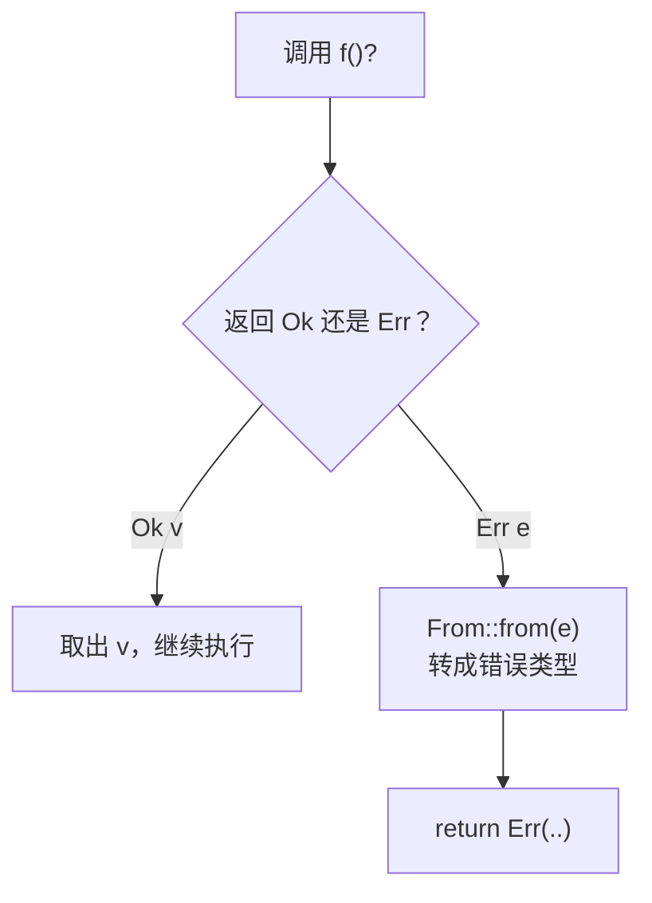

# 错误处理：Result、? 与 thiserror / anyhow

Rust 没有异常。函数可能失败时，失败就写在返回类型里：`Result<T, E>`。这听起来很像你在 TS 里偶尔会写的 `{ ok: true, value } | { ok: false, error }`，区别是在 Rust 里**所有**可能失败的函数都这么写，标准库也是，而且有专门的语法 `?` 让它写起来不啰嗦。

这一章讲 `panic!` 和 `Result` 的分工、`?` 运算符的工作原理、怎么定义自己的错误类型，以及生态里最常用的两个错误处理库：写库用 thiserror，写应用用 anyhow。

## 两种失败：panic 和 Result

| | `panic!` | `Result<T, E>` |
|---|---|---|
| 含义 | 程序进入了不该出现的状态，是 bug | 可预期的失败：文件不存在、格式不对、网络断了 |
| 行为 | 打印信息，展开栈，当前线程终止 | 一个普通的返回值，调用方决定怎么处理 |
| TS 里的类比 | `throw new Error("unreachable")`、断言失败 | 返回 `{ ok: false, error }` |
| 能不能捕获 | 技术上能（`catch_unwind`），但不该用来做流程控制 | 当然能，就是一个值 |

所以 Rust 里的问题不是「要不要 try/catch」，而是「这个失败是 bug 还是正常情况」。读用户给的文件失败是正常情况，用 `Result`；数组下标越界是 bug，会 panic。

### unwrap 和 expect

`Result` 和 `Option` 都有 `unwrap()`：成功时取出值，失败时 panic。`expect("说明")` 一样，只是 panic 时带上你写的说明。

```rust
fn main() {
    let n: u32 = "42".parse().unwrap();
    let home = std::env::var("HOME").expect("HOME 环境变量应该总是存在");
    println!("{n} {home}");
}
```

什么时候可以用：

- 示例代码、测试、原型
- 你**能证明**它不会失败的地方，比如解析一个写死在代码里的常量。这时用 `expect` 写清理由
- 程序启动时读必需的配置，读不到就该直接退出

其余地方，用下面讲的 `?`。

## Result 和 match

```rust
enum Result<T, E> {   // 标准库定义
    Ok(T),
    Err(E),
}
```

```rust
use std::fs;

fn main() {
    match fs::read_to_string("book.yaml") {
        Ok(text) => println!("读到 {} 字节", text.len()),
        Err(e) => eprintln!("读取失败：{e}"),
    }
}
```

`eprintln!` 输出到 stderr。如果每一步都这样 `match`，代码会迅速变成一层套一层，这就是 `?` 要解决的问题。

## ? 运算符

`?` 放在一个 `Result` 后面：成功就取出值继续往下走，失败就**立即从当前函数返回这个错误**。

```rust
use std::fs;
use std::io;

fn read_title(path: &str) -> Result<String, io::Error> {
    let text = fs::read_to_string(path)?;   // 失败时直接 return Err(e)
    let first = text.lines().next().unwrap_or("");
    Ok(first.trim_start_matches("# ").to_string())
}
```

它展开后大致是：

```rust
let text = match fs::read_to_string(path) {
    Ok(v) => v,
    Err(e) => return Err(From::from(e)),
};
```

注意 `From::from(e)`：`?` 在返回之前会尝试把错误转换成当前函数声明的错误类型。这是后面「自定义错误类型」能优雅工作的关键。

和 TS 对照：`?` 的效果很像在 `async` 函数里写 `await`：成功就拿到值，失败就把错误往上抛。区别是，Rust 的错误「往上抛」是**写在类型里的**，调用方不可能不知道这个函数会失败。



`?` 也能用在 `Option` 上：遇到 `None` 就提前返回 `None`。

```rust
fn second_chapter(chapters: &[String]) -> Option<&str> {
    let s = chapters.get(1)?;          // 越界时返回 None，不会 panic
    Some(s.trim_end_matches(".md"))
}
```

`Option` 和 `Result` 之间可以互相转换：`opt.ok_or("缺少 xxx")?` 把 `None` 变成一个错误再用 `?`。

## 组合子：不用 match 也能处理

`Result` 和 `Option` 有一组方法，用来在不展开的情况下变换它们，用法和数组的 `map`、Promise 的 `then` 类似：

| 方法 | 作用 | 例子 |
|---|---|---|
| `map(f)` | 变换成功值 | `parse::<u32>().map(\|n\| n * 2)` |
| `map_err(f)` | 变换错误值 | `.map_err(\|e\| format!("解析失败：{e}"))` |
| `and_then(f)` | 成功后接着做一件可能失败的事 | `read(path).and_then(parse)` |
| `unwrap_or(v)` | 失败时用默认值 | `.unwrap_or(0)` |
| `unwrap_or_default()` | 失败时用类型默认值 | `.unwrap_or_default()` |
| `ok()` | `Result` 转 `Option`，丢掉错误 | `.ok()` |
| `ok_or(e)` | `Option` 转 `Result` | `.ok_or("没有找到")` |
| `is_ok()` / `is_some()` | 只判断 | `if path.exists()` 的风格 |

一个实际的例子：读取环境变量里的并发数，没设或格式不对就用 4。

```rust
fn concurrency() -> usize {
    std::env::var("SHELF_JOBS")
        .ok()
        .and_then(|s| s.parse().ok())
        .filter(|&n| n > 0)
        .unwrap_or(4)
}
```

## 自定义错误类型

`read_title` 只会遇到 I/O 错误，所以返回 `io::Error` 就够了。但加载一本书会遇到好几种失败：读文件失败、YAML 格式错、内容不符合规则。函数只能声明一种错误类型，于是我们定义一个枚举把它们装起来。

先不用任何库，手写一遍，看清楚背后的机制：

```rust
use std::fmt;
use std::io;
use std::path::PathBuf;

#[derive(Debug)]
enum LoadError {
    Io { path: PathBuf, source: io::Error },
    Yaml(serde_yaml::Error),
    Invalid(String),
}

impl fmt::Display for LoadError {
    fn fmt(&self, f: &mut fmt::Formatter<'_>) -> fmt::Result {
        match self {
            LoadError::Io { path, .. } => write!(f, "读取 {} 失败", path.display()),
            LoadError::Yaml(e) => write!(f, "book.yaml 格式错误：{e}"),
            LoadError::Invalid(msg) => write!(f, "{msg}"),
        }
    }
}

impl std::error::Error for LoadError {
    fn source(&self) -> Option<&(dyn std::error::Error + 'static)> {
        match self {
            LoadError::Io { source, .. } => Some(source),
            LoadError::Yaml(e) => Some(e),
            LoadError::Invalid(_) => None,
        }
    }
}

impl From<serde_yaml::Error> for LoadError {
    fn from(e: serde_yaml::Error) -> Self {
        LoadError::Yaml(e)
    }
}
```

四块代码各管一件事：

- **枚举本身**：列出所有失败方式，调用方可以 `match` 精确处理
- **`Display`**：给人看的错误信息
- **`std::error::Error`**：标准错误 trait，`source()` 返回「导致这个错误的下层错误」，形成错误链，相当于 JS 的 `new Error(msg, { cause })`
- **`From<serde_yaml::Error>`**：让 `?` 能自动把 YAML 错误转成 `LoadError`

有了这些，加载函数可以写得很平：

```rust
use std::fs;
use std::path::Path;

fn load_manifest(dir: &Path) -> Result<BookManifest, LoadError> {
    let path = dir.join("book.yaml");
    let text = fs::read_to_string(&path)
        .map_err(|source| LoadError::Io { path: path.clone(), source })?;
    let manifest: BookManifest = serde_yaml::from_str(&text)?;   // From 自动转换
    if manifest.chapters.is_empty() {
        return Err(LoadError::Invalid("chapters 不能为空".into()));
    }
    Ok(manifest)
}
```

I/O 错误需要带上路径，所以用 `map_err` 手动包装；YAML 错误没有额外信息，靠 `From` 让 `?` 自动转。（`BookManifest` 是上一章用 serde 定义的那个结构体。）

## thiserror：给库写错误类型

上面那 40 行样板代码，用 thiserror 可以缩到十几行：

```bash
cargo add thiserror
```

```rust
use std::io;
use std::path::PathBuf;
use thiserror::Error;

#[derive(Debug, Error)]
enum LoadError {
    #[error("读取 {} 失败", .path.display())]
    Io {
        path: PathBuf,
        #[source]
        source: io::Error,
    },

    #[error("book.yaml 格式错误：{0}")]
    Yaml(#[from] serde_yaml::Error),

    #[error("{0}")]
    Invalid(String),
}
```

- `#[error("...")]` 生成 `Display`，`{0}` 引用元组字段，`{name}` 引用具名字段，`.path.display()` 这种写法可以在额外参数里调用字段的方法
- `#[source]` 标出下层错误，生成 `source()`
- `#[from]` 同时生成 `From` 实现和 `source()`

thiserror 生成的代码和手写的完全一样，它只是一个派生宏，不会出现在你的公共 API 里。**写库时用它**：库的调用方需要能 `match` 具体的错误变体，决定是重试、提示用户还是放弃。

> [!WARNING]
> thiserror 在 2024 年底发布了 2.0，和 1.x 相比主要是一些边缘写法的调整，本节的用法在两个版本中相同。升级大版本前看一下它在 GitHub 上的发布说明，以官方文档为准。

## anyhow：给应用写错误处理

写 CLI 或桌面应用的主逻辑时，你通常不需要区分错误的具体类型，只要做到两点：错误能一路传到顶层，打印出来的信息足够定位问题。这时用 anyhow：

```bash
cargo add anyhow
```

```rust
use anyhow::{bail, Context, Result};
use std::fs;
use std::path::Path;

fn count_chapters(dir: &Path) -> Result<usize> {
    let path = dir.join("book.yaml");
    let text = fs::read_to_string(&path)
        .with_context(|| format!("读取 {} 失败", path.display()))?;
    let manifest: BookManifest = serde_yaml::from_str(&text)
        .with_context(|| format!("解析 {} 失败", path.display()))?;
    if manifest.chapters.is_empty() {
        bail!("{} 没有列出任何章节", manifest.id);
    }
    Ok(manifest.chapters.len())
}

fn main() -> Result<()> {
    let n = count_chapters(Path::new("books/rust-practice"))?;
    println!("{n} 章");
    Ok(())
}
```

- `anyhow::Result<T>` 是 `Result<T, anyhow::Error>` 的别名。`anyhow::Error` 可以装下**任何**实现了 `std::error::Error` 的错误，所以 `?` 对什么错误都能用
- `.context("...")` / `.with_context(|| ...)` 给错误加一层说明，形成错误链。后者是惰性的，只在出错时才执行 `format!`
- `bail!("...")` 相当于 `return Err(anyhow!("..."))`，`ensure!(cond, "...")` 相当于断言失败时 `bail!`
- `main` 返回 `Result<()>` 时，出错会以非零退出码结束，并打印整条错误链

运行时如果文件不存在，输出是：

```text
Error: 读取 books/rust-practice/book.yaml 失败

Caused by:
    No such file or directory (os error 2)
```

一层层的 `Caused by` 就是 `context` 加上去的。这比 JS 里一个孤零零的 `ENOENT` 好定位得多。

## 库用 thiserror，应用用 anyhow

| | thiserror | anyhow |
|---|---|---|
| 用在哪 | 库、模块的公共接口 | 应用的主逻辑、`main`、CLI 命令 |
| 错误类型 | 你定义的具体枚举 | 统一的 `anyhow::Error` |
| 调用方能否 `match` 变体 | 能 | 基本不能（可以 `downcast_ref`，但不常用） |
| 加上下文 | 在变体里加字段 | `.context()` |
| 类比 TS | 自定义 `class NotFoundError extends Error` 并导出 | 到处 `throw new Error(msg, { cause })`，顶层统一打印 |

本书的 `shelf-rs` 就这样分：`shelf-core` 库定义 `LoadError`（thiserror），`shelf-cli` 的命令函数返回 `anyhow::Result`。库的错误进入应用后，`?` 自动把它装进 `anyhow::Error`。

## 错误还是结果：校验问题的建模

最后一个设计问题：`book.yaml` 的格式错误是「错误」，那「第 3 章有两个 H1」也是错误吗？

书巢的 TS 代码给了一个好答案。`@shelf/spec` 的 `prepareImport` 返回：

```typescript
type PreparedImport =
  | { ok: true; id: string; manifest: BookManifest; files: PackedFile[]; warnings: string[] }
  | { ok: false; error: string };
```

致命问题（读不了、解析不了）让整个导入失败；不致命的问题（不支持的文件类型被忽略）作为 `warnings` 和成功结果一起返回。Rust 里同样分两层：

```rust
#[derive(Debug, Clone, Copy, PartialEq, Eq)]
enum Severity {
    Error,
    Warning,
}

#[derive(Debug, Clone)]
struct Issue {
    severity: Severity,
    file: String,
    line: Option<usize>,
    message: String,
}

struct CheckedBook {
    manifest: BookManifest,
    issues: Vec<Issue>,
}

impl CheckedBook {
    fn has_errors(&self) -> bool {
        self.issues.iter().any(|i| i.severity == Severity::Error)
    }
}

// 外层 Result：能不能读出一本书；内层 issues：这本书有哪些问题
fn check_book(dir: &Path) -> Result<CheckedBook, LoadError> {
    let manifest = load_manifest(dir)?;
    let mut issues = Vec::new();
    for file in &manifest.chapters {
        match fs::read_to_string(dir.join(file)) {
            Ok(text) => issues.extend(lint_chapter(file, &text)),
            Err(e) => issues.push(Issue {
                severity: Severity::Error,
                file: file.clone(),
                line: None,
                message: format!("读取失败：{e}"),
            }),
        }
    }
    Ok(CheckedBook { manifest, issues })
}
```

`lint_chapter` 返回 `Vec<Issue>`，第 8 章实现。这里的原则是：

- **会让后续步骤无法进行的**，用 `Err`，配合 `?` 尽早返回
- **要收集起来一次性报告给用户的**，作为数据放进返回值。一次告诉用户 12 个问题，比让他改一个、跑一次、再看下一个友好得多

注意章节读取失败也被当成 `Issue` 收集，而不是用 `?` 中断：一章读不到，不妨碍检查其余章节。

## 本章要点

- `panic!` 表示 bug，`Result` 表示可预期的失败；`unwrap` / `expect` 只用在示例、测试和能证明不会失败的地方
- `?` 成功取值、失败提前返回，并通过 `From` 自动转换错误类型；对 `Option` 同样适用
- `map_err`、`and_then`、`ok_or`、`unwrap_or` 等组合子能在不展开的情况下处理结果
- 自定义错误 = 枚举 + `Display` + `std::error::Error` + `From`；thiserror 用派生宏生成这些样板
- 库用 thiserror 暴露可 `match` 的具体错误，应用用 anyhow 加 `context` 一路传到顶层
- 致命问题用 `Err` 中断，可收集的问题作为数据返回，一次报告给用户
