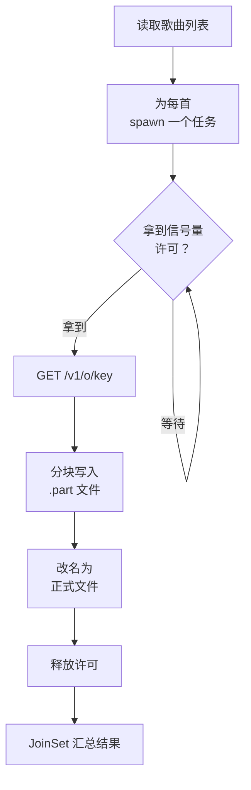

# 并发与 async：线程、Send/Sync 与 tokio

Node 只有一个 JS 线程，你很少需要考虑「两个线程同时改一个对象」；CPU 密集的活要么扔给 `worker_threads`，要么干脆不在 Node 里做。Rust 不一样：开线程很便宜，多个线程共享数据是日常操作，而编译器会在编译期拦住数据竞争。社区管这叫「无畏并发」（fearless concurrency）。

这一章分两半。前一半讲线程：`spawn` 和作用域线程、`Send` / `Sync` 这两个标记 trait、`Arc` 和 `Mutex`、channel，以及用 rayon 一行代码把检查全部书并行化。后一半讲 async：Rust 的 Future 和 JS 的 Promise 有什么不同、为什么需要 tokio，然后用唱片墙的「从曲库批量下载歌曲」写一个带并发上限、超时和 Ctrl-C 取消的下载器。

## 线程

```rust
use std::thread;
use std::time::Duration;

fn main() {
    let handle = thread::spawn(|| {
        for i in 1..=3 {
            println!("子线程 {i}");
            thread::sleep(Duration::from_millis(10));
        }
        42                                   // 线程的返回值
    });
    println!("主线程继续");
    let n = handle.join().unwrap();          // 等子线程结束，拿到返回值
    println!("子线程返回 {n}");
}
```

`join()` 返回 `Result`：如果子线程 panic 了，这里拿到的是 `Err`，主线程可以决定怎么处理，不会被连带崩溃。

### 作用域线程：可以借用局部变量

上一章说过，`thread::spawn` 要求闭包是 `'static` 的，所以只能 `move` 进去拥有所有权的数据。但很多时候你只想「把这个数组分成几段，每个线程处理一段，等全部处理完再继续」。这时用 `thread::scope`，它保证所有子线程在作用域结束前退出，所以可以安全地借用局部变量：

```rust
use std::thread;

fn main() {
    let chapters: Vec<String> = (1..=10).map(|i| format!("{i:02}-chapter.md")).collect();
    let (left, right) = chapters.split_at(chapters.len() / 2);

    let (a, b) = thread::scope(|s| {
        let h1 = s.spawn(|| left.iter().filter(|f| f.contains('1')).count());   // 借用 left
        let h2 = s.spawn(|| right.iter().filter(|f| f.contains('1')).count());  // 借用 right
        (h1.join().unwrap(), h2.join().unwrap())
    });
    println!("{a} + {b}");
    println!("chapters 还能用：{}", chapters.len());
}
```

不需要 `Arc`、不需要 `clone`。作用域线程是 Rust 1.63 加入的，在很多场景下比 `spawn` 好用。

## Send 和 Sync：编译器怎么知道线程安全

Rust 用两个**标记 trait**（没有方法，只是一个标签）描述类型的线程安全性：

| trait | 含义 | 不满足的典型类型 |
|---|---|---|
| `Send` | 值的**所有权**可以转移到另一个线程 | `Rc<T>`：引用计数不是原子的，两个线程同时增减会算错 |
| `Sync` | 值的**引用** `&T` 可以在多个线程间共享 | `RefCell<T>`、`Cell<T>`：内部可变性不加锁 |

这两个 trait 是**自动推导**的：一个结构体的所有字段都是 `Send`，它就是 `Send`。绝大多数类型（`String`、`Vec`、你自己的结构体）都自动满足。`thread::spawn` 的签名要求闭包和返回值是 `Send`，于是：

```rust
use std::rc::Rc;
use std::thread;

fn main() {
    let shared = Rc::new(vec![1, 2, 3]);
    thread::spawn(move || {
        println!("{}", shared.len());
    });
}
```

```text
error[E0277]: `Rc<Vec<i32>>` cannot be sent between threads safely
```

数据竞争在 Rust 里是**编译错误**，而不是偶尔复现的线上 bug。这是 Rust 并发最有价值的地方。

## 共享状态：Arc 和 Mutex

多个线程要共享**同一份**数据时：

- `Arc<T>`（Atomic Reference Counted）：线程安全的引用计数指针，`clone()` 只增加计数，不复制数据。相当于「多个所有者」
- `Mutex<T>`：互斥锁，同一时刻只有一个线程能拿到里面的 `&mut T`

```rust
use std::collections::HashMap;
use std::sync::{Arc, Mutex};
use std::thread;

fn main() {
    let counts: Arc<Mutex<HashMap<String, usize>>> = Arc::new(Mutex::new(HashMap::new()));
    let mut handles = Vec::new();

    for worker in 0..4 {
        let counts = Arc::clone(&counts);          // 每个线程一个 Arc，指向同一个 Mutex
        handles.push(thread::spawn(move || {
            let mut map = counts.lock().unwrap();  // 拿锁；返回的守卫离开作用域时自动解锁
            *map.entry(format!("worker-{}", worker % 2)).or_insert(0) += 1;
        }));
    }
    for h in handles {
        h.join().unwrap();
    }
    println!("{:?}", counts.lock().unwrap());
}
```

和其他语言的锁相比，Rust 的 `Mutex<T>` 有一个关键设计：**数据在锁里面**。你不可能「忘了加锁就访问数据」，因为不调用 `lock()` 根本拿不到数据；也不会「忘了解锁」，因为锁守卫离开作用域时自动释放。`lock()` 返回 `Result`，是因为持锁线程 panic 会让锁「中毒」，一般直接 `unwrap()`。

| 需求 | 用什么 |
|---|---|
| 多线程只读共享 | `Arc<T>` |
| 多线程读写，写不频繁 | `Arc<RwLock<T>>`：多读单写 |
| 多线程读写 | `Arc<Mutex<T>>` |
| 一个计数器或标志位 | `AtomicUsize` / `AtomicBool`，不用锁 |
| 单线程里多处共享并修改 | `Rc<RefCell<T>>` |

## channel：用消息代替共享

另一种思路是不共享，而是传消息，这和 Node 里主线程与 worker 之间 `postMessage` 的模式相同：

```rust
use std::sync::mpsc;
use std::thread;

fn main() {
    let (tx, rx) = mpsc::channel::<String>();   // multi-producer, single-consumer

    for id in ["rust-practice", "electron-desktop", "reading-map"] {
        let tx = tx.clone();
        thread::spawn(move || {
            tx.send(format!("{id} 检查完毕")).unwrap();
        });
    }
    drop(tx);   // 丢掉最初的发送端，否则下面的循环永远等不到结束

    for msg in rx {             // 所有发送端都被丢弃后，循环结束
        println!("{msg}");
    }
}
```

## rayon：一行并行化

前面这些是底层工具。对「把一个集合里的每个元素独立处理」这种最常见的并行场景，直接用 rayon：

```bash
cargo add rayon
```

```rust
use rayon::prelude::*;
use std::path::PathBuf;

fn main() {
    let dirs: Vec<PathBuf> = std::fs::read_dir("books")
        .unwrap()
        .filter_map(|e| e.ok())
        .map(|e| e.path())
        .filter(|p| p.join("book.yaml").exists())
        .collect();

    let results: Vec<(PathBuf, usize)> = dirs
        .par_iter()                                       // 只改了这一个词：iter -> par_iter
        .map(|dir| (dir.clone(), count_issues(dir)))
        .collect();

    let total: usize = results.iter().map(|(_, n)| n).sum();
    println!("{} 本书，{total} 个问题", results.len());
}

fn count_issues(dir: &std::path::Path) -> usize {
    // 第 8 章实现完整检查，这里只数一下章节文件
    std::fs::read_dir(dir).map(|it| it.count()).unwrap_or(0)
}
```

rayon 维护一个和 CPU 核数相同的线程池，用工作窃取（work stealing）分配任务。`par_iter()` 之后的链和普通迭代器写法几乎一样，结果的顺序也和输入一致。前提是闭包里的操作互相独立，这一点编译器会通过 `Send` / `Sync` 帮你检查。

书巢的 `books/` 目录下有八十多本书，每本要读 `book.yaml`、读全部章节、逐行扫描，这正是 rayon 的典型用法：CPU 和磁盘读取混在一起、每本书互不相关。

## async：和 Promise 的三个不同

线程适合 CPU 密集的活。I/O 密集的活（同时发几百个 HTTP 请求）开几百个线程太重，这时用 async。Rust 的 `async` / `await` 语法和 TS 几乎一样，但底层模型差别很大：

| | JS / TS | Rust |
|---|---|---|
| 运行时 | 语言自带（V8 + libuv 事件循环） | **不自带**，要选一个：tokio 是事实标准 |
| 何时开始执行 | `Promise` 一创建就开始跑 | `Future` 是**惰性**的，不 `await` 或不交给运行时就什么都不做 |
| 线程 | 单线程 | tokio 默认多线程，任务可能在不同线程上恢复执行 |
| 取消 | 没有内置取消，靠 `AbortController` | 丢弃（drop）一个 Future 就是取消它 |

第二条最容易踩坑：

```rust
async fn fetch_one(id: u32) -> String {
    format!("track {id}")
}

#[tokio::main]
async fn main() {
    let f = fetch_one(1);      // 什么都没发生，只是构造了一个 Future
    let s = f.await;           // 这时才开始执行
    println!("{s}");
}
```

在 JS 里 `const p = fetchOne(1)` 已经发出了请求；在 Rust 里只是得到一个「待执行的计算」。想让几个 Future 并发执行，要用 `join!` 或者 `tokio::spawn`。

第三条意味着 `tokio::spawn` 的任务要满足 `Send + 'static`，和 `thread::spawn` 一样，所以前面讲的 `move`、`Arc` 在 async 代码里同样适用。

### 配置 tokio

```bash
cargo add tokio --features full
cargo add reqwest
cargo add anyhow
```

> [!WARNING]
> tokio 1.x 承诺长期不做破坏性变更，但 reqwest 仍在 0.x，大版本之间（如 0.11 到 0.12）有过 API 调整，默认的 TLS 后端也可能变化。本节代码按 tokio 1、reqwest 0.12 前后的 API 写，以 docs.rs 上对应版本的文档为准。`features = ["full"]` 方便学习，正式项目建议只开用到的特性（`rt-multi-thread`、`macros`、`fs`、`sync`、`time`、`signal`）以缩短编译时间。

`#[tokio::main]` 是一个宏，把 `async fn main` 改写成「创建 tokio 运行时，然后在里面跑这个 Future」。

### 并发的几种写法

```rust
use std::time::Duration;
use tokio::time::sleep;

async fn work(name: &str, ms: u64) -> String {
    sleep(Duration::from_millis(ms)).await;      // 不能用 std::thread::sleep，会卡住整个线程
    format!("{name} 完成")
}

#[tokio::main]
async fn main() {
    // 1. join!：固定数量的 Future 并发，相当于 Promise.all([a, b])
    let (a, b) = tokio::join!(work("a", 100), work("b", 50));
    println!("{a} {b}");

    // 2. spawn：交给运行时调度，可能跑在别的线程上；返回 JoinHandle
    let h = tokio::spawn(async { work("后台", 30).await });
    println!("{}", h.await.unwrap());

    // 3. select!：谁先完成用谁，其余的被丢弃（取消），相当于 Promise.race
    tokio::select! {
        r = work("慢", 500) => println!("{r}"),
        _ = sleep(Duration::from_millis(100)) => println!("超时"),
    }

    // 4. timeout：给单个 Future 加超时
    match tokio::time::timeout(Duration::from_millis(10), work("很慢", 1000)).await {
        Ok(r) => println!("{r}"),
        Err(_) => println!("10ms 内没完成"),
    }
}
```

`select!` 那段里，「慢」的那个 Future 在超时分支胜出后被直接丢弃，它内部的 `sleep` 也随之取消，不会在后台继续跑。JS 的 `Promise.race` 做不到这一点，输掉的 Promise 会继续执行到底。

## 案例：从曲库批量下载歌曲

唱片墙的曲库是一个 Cloudflare Worker，凭令牌存取 R2 里的对象：`GET /v1/o/<key>`，带 `Authorization: Bearer <令牌>`。手机端用 TS 一首一首地下。现在用 Rust 写一个桌面命令行工具，把一批歌曲下载到本地目录，要求：

- 同时最多下 4 首，不要把 Worker 打满
- 每首单独超时，一首失败不影响其他
- 边下边写文件，不把整首歌读进内存；先写临时文件，完成后再改名，避免留下半截文件
- 按 Ctrl-C 时停止，不留半截文件



完整程序分 4 段给出，从上到下拼起来就是整个程序。第一段是导入和曲库客户端 `Vault`，它的 `download` 流式下载一首歌，先写 `.part` 文件，写完才改名：

```rust
use anyhow::{Context, Result};
use std::path::{Path, PathBuf};
use std::sync::Arc;
use std::time::Duration;
use tokio::io::AsyncWriteExt;
use tokio::sync::Semaphore;
use tokio::task::JoinSet;

#[derive(Clone)]
struct Vault {
    client: reqwest::Client,
    base: String,
    token: String,
}

impl Vault {
    async fn download(&self, key: &str, dest: &Path) -> Result<u64> {
        let url = format!("{}/v1/o/{}", self.base, key);
        let mut resp = self
            .client
            .get(&url)
            .bearer_auth(&self.token)
            .send()
            .await
            .with_context(|| format!("请求 {key} 失败"))?
            .error_for_status()
            .with_context(|| format!("曲库拒绝了 {key}"))?;

        let tmp = dest.with_extension("part");
        let mut file = tokio::fs::File::create(&tmp).await?;
        let mut written = 0u64;
        while let Some(chunk) = resp.chunk().await? {      // 流式读取，一块一块写
            file.write_all(&chunk).await?;
            written += chunk.len() as u64;
        }
        file.flush().await?;
        tokio::fs::rename(&tmp, dest).await?;              // 写完才改名
        Ok(written)
    }
}
```

第二段是 `download_all` 的前半部分：为每首歌 spawn 一个任务，任务先拿信号量许可，再带超时调用上一段的 `download`：

```rust
async fn download_all(vault: Vault, keys: Vec<String>, out: PathBuf) -> Result<()> {
    tokio::fs::create_dir_all(&out).await?;
    let limit = Arc::new(Semaphore::new(4));
    let mut set = JoinSet::new();

    for key in keys {
        let vault = vault.clone();                         // reqwest::Client 内部是 Arc，clone 很便宜
        let limit = Arc::clone(&limit);
        let dest = out.join(key.replace('/', "_"));
        set.spawn(async move {
            // 拿不到许可就在这里等；我们从不关闭信号量，所以 acquire 不会失败
            let _permit = limit.acquire_owned().await.expect("信号量不会被关闭");
            let r = tokio::time::timeout(Duration::from_secs(120), vault.download(&key, &dest)).await;
            match r {
                Ok(Ok(bytes)) => Ok((key, bytes)),
                Ok(Err(e)) => Err(e),
                Err(_) => {
                    let _ = tokio::fs::remove_file(dest.with_extension("part")).await;
                    Err(anyhow::anyhow!("{key} 超时"))
                }
            }
        });                                                // _permit 在任务结束时被丢弃，许可归还
    }
```

第三段是 `download_all` 的后半部分：用 `join_next()` 按完成顺序收集结果，边收边打印，最后汇总：

```rust
    let (mut ok, mut failed) = (0, 0);
    while let Some(joined) = set.join_next().await {
        match joined {
            Ok(Ok((key, bytes))) => {
                ok += 1;
                println!("✓ {key}（{} KB）", bytes / 1024);
            }
            Ok(Err(e)) => {
                failed += 1;
                eprintln!("✗ {e:#}");                       // {:#} 把错误链打印在一行
            }
            Err(e) => eprintln!("任务异常：{e}"),           // 任务 panic 或被取消
        }
    }
    println!("完成 {ok} 首，失败 {failed} 首");
    Ok(())
}
```

第四段是 `main`：从环境变量读配置，用 `tokio::select!` 让下载和 Ctrl-C 赛跑，谁先完成就以谁为准：

```rust
#[tokio::main]
async fn main() -> Result<()> {
    let vault = Vault {
        client: reqwest::Client::builder().connect_timeout(Duration::from_secs(10)).build()?,
        base: std::env::var("VAULT_URL").context("缺少 VAULT_URL")?,
        token: std::env::var("VAULT_TOKEN").context("缺少 VAULT_TOKEN")?,
    };
    let keys: Vec<String> = std::env::args().skip(1).collect();

    tokio::select! {
        r = download_all(vault, keys, PathBuf::from("downloads")) => r,
        _ = tokio::signal::ctrl_c() => {
            eprintln!("已取消");
            Ok(())
        }
    }
}
```

几处设计说明：

- **信号量控制并发**：所有任务一次性 spawn，但每个任务先 `acquire_owned()` 一个许可，同时最多 4 个在下载。许可是一个守卫值，任务结束时被丢弃，许可自动归还。TS 里你会用 `p-limit` 做同样的事
- **JoinSet**：管理一组任务，`join_next()` 按**完成顺序**返回结果，可以边完成边打印。JoinSet 被丢弃时会取消其中所有还没完成的任务
- **Ctrl-C**：`select!` 里 `ctrl_c()` 先完成时，`download_all` 这个 Future 被丢弃，它持有的 JoinSet 随之被丢弃，所有下载任务被取消。被取消的下载停在某个 `.await` 上，`.part` 文件留下，但正式文件名从未出现，所以不会被误当成完整的歌曲；下次运行时覆盖即可
- **错误分三层**：`JoinError`（任务 panic）、业务错误（`anyhow::Error`）、超时（`Elapsed`），在汇总处分别处理。一首失败只计数，不中断其他

> [!NOTE]
> 这个工具只用到了曲库的只读令牌，和手机端的订阅者权限一致。令牌从环境变量读，不要写进代码或命令行参数（命令行参数会出现在 `ps` 的输出和 shell 历史里）。

## 在 async 里做 CPU 密集的活

tokio 的工作线程数量和 CPU 核数相同。如果在一个 async 任务里做长时间的计算（比如给下载完的音频算哈希），它会占住一个工作线程，其他任务就少了一个线程可用。这和 Node 里「同步代码阻塞事件循环」是同一个问题。解决办法也类似：

```bash
cargo add sha2
```

```rust
use sha2::{Digest, Sha256};

async fn hash_file(path: std::path::PathBuf) -> anyhow::Result<String> {
    let bytes = tokio::fs::read(&path).await?;                    // I/O：async
    let hex = tokio::task::spawn_blocking(move || {               // 计算：挪到阻塞线程池
        let digest = Sha256::digest(&bytes);
        digest.iter().map(|b| format!("{b:02x}")).collect::<String>()
    })
    .await?;
    Ok(hex)
}
```

`spawn_blocking` 把闭包放到 tokio 专门的阻塞线程池里执行，相当于 Node 里把活交给 `worker_threads`。同样，调用同步的文件、数据库驱动时，也用它包一层。

| 任务类型 | 在 Rust 里怎么做 | Node 里对应 |
|---|---|---|
| 大量网络 I/O | tokio async | 默认的 async |
| 文件 I/O | `tokio::fs`（内部其实也是阻塞线程池） | `fs/promises`（libuv 线程池） |
| 一批独立的 CPU 计算 | rayon | `worker_threads` + 任务分片 |
| async 里夹一段计算 | `spawn_blocking` | 同上 |
| 共享可变状态 | `Arc<Mutex<T>>` 或 channel | 基本不需要（单线程） |

不需要网络并发时，**不要用 async**。读几个文件、算点东西的 CLI，同步代码加 rayon 更简单，编译也更快。第 8 章的 `shelf-rs check` 就完全没用 async。

## 本章要点

- `thread::spawn` 要求 `'static` 数据，常配合 `move`；`thread::scope` 允许借用局部变量，很多时候更方便
- `Send` / `Sync` 是自动推导的标记 trait，数据竞争在 Rust 里是编译错误
- `Arc<Mutex<T>>` 共享可变状态，数据在锁里面，不会忘记加锁或解锁；也可以用 channel 传消息
- 集合的独立并行处理用 rayon：`iter()` 换成 `par_iter()`
- Rust 的 Future 是惰性的、运行时要自己选（tokio）、丢弃即取消
- `join!` / `select!` / `timeout` / `JoinSet` / `Semaphore` 覆盖了常见的并发模式
- async 任务里的 CPU 计算和阻塞调用用 `spawn_blocking`；不需要网络并发时不必用 async
