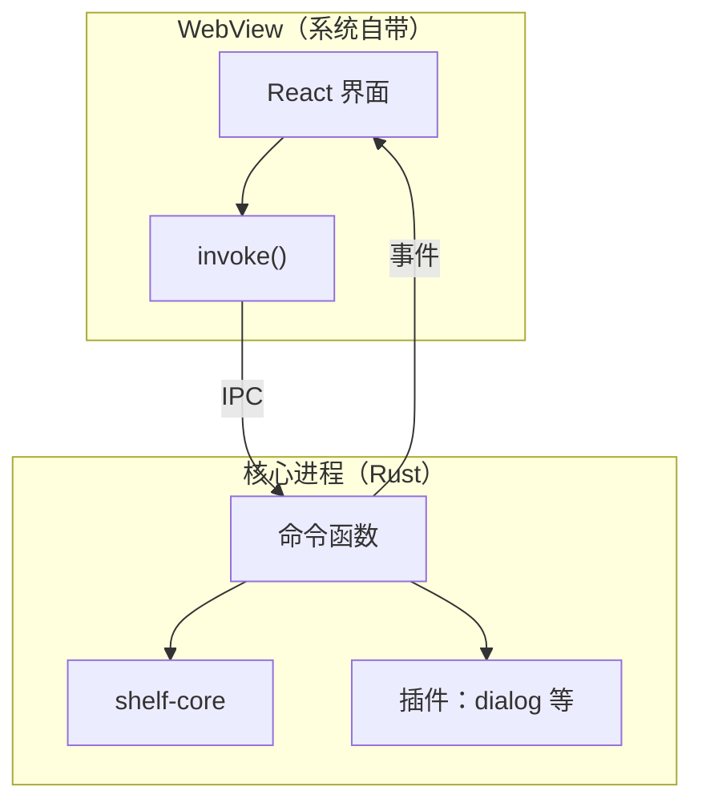
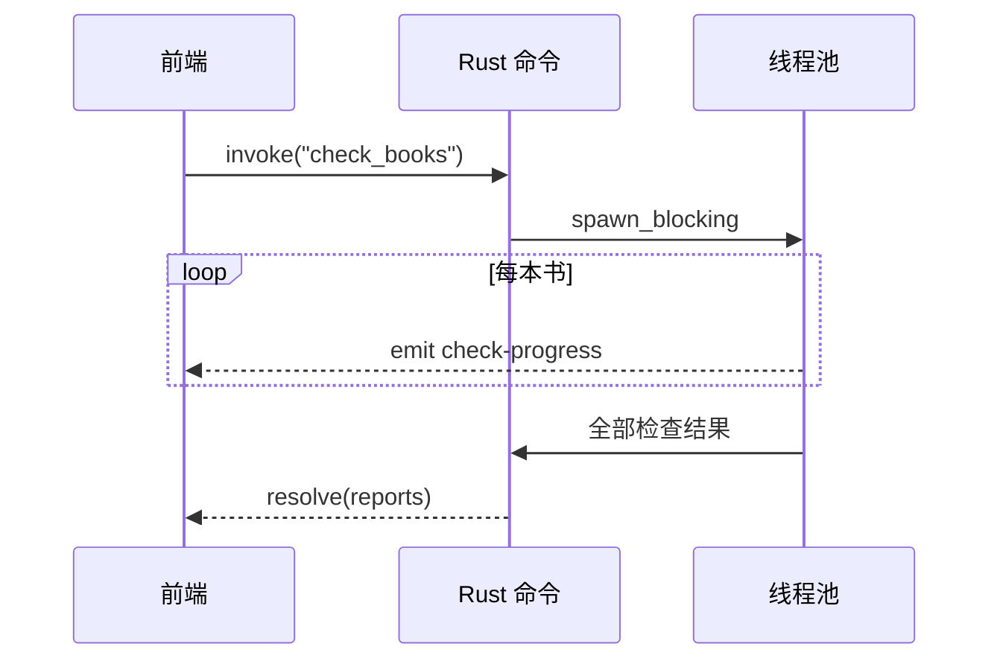

# 用 Tauri 做桌面应用

Tauri 让你用熟悉的 Web 技术（React、Vite、TS）写界面，用 Rust 写后端，打包成一个体积很小的桌面应用。对一个 TS 开发者来说，它的前端部分几乎没有学习成本，真正新的东西是 Rust 那一侧：命令怎么定义、前端怎么调用、权限怎么声明、长任务怎么汇报进度。

这一章把第 8 章的 `shelf-core` 套上界面，做一个「书巢写书助手」：选一个 `books/` 目录，并行检查全部书，实时显示进度，列出每本书的问题。做完之后，再和你熟悉的 Electron 对照一遍，看看两者在进程模型、IPC 和安全上的差异。

> [!WARNING]
> 本章按 Tauri 2.x 编写（2024 年 10 月发布稳定版）。Tauri 1 到 2 有大量破坏性变更：IPC 模块路径从 `@tauri-apps/api/tauri` 改成了 `@tauri-apps/api/core`，权限从 allowlist 改成了 capabilities，很多内置 API 拆成了独立插件。网上的教程有不少还是 1.x 的写法。命令、配置项和插件名以 [Tauri 官方文档](https://v2.tauri.app/) 为准。

## Tauri 的结构



- **WebView**：macOS 上是 WKWebView，Windows 上是 WebView2，Linux 上是 WebKitGTK。Tauri 不打包浏览器，这是它体积小的根本原因
- **核心进程**：你写的 Rust 代码编译成的原生二进制，负责窗口管理、文件系统、调用系统 API
- **IPC**：前端调用 `invoke("命令名", 参数)`，Rust 侧对应一个标了 `#[tauri::command]` 的函数；参数和返回值都用 JSON 序列化，所以要实现 serde 的 trait

如果你读过[《Electron 桌面应用》](../electron-desktop/01-process-model.md)，可以这样对应：WebView 相当于渲染进程，Rust 核心相当于主进程，而 preload 这一层在 Tauri 里不存在，它的「只暴露必要能力」的职责由 capabilities 承担。

## 创建项目

```bash
pnpm create tauri-app shelf-desk
# 依次选：TypeScript / JavaScript → pnpm → React → TypeScript
cd shelf-desk
pnpm install
pnpm tauri dev
```

第一次 `pnpm tauri dev` 会编译 Tauri 和它的全部依赖，需要几分钟；之后是增量编译。生成的目录结构里，前端部分就是一个标准的 Vite + React 项目，新东西都在 `src-tauri/` 下：

| 路径 | 作用 | 对应 Electron 里的 |
|---|---|---|
| `src/` | React 前端 | 渲染进程代码 |
| `src-tauri/Cargo.toml` | Rust 依赖 | 主进程的 `package.json` 依赖 |
| `src-tauri/src/lib.rs` | 应用入口：注册命令、插件、状态 | `main.ts` |
| `src-tauri/src/main.rs` | 桌面端的 `main`，只调用 `lib.rs` 里的 `run()` | |
| `src-tauri/tauri.conf.json` | 应用名、窗口、打包配置 | `electron-builder.yml` + `BrowserWindow` 选项 |
| `src-tauri/capabilities/` | 前端能调用哪些命令和插件 | preload 里的 `contextBridge` 白名单 |
| `src-tauri/icons/` | 各平台图标 | `build/` 下的图标 |

把 `src-tauri` 加进第 8 章的 Cargo workspace，就能直接依赖 `shelf-core`。在 `shelf-rs/Cargo.toml` 的 `members` 里加上这个路径，然后在 `src-tauri/Cargo.toml` 里：

```toml
[dependencies]
tauri = { version = "2", features = [] }
tauri-plugin-dialog = "2"
serde = { workspace = true }
rayon = { workspace = true }
shelf-core = { workspace = true }

[build-dependencies]
tauri-build = { version = "2", features = [] }
```

模板生成的 `[lib]` 段（`crate-type = ["staticlib", "cdylib", "rlib"]`）保留不动，移动端构建要用到它。

## 定义命令

命令就是一个普通的 Rust 函数，加上 `#[tauri::command]`。参数从前端传来的 JSON 反序列化，返回值序列化成 JSON 交给前端。

`src-tauri/src/lib.rs` 完整文件分 4 段给出，从上到下拼起来就是整个文件。第一段是导入，以及返回给前端的报告、进度事件和应用状态三个类型：

```rust
use rayon::prelude::*;
use serde::Serialize;
use shelf_core::{check_book, Issue, Severity};
use std::path::{Path, PathBuf};
use std::sync::atomic::{AtomicUsize, Ordering};
use std::sync::Mutex;
use tauri::{AppHandle, Emitter, State};

#[derive(Serialize, Clone)]
#[serde(rename_all = "camelCase")]
struct BookReport {
    dir: String,
    id: Option<String>,
    title: Option<String>,
    error_count: usize,
    warning_count: usize,
    issues: Vec<Issue>,
    load_error: Option<String>,
}

#[derive(Serialize, Clone)]
struct Progress {
    done: usize,
    total: usize,
}

#[derive(Default)]
struct AppState {
    last_dir: Mutex<Option<PathBuf>>,
}
```

第二段是两个普通函数：`report` 检查一本书并整理成报告，`book_dirs` 找出要检查的书目录：

```rust
fn report(dir: &Path) -> BookReport {
    let dir_str = dir.display().to_string();
    match check_book(dir) {
        Ok(b) => BookReport {
            dir: dir_str,
            error_count: b.count(Severity::Error),
            warning_count: b.count(Severity::Warning),
            id: Some(b.manifest.id),
            title: Some(b.manifest.title),
            issues: b.issues,
            load_error: None,
        },
        Err(e) => BookReport {
            dir: dir_str,
            id: None,
            title: None,
            error_count: 1,
            warning_count: 0,
            issues: vec![],
            load_error: Some(e.to_string()),
        },
    }
}

fn book_dirs(root: &Path) -> Result<Vec<PathBuf>, String> {
    if root.join("book.yaml").exists() {
        return Ok(vec![root.to_path_buf()]);
    }
    let mut dirs: Vec<PathBuf> = std::fs::read_dir(root)
        .map_err(|e| format!("读取 {} 失败：{e}", root.display()))?
        .flatten()
        .map(|e| e.path())
        .filter(|p| p.join("book.yaml").exists())
        .collect();
    dirs.sort();
    Ok(dirs)
}
```

第三段是主命令 `check_books`：记下本次目录，把检查挪到阻塞线程池里用 rayon 并行跑，每完成一本就向前端发一次进度事件：

```rust
#[tauri::command]
async fn check_books(
    path: String,
    app: AppHandle,
    state: State<'_, AppState>,
) -> Result<Vec<BookReport>, String> {
    let root = PathBuf::from(&path);
    *state.last_dir.lock().unwrap() = Some(root.clone());

    // 检查是 CPU + 磁盘的活，挪到阻塞线程池，不占 Tauri 的 async 运行时
    tauri::async_runtime::spawn_blocking(move || {
        let dirs = book_dirs(&root)?;
        let total = dirs.len();
        let done = AtomicUsize::new(0);
        let reports: Vec<BookReport> = dirs
            .par_iter()
            .map(|dir| {
                let r = report(dir);
                let n = done.fetch_add(1, Ordering::Relaxed) + 1;
                let _ = app.emit("check-progress", Progress { done: n, total });
                r
            })
            .collect();
        Ok::<_, String>(reports)
    })
    .await
    .map_err(|e| e.to_string())?
}
```

第四段是读取上次目录的小命令 `last_dir`，以及注册插件、状态和命令的入口 `run`：

```rust
#[tauri::command]
fn last_dir(state: State<'_, AppState>) -> Option<String> {
    state.last_dir.lock().unwrap().as_ref().map(|p| p.display().to_string())
}

#[cfg_attr(mobile, tauri::mobile_entry_point)]
pub fn run() {
    tauri::Builder::default()
        .plugin(tauri_plugin_dialog::init())
        .manage(AppState::default())
        .invoke_handler(tauri::generate_handler![check_books, last_dir])
        .run(tauri::generate_context!())
        .expect("启动 Tauri 应用失败");
}
```

逐段看：

- **返回 `Result<T, String>`**：`Ok` 在前端 resolve，`Err` 在前端 reject。错误类型必须能序列化，最简单的就是 `String`；也可以定义一个实现了 `Serialize` 的错误枚举，让前端拿到结构化的错误码
- **`#[serde(rename_all = "camelCase")]`**：Rust 字段是 `error_count`，前端拿到的是 `errorCount`，两边各自遵守自己的命名习惯
- **`async` 命令和 `State<'_, T>`**：带引用参数（`State` 内部借用了全局状态）的 async 命令必须返回 `Result`，这是 Tauri 的一个限制，编译报错时会提示
- **`spawn_blocking` + `par_iter`**：和第 7 章讲的一样，CPU 密集的活不放在 async 运行时里做。`spawn_blocking` 的闭包返回 `Result<Vec<_>, String>`，`.await` 外面再包一层 `tauri::Error`，`map_err(...)?` 剥掉外层，剩下的 `Result` 正好就是命令的返回值
- **进度事件**：`app.emit` 向所有窗口广播一个事件。rayon 的多个线程同时完成任务，计数用 `AtomicUsize`，不需要锁；`AppHandle` 是 `Send + Sync` 的，可以在线程间共享
- **`AppState`**：`.manage()` 注册的全局状态，任何命令都可以通过 `State<'_, AppState>` 参数拿到。因为命令可能在多个线程上同时执行，可变状态要用 `Mutex` 包起来，编译器会强制这一点
- **`generate_handler!`**：注册命令，没注册的函数前端调不到

## 前端调用

```bash
pnpm add @tauri-apps/plugin-dialog
```

```tsx
import { invoke } from "@tauri-apps/api/core";
import { listen } from "@tauri-apps/api/event";
import { open } from "@tauri-apps/plugin-dialog";
import { useEffect, useState } from "react";

type Issue = { severity: "error" | "warning"; file: string; line: number | null; message: string };
type BookReport = {
  dir: string;
  id: string | null;
  title: string | null;
  errorCount: number;
  warningCount: number;
  issues: Issue[];
  loadError: string | null;
};
type Progress = { done: number; total: number };

export function App() {
  const [reports, setReports] = useState<BookReport[]>([]);
  const [progress, setProgress] = useState<Progress | null>(null);
  const [error, setError] = useState<string | null>(null);

  useEffect(() => {
    const unlisten = listen<Progress>("check-progress", (e) => setProgress(e.payload));
    return () => {
      void unlisten.then((off) => off());
    };
  }, []);

  async function pickAndCheck() {
    const dir = await open({ directory: true });
    if (typeof dir !== "string") return;
    setError(null);
    setProgress(null);
    try {
      setReports(await invoke<BookReport[]>("check_books", { path: dir }));
    } catch (e) {
      setError(String(e));
    }
  }

  const failed = reports.filter((r) => r.errorCount > 0);
  return (
    <main>
      <button onClick={() => void pickAndCheck()}>选择 books 目录</button>
      {progress && <p>已检查 {progress.done} / {progress.total}</p>}
      {error && <p role="alert">{error}</p>}
      <p>{reports.length} 本书，{failed.length} 本有问题</p>
      <ul>
        {failed.map((r) => (
          <li key={r.dir}>
            <strong>{r.title ?? r.dir}</strong>
            {r.loadError && <div>{r.loadError}</div>}
            <ul>
              {r.issues.map((i, k) => (
                <li key={k}>
                  {i.file}
                  {i.line !== null && `:${i.line}`} {i.message}
                </li>
              ))}
            </ul>
          </li>
        ))}
      </ul>
    </main>
  );
}
```

几个容易踩的点：

- `invoke` 的参数对象里，键名要用 **camelCase**。Rust 函数参数如果叫 `book_dir`，前端要传 `{ bookDir: ... }`，Tauri 默认做这层转换
- `listen` 返回的是 `Promise<UnlistenFn>`，组件卸载时要等它 resolve 再调用，否则在 React 严格模式的双重挂载下会重复监听
- 前端的 `BookReport` 类型是手写的，和 Rust 结构体之间没有任何编译期联系。字段改名时两边容易不同步。可以用 `ts-rs` 或 `tauri-specta` 这类 crate 从 Rust 类型生成 TS 类型定义，项目大了值得引入

调用的完整时序：



## capabilities：前端能做什么

Tauri 2 的安全模型是**默认拒绝**：插件的每个能力都要在 capability 文件里显式授权给某个窗口。`src-tauri/capabilities/default.json`：

```json
{
  "$schema": "../gen/schemas/desktop-schema.json",
  "identifier": "default",
  "description": "主窗口的权限",
  "windows": ["main"],
  "permissions": ["core:default", "dialog:allow-open"]
}
```

- `core:default` 是 Tauri 核心的一组基础权限（事件、窗口等）
- `dialog:allow-open` 只允许打开文件选择框，不允许保存对话框、消息框
- 没写进来的插件能力，前端调用时会被拒绝并报错

你自己用 `generate_handler!` 注册的命令默认对所有窗口可用；需要更细的控制时，可以在 `build.rs` 里为应用命令声明权限，再在 capability 里按窗口授予。

> [!WARNING]
> capability 的权限标识符（如 `dialog:allow-open`）由各插件定义，会随插件版本变化。写配置时以 `src-tauri/gen/schemas/` 下生成的 schema 和插件文档为准，编辑器加载 `$schema` 后会有自动补全。

对比 Electron：在 Electron 里，渲染进程能做什么取决于 preload 里通过 `contextBridge` 暴露了哪些函数，[安全清单](../electron-desktop/03-security.md)里的大部分条目都是在防止「暴露得太多」。Tauri 把这件事变成了一份声明式的白名单，而且插件的能力是细分到单个操作的。一个写书助手只需要「选目录」，那就只授权这一项；即使前端被注入了恶意脚本，它也调不了文件写入。

注意 `check_books` 命令本身接收任意路径并读取文件，capability 管不到命令内部的逻辑。命令就是你的 API 边界，参数校验要在 Rust 里做，和写后端接口是同一个道理。

## 打包

```bash
pnpm tauri build
```

产物在 `src-tauri/target/release/bundle/` 下：macOS 上是 `.app` 和 `.dmg`，Windows 上是 `.msi` 或 NSIS 安装包。应用名、标识符、版本号在 `tauri.conf.json` 里配置：

```json
{
  "productName": "书巢写书助手",
  "version": "0.1.0",
  "identifier": "com.jarvis.shelf.desk",
  "bundle": {
    "active": true,
    "targets": ["app", "dmg"],
    "icon": ["icons/icon.icns", "icons/icon.png"]
  }
}
```

macOS 的签名和公证与 Electron 遵循同样的规则：自己用可以 ad-hoc 签名，发给别人需要开发者证书加公证。原理和取舍在[《Electron 桌面应用》的签名一章](../electron-desktop/06-packaging-signing.md#macos-签名为什么不能不签)里讲过，换成 Tauri 只是配置项的位置不同（`bundle.macOS.signingIdentity` 等）。自动更新用官方的 updater 插件。

至于体积：Tauri 应用不带浏览器引擎，安装包通常比同等功能的 Electron 应用小一个数量级。具体数字和应用本身关系很大，打完包用 `du -sh` 看一下就知道，不需要引用网上的对比数据。

## 和 Electron 的对照

| 方面 | Electron | Tauri 2 |
|---|---|---|
| 后端语言 | TS（Node） | Rust |
| 前端调用后端 | `ipcRenderer.invoke` → preload 暴露 → `ipcMain.handle` | `invoke` → `#[tauri::command]` |
| 后端推送给前端 | `webContents.send` | `app.emit` / `window.emit`，或 `Channel` 传流式数据 |
| 全局状态 | 主进程里的模块变量 | `.manage()` + `State<T>`，多线程共享要加锁 |
| 权限 | preload 暴露什么就有什么 | capability 白名单，按窗口、按插件能力授权 |
| 文件、对话框、托盘 | Electron 内置 API | 官方插件（`plugin-fs`、`plugin-dialog` 等）和核心 API |
| 前后端共享类型 | 同一种语言，直接共享 | 要用 `ts-rs` / `tauri-specta` 生成，或手写 |
| 开发迭代 | 改主进程代码重启很快 | 改 Rust 代码要重新编译，比 Node 慢 |
| 移动端 | 不支持 | 支持 iOS / Android |

最后两行之前的差异都可以适应，「前后端共享类型」和「开发迭代速度」是一个 TS 全栈开发者在 Tauri 里最能感受到的成本。Electron 里，主进程和渲染进程可以 import 同一个 `types.ts`，甚至同一份业务逻辑；Tauri 里，两边隔着一道语言边界。

唱片墙的桌面端选了 Electron，核心原因正是这一点：它的价值在跨手机和桌面共享的 `packages/core`，那是一份 TS 代码。[《Electron 桌面应用》的最后一章](../electron-desktop/08-electron-vs-tauri.md#推演如果唱片墙用-tauri)逐项推演过换成 Tauri 要改什么。反过来，像本章这个写书助手：逻辑本来就在 Rust 库里、界面简单、只要读文件，Tauri 就很合适。

## 本章要点

- Tauri = 系统 WebView 跑前端 + Rust 核心进程，两者通过 JSON 序列化的 IPC 通信
- `#[tauri::command]` 定义命令，`generate_handler!` 注册，前端 `invoke("名字", { camelCase 参数 })` 调用
- 命令返回 `Result<T, E>`，`E` 要能序列化；`Err` 在前端变成 reject
- CPU 密集的命令用 `spawn_blocking`，进度用 `emit` 推给前端；全局状态用 `.manage()`，可变的要加 `Mutex`
- capabilities 是默认拒绝的白名单；命令本身是 API 边界，参数要在 Rust 里校验
- 签名公证与 Electron 规则相同；体积小是真的，具体多少自己打包实测
- 逻辑已经在 Rust 里、界面简单时选 Tauri；要和 TS 代码共享业务逻辑时，Electron 的摩擦更小

## 动手练习

以下练习都在本章的 `shelf-desk` 项目里做，`pnpm tauri dev` 运行，前端报错在窗口里右键「检查元素」打开的 Web Inspector 控制台里看。

1. **收回一项权限**：把 `capabilities/default.json` 里的 `"dialog:allow-open"` 删掉，保存后让 `pnpm tauri dev` 重新编译，点「选择 books 目录」。

   验证：文件选择框不再弹出；在 `pickAndCheck` 外层加一个 `.catch(console.error)`（或在控制台看未处理的 rejection），能看到一条说明 dialog 的 open 操作不被允许的错误。加回这一项后恢复正常。

   参考答案：capability 是默认拒绝的白名单，插件的每个操作都要显式授权给窗口。前端代码一行没改，能力就被收回了，这就是它和 Electron preload 的区别。

2. **参数名的大小写**：把 Rust 命令的参数 `path: String` 改名为 `book_dir: String`（函数体里同步改），前端仍然传 `{ path: dir }`。预测选目录之后发生什么，再把前端改成正确的键名。

   验证：Rust 能编译通过，但 `invoke` 被 reject，页面上的错误提示提到缺少 `bookDir` 这个键。前端改成 `{ bookDir: dir }` 后恢复正常。

   参考答案：Tauri 默认把 Rust 的 snake_case 参数名映射成 camelCase。前后端的约定没有编译期检查，这类错误只能在运行时暴露，也是 `tauri-specta` 这类工具存在的原因。

3. **没注册的命令**：从 `generate_handler![check_books, last_dir]` 里删掉 `last_dir`，在前端 `useEffect` 里加一行 `invoke<string | null>("last_dir").then(console.log, console.error)`。

   验证：`cargo` 编译时出现 `last_dir` 未被使用的警告；前端控制台打印的是 reject 的错误，说明找不到 `last_dir` 这个命令。加回去后打印 `null`（还没检查过任何目录时）或上次的目录路径。

   参考答案：`#[tauri::command]` 只是让函数能被调用，`generate_handler!` 才是把它挂到 IPC 上。没挂上的命令前端调不到，这也是一层默认收紧的边界。
