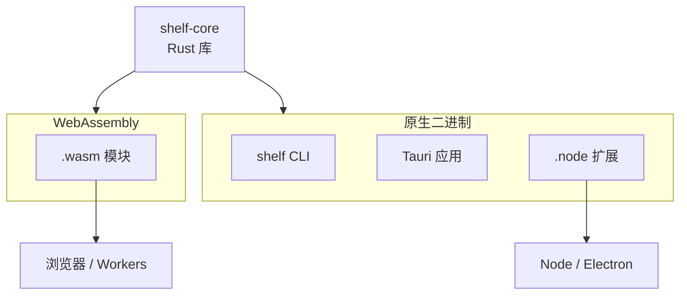
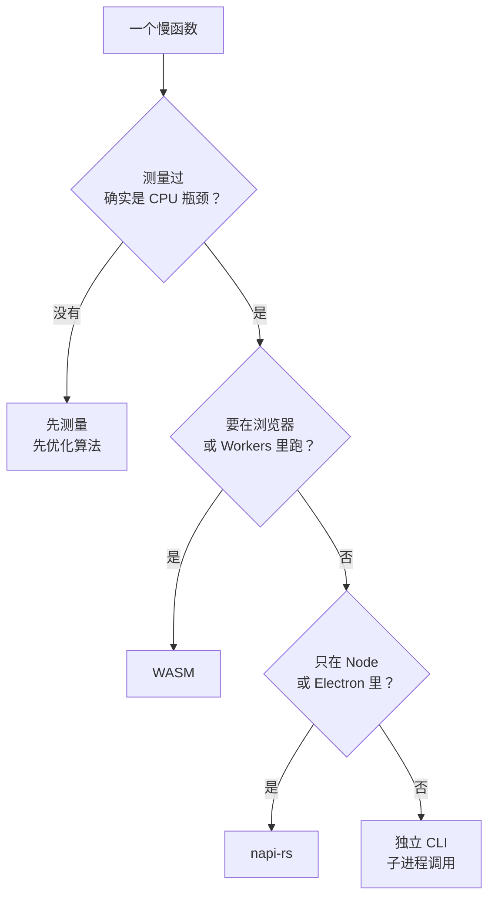

# WASM 与 Node 原生扩展：wasm-bindgen 与 napi-rs

第 1 章说过，对一个 TS 开发者，Rust 最实际的用法往往不是「用 Rust 写一个应用」，而是「把 TS 项目里最慢、最需要可靠的那个函数换成 Rust」。这一章讲两条把 Rust 嵌进 JS 世界的路：

- **WebAssembly**：编译成 `.wasm`，在浏览器、Node、Cloudflare Workers 里都能跑，一份产物到处用
- **Node 原生扩展**：用 napi-rs 编译成 `.node` 动态库，在 Node 和 Electron 里以原生速度运行，能用线程、能直接读写文件

两条路都继续用 `shelf-core`：同一个检查函数，第 8 章是 CLI，第 9 章是桌面应用，这一章变成一个 npm 包。最后给出一张选型表，并回顾全书。



## WebAssembly 是什么

WebAssembly（WASM）是一种可移植的二进制指令格式，浏览器和 JS 运行时都内置了它的虚拟机。对你来说，可以把它理解成「一个由 JS 加载、在沙箱里运行的高速函数库」：

- **沙箱**：WASM 模块默认什么都碰不到，没有文件系统、没有网络、没有 DOM。它能做的只有计算，外界的一切都要由 JS 传进来
- **线性内存**：模块有一块自己的连续内存（一个 `ArrayBuffer`），Rust 的堆就分配在这里面
- **类型很少**：WASM 函数的参数和返回值只有整数和浮点数。字符串、对象都要靠胶水代码在 JS 和线性内存之间搬运

第三点就是 wasm-bindgen 存在的原因：它根据你的 Rust 函数签名，自动生成两边的胶水代码，让你在 JS 里直接传字符串、拿回对象。

## wasm-bindgen：把 lint_chapter 编译成 WASM

> [!WARNING]
> Rust 的 WASM 工具链在 2025 年有过组织调整：原来的 rustwasm 工作组解散，wasm-bindgen 迁到了独立的组织继续维护，wasm-pack 的维护状态也有变化。本节按 wasm-bindgen 0.2 编写；动手前先到 wasm-bindgen 的 GitHub 仓库和 crates.io 确认当前推荐的构建方式，以官方文档为准。

在第 8 章的 workspace 里新建一个库：

```bash
cargo new --lib crates/shelf-wasm
rustup target add wasm32-unknown-unknown
```

`crates/shelf-wasm/Cargo.toml`：

```toml
[package]
name = "shelf-wasm"
version = "0.1.0"
edition = "2024"

[lib]
crate-type = ["cdylib", "rlib"]

[dependencies]
wasm-bindgen = "0.2"
serde-wasm-bindgen = "0.6"
shelf-core = { workspace = true }
```

`cdylib` 表示编译成一个给外部语言加载的动态库，WASM 模块就是这种形式。

`src/lib.rs`：

```rust
use wasm_bindgen::prelude::*;

/// 检查一章 Markdown，返回问题列表（Issue[]）
#[wasm_bindgen(js_name = lintChapter)]
pub fn lint_chapter(file: &str, markdown: &str) -> Result<JsValue, JsValue> {
    let issues = shelf_core::lint_chapter(file, markdown);
    Ok(serde_wasm_bindgen::to_value(&issues)?)
}

/// 统计代码块外的 H1 数量
#[wasm_bindgen(js_name = countH1)]
pub fn count_h1(markdown: &str) -> u32 {
    shelf_core::scan(markdown)
        .filter(|l| !l.in_fence && l.text.starts_with("# "))
        .count() as u32
}

/// 校验书籍 id
#[wasm_bindgen(js_name = isSlug)]
pub fn is_slug(s: &str) -> bool {
    shelf_core::is_slug(s)
}
```

- `#[wasm_bindgen]` 标记要导出给 JS 的函数，`js_name` 指定 JS 侧的名字，让两边各自遵守命名习惯
- `&str`、`u32`、`bool` 这类简单类型，wasm-bindgen 直接支持
- 结构化的返回值（这里是 `Vec<Issue>`）用 `serde-wasm-bindgen` 转成 JS 对象。`Issue` 在第 8 章已经派生了 `Serialize`，不用改
- 返回 `Result<_, JsValue>` 时，`Err` 会在 JS 里变成一个抛出的异常

`shelf-core` 里有读文件的 `check_book`，在 `wasm32-unknown-unknown` 目标上照样能编译，只是调用时文件操作会返回错误，因为沙箱里没有文件系统。这里只导出纯计算的 `lint_chapter`，正好避开了它。**适合编译成 WASM 的，是那些输入输出都是数据、不碰 I/O 的函数**。

### 构建

用 wasm-pack 一条命令完成编译、生成胶水代码和 `package.json`：

```bash
cargo install wasm-pack
wasm-pack build crates/shelf-wasm --target web --release
```

也可以不用 wasm-pack，分两步手动做：

```bash
cargo build -p shelf-wasm --target wasm32-unknown-unknown --release
cargo install wasm-bindgen-cli     # 版本要和 Cargo.lock 里的 wasm-bindgen 一致
wasm-bindgen target/wasm32-unknown-unknown/release/shelf_wasm.wasm --out-dir pkg --target web
```

产物在 `pkg/` 下：

| 文件 | 内容 |
|---|---|
| `shelf_wasm_bg.wasm` | 编译好的 WASM 模块 |
| `shelf_wasm.js` | 胶水代码：加载模块、在 JS 字符串和线性内存之间转换 |
| `shelf_wasm.d.ts` | TS 类型声明，从 Rust 签名生成 |
| `package.json` | wasm-pack 生成，可以直接发布或用 `workspace:` / `file:` 引用 |

`--target` 决定胶水代码的形式：`web` 生成 ES 模块、需要手动调用初始化函数；`bundler` 交给打包器处理 `.wasm` 的导入；`nodejs` 生成 CommonJS，同步加载，给 Node 用。

### 在 Vite 前端里用

```typescript
import init, { lintChapter, isSlug } from "shelf-wasm";

type Issue = { severity: "error" | "warning"; file: string; line: number | null; message: string };

await init();   // 下载并实例化 .wasm，只需一次

const text = "# 标题\n\n```\nno lang\n```\n";
const issues = lintChapter("draft.md", text) as Issue[];
console.log(issues, isSlug("rust-practice"));
```

`--target web` 生成的胶水代码用 `new URL("shelf_wasm_bg.wasm", import.meta.url)` 定位 `.wasm` 文件，Vite 能识别这种写法并把文件打进产物（[打包器那一章](../frontend-engineering/04-vite-bundling.md)讲过 Vite 怎么处理静态资源）。`lintChapter` 返回的是 `any`，`.d.ts` 不知道 serde 序列化出来的形状，这里要自己断言类型；需要严格类型时，可以用 `tsify` 这类 crate 从 Rust 类型生成 TS 定义。

### 边界的成本

每次调用 `lintChapter`，胶水代码都要：把 JS 字符串（UTF-16）编码成 UTF-8 写进 WASM 的线性内存，Rust 处理完，再把结果序列化成 JS 对象。字符串越长、调用越频繁，这部分开销越明显。所以：

- **调用要粗粒度**：传一整章进去检查一次，而不是每行调用一次
- **不要为了简单的字符串处理用 WASM**：`isSlug` 这种函数用 JS 正则写一行就够了，跨边界的开销可能比计算本身还大。上面导出它只是为了演示
- **先测量**：WASM 不是自动就快。V8 的 JIT 对热点 JS 代码优化得很好，只有在计算量足够大时（解析、压缩、图像处理、加密），WASM 的优势才会体现出来

### 体积

WASM 模块要通过网络下载（在浏览器里），体积比原生程序更敏感。几个常用手段：

```toml
[profile.release]
opt-level = "z"     # 按体积优化，而不是按速度
lto = true
codegen-units = 1
panic = "abort"     # 不需要栈展开代码
```

wasm-pack 默认会调用 binaryen 的 `wasm-opt` 进一步压缩。另外，依赖会一起编进来：`shelf-core` 依赖了 serde_yaml，但链接器会去掉没被调用到的代码，只导出 `lint_chapter` 时 YAML 解析器大部分不会出现在产物里。编完用 `ls -lh` 看一下，比 gzip 后的大小更有参考意义的是 `gzip -c pkg/shelf_wasm_bg.wasm | wc -c`。

## WASM 能跑在哪

> [!WARNING]
> 各运行时对 WebAssembly 的支持程度会随版本变化，尤其是 React Native 的 Hermes 引擎。下表按 2026 年下半年的情况整理，用之前以各运行时的官方文档为准。

| 运行时 | 能不能用 | 说明 |
|---|---|---|
| 浏览器 | 能 | 所有主流浏览器都支持 |
| Node | 能 | `--target nodejs`；不过在 Node 里，下一节的原生扩展通常是更好的选择 |
| Cloudflare Workers | 能 | 可以导入 `.wasm` 模块，也可以用 `workers-rs` 整个 Worker 用 Rust 写；CPU 时间计费，计算密集的逻辑放 WASM 有意义 |
| Electron 渲染进程 | 能 | Chromium 内置支持 |
| Tauri 前端 | 能，但没必要 | 直接 `invoke` 调 Rust 命令更自然 |
| React Native（Hermes） | 写作时不支持 | Hermes 没有内置 WebAssembly；在 RN 里用 Rust 要走原生模块（如 uniffi 生成 Swift / Kotlin 绑定），链路长很多 |
| RN 里的 WebView | 能 | WKWebView 支持 WASM |

最后两行对书巢有直接意义。书巢的 App 是 Expo 写的，跑在 Hermes 上，所以 `@shelf/spec` 的规则如果用 Rust 实现，App 那一侧**没法直接用 WASM 调用**。阅读器是跑在 WebView 里的网页，倒是可以加载 WASM，但导入管线不在阅读器里。这再次印证了第 8 章的结论：书巢的规则留在 TS 里是对的。

唱片墙的曲库 Worker 则是另一种情况：Workers 支持 WASM，如果哪天曲库要在边缘做音频转码或者大量的签名校验，把那部分写成 Rust 编译成 WASM 是一条可行的路。[Workers 运行模型那一章](../cloud-and-edge/04-workers-runtime.md#限制与计费cpu-时间不是墙钟时间)讲过它的 CPU 时间限制，那正是需要考虑 WASM 的时候。

## napi-rs：Node 原生扩展

如果目标运行时是 Node 或 Electron 的主进程，比 WASM 更好的选择是**原生扩展**：Rust 代码编译成一个平台相关的动态库（`.node` 文件），Node 用 `require` 直接加载。和 WASM 相比，它有三个优势：

- **能做 I/O**：可以直接读文件、开线程、用 rayon 和 tokio，没有沙箱
- **更快**：原生机器码，没有 WASM 虚拟机这一层
- **能异步**：耗时的计算放在 libuv 线程池里，不阻塞 Node 的事件循环，返回一个 Promise

代价是要为每个平台（macOS arm64 / x64、Windows、Linux glibc / musl……）分别编译一份。

Node 提供了一套稳定的 C 接口 **Node-API**（N-API），napi-rs 是它的 Rust 绑定。Node-API 的 ABI 在 Node 大版本之间保持稳定，所以编译一次的 `.node` 文件能在不同版本的 Node 上加载，也能在 Electron 里加载，不需要 `electron-rebuild` 针对 Electron 的 Node 版本重新编译。SWC、Rspack、Rolldown、Lightning CSS 这些工具，都是通过 napi-rs 提供 Node 接口的。

> [!WARNING]
> 本节按 napi-rs 3.x 编写（`napi` / `napi-derive` 3.x，`@napi-rs/cli` 3.x）。2.x 到 3.x 有 API 和 CLI 配置的变化，网上很多示例仍是 2.x 写法。具体的宏属性、`Task` trait 签名和 CLI 参数以 napi.rs 官方文档为准。

### 创建项目

```bash
pnpm add -g @napi-rs/cli
napi new
```

`napi new` 会询问包名、要支持的平台，生成一个带 GitHub Actions 多平台构建配置的项目。核心文件只有几个：

```toml
[package]
name = "shelf-node"
version = "0.1.0"
edition = "2024"

[lib]
crate-type = ["cdylib"]

[dependencies]
napi = "3"
napi-derive = "3"
rayon = "1"
shelf-core = { path = "../shelf-rs/crates/shelf-core" }

[build-dependencies]
napi-build = "2"
```

```rust
// build.rs
fn main() {
    napi_build::setup();
}
```

### 导出函数

```rust
use napi::bindgen_prelude::*;
use napi_derive::napi;
use rayon::prelude::*;
use std::path::PathBuf;

#[napi(object)]
pub struct JsIssue {
    pub severity: String,
    pub file: String,
    pub line: Option<u32>,
    pub message: String,
}

#[napi(object)]
pub struct BookSummary {
    pub id: String,
    pub title: String,
    pub error_count: u32,
    pub issues: Vec<JsIssue>,
}

fn to_js(issue: shelf_core::Issue) -> JsIssue {
    JsIssue {
        severity: match issue.severity {
            shelf_core::Severity::Error => "error".to_string(),
            shelf_core::Severity::Warning => "warning".to_string(),
        },
        file: issue.file,
        line: issue.line.map(|n| n as u32),
        message: issue.message,
    }
}

/// 同步检查一章：适合小输入
#[napi]
pub fn lint_chapter(file: String, markdown: String) -> Vec<JsIssue> {
    shelf_core::lint_chapter(&file, &markdown).into_iter().map(to_js).collect()
}

pub struct CheckBooks {
    root: String,
}

impl Task for CheckBooks {
    type Output = Vec<BookSummary>;
    type JsValue = Vec<BookSummary>;

    // 在 libuv 线程池里执行，不阻塞 JS 线程
    fn compute(&mut self) -> Result<Self::Output> {
        let mut dirs: Vec<PathBuf> = std::fs::read_dir(&self.root)
            .map_err(|e| Error::from_reason(format!("读取 {} 失败：{e}", self.root)))?
            .flatten()
            .map(|e| e.path())
            .filter(|p| p.join("book.yaml").exists())
            .collect();
        dirs.sort();

        let books = dirs
            .par_iter()
            .filter_map(|d| shelf_core::check_book(d).ok())
            .map(|b| BookSummary {
                error_count: b.count(shelf_core::Severity::Error) as u32,
                id: b.manifest.id,
                title: b.manifest.title,
                issues: b.issues.into_iter().map(to_js).collect(),
            })
            .collect();
        Ok(books)
    }

    // 回到 JS 线程，把结果交给 Promise
    fn resolve(&mut self, _env: Env, output: Self::Output) -> Result<Self::JsValue> {
        Ok(output)
    }
}

/// 并行检查目录下的全部书，返回 Promise
#[napi]
pub fn check_books(root: String) -> AsyncTask<CheckBooks> {
    AsyncTask::new(CheckBooks { root })
}
```

- `#[napi(object)]` 把结构体映射成一个普通的 JS 对象，字段名自动转成 camelCase（`error_count` → `errorCount`）
- `#[napi]` 导出函数，函数名同样转成 camelCase
- `AsyncTask` 是 napi-rs 对「在线程池里算、在 JS 线程上交结果」的封装：`compute` 在后台线程运行，可以随便用 rayon；`resolve` 回到 JS 线程。JS 侧拿到的是一个 Promise
- 这里没有直接复用 `shelf_core::Issue`，而是转换成 `JsIssue`，因为 `#[napi(object)]` 需要标在结构体定义上。也可以在 `shelf-core` 里加一个可选的 `napi` feature，用条件编译给原结构体加上这个宏，免去一次转换

napi-rs 3 也支持直接写 `#[napi] pub async fn`（需要开启对应的 feature，内部用 tokio），适合本身就是异步 I/O 的函数；CPU 密集的活用 `AsyncTask` 更直接。

### 构建和使用

```bash
napi build --platform --release
```

生成三个文件：`shelf-node.darwin-arm64.node`（当前平台的二进制）、`index.js`（按平台加载对应二进制的入口）、`index.d.ts`（类型声明）。生成的类型声明大致是：

```typescript
export interface JsIssue {
  severity: string;
  file: string;
  line?: number;
  message: string;
}
export interface BookSummary {
  id: string;
  title: string;
  errorCount: number;
  issues: Array<JsIssue>;
}
export declare function lintChapter(file: string, markdown: string): Array<JsIssue>;
export declare function checkBooks(root: string): Promise<Array<BookSummary>>;
```

和 WASM 那边要手动断言类型不同，这里的类型声明是从 Rust 签名**完整生成**的，包括 `#[napi(object)]` 结构体的字段。在 Node 里使用：

```typescript
import { checkBooks, lintChapter } from "shelf-node";

const books = await checkBooks("books");
for (const b of books.filter((b) => b.errorCount > 0)) {
  console.log(b.id, b.issues.map((i) => `${i.file}:${i.line ?? "-"} ${i.message}`));
}
console.log(lintChapter("a.md", "no heading"));
```

`checkBooks` 在后台线程里用 rayon 并行检查，Node 的事件循环在这期间完全不受影响，这是 WASM 和 `worker_threads` 都很难这么简洁做到的。

### 发布到 npm

`.node` 是平台相关的，不能像纯 JS 包那样一个包走天下。napi-rs 采用的方案（也是 esbuild、SWC、Biome 用的方案）是：

- 每个平台一个 npm 包，比如 `shelf-node-darwin-arm64`、`shelf-node-linux-x64-gnu`，里面只有对应的 `.node` 文件，`package.json` 里用 `os` 和 `cpu` 字段声明适用平台
- 主包 `shelf-node` 把这些平台包列为 `optionalDependencies`。包管理器只会安装和当前机器匹配的那一个
- 主包的 `index.js` 在运行时判断平台，`require` 对应的二进制

`napi new` 生成的 GitHub Actions 配置会在各平台的 runner 上编译，然后用 `napi prepublish` 生成和发布这些平台包。对一个人维护的项目，如果只在自己的 Mac 上用，大可以只编译 `darwin-arm64`，直接把 `.node` 文件放进 monorepo 里引用。

在 Electron 里用时，`.node` 文件不能被打进 asar 归档（系统的动态库加载器读不了 asar），要在打包配置里用 `asarUnpack` 把它解出来。这和其他原生模块的处理方式相同。

## 怎么选

| 方案 | 运行在哪 | 能做 I/O | 跨平台分发 | 和 JS 的交互成本 | 适合 |
|---|---|---|---|---|---|
| 纯 TS | 到处 | 能 | 无需处理 | 无 | 绝大多数情况，先从这里开始 |
| TS + `worker_threads` | Node | 能 | 无需处理 | 消息序列化 | CPU 任务不多、不想引入新语言 |
| WASM（wasm-bindgen） | 浏览器、Node、Workers | 不能（沙箱） | 一份产物 | 字符串要拷贝、编码 | 浏览器或 Workers 里的纯计算 |
| Node 扩展（napi-rs） | Node、Electron | 能 | 每个平台一份 | 低 | 只在 Node 侧用、计算或 I/O 很重 |
| 独立 CLI（第 8 章） | 任何地方，作为子进程 | 能 | 每个平台一份 | 进程启动 + 文本解析 | 工具本身就有独立使用的价值 |
| Tauri 命令（第 9 章） | Tauri 应用 | 能 | 随应用打包 | JSON 序列化 | 桌面应用 |



最常见的情况仍然是第一行：保持纯 TS。Rust 扩展意味着多一套构建、多一组平台产物、多一道类型边界。值得付出这些成本的，是那些边界清楚、计算重、长期稳定的函数，比如压缩、哈希、解析器、图像和音频处理。

## 全书回顾

| 章 | 一句话 |
|---|---|
| [为什么学 Rust](01-why-rust.md) | Rust 适合边界清楚、计算重的那一小块；不需要整体改写 |
| [所有权与借用](02-ownership-borrowing.md) | 每个值一个所有者；同一时刻要么多个读，要么一个写 |
| [生命周期](03-lifetimes.md) | 标注只描述引用之间的关系；改不动时先用拥有所有权的类型 |
| [类型、trait 与泛型](04-types-traits-generics.md) | 名义类型、显式实现的 trait；serde 只管形状，规则自己校验 |
| [错误处理](05-error-handling.md) | `Result` + `?`；库用 thiserror，应用用 anyhow |
| [集合、迭代器与闭包](06-collections-iterators-closures.md) | 迭代器惰性且零成本；闭包按捕获方式分三种 |
| [并发与 async](07-concurrency-async.md) | 数据竞争是编译错误；Future 惰性、丢弃即取消 |
| [写一个 CLI](08-cli-clap.md) | 库放逻辑、二进制只做壳；规则要多端共用时不要写两份 |
| [Tauri](09-tauri.md) | 命令是 API 边界，capability 是白名单；共享 TS 逻辑时 Electron 更顺 |
| WASM 与 napi-rs（本章） | 浏览器和 Workers 用 WASM，Node 和 Electron 用 napi-rs，先测量再动手 |

## 本章要点

- WASM 是沙箱里的可移植指令格式，只能计算、不能 I/O；wasm-bindgen 生成 JS 与线性内存之间的胶水代码
- `--target web / bundler / nodejs` 决定胶水代码的形式；跨边界有字符串拷贝成本，调用要粗粒度
- WASM 能跑在浏览器、Node、Cloudflare Workers；写作时 React Native 的 Hermes 不支持
- napi-rs 基于 ABI 稳定的 Node-API，编译出的 `.node` 能在 Node 和 Electron 里加载，可以做 I/O、开线程
- `AsyncTask` 把计算放进 libuv 线程池并返回 Promise；类型声明从 Rust 签名完整生成
- 原生扩展按平台分包，主包用 `optionalDependencies` 引用；Electron 里要 `asarUnpack`
- 多数时候保持纯 TS；只有测量确认的 CPU 瓶颈才值得引入 Rust

## 接下来读什么

第 9 章从 Rust 的角度做了一个 Tauri 应用，[《Electron 桌面应用》](../electron-desktop/)从另一个方向讲桌面开发：同一种语言写主进程和界面，代价是体积。两本对照着读，桌面方案的取舍会具体得多。napi-rs 扩展最终跑在 Node 的事件循环和线程池里，[事件循环与 libuv](../ts-node-advanced/04-event-loop-libuv.md) 那一章能帮你理解 `AsyncTask` 的后台线程从哪来。想把 WASM 放到边缘去跑，可以回到[《云与边缘》](../cloud-and-edge/)。
