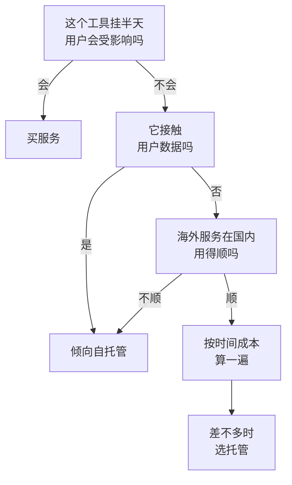
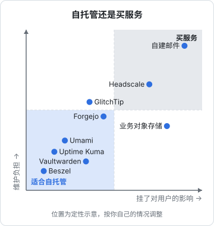

# 什么时候该自托管

一个人做产品，手边总会冒出一串「要不要自己搭一个」的问题：代码放 GitHub 还是自己的 Git 服务，错误监控用 Sentry 还是 GlitchTip，密码交给 1Password 还是自己跑 Vaultwarden，文件放网盘还是自己的对象存储。每一个单拿出来都不难，开源项目的 README 里通常就有一份能直接跑起来的 compose 文件。

难的是加起来之后的样子：十个服务、十套升级节奏、十份要备份的数据，全部压在一个人身上。本章先把「自托管」这笔账算清楚，给出判断标准，再用 hatch-counter 的工具清单走一遍，决定哪些值得搬回自己手里、哪些继续买服务。

## 关于这本书

### 讲什么

这本书讲**一个人怎么选、搭、维护一套自托管工具栈**：代码托管与 CI、监控面板、错误追踪与统计、密码与密钥、文件与对象存储、邮件、内网访问，最后是升级、迁移和退出计划。

这里的「工具」指的是**支撑你做产品的那些服务**，而不是产品本身。hatch-counter 的 API 和数据库是产品，跑在生产机上；Git 服务、CI runner、错误追踪、密码库是工具，本书建议把它们集中放在另一台「工具机」上。

和其他几本书的分工：

| 主题 | 在哪讲 | 本书怎么处理 |
|---|---|---|
| 服务器加固、异地备份、成本控制 | [《一人运维手册》](../production-ops/) | 直接沿用，只讲工具机特有的部分 |
| 错误监控的接入、可用性监控的设计 | [《可观测性与性能》](../observability-performance/) | 那边讲「监控什么、怎么接」，本书讲「工具怎么部署和维护」 |
| PostHog / Umami 的部署 | [《数据分析与埋点》第 7 章](../product-analytics/07-self-hosting.md) | 不重复，只讲怎么放进统一的底座 |
| Compose、镜像仓库、容器安全 | [《容器技术》](../docker-containers/) | 当作前置知识 |
| Caddy 与 nginx 的比较 | [《Nginx 与反向代理》第 8 章](../nginx-gateway/08-alternatives.md) | 本书的工具机直接用 Caddy |
| 密钥进仓库（SOPS） | [《基础设施即代码》第 4 章](../iac-gitops/04-secrets.md) | 本书讲人用的密码库，机器用的密钥仍走 SOPS |

### 适合谁

已经有一台生产机在跑服务，熟悉 Docker Compose 和基本的 Linux 运维，开始觉得「工具散落在七八个 SaaS 里、有几个在国内用起来不顺」的独立开发者。

### 怎么读

第 1、2 章是总纲和底座，后面每一章都建立在第 2 章的目录约定、Caddy 和统一备份之上，建议先读。第 3 到 9 章按工具分，彼此独立，挑你需要的读。第 10 章讲升级和退出，建议在部署第一个服务之前就读一遍：**退出计划要在进入时就想好**。

## 自托管的真实成本

「开源免费」只说了软件许可证的价格。真正的成本由四部分组成：

| 成本项 | 内容 | 容易被低估的原因 |
|---|---|---|
| 机器 | 工具机的月租、磁盘、流量、备份存储 | 这一项最显眼，反而最不容易算错 |
| 搭建 | 部署、配 HTTPS、接通知、迁数据 | 一次性的，但第一次往往是预计的两到三倍 |
| 日常维护 | 升级、看备份是否成功、清理磁盘、处理告警 | 每个月都有，单次很短，加起来不少 |
| 故障 | 它坏了的那几个小时，以及坏的时候你被耽误的事 | 发生之前总觉得不会发生 |

可以用一个粗略的公式比较：

$$
\text{自托管月成本} = \text{机器分摊} + (\text{月维护小时} + \text{故障小时期望}) \times \text{时薪}
$$

举个例子。假设你给自己的时间定价每小时 200 元，错误追踪一项：

- 自托管 GlitchTip：占工具机大约四分之一的资源，按工具机月租 100 元算分摊 25 元；每月维护约 0.5 小时（升级、看一眼磁盘），一年大概坏一次、每次耗 2 小时，折合每月约 0.17 小时。合计 $25 + (0.5 + 0.17) \times 200 \approx 159$ 元
- 托管服务：看你的事件量落在哪一档，可能是免费，也可能每月几十到几百元

单看这一项，自托管并不占优。但工具机是**共享**的：机器分摊会随服务数量摊薄，维护时间里的「登录机器、看一眼备份」也是一起做的。第三、第四个服务加进来时，边际成本明显下降。这也是本书主张**先搭一个底座、再往上放服务**的原因。

> [!WARNING]
> 文中的托管服务价格档位只是为了演示怎么算账，各家 SaaS 的免费额度、计费方式经常调整，做决定前以各服务官网当前的定价页为准。

这个公式里最主观的是时薪。早期收入为零的时候，你的时间确实便宜，自托管省下的每一块钱也真实；收入起来之后，时间越来越贵，托管服务越来越划算。所以「该不该自托管」不是一次性的决定，**每半年值得重新算一遍**。[《一人运维手册》第 6 章](../production-ops/06-cost-control.md)的「自建还是托管」用数据库做了同样的计算，可以对照着看。

## 值得自托管的三个理由

如果算下来钱差不多，下面三个理由会让天平倾向自托管。

### 数据留在自己手里

错误上报里有请求 URL、设备型号，有时还有一段业务数据；统计工具里有用户的访问路径；代码仓库里有你全部的商业逻辑。用户在国内、数据发往境外的 SaaS，就涉及个人信息出境的合规问题。门店 SaaS 的客户是商家，他们未必问，但一旦问起「我的数据存在哪」，能回答「全在境内、在我自己的机器上」会省很多解释。

合规的具体要求见[《国内合规实务》](../opc-compliance-cn/)。这里只说结论：**会接触用户数据的工具**（错误追踪、统计、日志）最值得自托管；只接触你自己数据的工具（代码、密码库）则主要看后两个理由。

### 国内网络

在境内做产品，海外 SaaS 有几个绕不开的问题：

- **访问不稳定**：GitHub 的网页和 `git clone` 时快时慢，Docker Hub 拉镜像经常超时，有些 SaaS 的控制台在国内打不开
- **上报失败**：如果错误追踪、统计服务的上报地址在境外，部分用户的上报会丢，你看到的数据本身就是有偏差的
- **付款**：不少海外服务只收外币信用卡，开发票也是问题

自托管在境内的机器上，这些问题一次解决。代价是另一个问题：**境内机器用域名对外提供服务需要 ICP 备案**，第 2 章会讲怎么在不对公网开放的前提下，给内部工具配上正常的 HTTPS 域名。

### 可控

SaaS 会涨价、会改免费额度、会被收购、会关停。自托管的服务不会在某天早上发邮件通知你「免费计划将于下月取消」。这个理由单独成立不了，因为开源项目也会改许可证、会停更（第 7 章的 MinIO 就是例子），但它确实让你多一个选择：**数据格式在你手里，换工具的主动权也在你手里**。

## 不该自托管的情况

反过来，有几类东西几乎总是不值得自己搭。

**邮件发送**。自建 SMTP 发出去的邮件大概率进垃圾箱，境内云主机通常还封了 25 端口。第 8 章专门讲为什么不建议、以及怎么挑托管服务。

**关键路径上的单点**。如果某个服务挂了会让你的产品也停摆，就不要把它放在一台没人值班的工具机上。比如生产环境的 DNS、给用户发登录验证码的短信通道、支付回调。工具机的设计目标是「坏了半天也不影响用户」，这类东西不满足这个前提。

**你不会去看的东西**。自托管一个服务的前提是你会去维护它。一个装好后再也不登录的 Grafana，一个从来没恢复过的备份目标，比没有更糟：它给你一种「这件事有人管」的错觉。

**需要高可用的东西**。一台工具机的可用性大概就是 99% 出头，一个月坏几个小时很正常。要求比这更高的，交给专门做这件事的服务商。

## 一张判断表

把上面的理由收成几个问题，对每一个候选工具问一遍：

最后一步「差不多时选托管」是有意的：自托管的隐性成本总是被低估，平手时应该判给托管。

这张图的位置是定性的，用来说明思路，不同的人放的位置会不一样。比如有人把密码库看得比代码还重要，就会把 Vaultwarden 往右移。

## 工具机和生产机分开

决定自托管之后，第一个问题是放在哪。最省事的做法是塞进生产机，本书不建议这样做，理由有四个：

- **监控必须在外面**。可用性监控要从被监控机器之外探测（[《可观测性与性能》第 6 章](../observability-performance/06-uptime-monitoring.md)），和生产放一起就失去了意义
- **CI 会吃满 CPU**。一次 `pnpm install` 加 `tsc` 加镜像构建能把 2 核机器占满几分钟，这几分钟里生产 API 的延迟会明显变差
- **爆炸半径**。工具升级失败、某个服务把磁盘写满、runner 跑了一个有问题的依赖，都不应该波及生产
- **权限分离**。生产机上只有生产需要的东西，被入侵时攻击者能接触的东西更少

所以本书的形态是：

| | 生产机 | 工具机 |
|---|---|---|
| 跑什么 | API、数据库、静态站 | Git、CI runner、监控、错误追踪、密码库…… |
| 谁访问 | 用户 | 主要是你自己，少数入口对用户（如错误上报） |
| 可用性目标 | 按 SLO 定 | 「坏了半天不影响用户」 |
| 配置 | 按业务需要 | 2 核 4G 起步，跑 CI 的话 4 核 8G 更从容 |

工具机放境内还是香港等境外地域，第 2 章会对比。

## 案例：hatch-counter 的工具盘点

把 hatch-counter 用到的周边工具列出来，逐项过一遍判断表：

| 工具 | 现状 / 候选 | 判断 | 理由 |
|---|---|---|---|
| 代码托管 | GitHub | 保留，加一个自托管镜像 | 国内访问时好时坏；GitHub 作为异地副本仍有价值（第 3 章） |
| CI / 发版 | GitHub Actions | 逐步迁到自托管 runner | 境内 runner 推镜像到同地域的镜像仓库走内网，不再需要转存 Docker Hub 镜像 |
| 可用性监控 | 待定 | 第三方 + 工具机上的 Uptime Kuma | 互为备份（第 4 章） |
| 主机指标 | 云厂商控制台 | 加 Beszel | 一个面板看所有机器的 CPU、内存、磁盘（第 4 章） |
| 错误追踪 | 待定 | 自托管 GlitchTip | 上报里有门店的业务数据，不出境（第 5 章） |
| 网站统计 | 待定 | 自托管 Umami | 同上 |
| 密码库 | 个人密码管理器 | 看个人偏好 | 第 6 章给出两种选择各自的做法 |
| 业务文件 | 云对象存储 | **不动** | 用户上传的单据照片属于产品的关键路径 |
| 备份第二目标 | 无 | 家里的 NAS 定期拉取 | 第二份异地副本，不在同一个云账号里（第 7 章） |
| 通知邮件 | 无 | 托管的邮件推送服务 | 不自建（第 8 章） |
| 管理入口 | SSH 公网 | Tailscale 组网 | 工具机的管理界面全部只对内网（第 9 章） |

有两点值得注意。一是**业务的对象存储不动**：它是产品的一部分，挂了用户就看不到单据，交给云厂商；自托管的对象存储只用在备份这种「坏一会儿也没关系」的地方。二是这张表里没有一项是「全部自己来」，几乎每一项都是自托管和托管的组合。这是一个人的常态，不是妥协。

## 本章要点

- 自托管的成本 = 机器分摊 + 维护和故障的时间 × 你的时薪；第一个服务最贵，后面的边际成本递减，所以先搭底座
- 值得自托管的三个理由：接触用户数据、海外服务在国内用不顺、想掌握数据和退出的主动权
- 不该自托管的：邮件发送、产品关键路径上的单点、你不会去维护的东西、需要高可用的东西
- 判断平手时选托管，并且每半年重新算一次
- 工具和生产分两台机器：监控要在外面、CI 吃 CPU、爆炸半径和权限都要隔开
- 现实的结果几乎总是「自托管 + 托管」的组合，把每一项的理由写下来

## 动手练习

1. **用公式算一笔账**：你给自己的时间定价每小时 150 元，工具机月租 120 元、上面准备放 4 个服务。候选是自托管 Uptime Kuma：资源按四分之一分摊，每月维护约 0.25 小时，估计一年坏一次、每次 1.5 小时。托管的同类服务每月 60 元。算出自托管的月成本；再算时薪涨到 600 元时的结果。

   验证：时薪 150 元时约 $30 + (0.25 + 0.125) \times 150 \approx 86$ 元；600 元时约 $30 + 0.375 \times 600 = 255$ 元。

   参考答案：两种时薪下自托管都比 60 元的托管贵，单看这一项应该买服务。它值得自托管的理由只能来自公式之外：比如监控要放在生产机之外、和其他服务共享维护时间之后边际成本更低。收入上来后时薪变贵，这笔账要重算。

2. **过一遍判断表**：对这四项走本章的流程图：给用户发登录验证码的短信通道、记录用户访问路径的网站统计、只有你自己看的读书笔记 Wiki、生产域名的权威 DNS。

   验证：每项给出「自托管」或「买服务」，并说出在流程图的哪一步做出的决定。

   参考答案：短信通道和权威 DNS 在第一步就出局，挂半天用户就登录不了或访问不了，买服务；网站统计接触用户数据，倾向自托管；读书笔记 Wiki 不碰用户数据，海外服务在国内也通常够用，按时间成本算，平手时选托管。
