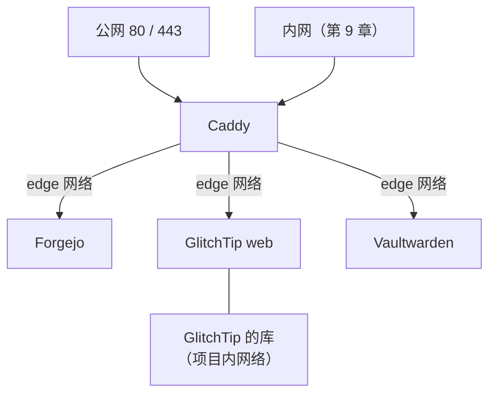
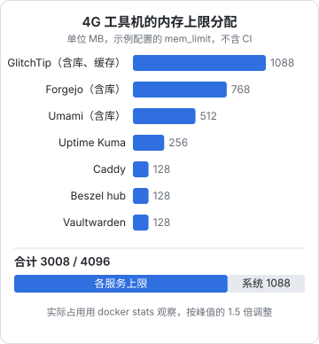

# 底座：一台机器、Compose、Caddy 与统一备份

自托管十个服务，最怕的是十种部署方式：这个用 apt 装的，那个是一键脚本，另一个手写了 systemd 单元；证书有的 Caddy 管、有的 certbot 管；备份各写各的脚本，各配各的定时器。半年后你自己都说不清哪个服务的数据在哪。

本章先搭一个底座，后面每一章的服务都按同一套约定放进来：**一台工具机、每个服务一个 Compose 目录、一个 Caddy 统一入口、一套备份脚本覆盖所有服务**。底座立住了，加一个新服务就只是「建目录、写 compose、在 Caddyfile 里加三行、写一个备份钩子」。

## 机器放哪

工具机的配置和选址，主要看两个问题：要不要跑 CI，以及放境内还是境外。

| 选项 | 好处 | 麻烦 |
|---|---|---|
| 境内云主机（与生产同地域） | 延迟低；推镜像、读写对象存储走内网；上报地址国内用户访问稳定 | 对公网开放网站要 ICP 备案；拉 Docker Hub、GitHub 不稳定 |
| 香港或其他境外地域 | 不用备案；拉镜像、访问 GitHub 顺畅 | 跨境网络有抖动；错误上报这类面向用户的入口在境内可能不稳 |
| 家里的小主机或 NAS | 没有月租；磁盘便宜 | 家宽上行慢、IP 会变、停电断网；不适合放面向用户的入口 |

对 hatch-counter 这样用户全在境内的产品，本书的选择是**境内云主机，与生产同地域**：错误上报要让国内的手机稳定打得到，CI 构建好的镜像推到同地域的镜像仓库也最快。备案的问题用一个办法绕开：**工具机上绝大多数服务不对公网开放**，只在第 9 章的内网里访问；需要对公网的少数入口，用已经备案的主域名下的子域名。

> [!WARNING]
> 备案以「在境内服务器上用域名对公网提供网站服务」为对象，子域名是否被已有备案覆盖、换一家云厂商时是否要做接入备案，规则由云厂商和主管部门解释，会调整，以你所用云厂商的备案说明为准。

配置上，不跑 CI 时 2 核 4G 足够放下本书所有服务；要跑 CI 构建镜像，建议 4 核 8G，或者把 runner 单独放一台按量计费的机器。磁盘建议单独挂一块数据盘到 `/srv`，系统盘坏了或要重装时数据不受影响，云盘快照也可以只对数据盘做。

机器初始化（部署用户、SSH、防火墙、自动安全更新）按[《部署与 CI/CD》第 1 章](../deploy-release/01-vps-setup.md)和[《一人运维手册》第 1 章](../production-ops/01-hardening.md)做，这里不再重复。工具机和生产机的区别只有一处：**安全组只开 80 和 443**，连 22 都可以在第 9 章组好内网之后关掉。

## 目录约定

所有东西都在 `/srv/tools` 下，每个服务一个目录：

```text
/srv/tools/
├── caddy/
│   ├── compose.yaml
│   ├── Caddyfile
│   └── .env
├── forgejo/
│   ├── compose.yaml
│   ├── .env
│   └── backup.sh
├── glitchtip/
│   ├── compose.yaml
│   ├── .env
│   └── backup.sh
├── vaultwarden/
│   └── ……
├── backup/
│   ├── run.sh
│   └── excludes.txt
└── README.md
```

几条约定：

- **每个服务一个 Compose 项目**，项目名就是目录名。升级、重启、查日志都是 `cd` 进去 `docker compose ...`，互不影响
- **数据用具名卷，不用绑定挂载到散落的路径**。具名卷统一落在 Docker 的数据目录里，把它也放到数据盘上（`/etc/docker/daemon.json` 里设 `"data-root": "/srv/docker"`），备份时就知道去哪找
- **版本写在 `.env` 里**，不用 `latest`。升级是一次显式的修改（第 10 章）
- **`.env` 权限 600、不进 git**，`compose.yaml`、`Caddyfile`、`backup.sh` 进 git
- **`README.md` 记录每个服务的用途、入口、数据在哪、怎么恢复**，这是第 10 章整机迁移时唯一要看的文档

整个 `/srv/tools` 去掉 `.env` 后放进一个私有仓库。第 3 章搭好 Forgejo 后，这个仓库可以放在 Forgejo 上，同时推一份到 GitHub 作为异地副本。

## 共享网络

所有服务通过 Caddy 对外，Caddy 和服务之间用一个共享的 Docker 网络通信，服务本身**一个端口都不映射到宿主机**：

```bash
docker network create edge
```

每个服务的 compose 里，需要被 Caddy 访问的那个容器加入 `edge`，数据库、缓存这些只留在自己项目的默认网络里：

```yaml
# 每个服务 compose.yaml 末尾都有的一段
networks:
  edge:
    external: true
```

这样做有两个好处。一是**Docker 映射端口绕过 ufw 的坑不存在了**，因为根本没有映射（这个坑见[《容器技术》第 5 章](../docker-containers/05-network-storage.md)）。二是 Caddy 用容器名就能找到服务，`reverse_proxy forgejo:3000`，不需要记端口分配表。



## Caddy：统一入口

工具机用 Caddy 而不是 nginx，理由是这里的服务多、变动频繁、几乎全是简单的反向代理，Caddy 的自动 HTTPS 和简短的配置正合适。两者的取舍见[《Nginx 与反向代理》第 8 章](../nginx-gateway/08-alternatives.md)。

### 内部服务的证书：DNS 验证

内部服务不对公网开放，Let's Encrypt 默认的 HTTP 验证就走不通：CA 要从公网访问你的 80 端口。解决办法是 **DNS-01 验证**：Caddy 调用 DNS 服务商的 API，在域名下写一条 TXT 记录证明所有权，全程不需要公网能访问这台机器。

Caddy 的官方镜像不带 DNS 插件，要用 `xcaddy` 编一个。以阿里云解析为例：

```dockerfile
# /srv/tools/caddy/Dockerfile
ARG CADDY_TAG
FROM caddy:${CADDY_TAG}-builder AS builder
# 境内机器上编译时，Go 模块走国内代理
ENV GOPROXY=https://goproxy.cn,direct
RUN xcaddy build --with github.com/caddy-dns/alidns

FROM caddy:${CADDY_TAG}
COPY --from=builder /usr/bin/caddy /usr/bin/caddy
```

域名在 Cloudflare 上就换成 `github.com/caddy-dns/cloudflare`，其他服务商在 `caddy-dns` 组织下找对应的模块。

> [!WARNING]
> `caddy-dns` 下各插件的模块路径、Caddyfile 参数名由各插件维护者决定，会随版本变化；本节按写作时的写法整理，编译和配置前以插件仓库的 README 为准，并用 `caddy validate` 校验配置。

给 DNS 插件用的 API 密钥要单独建一个**只能改解析记录**的子账号（阿里云 RAM 子用户只授予云解析权限），不要用主账号的 AccessKey。

### compose 与 Caddyfile

```yaml
# /srv/tools/caddy/compose.yaml
name: caddy

services:
  caddy:
    build:
      context: .
      args:
        CADDY_TAG: ${CADDY_TAG:?在 .env 里设置 CADDY_TAG}
    image: tools/caddy:${CADDY_TAG}
    restart: unless-stopped
    ports:
      - "80:80"
      - "443:443"
      - "443:443/udp"     # HTTP/3
    env_file: .env
    volumes:
      - ./Caddyfile:/etc/caddy/Caddyfile:ro
      - caddy-data:/data     # 证书和 ACME 账号，迁机器时要一起搬
      - caddy-config:/config
    networks: [edge]
    mem_limit: 128m

volumes:
  caddy-data:
  caddy-config:

networks:
  edge:
    external: true
```

```text
# /srv/tools/caddy/Caddyfile
{
	email ops@example.com
}

# 所有站点共用的证书签发方式：DNS 验证
(dns_tls) {
	tls {
		dns alidns {
			access_key_id {env.ALIDNS_KEY_ID}
			access_key_secret {env.ALIDNS_KEY_SECRET}
		}
	}
}

# 只允许内网来源访问（第 9 章的 Tailscale 地址段）
(private) {
	@outside not remote_ip 100.64.0.0/10
	respond @outside 403
}

git.tools.example.com {
	import dns_tls
	import private
	reverse_proxy forgejo:3000
}

errors.example.com {
	import dns_tls
	# 错误上报要对公网开放，见第 5 章
	reverse_proxy glitchtip-web:8000
}
```

两个 snippet 是这个底座的关键：`dns_tls` 让每个站点都用 DNS 验证签证书，`private` 让一个站点只对内网开放。新加一个内部服务就是三行：域名、两个 `import`、一个 `reverse_proxy`。

内部域名的 DNS 记录怎么指，第 9 章细讲。简单说就是把 `*.tools.example.com` 解析到工具机的内网地址：公网上的人解析出来是一个 `100.x` 的地址，连不上；你在内网里则能正常访问，浏览器看到的也是正规签发的证书。

### 改完配置怎么生效

```bash
cd /srv/tools/caddy
# 先校验，再热加载，不重启容器
docker compose exec caddy caddy validate --config /etc/caddy/Caddyfile
docker compose exec caddy caddy reload --config /etc/caddy/Caddyfile
```

把这两行写进一个 `reload.sh`，养成「改完先校验」的习惯。Caddy 的 reload 在配置有错时会拒绝加载并保留旧配置，但一次失败的 reload 往往意味着你以为生效的改动其实没生效。

## 给每个服务设内存上限

一台机器跑十几个容器，最常见的事故是某一个服务内存泄漏或被一次大请求撑爆，触发内核的 OOM killer，杀掉的却可能是另一个无辜的进程。给每个容器设 `mem_limit`，让超限的容器自己被杀、自己重启，不连累别人。



这些数字是本书示例 compose 里的**上限设定**，不是实测占用。实际占用用 `docker stats --no-stream` 看，跑一两周后按峰值的 1.5 倍左右调整。图里没有 CI runner：构建时的峰值远高于空闲时，要跑 CI 就按上文换 8G 的机器，或者把 runner 放到单独的机器上（第 3 章）。PostHog 不在这张图里：它自己就需要一台更大的机器（见[《数据分析与埋点》第 7 章](../product-analytics/07-self-hosting.md)），不要和这些工具挤在一起。

## 统一备份

[《一人运维手册》第 2 章](../production-ops/02-backup-dr.md)已经讲了怎么用 restic 搭一套异地、加密、带心跳的备份，工具机直接沿用那里的 `/etc/restic/env` 和仓库初始化步骤。本节解决的是工具机特有的问题：**十几个服务，怎么用一个脚本备份全部，而且新加服务时不用改主脚本**。

### 约定：每个服务一个备份钩子

数据分两种：

- **能直接复制的文件**：配置、上传的附件、Caddy 的证书。restic 直接备份卷目录即可
- **不能直接复制的数据库**：Postgres、SQLite 正在写入时复制文件，得到的可能是损坏的副本。要先导出（dump）成一致的文件，再备份导出的文件

约定每个有数据库的服务目录里放一个 `backup.sh`，只负责一件事：**把数据库导出到 `/srv/tools/_dumps/<服务名>/`**。比如 GlitchTip：

```bash
#!/usr/bin/env bash
# /srv/tools/glitchtip/backup.sh：只负责导出，上传由主脚本统一做
set -euo pipefail
cd "$(dirname "$0")"
out=/srv/tools/_dumps/glitchtip
mkdir -p "$out"
docker compose exec -T postgres pg_dump -U glitchtip -Fc glitchtip > "$out/glitchtip.dump.tmp"
mv "$out/glitchtip.dump.tmp" "$out/glitchtip.dump"
```

先写 `.tmp` 再 `mv`，保证 `_dumps` 里永远不会出现半截文件。

### 主脚本

```bash
#!/usr/bin/env bash
# /srv/tools/backup/run.sh：由 tools-backup.timer 每天调用
set -euo pipefail
umask 077
source /etc/restic/env

failed=()

# 1. 依次跑每个服务的导出钩子；一个失败不影响其他，最后统一判定
for hook in /srv/tools/*/backup.sh; do
  svc=$(basename "$(dirname "$hook")")
  if ! bash "$hook"; then
    echo "导出失败：$svc" >&2
    failed+=("$svc")
  fi
done

# 2. 一次备份：服务目录（含导出文件）+ Docker 卷
#    数据库的原始数据目录在 excludes.txt 里排除，只要 dump
restic backup /srv/tools /srv/docker/volumes \
  --exclude-file /srv/tools/backup/excludes.txt \
  --tag tools --host tools

restic forget --tag tools --keep-daily 7 --keep-weekly 4 --keep-monthly 6 --prune

# 3. 有任何一个钩子失败，就不发成功心跳，让心跳服务报警
if (( ${#failed[@]} > 0 )); then
  echo "以下服务导出失败：${failed[*]}" >&2
  exit 1
fi
curl -fsS -m 10 --retry 3 "$BACKUP_PING_URL" >/dev/null
```

```text
# /srv/tools/backup/excludes.txt
# 数据库的原始文件：只备份 dump，不备份正在写入的文件
/srv/docker/volumes/*_pg-data
/srv/docker/volumes/*_valkey-data
# CI 的缓存和构建产物，丢了重新生成即可
/srv/docker/volumes/runner_*
```

这套约定的关键是**排除规则按卷名的后缀匹配**：所有服务的 Postgres 卷都叫 `pg-data`，Compose 会自动加上项目名前缀变成 `glitchtip_pg-data`。只要新服务遵守命名，排除规则就不用改。

定时器、心跳和恢复演练和《一人运维手册》第 2 章完全一样，这里只强调两点：

- **心跳服务不能放在工具机上**。工具机自己挂了，心跳服务也跟着挂，报警永远不会来。用第三方的心跳服务，或者放在生产机上的 Uptime Kuma 推送监控里（第 4 章）
- **恢复演练要按服务做**。每个月挑一个服务，在一台临时机器上只用备份和 `README.md` 把它恢复出来。一年下来每个服务都至少演练过一次

### 第二个备份目标

restic 的仓库放在云对象存储上，和工具机多半是同一个云账号。账号出问题时两者一起没了。第 7 章会让家里的 NAS 用一把只读钥匙，每天用 `restic copy` 把云端的快照拉到本地，作为第二个备份目标。

## 这台机器自己的文档

底座搭好后，在 `/srv/tools/README.md` 里写下这几样东西：

```markdown
# 工具机

- 机器：境内某云 4C8G，数据盘挂在 /srv，Docker data-root 在 /srv/docker
- 入口：Caddy，配置在 caddy/Caddyfile；DNS 验证用 RAM 子账号 tools-dns
- 内网：Tailscale，机器名 tools（第 9 章）
- 备份：backup/run.sh，每天 04:00，restic 仓库见密码库「restic tools」条目
- 心跳：第三方心跳服务，检查项名 tools-backup，宽限 26 小时

## 服务

| 服务 | 域名 | 数据 | 备份方式 |
|---|---|---|---|
| forgejo | git.tools.example.com | forgejo_data 卷 + pg dump | backup.sh |
| …… | | | |
```

这份文档的读者是半年后的你，或者凌晨三点在一台新机器上恢复服务的你。写的标准是：**只看它，不凭记忆，能把整台机器恢复出来**。

## 本章要点

- 工具机与生产同地域放境内，绝大多数服务只对内网，少数面向用户的入口用已备案域名的子域名
- 每个服务一个 Compose 目录，版本写在 `.env` 里，数据用具名卷，整个 `/srv/tools` 去掉 `.env` 进 git
- 服务不映射端口，通过共享的 `edge` 网络让 Caddy 访问；Caddy 用 DNS 验证给内部域名签证书
- 两个 snippet 撑起整个入口：`dns_tls` 管证书，`private` 管只对内网
- 每个容器设内存上限，避免一个服务拖垮整台机器
- 统一备份：每个服务一个只负责导出的 `backup.sh`，主脚本统一上传；任何一个钩子失败都不发成功心跳
- 心跳服务放在工具机之外；恢复演练按服务轮流做
