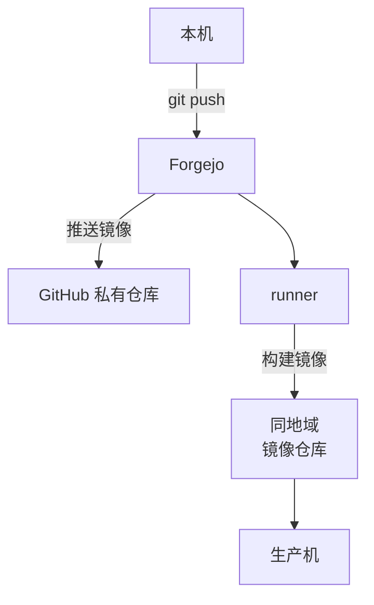

# 代码托管与 CI：Forgejo 与 Actions runner

代码是一人公司最核心的资产，也是最不怕丢的资产之一：你的电脑上有一份，GitHub 上有一份，生产机上还有构建产物。所以自托管 Git 服务的理由从来不是「怕丢」，而是另外几件事：国内拉代码和跑 CI 不顺，发版流水线要跨境推镜像，以及想让 CI 跑在离生产近的地方。

本章在工具机上部署 Forgejo 作为 Git 服务，配一个 Actions runner 跑 CI，再设计它和 GitHub 的关系：谁是主、谁是镜像，出了问题切到哪边。

## Gitea 还是 Forgejo

> [!WARNING]
> 本节的许可证、版本节奏和项目治理情况按写作时（2026 年下半年）整理，开源项目的许可证和维护状态会变，选型前以两个项目官网和代码仓库的说明为准。

两者同源：Forgejo 是 2022 年从 Gitea 分出来的社区分支，起因是 Gitea 的商标和域名转给了一家商业公司。它们的使用体验至今非常接近，选哪个都不会错，区别主要在治理和许可证：

| | Gitea | Forgejo |
|---|---|---|
| 治理 | Gitea Ltd. 公司主导，有商业版 | 社区主导，挂在非营利组织 Codeberg e.V. 下 |
| 许可证 | MIT | 从 v9 起改为 GPLv3 或更新版本 |
| 发布节奏 | 按需发版 | 固定周期发大版本，部分版本是长期支持（LTS） |
| Actions | Gitea Actions + act_runner | Forgejo Actions + forgejo-runner |
| 与对方的兼容 | — | 早期可以从 Gitea 原地升级，较新版本之后不再保证 |

对一个人自用来说，许可证差异几乎没有影响：你不分发它的修改版。本书选 **Forgejo**，理由有两个：有 LTS 版本，一年升一次大版本也来得及；Codeberg 本身就跑在 Forgejo 上，大量真实用户在替你踩坑。如果你更熟悉 Gitea，下面的配置把镜像名换掉、几个环境变量前缀对上，基本可以照搬。

## 部署 Forgejo

数据库用 Postgres。Forgejo 也支持 SQLite，单人使用完全够；选 Postgres 是为了让备份钩子和其他服务一致，都是 `pg_dump`。

```yaml
# /srv/tools/forgejo/compose.yaml
name: forgejo

services:
  forgejo:
    image: codeberg.org/forgejo/forgejo:${FORGEJO_TAG:?在 .env 里设置}
    restart: unless-stopped
    environment:
      USER_UID: "1000"
      USER_GID: "1000"
      FORGEJO__database__DB_TYPE: postgres
      FORGEJO__database__HOST: postgres:5432
      FORGEJO__database__NAME: forgejo
      FORGEJO__database__USER: forgejo
      FORGEJO__database__PASSWD: ${PG_PASSWORD}
      FORGEJO__server__DOMAIN: git.tools.example.com
      FORGEJO__server__ROOT_URL: https://git.tools.example.com/
      FORGEJO__server__SSH_DOMAIN: git.tools.example.com
      FORGEJO__server__SSH_PORT: "2222"
      FORGEJO__service__DISABLE_REGISTRATION: "true"
      FORGEJO__service__REQUIRE_SIGNIN_VIEW: "true"
      FORGEJO__actions__ENABLED: "true"
    volumes:
      - data:/data
    ports:
      # Git over SSH 只绑内网地址，见第 9 章
      - "${TAILSCALE_IP}:2222:22"
    depends_on:
      postgres:
        condition: service_healthy
    networks: [default, edge]
    mem_limit: 512m

  postgres:
    image: postgres:${PG_TAG:?}
    restart: unless-stopped
    environment:
      POSTGRES_USER: forgejo
      POSTGRES_PASSWORD: ${PG_PASSWORD}
      POSTGRES_DB: forgejo
    volumes:
      - pg-data:/var/lib/postgresql/data
    healthcheck:
      test: ["CMD", "pg_isready", "-U", "forgejo"]
      interval: 10s
    mem_limit: 256m

volumes:
  data:
  pg-data:

networks:
  edge:
    external: true
```

```bash
# /srv/tools/forgejo/.env，权限 600
FORGEJO_TAG=<从官方发布页选一个 LTS 版本号>
PG_TAG=16-alpine
PG_PASSWORD=<openssl rand -hex 24 生成>
TAILSCALE_IP=<工具机的内网地址，第 9 章>
```

几处说明：

- **`FORGEJO__节__键` 形式的环境变量会写进 `app.ini`**，配置都留在 compose 里，不用进容器改文件。完整的配置项见 Forgejo 文档的配置速查表
- **关闭注册、要求登录才能浏览**：这是一个只给你自己用的实例。即使它只对内网开放，也按公网的标准收紧，内网不等于安全
- **Git over SSH 只绑内网地址**：网页走 Caddy 的 `private`，SSH 端口不经过 Caddy，所以直接绑在内网网卡上，公网根本连不到
- **境内拉不到 `codeberg.org` 的镜像时**，按[《容器技术》第 7 章](../docker-containers/07-registry.md)的办法转存到自己的镜像仓库。`postgres` 镜像同理

Caddyfile 里加三行：

```text
git.tools.example.com {
	import dns_tls
	import private
	reverse_proxy forgejo:3000
}
```

第一次打开网页会进入安装向导，数据库那一页已经被环境变量填好了，只需要创建管理员账号。关闭了注册，这一步建的就是唯一的账号。

### 备份钩子

```bash
#!/usr/bin/env bash
# /srv/tools/forgejo/backup.sh
set -euo pipefail
cd "$(dirname "$0")"
out=/srv/tools/_dumps/forgejo
mkdir -p "$out"
docker compose exec -T postgres pg_dump -U forgejo -Fc forgejo > "$out/forgejo.dump.tmp"
mv "$out/forgejo.dump.tmp" "$out/forgejo.dump"
```

仓库本身是 `data` 卷里的裸仓库文件，由主脚本直接备份。Forgejo 也有自带的 `forgejo dump` 命令，能把仓库、数据库、配置打成一个 zip，适合在迁移时用一次（第 10 章），日常备份用上面的方式更省空间：restic 对仓库文件能去重，对一个每天都变的 zip 则不能。

## 它和 GitHub 是什么关系

部署完 Forgejo，最重要的设计问题是：**代码的主副本在哪里**。有两种可行的形态：

| 形态 | 怎么做 | 适合 |
|---|---|---|
| GitHub 为主，Forgejo 镜像 | Forgejo 建「拉取镜像」，定时从 GitHub 同步；CI 用 Forgejo 上的副本 | 有开源项目、有协作者、PR 和 Issue 都在 GitHub 上 |
| Forgejo 为主，GitHub 镜像 | 日常推送到 Forgejo；Forgejo 配「推送镜像」，每次推送后同步到 GitHub 的私有仓库 | 私有项目，一个人开发，主要痛点是国内访问 GitHub |

hatch-counter 是私有项目，一个人开发，适合第二种：**Forgejo 为主，GitHub 作为异地副本**。这样 GitHub 那份同时还是代码的异地备份，工具机整个丢了，代码一行都不会少。



### 配置推送镜像

在 Forgejo 仓库的「设置 → 仓库 → 镜像设置」里添加推送镜像：

- 远程地址填 GitHub 仓库的 HTTPS 地址
- 认证用一个 **fine-grained personal access token**，只授予这一个仓库的 Contents 读写权限，有效期设一年并在日历里记一笔到期提醒
- 勾选「推送提交时同步」

> [!WARNING]
> 推送镜像的菜单位置、是否支持 SSH 密钥认证、同步触发方式在 Forgejo 不同版本间有调整；GitHub fine-grained token 的权限名和最长有效期也可能变化。配置时以两边的当前文档为准。

镜像同步失败不会影响你往 Forgejo 推送，所以它会**静默失败**。在第 4 章的 Uptime Kuma 里加一个监控：每天用 GitHub API 查一次仓库最近的推送时间，超过两天没更新就提醒。更省事的做法是每周手动看一眼 GitHub 仓库的提交时间，写进[《一人运维手册》第 8 章](../production-ops/08-checklists.md)的周检查清单。

### 本机的 remote 怎么设

```bash
git remote rename origin github
git remote add origin ssh://git@git.tools.example.com:2222/jarvis/hatch-counter.git
git push -u origin main
```

保留 `github` 这个 remote 有用：工具机坏了的那几天，直接 `git push github` 继续工作，等工具机恢复后再推回 Forgejo，推送镜像会自动把两边对齐。

## Actions runner

Forgejo Actions 的工作流语法和 GitHub Actions 基本一致，大多数工作流可以原样搬过来。执行任务的是单独的 **forgejo-runner** 进程，它主动连 Forgejo 领任务，所以 runner 可以放在任何能访问 Forgejo 的地方。

### 放在哪

| 位置 | 优点 | 缺点 |
|---|---|---|
| 工具机上 | 不多花钱 | 构建时 CPU 被占满，同机的其他服务变慢 |
| 单独一台按量计费机器 | 隔离，配置可以按构建需要选 | 多一台机器的费用和维护 |
| 你的开发机 | 性能好，免费 | 关机就没有 CI；Mac 是 arm64，构建 amd64 镜像要模拟，很慢 |

起步时放在工具机上（4 核 8G），发现构建明显拖慢其他服务时再拆出去。runner 的配置不依赖它在哪台机器上，拆出去只是换个地方跑同一个 compose。

### Docker-in-Docker

runner 执行任务时，每个 job 起一个容器。它需要访问一个 Docker 引擎。最简单的做法是把宿主机的 `/var/run/docker.sock` 挂进去，但这等于把整台工具机的 root 权限交给了每一个 CI 任务：任务里一条 `docker ps` 就能看到 Vaultwarden 的容器，一条 `docker run -v /:/host` 就能读到所有数据。

所以本书用一个独立的 **Docker-in-Docker（dind）** 容器给 runner 用。job 只能看到 dind 里的容器，看不到宿主机上的服务：

```yaml
# /srv/tools/runner/compose.yaml
name: runner

services:
  docker:
    image: docker:${DIND_TAG:?}-dind
    restart: unless-stopped
    privileged: true
    environment:
      DOCKER_TLS_CERTDIR: /certs
    volumes:
      - dind-certs:/certs/client
      - dind-data:/var/lib/docker
    mem_limit: 3g

  runner:
    image: code.forgejo.org/forgejo/runner:${RUNNER_TAG:?}
    restart: unless-stopped
    user: "1000:1000"
    depends_on: [docker]
    environment:
      DOCKER_HOST: tcp://docker:2376
      DOCKER_TLS_VERIFY: "1"
      DOCKER_CERT_PATH: /certs/client
    volumes:
      - runner-data:/data
      - dind-certs:/certs/client:ro
    command: forgejo-runner daemon --config /data/config.yml
    mem_limit: 256m

volumes:
  dind-certs:
  dind-data:
  runner-data:
```

`privileged: true` 看起来很吓人，它确实给了 dind 容器很高的权限。和挂 socket 相比，区别在于**job 接触不到宿主机上已有的容器和卷**。对一个人跑自己代码的 CI，这个隔离程度足够；如果要跑来自外部的 PR，就把 runner 放到单独的机器上。

> [!WARNING]
> forgejo-runner 的注册命令、配置文件字段、与 dind 配合的推荐写法在不同版本间变化较多，下面的命令按写作时的版本整理，部署前以 Forgejo 文档中 runner 安装一节的当前版本为准。

### 注册

在 Forgejo 的「站点管理 → Actions → Runners」里创建一个注册令牌，然后：

```bash
cd /srv/tools/runner
# 生成默认配置，再按需修改
docker compose run --rm runner forgejo-runner generate-config > config.yml
docker compose run --rm -v "$PWD/config.yml:/data/config.yml" runner \
  forgejo-runner register --no-interactive \
    --instance https://git.tools.example.com \
    --token <注册令牌> \
    --name tools-runner \
    --labels docker:docker://node:22-bookworm
```

`--labels` 决定工作流里 `runs-on` 能写什么：上面这行表示 `runs-on: docker` 的 job 用 `node:22-bookworm` 镜像跑。

`config.yml` 里值得改的几项：

- `runner.capacity`：同时跑几个 job。工具机上设 1，避免两个构建同时把机器压垮
- `container.network`：设成 `host` 时 job 能访问 dind 所在网络里的服务容器（比如测试用的 Postgres），按你的工作流需要选
- `cache`：开启 runner 自带的缓存服务，`actions/cache` 能用上，`pnpm install` 能快很多

注意 runner 要能访问 `git.tools.example.com`，而这个域名只对内网开放。runner 和 Forgejo 在同一台机器上时，最简单的办法是在 runner 的 compose 里加 `extra_hosts`，把域名指向 Caddy 所在的地址；runner 在另一台机器上时，让那台机器也加入第 9 章的内网。

### 工作流里的 action 从哪来

工作流里的 `uses: actions/checkout@v4` 需要下载这个 action 的代码。Forgejo 默认从它自己的官方镜像站下载常用 action，而不是 GitHub，这在国内反而是好事。也可以把用到的 action 仓库拉取镜像到自己的 Forgejo 上，在 `app.ini` 的 `[actions]` 节里把默认地址改成自己的实例，彻底不依赖外网。

用到的 action 越少越好。很多 action 做的事就是一两行 shell，自己写在 `run:` 里，少一个外部依赖，也少一个供应链风险（[《应用安全》第 5 章](../app-security/05-supply-chain.md)）。

## 案例：把 hatch-counter 的发版流水线搬过来

hatch-counter 的发版走 GitHub Actions：`pnpm release` 打 tag，工作流在 GitHub 的 runner 上构建镜像，推到阿里云的镜像仓库，再触发生产机部署（[《部署与 CI/CD》第 5 章](../deploy-release/05-ci-cd.md)）。为了让 GitHub 的境外 runner 构建时拉得到镜像，它还专门有一条工作流把 `postgres:16-alpine` 之类的外来镜像转存进自己的仓库。

搬到工具机上的 runner 之后：

- 工作流文件从 `.github/workflows/` 复制到 `.forgejo/workflows/`，`runs-on: ubuntu-latest` 改成 `runs-on: docker`
- 登录镜像仓库改用**VPC 内网地址**，推镜像不走公网、不计流量
- 构建时的基础镜像从自己的镜像仓库拉，转存那条工作流还要留着，但 runner 本身已经在境内，不再受 Docker Hub 的影响
- 密钥（镜像仓库的密码、部署用的 SSH 私钥）在 Forgejo 仓库的「设置 → Actions → Secrets」里重新录一遍

```yaml
# .forgejo/workflows/release-api.yml（只保留和 GitHub 版不同的部分）
on:
  push:
    tags: ["api-v*"]

jobs:
  build:
    runs-on: docker
    steps:
      - uses: actions/checkout@v4
      - name: 登录镜像仓库（VPC 地址）
        run: echo "${{ secrets.ACR_PASSWORD }}" |
          docker login --username "${{ secrets.ACR_USER }}" --password-stdin "${{ vars.ACR_VPC_HOST }}"
      - name: 构建并推送
        run: |
          tag="${GITHUB_REF_NAME#api-v}"
          docker build -f apps/api/Dockerfile -t "${{ vars.ACR_VPC_HOST }}/hatch/api:$tag" .
          docker push "${{ vars.ACR_VPC_HOST }}/hatch/api:$tag"
```

工作流里能用 `GITHUB_REF_NAME` 这类变量，因为 Forgejo 为了兼容提供了同名的上下文变量；它也提供 `FORGEJO_` 前缀的版本。

job 容器里要能执行 `docker build`，需要能连上 dind。这一点在 runner 的 `config.yml` 里配置：让 job 容器继承 `DOCKER_HOST` 并挂上证书，或者用 `docker:cli` 镜像作为 job 镜像。具体写法以 runner 文档里「在 job 中使用 Docker」一节为准。

搬迁建议分两步：先让 Forgejo 上的 CI（测试、类型检查）跑起来，和 GitHub Actions 并行一两周；确认稳定后再搬发版流水线，同时把 GitHub 上的发版工作流禁用而不是删除，留作工具机故障时的后备。

## 本章要点

- Forgejo 和 Gitea 同源，体验接近；本书选 Forgejo，因为有 LTS 和社区治理
- 数据库用 Postgres，备份钩子与其他服务一致；网页只对内网，SSH 端口只绑内网地址
- 私有项目用「Forgejo 为主、推送镜像到 GitHub」，GitHub 那份就是代码的异地备份；本机保留 `github` remote 作为后备
- runner 用独立的 Docker-in-Docker，不挂宿主机的 docker.sock；工具机上同时只跑一个 job
- 境内 runner 推镜像走同地域的内网地址，发版流水线不再受跨境网络影响
- 搬迁分两步：先并行跑 CI，再迁发版；GitHub 的工作流禁用而不删除，作为后备

## 动手练习

1. **环境变量会写进 app.ini**：在本机起一个一次性的 Forgejo（用内置 SQLite 即可）：`docker run -d --name fj -p 3000:3000 -e FORGEJO__service__DISABLE_REGISTRATION=true -e FORGEJO__service__REQUIRE_SIGNIN_VIEW=true codeberg.org/forgejo/forgejo:<从官方发布页选的版本号>`。打开 `http://localhost:3000` 完成安装向导并创建管理员，然后执行 `docker exec fj grep -A3 '^\[service\]' /data/gitea/conf/app.ini`，再用浏览器的无痕窗口打开 `http://localhost:3000/user/sign_up`。

   验证：`app.ini` 的 `[service]` 节里有 `DISABLE_REGISTRATION = true` 和 `REQUIRE_SIGNIN_VIEW = true`；注册页提示注册已关闭。做完 `docker rm -f fj`。

   参考答案：`FORGEJO__节__键` 形式的变量在容器启动时写进 `app.ini`，配置留在 compose 里，换机器时不用进容器改文件。（配置文件路径沿用了 Gitea 的目录名，不同版本可能调整，找不到时用 `docker exec fj find /data -name app.ini`。）

2. **dind 看不到宿主机的容器**：保持上题的 `fj` 容器运行。先执行 `docker run --rm -v /var/run/docker.sock:/var/run/docker.sock docker:cli docker ps --format '{{.Names}}'`；再起一个独立的 dind：

   ```bash
   docker network create ci
   docker run -d --privileged --name dind --network ci -e DOCKER_TLS_CERTDIR= docker:dind
   sleep 5
   docker run --rm --network ci -e DOCKER_HOST=tcp://dind:2375 docker:cli docker ps --format '{{.Names}}'
   ```

   验证：挂 socket 的那条列出了 `fj` 等宿主机上的全部容器；连 dind 的那条什么都没有。做完 `docker rm -f dind && docker network rm ci`。

   参考答案：CI 任务拿到宿主机的 socket 就能操作工具机上的所有服务；连独立的 dind，它只能看到自己起的容器。练习里为了省事关了 dind 的 TLS，正文的配置是开着的。

3. **主副本挂了时的后备 remote**：用两个本地裸仓库模拟 Forgejo 和 GitHub：`git init --bare /tmp/fj.git && git init --bare /tmp/gh.git`；在一个新仓库里 `git remote add origin /tmp/fj.git && git remote add github /tmp/gh.git`，提交一次并推到两边。然后 `mv /tmp/fj.git /tmp/fj.down` 模拟工具机故障，再提交一次，`git push origin main` 和 `git push github main` 各试一次；最后 `mv /tmp/fj.down /tmp/fj.git` 恢复，再 `git push origin main`。

   验证：故障期间推 `origin` 失败、推 `github` 成功；恢复后推 `origin` 成功，`git ls-remote origin main` 和 `git ls-remote github main` 输出的提交哈希相同。

   参考答案：保留一个指向异地副本的 remote，工具机坏的那几天照常工作；恢复后再推回主副本，两边就对齐了。真实环境里这一步由 Forgejo 的推送镜像自动完成。
