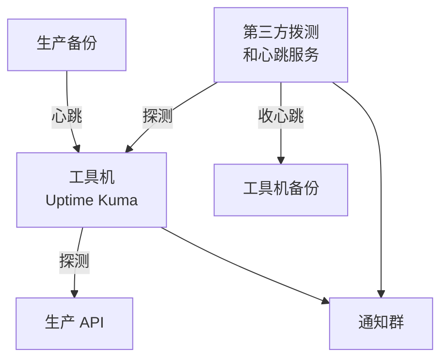

# 监控面板：Uptime Kuma 与 Beszel

[《可观测性与性能》](../observability-performance/)用九章讲了监控：日志、Prometheus 指标、链路追踪、告警设计、可用性监控。那本书回答的是「该监控什么、怎么设计」。本章回答更朴素的问题：**一个人的工具机上，装哪两个面板最划算，怎么部署、怎么维护，和那本书里的 Prometheus 栈怎么分工**。

答案是两个轻量的工具：**Uptime Kuma** 从外面看服务通不通，**Beszel** 从里面看机器累不累。两个加起来不到 400M 内存，半小时能配好，覆盖一个人最常遇到的大多数故障。

## 分工

先把几样东西的边界说清楚：

| 工具 | 看什么 | 回答的问题 | 在哪讲 |
|---|---|---|---|
| Uptime Kuma | HTTP、证书、端口、心跳 | 「用户现在能不能用」 | 探测设计见[《可观测性与性能》第 6 章](../observability-performance/06-uptime-monitoring.md)，本章讲部署和维护 |
| Beszel | 每台机器的 CPU、内存、磁盘、网络、容器 | 「机器是不是快撑不住了」 | 本章 |
| Prometheus + Grafana | 应用内部指标：QPS、延迟分位、事件循环、连接池 | 「为什么慢」 | [《可观测性与性能》第 2 章](../observability-performance/02-metrics-prometheus.md) |
| GlitchTip | 异常和堆栈 | 「哪段代码坏了」 | 第 5 章 |

Beszel 和 Prometheus 的 node_exporter 在「主机指标」上是重叠的。怎么选：

- **还没有 Prometheus**：先上 Beszel。它不需要写 PromQL、不需要画面板，装上就有每台机器的历史曲线和阈值告警。很多一人项目到这一步就够了
- **已经有 Prometheus 栈**：主机指标用 node_exporter 进 Prometheus，Beszel 可以不装。如果你喜欢它那个「一屏看所有机器」的概览页，两个并存也只多几十兆内存
- **应用指标**（接口延迟、错误率）Beszel 做不了，需要的时候再上 Prometheus

一个人最容易犯的错误是第一天就把 Prometheus、Grafana、Loki、Alertmanager 全装上，然后再也不打开。**从能回答「通不通」和「撑不撑得住」的两个面板开始**，等真的遇到「为什么慢」的问题再往上加。

## 谁监控谁

监控工具本身也会挂。一个人的两台机器，按下面的方式互相看：



- 工具机上的 Uptime Kuma 探测生产，同时接收**生产机**定时任务的心跳
- 第三方服务探测工具机上的 Uptime Kuma 本身，并接收**工具机**备份的心跳
- 两路通知发到同一个群

这样任何一台机器挂了都有人报：生产挂了 Kuma 报，工具机挂了第三方报。第三方用免费额度就够，它只需要盯一两个地址。

## 部署 Uptime Kuma

> [!WARNING]
> Uptime Kuma 2.0 相对 1.x 有较大变化（数据库支持、部分监控类型和设置项），镜像标签、环境变量和升级步骤以项目 GitHub 仓库的 README 和发布说明为准；从 1.x 升级前务必先备份数据目录。

```yaml
# /srv/tools/uptime-kuma/compose.yaml
name: uptime-kuma

services:
  kuma:
    image: louislam/uptime-kuma:${KUMA_TAG:?}
    restart: unless-stopped
    volumes:
      - data:/app/data
    networks: [edge]
    mem_limit: 256m

volumes:
  data:

networks:
  edge:
    external: true
```

```text
# Caddyfile 片段
status.tools.example.com {
	import dns_tls
	import private
	reverse_proxy kuma:3001
}
```

管理界面只对内网。第一次打开时创建管理员账号，**随后立刻在设置里开启两步验证**。Uptime Kuma 能保存各种通知渠道的 Webhook 地址和机器人令牌，管理界面被拿下，攻击者就能用你的机器人往群里发消息。

### 公开的状态页

如果要给用户一个公开的状态页（「是不是挂了」先看这里），不要把整个 Kuma 开到公网。有两种做法：

- **用第三方服务的状态页**，Kuma 只做内部监控。最省事
- **用 Caddy 只放行状态页需要的路径**，其他路径一律 403

第二种的路径白名单取决于 Uptime Kuma 的前端怎么加载资源，版本间会变，配好后要用一台不在内网里的手机逐项点一遍：状态页能打开、数据能刷新、管理界面打不开。如果做不到这一点，就用第一种。

### 通知渠道

国内最顺手的是**飞书或企业微信、钉钉的群机器人**：建一个只有你自己的群，加一个自定义机器人，把 Webhook 地址填进 Uptime Kuma 的通知设置。手机上的推送比邮件可靠得多，也不依赖第 8 章的邮件服务。

[《一人运维手册》第 7 章](../production-ops/07-on-call.md)讲了告警分级和通知渠道的设计。落到 Uptime Kuma 上就是：所有监控默认用同一个通知渠道；重要的（生产 API、备份心跳）在手机上给这个群单独设成「有消息就响」，其余的群消息免打扰，白天看一眼就行。

### 推送监控：接收心跳

Uptime Kuma 的「Push」类型监控就是一个心跳接收器：它给你一个地址，你的脚本定期访问它，超过设定的时间没访问就报警。生产机的备份脚本最后一行改成：

```bash
# 生产机 /etc/restic/env 里
BACKUP_PING_URL="https://status.tools.example.com/api/push/<推送令牌>?status=up&msg=OK"
```

注意这个地址在内网域名下。生产机要能访问它，就得加入第 9 章的内网；或者单独给推送接口开一个公网子域名，用 Caddy 只放行 `/api/push/*`。前者更干净，本书用前者。

心跳间隔设成任务周期加一点余量：每天一次的备份，「心跳间隔」设 25 小时左右。

### 维护

- **数据**：默认用内置的 SQLite，全在 `data` 卷里。监控历史会越积越多，在设置里把保留天数调到 90 天左右
- **备份**：数据量很小。最稳妥的是像第 6 章 Vaultwarden 那样，在备份钩子里先停容器、复制、再启动，停几秒对监控没有影响；或者干脆接受「监控历史丢了就丢了」，只备份配置，配置在界面里能导出成 JSON
- **监控的监控**：如上文，第三方服务盯着它

## 部署 Beszel

Beszel 分两部分：**hub** 是带网页界面的中心，存历史数据、发告警；**agent** 装在每台被监控的机器上，采集指标。hub 放在工具机上，agent 装在工具机和生产机上。

> [!WARNING]
> Beszel 迭代较快，agent 与 hub 的连接方式（hub 主动连 agent，还是 agent 主动连 hub）、环境变量名和默认端口在不同版本间有变化。下面按 SSH 密钥认证、hub 主动连接的方式整理，部署时以官方文档和 hub 界面里「添加系统」时给出的配置为准。

```yaml
# /srv/tools/beszel/compose.yaml
name: beszel

services:
  hub:
    image: henrygd/beszel:${BESZEL_TAG:?}
    restart: unless-stopped
    volumes:
      - data:/beszel_data
    networks: [edge]
    mem_limit: 128m

volumes:
  data:

networks:
  edge:
    external: true
```

```text
# Caddyfile 片段
metrics.tools.example.com {
	import dns_tls
	import private
	reverse_proxy hub:8090
}
```

打开 hub 创建账号后，点「添加系统」，界面会显示 hub 的公钥和一段 agent 的 compose 配置。在**每台被监控的机器**上放一个 agent：

```yaml
# 生产机和工具机上：/srv/beszel-agent/compose.yaml
name: beszel-agent

services:
  agent:
    image: henrygd/beszel-agent:${BESZEL_TAG:?}
    restart: unless-stopped
    network_mode: host
    volumes:
      - /var/run/docker.sock:/var/run/docker.sock:ro
    environment:
      LISTEN: "45876"
      KEY: "<hub 界面上显示的公钥>"
    mem_limit: 64m
```

几处说明：

- **`network_mode: host`** 是为了采集宿主机真实的网卡流量
- **agent 挂了只读的 docker.sock**，用来统计每个容器的资源占用。只读挂载限制的是文件本身，并不限制通过 socket 能调用的 Docker API，所以 agent 仍然有很高的权限。这是看容器指标的代价；不需要容器级别的数据，就去掉这一行
- **45876 端口不能对公网开放**。它用 SSH 密钥认证，不是谁都能连，但按本书的原则，管理和监控流量只走内网：云安全组不放行这个端口，hub 添加系统时填 agent 机器的内网地址

hub 本身也能设置告警：CPU、内存、磁盘使用率超过阈值持续若干分钟，或者某台机器失联。通知同样发到那个群。建议起步只开三条：

| 告警 | 阈值 | 理由 |
|---|---|---|
| 磁盘使用率 | 超过 80% | 磁盘满是一人运维最常见、也最容易预防的事故 |
| 内存使用率 | 超过 90%，持续 10 分钟 | 短时间的峰值不值得打扰你 |
| 系统失联 | 立即 | 机器挂了或 agent 挂了，都要知道 |

CPU 告警先不开：CI 构建时工具机的 CPU 会满几分钟，这是正常的。等你有了一两个月的历史曲线，再决定要不要加、阈值定多少。

### 用面板养成习惯

Beszel 最有用的不是告警，而是那一屏概览。把它放进浏览器的收藏夹，每周检查（[《一人运维手册》第 8 章](../production-ops/08-checklists.md)）时打开看三件事：

- 磁盘曲线是不是一条斜向上的直线：是的话，按斜率算出多久会满，在满之前处理
- 内存是不是在缓慢爬升：可能有服务在泄漏，看容器视图找出是哪一个
- 生产机的 CPU 在每天的业务高峰是不是越来越接近上限：这是扩容的早期信号，容量怎么评估见[《可观测性与性能》第 9 章](../observability-performance/09-capacity-planning.md)

## 别装太多面板

自托管社区里有大量好看的监控和面板工具：Netdata、Glances、Grafana 的各种现成面板、首页导航（Homepage、Dashy 之类）。它们都不错，但每多一个就多一个要升级、要备份、要收紧权限的服务。

一个判断标准：**这个面板显示的信息，我会因为它而做出什么不同的决定吗**？如果答案是「不会，只是看着舒服」，就不要装。Uptime Kuma 让你知道要不要立刻处理，Beszel 让你知道要不要提前扩容或清理，这两个都通过了这个检验。

## 本章要点

- 一个人的监控从两个面板起步：Uptime Kuma 看「通不通」，Beszel 看「撑不撑得住」；「为什么慢」等需要时再上 Prometheus
- 两台机器互相看：工具机的 Kuma 探测生产并接收生产的心跳，第三方服务探测工具机并接收工具机的心跳
- Kuma 管理界面只对内网并开两步验证；公开状态页优先用第三方，自己做就只放行状态页路径并逐项验证
- 通知用飞书、企业微信、钉钉的群机器人，重要的设成必响，其余免打扰
- Beszel 的 hub 放工具机，agent 装在每台机器上，端口只对内网；起步只开磁盘、内存、失联三条告警
- 每多一个面板都是一份维护负担，只装会改变你决策的那几个

## 动手练习

1. **心跳停了会报警**：在本机起一个一次性的 Uptime Kuma：`docker run -d --name kuma -p 3001:3001 louislam/uptime-kuma:<从官方发布页选的版本号>`，打开 `http://localhost:3001` 建好账号，新建一个 Push 类型的监控，心跳间隔设 60 秒，复制它给出的推送地址。执行三次 `curl -fsS '<推送地址>'`，每次间隔十几秒；然后停下来等两分钟。

   验证：推送期间监控是绿色的 `Up`；停止推送一段时间后变成 `Down`，事件列表里有一条记录。做完 `docker rm -f kuma`。

   参考答案：推送监控不主动探测任何东西，只看「是不是按时来过」。备份脚本只在成功时推送，失败或根本没跑都会变成没来，这正是心跳要抓的情况。

2. **从磁盘曲线算出还剩几天**：生产机数据盘 40G，Beszel 显示当前使用 62%，过去一个月的曲线基本是一条直线，每天增长约 0.8G。告警阈值是 80%。算出多少天后触发告警、多少天后写满。

   验证：约 9 天后到 80%，约 19 天后写满。

   参考答案：已用 $40 \times 0.62 = 24.8$G；到 80% 是 32G，$(32 - 24.8) / 0.8 = 9$ 天；写满 $(40 - 24.8) / 0.8 = 19$ 天。斜向上的直线说明是持续写入（日志、备份、上传），在告警之前就该找出是谁，而不是等告警再处理。

3. **监控放错地方会漏掉什么**：有人图省事，把 Uptime Kuma 装在生产机上，用它探测生产 API，并接收生产机和工具机两边备份的心跳。列出这种安排下会漏报的故障。

   验证：至少列出两类漏报，并给出改法。

   参考答案：生产机整机宕机或断网时，Kuma 跟着一起挂，API 不可用和生产备份失败都没人报；探测走的是本机回环，「本机通、外面不通」（安全组、DNS、证书问题）也看不出来。改法就是本章的安排：Kuma 放工具机，再用第三方服务盯工具机本身。
