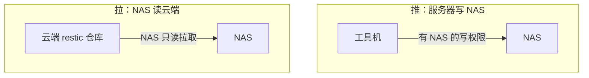

# 文件、对象存储与同步

文件相关的自托管需求可以分成三类，它们经常被混为一谈：

- **对象存储**：给程序用的，通过 S3 API 读写。业务的用户上传、备份仓库、CI 的缓存
- **备份目标**：只为了「出事时能拿回来」，平时只写不读
- **文件同步**：给人用的，让几台设备上的同一个文件夹保持一致

本章先说清楚业务的对象存储为什么不自托管，然后在家里的 NAS 上搭第二个备份目标，介绍 Garage 这个轻量的 S3 实现以及 MinIO 的现状，最后用 Syncthing 解决设备之间的文件同步。

## 业务的对象存储：不动

hatch-counter 的单据照片存在云厂商的对象存储里。第 1 章的判断表已经给出结论：**它是产品的关键路径**，挂了用户就看不到单据，所以不自托管。

云对象存储的价格、耐久性和带宽，一台自己的机器都比不上：几块钱一个月、多副本冗余、和生产机同地域走内网。它的设计和计费见[《云与边缘》第 3 章](../cloud-and-edge/03-object-storage.md)。

自托管的对象存储适合的是**坏一会儿也没关系**的场景：

| 场景 | 为什么适合自托管 |
|---|---|
| 备份的第二个目标 | 和云对象存储不在同一个账号、同一家公司，互为容灾 |
| 本地开发和测试 | 在开发机上起一个 S3 兼容服务，测试上传逻辑不碰线上的桶 |
| 工具自己的存储 | 某些工具（如 Forgejo 的附件、CI 缓存）可以配 S3 后端 |
| 大量冷数据 | 家里的大硬盘比云上便宜得多，但要接受家宽的速度和可用性 |

## 第二个备份目标

[《一人运维手册》第 2 章](../production-ops/02-backup-dr.md)的 3-2-1 原则要求有一份异地副本。第 2 章的统一备份已经把工具机的数据送到了云对象存储，生产机的备份也在云上。问题是：**它们都在同一个云账号里**。账号被盗、欠费停机、误操作删桶，所有备份一起没了。

第二个备份目标要满足两点：**不在同一个云账号**，以及**生产机和工具机被入侵时删不掉它**。家里的 NAS 或一台常开的小主机是很自然的选择。

### 推还是拉



推的方式下，工具机持有 NAS 的写入凭据，工具机被入侵，攻击者顺手就能把 NAS 上的备份也删了。**拉的方式更安全**：NAS 定期从云端 restic 仓库把新快照复制到本地，云端那边只需要给 NAS 一把**只读**的钥匙，而服务器上没有任何能碰到 NAS 的凭据。

### 用 restic copy 拉取

restic 的 `copy` 命令能把一个仓库的快照复制到另一个仓库，加密和去重都保留。在 NAS 上：

```bash
# NAS 上 /etc/restic/pull.env，权限 600
# 源：云端仓库，用一把只读的对象存储钥匙
export RESTIC_FROM_REPOSITORY="s3:https://<对象存储端点>/<桶名>"
export RESTIC_FROM_PASSWORD_FILE=/etc/restic/from-password
# 目标：NAS 本地的仓库
export RESTIC_REPOSITORY=/volume1/backup/restic-tools
export RESTIC_PASSWORD_FILE=/etc/restic/local-password
export AWS_ACCESS_KEY_ID="<只读钥匙>"
export AWS_SECRET_ACCESS_KEY="<对应的密钥>"
```

```bash
source /etc/restic/pull.env

# 第一次：初始化本地仓库，并沿用源仓库的分块参数，这样两边的去重才对得上
restic init --from-repo "$RESTIC_FROM_REPOSITORY" --copy-chunker-params

# 之后每天：复制源仓库里本地还没有的快照
restic copy
restic forget --keep-daily 14 --keep-weekly 8 --keep-monthly 12 --prune
```

> [!WARNING]
> `restic copy` 的参数在不同版本间改过名（早期版本用 `--repo2` 指定另一个仓库），`--from-repo`、`RESTIC_FROM_*` 等写法以你所装 restic 版本的 `restic copy --help` 和官方文档为准。NAS 系统自带的 restic 往往较旧，建议直接下载官方发布的二进制。

本地仓库可以保留得比云端更久：NAS 的硬盘便宜，多留几个月的月度快照几乎不花钱。

NAS 拉取完成后同样要发心跳，发到第三方心跳服务（工具机挂了时它也要能报警）。只读钥匙的意思是，**云端的对象存储里给这个桶单独建一个只能读的子账号**，具体怎么建看各家对象存储的权限文档。

### 另一种选择：rest-server 追加模式

如果你更希望由服务器直接推送到 NAS，restic 官方的 **rest-server** 有一个 `--append-only` 模式：客户端只能新增快照，不能删除或修改已有的数据。工具机就算被入侵，攻击者也只能往里写，删不掉历史。清理旧快照（`forget --prune`）在 NAS 本机上用另一个不受限的入口执行。

两种方式都能做到「服务器被入侵时删不掉第二份备份」。拉取的方式少一个常驻服务，本书推荐拉取。

## Garage：轻量的 S3

前面两种方式都不需要 S3：restic 可以直接写本地目录，也可以写 rest-server。什么时候才需要在 NAS 上跑一个 S3 兼容服务？

- 你有好几样东西都要往 NAS 写，而且它们都只会说 S3：其他机器的备份工具、某个只支持 S3 后端的应用、开发时要模拟线上的对象存储
- 你想要多地冗余：家里一台、父母家一台，数据自动在两地各存一份

这时 **Garage** 是一个合适的选择。它由一个法国的非营利组织开发，Rust 写成，单个二进制，内存占用很小，设计目标就是「在不可靠的家用网络和普通硬件上，跨几个地点运行」。

> [!WARNING]
> Garage 采用 AGPL-3.0 许可证。它的配置项（如副本数的写法）、命令行子命令和镜像标签在 1.x 与 2.x 之间有变化，S3 API 只实现了常用的子集。下面的配置按写作时的 2.x 版本整理，部署前以 Garage 官网文档中「快速开始」一节为准。

### 单节点部署

```toml
# /srv/garage/garage.toml
metadata_dir = "/var/lib/garage/meta"
data_dir = "/var/lib/garage/data"
db_engine = "lmdb"

# 单节点：只存一份。多地部署时改为 3
replication_factor = 1

rpc_bind_addr = "[::]:3901"
rpc_public_addr = "127.0.0.1:3901"
rpc_secret = "<openssl rand -hex 32>"

[s3_api]
s3_region = "garage"
api_bind_addr = "[::]:3900"
root_domain = ".s3.garage.localhost"

[admin]
api_bind_addr = "[::]:3903"
admin_token = "<openssl rand -base64 32>"
```

```yaml
# /srv/garage/compose.yaml
name: garage

services:
  garage:
    image: dxflrs/garage:${GARAGE_TAG:?}
    restart: unless-stopped
    volumes:
      - ./garage.toml:/etc/garage.toml:ro
      - /volume1/garage/meta:/var/lib/garage/meta
      - /volume1/garage/data:/var/lib/garage/data
    ports:
      # S3 接口只绑 NAS 的内网地址
      - "${TAILSCALE_IP}:3900:3900"
    mem_limit: 256m
```

元数据目录建议放在 SSD 上，数据目录放在大容量硬盘上。NAS 只有机械盘时也能用，只是列目录这类操作慢一些。

### 初始化

Garage 启动后还不能用，要先告诉它「集群里有哪些节点、每个节点给多少容量」，这叫布局（layout）：

```bash
cd /srv/garage
alias garage='docker compose exec garage /garage'

garage status                              # 记下节点 ID
garage layout assign -z home -c 2T <节点ID>  # 区域名 home，分配 2T
garage layout apply --version 1

garage bucket create restic-laptop
garage key create laptop-backup
garage bucket allow --read --write --owner restic-laptop --key laptop-backup
garage key info laptop-backup             # 显示访问密钥和私密密钥
```

拿到钥匙后，任何 S3 客户端都能用。比如让你的笔记本把文档备份到 NAS：

```bash
export AWS_ACCESS_KEY_ID="<laptop-backup 的访问密钥>"
export AWS_SECRET_ACCESS_KEY="<私密密钥>"
export AWS_DEFAULT_REGION=garage
restic -r s3:http://nas:3900/restic-laptop init
```

地址用的是 HTTP，因为流量走在第 9 章的内网里，WireGuard 已经加密了。如果 S3 接口要给内网之外的东西用，就在前面加一个 Caddy 做 HTTPS。

## MinIO 的现状

几年前，「自托管 S3」几乎等于 MinIO。现在不再推荐它作为新部署的首选。

> [!WARNING]
> 本节关于 MinIO 的描述按 2025 年到 2026 年上半年的公开信息整理：MinIO 社区版先是从网页控制台里移除了大部分管理功能，之后停止为社区版发布预编译的二进制和官方镜像，项目随后进入维护状态，重心转向商业产品。后续情况可能变化，以 MinIO 官方仓库和公告为准。

这对一个人的影响很直接：拿不到官方镜像，就得自己从源码构建；控制台功能缩水，日常管理要回到命令行；维护状态意味着安全修复的节奏没有保证。已经在用 MinIO 的，旧版本照样能跑，但值得把它列入第 10 章的退出计划。

替代品除了 Garage，还有 SeaweedFS（功能多、适合海量小文件）以及一些较新的项目。挑选时看三件事：许可证、是否有稳定的维护者和发布节奏、S3 API 覆盖到你需要的程度没有。**S3 是一个事实标准接口，这是好事**：只要你的程序和工具只通过 S3 API 访问存储，换实现就是改一个端点地址和一对钥匙。

## Syncthing：设备之间的文件同步

最后一类需求是给人用的：工作笔记、设计稿、运维文档、合同扫描件，希望在笔记本、台式机、NAS 之间保持一致，而且不经过任何第三方的服务器。

Syncthing 是做这件事的老牌开源工具：设备之间点对点同步，传输加密，没有中心服务器存你的数据。

### 它不是备份

这一点必须先说清楚。同步的语义是「让所有设备一样」，所以你在笔记本上误删了一个文件夹，几秒后 NAS 上的那份也没了；勒索软件加密了你的文件，加密后的版本也会同步过去。

两个补救：

- 在 NAS 那一端给共享文件夹开**文件版本控制**，选「阶梯式版本」：被删除或覆盖的文件挪到 `.stversions` 目录里保留一段时间
- NAS 上的同步文件夹**再用 restic 备份**，进入上文的备份体系

### 在 NAS 上跑

```yaml
# /srv/syncthing/compose.yaml
name: syncthing

services:
  syncthing:
    image: syncthing/syncthing:${SYNCTHING_TAG:?}
    restart: unless-stopped
    hostname: nas-syncthing
    environment:
      PUID: "1000"
      PGID: "1000"
    volumes:
      - /volume1/syncthing:/var/syncthing
    ports:
      # 管理界面和同步端口都只绑内网地址
      - "${TAILSCALE_IP}:8384:8384"
      - "${TAILSCALE_IP}:22000:22000/tcp"
    mem_limit: 256m
```

Mac 上用 Syncthing 的原生应用，它在菜单栏常驻。

### 国内网络下的设置

Syncthing 默认靠全球发现服务器找到对方设备，连不上时走公共中继服务器转发。这两类服务器大多在境外，国内用起来时好时坏，而且中继意味着你的（加密）数据流经别人的机器。

所有设备都在第 9 章的内网里时，可以把这些都关掉，直接告诉它对方在哪：

- 在每台设备的「设置 → 连接」里关闭「全局发现」和「启用中继」，保留「本地发现」
- 添加远程设备时，地址不填 `dynamic`，填对方的内网地址，如 `tcp://100.101.102.103:22000`

这样同步流量只在你的内网里走，速度取决于两端之间的网络，不再受境外服务器影响。

> [!WARNING]
> Syncthing 的设置项名称以当前版本的界面为准。手机端方面，官方的 Android 应用已停止维护，社区有延续的分支；iOS 上没有官方客户端，只有第三方付费应用。手机端客户端的可用性和后台同步限制以各应用商店的当前情况为准。

### 什么时候需要网盘

Syncthing 只做同步，没有网页界面、没有分享链接、没有在线预览。如果你需要「给客户发一个下载链接」「在手机浏览器里看一份文件」，那是网盘的需求，Nextcloud、Seafile 这类工具能做。它们比 Syncthing 重得多，Nextcloud 尤其是一个需要认真维护的 PHP 应用。先问一句：给客户发文件，用对象存储生成一个限时的预签名链接是不是就够了？大多数时候是够的。

## 本章要点

- 业务的对象存储是关键路径，留在云上；自托管的存储只用在坏一会儿也没关系的地方
- 第二个备份目标要满足：不在同一个云账号、服务器被入侵时删不掉；家里的 NAS 用只读钥匙从云端「拉」，比服务器「推」更安全
- `restic copy` 复制快照时初始化目标仓库要沿用源仓库的分块参数；NAS 拉取完成后向第三方发心跳
- 只有多个工具都要说 S3，或者要多地冗余时，才在 NAS 上跑 Garage；它是单二进制、AGPL、S3 子集
- MinIO 社区版已不适合作为新部署的首选；只通过 S3 API 访问存储，换实现就只是改端点
- Syncthing 解决设备间同步，但它不是备份：开版本控制并再备份一次；国内关掉全局发现和中继，直接填内网地址
