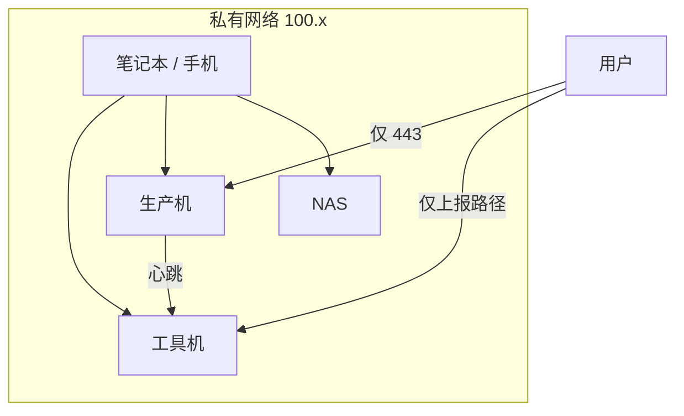

# 内网访问：Tailscale 与 WireGuard

前面每一章都在说「只对内网」：Forgejo 的网页和 SSH、Uptime Kuma 和 Beszel 的管理界面、Vaultwarden、GlitchTip 的后台、NAS 上的 Garage 和 Syncthing。Caddyfile 里那个 `private` snippet 只放行 `100.64.0.0/10` 这个地址段。本章把这个「内网」真正搭起来。

目标很具体：**你的笔记本、手机、工具机、生产机、家里的 NAS 在同一个私有网络里，彼此用固定的内网地址互访，工具机和生产机的管理入口全部从公网撤下**。

## 为什么要组网

一台云主机对公网暴露的东西越少，被攻击的面就越小。本书的工具机如果不组网，有两种选择：

- 每个工具都开放到公网，各自靠登录密码保护。十几个登录页，每一个的漏洞都是你的漏洞
- 每次用 SSH 隧道访问：`ssh -L 3001:localhost:3001 tools`。安全，但手机上几乎没法用，你也会因为麻烦而不去看

组网之后，访问内部工具就像访问局域网里的设备：手机上打开 `https://vault.tools.example.com`，背后是加密的点对点连接，公网上的人连这个地址都解析不到能用的结果。



## 方案比较

> [!WARNING]
> 本节涉及的 Tailscale 免费计划的用户数和设备数限制、各项目的许可证、以及它们在境内的可用性，按写作时的情况整理，会变化，以各项目官网和你自己的实测为准。

| 方案 | 怎么工作 | 好处 | 麻烦 |
|---|---|---|---|
| Tailscale | 基于 WireGuard；协调服务器由 Tailscale 公司托管，负责分发密钥和打洞 | 装上登录就能用；自动穿透 NAT；手机客户端完善；访问控制集中管理 | 协调服务器在境外，境内登录和首次连接可能不稳；控制面在别人手里 |
| Headscale | Tailscale 协调服务器的开源实现，自己部署；客户端仍用 Tailscale 官方客户端 | 控制面在自己手里 | 你又多了一个**关键**服务要维护 |
| 原生 WireGuard | 手写配置，点对点或星形 | 没有任何第三方依赖，内核级性能 | 密钥手工分发；不会自动打洞，NAT 后面的设备互访麻烦；没有集中的访问控制 |
| ZeroTier 等 | 类似 Tailscale 的托管组网服务 | 和 Tailscale 相近 | 同样有控制面在境外的问题 |

境内也有一些厂商提供组网产品，适合不想折腾的用户，选择时同样看控制面在哪、数据走不走对方的服务器。

本书的建议：**先用 Tailscale**。设备少、配置快，大多数时候在境内也能用。如果实测发现登录或连接经常出问题，再换 Headscale；如果只有两三台位置固定、都有公网 IP 的机器，原生 WireGuard 也很好。

## Tailscale

### 在境内能用吗

Tailscale 的数据流量和控制流量是分开的：

- **控制流量**：设备向协调服务器登录、领取其他设备的公钥和地址。协调服务器在境外，境内访问时快时慢，影响的是**登录和新设备加入**
- **数据流量**：设备之间的实际通信。能打洞成功时是**点对点直连**，不经过任何第三方服务器；打洞失败时走 Tailscale 的中继服务器（DERP），而境内没有官方中继节点，走中继会非常慢

云主机有公网 IP，打洞几乎总能成功，所以「工具机和生产机之间」「你和工具机之间」的流量通常是直连的。用下面的命令确认：

```bash
tailscale status          # 列出网络里的所有设备和它们的内网地址
tailscale ping tools      # 看到 via <公网IP:端口> 是直连，via DERP(xxx) 是走中继
```

如果你的家庭网络在多层 NAT 后面、经常落到中继上，可以在工具机上**自建一个 DERP 中继**。自建中继需要域名和证书，在境内机器上又会遇到备案问题，细节按 Tailscale 文档里自建 DERP 的说明来。

### 安装与加入

在每台设备上按 Tailscale 官方文档安装（Linux 有官方的软件源；macOS、iOS、Android 从应用商店装），然后登录同一个账号：

```bash
sudo tailscale up
# 按提示在浏览器里打开链接、登录
tailscale ip -4           # 本机的内网地址，形如 100.x.y.z
```

内网地址在设备第一次加入时分配，之后不变，可以放心写进配置。

**服务器加入后，立刻在管理后台把它的「密钥过期」关掉**。Tailscale 默认每隔一段时间要求设备重新登录，笔记本和手机重新登录无所谓，服务器则会在某天凌晨突然掉出内网，而你要靠内网才能登录它。这是最常见的「把自己锁在外面」的方式。

### 访问控制

默认所有设备都能互访所有端口。对一个人来说可以接受，但更好的做法是让服务器之间只开必要的口子：生产机被入侵时，攻击者不能顺着内网去扫工具机上的每一个服务。

在 Tailscale 管理后台给设备打标签：工具机 `tag:tools`，生产机 `tag:prod`，NAS `tag:nas`。然后写访问策略：

```json
{
  "tagOwners": {
    "tag:tools": ["autogroup:admin"],
    "tag:prod": ["autogroup:admin"],
    "tag:nas": ["autogroup:admin"]
  },
  "acls": [
    { "action": "accept", "src": ["autogroup:member"], "dst": ["*:*"] },
    { "action": "accept", "src": ["tag:prod"], "dst": ["tag:tools:443"] },
    { "action": "accept", "src": ["tag:tools"], "dst": ["tag:prod:45876"] }
  ]
}
```

读法：

- 你的个人设备（以你的账号登录的设备）可以访问一切
- 生产机只能访问工具机的 443：用来向 Uptime Kuma 发心跳（第 4 章）
- 工具机只能访问生产机的 45876：Beszel hub 去连 agent（第 4 章）
- NAS 没有任何入站或出站的内网规则：它从云端拉备份走的是公网（第 7 章），你访问它属于第一条

没有写到的一律拒绝。以后新增一条服务器之间的通信，就在这里加一行，顺便也是一份「谁和谁说话」的文档。

> [!WARNING]
> Tailscale 的访问策略语法在演进，较新的版本推荐用 `grants` 写法，`acls` 写法仍然兼容。字段名和标签规则以 Tailscale 文档中访问控制一节的当前版本为准；保存策略前用管理后台自带的测试功能验证。

## 内部域名怎么解析

第 2 章的内部服务都用 `*.tools.example.com` 这样的域名，证书用 DNS 验证签发。剩下的问题是让这些域名解析到工具机的内网地址。

最简单的做法是**直接在公网 DNS 里写内网地址**：

```text
*.tools.example.com.    A    100.101.102.103
```

`100.101.102.103` 是工具机的 Tailscale 地址。公网上任何人都能查到这条记录，但这个地址只在你的私有网络里有意义，查到了也连不上。你自己的设备在内网里，解析到这个地址后直接走内网访问。

这样做有两个好处：不需要自建 DNS 服务器；所有设备（包括没法改 DNS 设置的手机）都能直接用。代价是暴露了「你有一个 tools 子域名」这件事，对一个人的项目来说可以接受。

如果不想让内部域名出现在公网 DNS 里，可以用 Tailscale 的 MagicDNS 加「分流 DNS」：只把 `tools.example.com` 的查询交给你自己在内网里跑的 DNS 服务器。配置更多，收益主要是隐私，本书不展开。

注意 `errors.example.com`、`stats.example.com` 这类要对公网开放的域名（第 5 章）**不能**这样写，它们要解析到工具机的公网地址。

## 端口绑到内网地址

有的服务不经过 Caddy，需要直接暴露端口：Forgejo 的 Git SSH（第 3 章）、Garage 的 S3 接口和 Syncthing（第 7 章）。前面的 compose 里把它们写成了 `${TAILSCALE_IP}:2222:22`，只绑在内网网卡上，公网网卡上根本没有这个端口。

这样有一个启动顺序的坑：机器重启后，如果 Docker 先于 Tailscale 拿到内网地址就启动了容器，绑定一个还不存在的地址会失败，容器起不来。两种处理方式：

- **让 Docker 等 Tailscale**：给 Docker 的 systemd 单元加一个依赖，并在启动前等内网地址出现

```ini
# /etc/systemd/system/docker.service.d/wait-tailscale.conf
[Unit]
After=tailscaled.service
Wants=tailscaled.service

[Service]
ExecStartPre=/bin/sh -c 'for i in $(seq 1 60); do tailscale ip -4 >/dev/null 2>&1 && exit 0; sleep 1; done; exit 0'
```

等待最多 60 秒，等不到也照常启动 Docker，不会因为 Tailscale 出问题而让所有服务都起不来。

- **绑在所有地址上，靠云安全组挡住**：写成 `2222:22`，云安全组不放行 2222。这样启动顺序不再是问题，但防线只剩安全组一道，而且 Docker 的端口映射会绕过 ufw（[《容器技术》第 5 章](../docker-containers/05-network-storage.md)）

本书用第一种。改完后重启一次机器，确认所有容器都正常起来，这一步不能省。

## 把 SSH 从公网撤下

内网通了之后，可以做[《一人运维手册》第 1 章](../production-ops/01-hardening.md)里「管理入口不对公网」那一步：

1. 确认通过内网能 SSH 登录：`ssh deploy@100.101.102.103`，或者在 `~/.ssh/config` 里把主机地址改成内网地址
2. **确认云控制台的远程连接（VNC）能用**。这是内网出问题时唯一的入口。打开它，用控制台的方式登录一次
3. 把这条应急路径写进 `/srv/tools/README.md` 和应急手册
4. 在云安全组里删掉 22 端口的入站规则
5. 从一个不在内网里的网络（比如手机关掉 Tailscale、开热点）确认 22 已经连不上

生产机做同样的事。之后两台机器对公网只剩 80 和 443，再加上第 5 章的上报接口这类有意开放的路径。

## Headscale：自托管控制面

如果 Tailscale 的协调服务器在你那里经常连不上，或者你不愿意让一家境外公司掌握你内网的控制面，可以部署 Headscale。

> [!WARNING]
> Headscale 的配置文件结构、支持的 Tailscale 功能范围（如访问策略的语法、MagicDNS）和对客户端版本的要求随版本变化较快，部署前以 Headscale 官方文档和发布说明为准。

部署前想清楚它的位置：

- **它是一个关键服务**。Headscale 挂了，已经建立的连接通常还能继续工作一段时间，但新设备无法加入、设备换了网络后可能连不回来。它的可用性要求高于本书的其他工具
- **它必须对公网开放**，客户端要能访问它。放在境内机器上就要用已备案的域名；也可以单独放在一台香港或其他境外的小机器上
- **它不能放在工具机上**。工具机的管理入口依赖内网，内网又依赖 Headscale，Headscale 一挂就是死循环。放在一台单独的小机器上，这台机器的 SSH 留在公网，用密钥加 fail2ban 保护

客户端仍然用 Tailscale 官方的客户端，登录时指定你的服务器地址：

```bash
sudo tailscale up --login-server https://hs.example.com
```

一个人的场景下，Headscale 带来的维护负担不小。先用 Tailscale，实测确有问题再换。

## 原生 WireGuard

如果你的网络只有两三台位置固定、有公网 IP 的机器，加上一台笔记本，原生 WireGuard 足够了，而且没有任何第三方依赖。以工具机作为中心，其他设备都连它：

```ini
# 工具机 /etc/wireguard/wg0.conf
[Interface]
Address = 10.66.0.1/24
ListenPort = 51820
PrivateKey = <工具机私钥>

[Peer]
# 生产机
PublicKey = <生产机公钥>
AllowedIPs = 10.66.0.2/32

[Peer]
# 笔记本
PublicKey = <笔记本公钥>
AllowedIPs = 10.66.0.10/32
```

```ini
# 笔记本 wg0.conf
[Interface]
Address = 10.66.0.10/24
PrivateKey = <笔记本私钥>

[Peer]
PublicKey = <工具机公钥>
Endpoint = <工具机公网 IP>:51820
AllowedIPs = 10.66.0.0/24
PersistentKeepalive = 25
```

```bash
wg genkey | tee privatekey | wg pubkey > publickey   # 每台设备各生成一对
sudo systemctl enable --now wg-quick@wg0
sudo wg show                                          # 看最近一次握手时间
```

云安全组放行 UDP 51820。用原生 WireGuard 时，Caddyfile 里 `private` snippet 的地址段要改成 `10.66.0.0/24`，内部域名解析到 `10.66.0.1`。

它的局限在设备多了之后显现：每加一台设备，中心节点的配置就要改一次；两台都在 NAT 后面的设备（比如你的笔记本和家里的 NAS）无法直连，只能经过中心转发；手机上要手动导入配置。到了这一步，换成 Tailscale 或 Headscale 会轻松很多。

## 本章要点

- 组网的目标：所有设备在一个私有网络里，管理入口全部从公网撤下
- 先用 Tailscale：云主机之间、你和云主机之间通常是点对点直连；用 `tailscale ping` 确认没有走中继
- 服务器加入后立刻关闭密钥过期；用标签和访问策略让服务器之间只开必要的端口
- 内部域名直接在公网 DNS 里解析到内网地址，简单且所有设备都能用；对公网开放的域名除外
- 端口绑内网地址时，让 Docker 等 Tailscale 拿到地址再启动，改完重启一次验证
- 撤下公网 SSH 前，先确认云控制台的远程连接能用，并写进应急文档
- Headscale 是关键服务，不能放在依赖它的工具机上；设备少且固定时，原生 WireGuard 也够用
