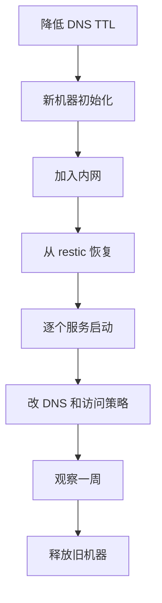

# 升级、迁移与退出计划

部署一个服务只要一个下午，维护它要好几年。自托管的工具栈最常见的结局不是某天突然崩溃，而是慢慢腐烂：版本停在两年前，没人敢升；某个服务的数据库版本已经停止维护；当初为什么这么配置，谁也想不起来。等到不得不动的时候，往往是一次安全漏洞的公告，或者一台要退役的机器。

本章讲三件让工具栈不腐烂的事：**有节奏地升级**，**能随时整机迁移**，以及**每个工具都有退出计划**。

## 升级的节奏

不是所有服务都要追最新版。按「被攻击的可能」和「升级的风险」分成三档：

| 档位 | 服务 | 节奏 | 理由 |
|---|---|---|---|
| 及时 | Caddy、GlitchTip、Umami（有公网入口的） | 安全更新发布后一周内 | 直接面对公网的请求 |
| 定期 | Vaultwarden、Uptime Kuma、Beszel、runner | 每月一次，批量升小版本 | 只在内网，但 Vaultwarden 要跟上客户端的兼容性 |
| 按大版本 | Forgejo（跟 LTS）、各服务的 Postgres | 每年一次，专门安排时间 | 大版本升级有破坏性变更，要读发布说明、要演练 |

宿主机的系统更新由自动安全更新负责（[《一人运维手册》第 1 章](../production-ops/01-hardening.md)），不在这张表里。

### 怎么知道有新版本

每个服务都去看一遍发布页是不现实的。两种办法：

- **订阅发布通知**：在 GitHub 上对每个项目选「Watch → Custom → Releases」，或者用 RSS 阅读器订阅发布页（GitHub、Codeberg 的发布页都提供 RSS）。不需要部署任何东西
- **部署镜像更新通知工具**：比如 Diun，它定期检查你正在运行的容器的镜像有没有新标签，有就发通知

> [!WARNING]
> Diun 的配置项名称、支持的通知渠道（是否原生支持飞书、企业微信，还是要通过通用 Webhook）以项目文档为准。

第一种更适合本书的规模：十来个项目，一个 RSS 文件夹，每周检查时扫一眼。重要的不是工具，是**每周有固定的一刻去看**。

### 升级前读什么

每次升级前读目标版本和中间所有版本的发布说明，找这几类关键词：

| 关键词 | 意味着 |
|---|---|
| breaking change、不兼容 | 配置或行为变了，可能要改 compose |
| migration、数据库迁移 | 升级后数据库结构变了，**回滚镜像不够，要恢复数据** |
| deprecated、移除 | 某个环境变量或功能要没了，下一个版本可能就不能用 |
| minimum version、要求 | 要求更高版本的 Postgres、Docker 或客户端 |
| security、CVE | 尽快升 |

跨大版本时，很多项目要求**逐个大版本升级**，不能从 v1 直接跳到 v3。Forgejo 的 LTS 之间、Postgres 的大版本之间都要特别注意。

## 一个升级脚本

每次升级都做同样的几步，写成脚本，避免漏掉：

```bash
#!/usr/bin/env bash
# /srv/tools/upgrade.sh <服务名> <新版本>
# 示例：./upgrade.sh glitchtip 5.1.0
set -euo pipefail

svc=$1
new=$2
dir=/srv/tools/$svc
cd "$dir"

# 1. 升级前单独备份一次，打上标签，便于回滚时找到
if [[ -x backup.sh ]]; then
  bash backup.sh
fi
source /etc/restic/env
restic backup "$dir" "/srv/tools/_dumps/$svc" --tag "pre-upgrade" --tag "$svc" --host tools

# 2. 记下旧版本，改成新版本
var=$(grep -oE '^[A-Z_]+_TAG' .env | head -n 1)
old=$(grep -E "^${var}=" .env | cut -d= -f2)
sed -i "s/^${var}=.*/${var}=${new}/" .env
echo "$svc: $old -> $new"

# 3. 先拉镜像，拉不下来就停在这里，旧版本还在跑
docker compose pull

# 4. 有一次性的迁移容器就先跑它
if grep -qE '^  migrate:' compose.yaml; then
  docker compose run --rm migrate
fi

# 5. 启动，等待健康检查
docker compose up -d --wait

# 6. 记录
echo "$(date +%F) $svc $old -> $new" >> /srv/tools/UPGRADES.log
```

几点说明：

- **第 3 步先拉镜像**：境内机器拉镜像失败是常事，拉不下来时脚本在这里停下，什么都没改动（除了 `.env`，手动改回即可）
- **迁移容器**按第 5 章的约定放在单独的 profile 里，`up` 不会启动它，只在第 4 步显式跑一次
- **`--wait`** 要求服务配置了健康检查。没有健康检查的服务，脚本结束后手动打开页面确认
- **假设每个服务的 `.env` 里只有一个主版本变量**。像 GlitchTip 那样还有 Postgres、Valkey 版本的，它们按「大版本」档单独升，不走这个脚本
- **`UPGRADES.log` 进 git**，它是这台机器的升级历史，出问题时第一个要看的东西

### 回滚

回滚分两种情况：

- **没有数据库迁移**：把 `.env` 里的版本改回旧值，`docker compose up -d`。几十秒的事
- **有数据库迁移**：只把镜像改回去，旧代码会对着新结构的数据库报错。要先停服务，用升级前那份 dump 恢复数据库，再起旧版本。这也是第 1 步一定要单独备份的原因

对工具机上的服务来说，回滚丢掉的是升级后到回滚前这段时间的数据，通常只有几分钟到几小时，可以接受。

## 各服务的 Postgres 大版本

本书每个服务各带一个 Postgres 容器（第 5 章解释过为什么不合并）。它们的大版本迟早要升：Postgres 每个大版本的维护期大约五年，过了维护期就不再有安全修复。

> [!WARNING]
> Postgres 各大版本的维护截止时间以 PostgreSQL 官网的版本策略页为准；各服务支持的 Postgres 版本范围以该服务的文档为准，升级前确认新版本在支持范围内。

Postgres 容器不能直接改镜像版本：数据目录的格式和大版本绑定，`postgres:16` 的数据目录交给 `postgres:17`，容器会拒绝启动。工具机上的这些库都很小，最简单的办法是**导出、换新卷、导入**：

```bash
cd /srv/tools/forgejo
bash backup.sh                                  # 得到 _dumps/forgejo/forgejo.dump
docker compose stop forgejo
docker compose stop postgres
docker compose rm -f postgres
docker volume rm forgejo_pg-data               # 原数据还在 dump 和 restic 里

sed -i 's/^PG_TAG=.*/PG_TAG=17-alpine/' .env
docker compose up -d postgres --wait
docker compose exec -T postgres pg_restore -U forgejo -d forgejo --no-owner \
  < /srv/tools/_dumps/forgejo/forgejo.dump
docker compose up -d
```

删卷之前，**先确认 dump 文件能用**：至少确认文件大小正常，最好先在临时容器里恢复一遍（[《一人运维手册》第 2 章](../production-ops/02-backup-dr.md)的恢复脚本）。数据量大的库用 `pg_upgrade` 更快，见[《PostgreSQL 运维》第 8 章](../database-ops/08-major-upgrade.md)。

## 整机迁移

迟早有一天你要换机器：云厂商的机型下线了、要换地域、要从 4G 升到 8G、或者只是想把系统从一个大版本换到下一个。工具机的整机迁移，正好也是对第 2 章「只看 README 就能恢复」的一次检验。



1. **提前一天降低 DNS TTL**：把 `*.tools`、`errors`、`stats` 这些记录的 TTL 改成 5 分钟，切换时生效更快
2. **新机器初始化**：按[《部署与 CI/CD》第 1 章](../deploy-release/01-vps-setup.md)做；挂数据盘到 `/srv`；Docker 的 `data-root` 指到 `/srv/docker`
3. **加入内网**：新机器加入 Tailscale，关闭密钥过期，打上 `tag:tools` 标签。它会拿到一个**新的内网地址**
4. **恢复数据**：从 restic 恢复 `/srv/tools`（包括 `_dumps`）和需要的 Docker 卷，`.env` 文件从密码库或旧机器复制过来
5. **逐个服务启动**：先 Caddy，再每个服务。有数据库的服务先起 Postgres、用 dump 恢复，再起应用。每起一个就在新机器上验证一个
6. **切换**：`*.tools.example.com` 改指向新的内网地址；`errors`、`stats` 改指向新的公网地址；各服务 `.env` 里的 `TAILSCALE_IP` 改成新值；生产机的 Beszel agent 不用动，在 hub 里改一下系统地址即可
7. **观察一周**：旧机器先关机但不释放。一周内备份心跳正常、各服务正常，再释放旧机器
8. **把迁移中发现的、README 里没写的东西补进 README**

两个容易漏的地方：

- **Caddy 的 `caddy-data` 卷**：里面是证书和 ACME 账号。不迁的话新机器会重新为每个域名申请证书，域名多时可能撞上证书颁发机构的频率限制
- **Forgejo 的 runner**：它注册在 Forgejo 上，凭据在 `runner-data` 卷里，一起迁过去即可；如果没迁，在 Forgejo 后台删掉旧的 runner 记录，重新注册一个

## 每个工具的退出计划

第 1 章说过，自托管的价值之一是「换工具的主动权在你手里」。这个主动权不会自动存在，要在进入的时候就确认：**数据能用什么格式拿出来，拿出来之后放到哪里**。

| 工具 | 数据怎么拿出来 | 可以换成 | 退出难度 |
|---|---|---|---|
| Forgejo | `git push --mirror` 推到任何 Git 服务；Issue 等可以用目标平台的迁移工具导入 | GitHub、Gitea、其他 Git 托管 | 低。代码本来就在 GitHub 有镜像（第 3 章） |
| Actions 工作流 | 就是仓库里的 YAML 文件 | GitHub Actions、其他兼容的 CI | 低。语法基本兼容 |
| Uptime Kuma | 设置里导出监控项；监控项本身也不多，重建很快 | 第三方拨测服务 | 低。历史数据通常不需要保留 |
| Beszel | 没有需要保留的数据 | Prometheus + node_exporter、云厂商监控 | 很低 |
| GlitchTip | 历史错误一般不迁；SDK 本来就是 Sentry 的 | Sentry 官方托管、其他兼容 Sentry 协议的服务 | 很低。改一个 DSN |
| Umami | 数据在 Postgres 里，可以导出 CSV；界面也提供导出 | 其他统计工具 | 中。历史数据格式不通用，要接受断档 |
| Vaultwarden | 加密 JSON 导出（第 6 章每月都在做） | Bitwarden 官方托管、其他支持 Bitwarden 格式的密码管理器 | 低 |
| Garage | 任何 S3 客户端（如 rclone）同步到别的 S3 | 云对象存储、其他 S3 实现 | 低。只通过 S3 API 访问的前提下 |
| Syncthing | 文件本来就是普通文件 | 任何同步或网盘工具 | 很低 |
| Tailscale | 访问策略就是一份「谁和谁通信」的文档 | Headscale、原生 WireGuard | 中。每台设备要重新加入 |
| 邮件推送 | 改 DNS 记录和 SMTP 参数 | 其他推送服务 | 低。要重新预热信誉 |

这张表放进 `/srv/tools/README.md`。它有两个用途：选型时，退出难度高的工具要多想一想；某个项目出事时（停更、改许可证、出现严重漏洞而迟迟不修），你不用慌，按表执行就是。第 7 章的 MinIO 就是一个例子：只通过 S3 API 访问它的用户，换一个实现就是一个下午的事。

### 退出自托管本身

还有一种退出：**不再自托管**。第 1 章说过，时薪越高，托管越划算。收入起来之后，把工具一个个交还给托管服务是正常的演进，不是失败。

退出的顺序和进入相反：先退出维护最重、离你的核心业务最远的。一般来说，Vaultwarden 换成托管的密码管理器、GlitchTip 换成托管的错误追踪，都是一个晚上就能完成的事，而且立刻减少了你每月的维护时间。

## 每年一次的工具栈复盘

把下面这几个问题加进年度的检查清单（[《一人运维手册》第 8 章](../production-ops/08-checklists.md)），每年回答一次：

- 过去一年每个工具我实际打开了多少次？有没有一个都没打开过的
- 每个工具当前的版本是多少，有没有已经停止维护的版本（包括它带的 Postgres）
- 每个服务今年做过恢复演练吗
- 工具机今年出过几次问题，每次花了多少时间
- 按第 1 章的公式重新算一遍：哪个工具现在换成托管更划算
- 有没有哪个项目的许可证、维护状态发生了变化
- 应急包上的信息还是最新的吗

一个都没打开过的工具，下线它。下线一个服务带来的轻松，往往比新部署一个服务带来的好处更实在。

## 本章要点

- 按风险分三档升级：有公网入口的及时升，内网服务每月批量升，大版本每年专门安排
- 用 RSS 或发布通知知道新版本，重要的是每周有固定的时间去看
- 升级前读发布说明，重点找破坏性变更、数据库迁移、最低版本要求；跨大版本要逐个升
- 升级脚本：先单独备份并打标签，再拉镜像、跑迁移、启动、记录；有数据库迁移的回滚要恢复数据
- 各服务的小型 Postgres 升大版本用「导出、换新卷、导入」，删卷前先验证 dump
- 整机迁移照着 README 做，别忘了 Caddy 的证书卷和 runner 的凭据，旧机器观察一周再释放
- 每个工具在进入时就写好退出计划；收入起来后退出自托管是正常的演进；每年复盘一次，下线没人用的工具
