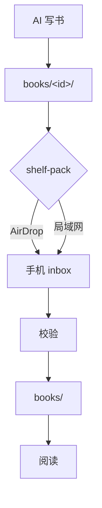
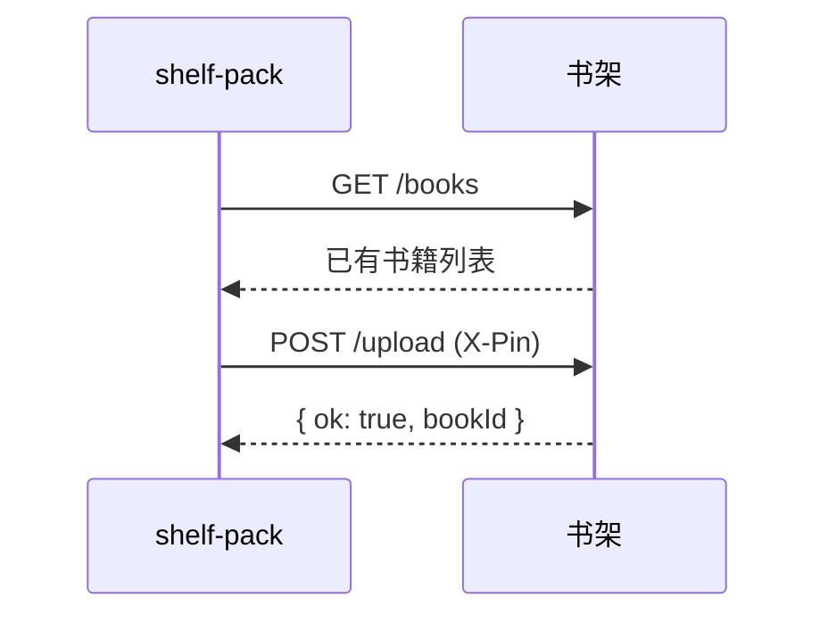

# 渲染示例

这一章把阅读器支持的元素都过一遍，也是阅读器的回归测试页。

## 代码

### Go

```go
package main

import (
	"fmt"
	"sync"
)

func main() {
	var wg sync.WaitGroup
	results := make(chan int, 3)
	for i := 1; i <= 3; i++ {
		wg.Add(1)
		go func(n int) {
			defer wg.Done()
			results <- n * n // 计算平方
		}(i)
	}
	wg.Wait()
	close(results)
	for r := range results {
		fmt.Println(r)
	}
}
```

### TypeScript

```ts
interface Book {
  id: string;
  title: string;
  chapters: string[];
}

export const chapterCount = (book: Book): number => book.chapters.length;
```

### 超长的一行

默认横向滚动；在阅读设置里打开「代码换行」后会自动折行。

```python
result = some_function_with_a_really_long_name(first_argument="value", second_argument=[1, 2, 3, 4, 5], third_argument={"key": "value"})
```

行内代码：`sync.WaitGroup`、`chan<- int`。

## 公式

行内公式：质能方程 $E = mc^2$，以及 $\sum_{i=1}^{n} i = \frac{n(n+1)}{2}$。

块级公式：

$$
f(x) = \int_{-\infty}^{\infty} \hat{f}(\xi)\, e^{2 \pi i \xi x} \, d\xi
$$

$$
\begin{aligned}
\nabla \cdot \mathbf{E} &= \frac{\rho}{\varepsilon_0} \\
\nabla \times \mathbf{B} &= \mu_0 \mathbf{J} + \mu_0 \varepsilon_0 \frac{\partial \mathbf{E}}{\partial t}
\end{aligned}
$$

## 图表





## 宽表格

| 层 | 选择 | 理由 | 备注 | 版本 |
|---|---|---|---|---|
| 框架 | Expo + TypeScript + expo-router | 保留以后出 Android 的可能 | 需要 dev client | SDK 58 |
| 渲染 | WebView + markdown-it | 代码高亮、公式、图表支持好 | 资源全部本地打包 | markdown-it 15 |
| 数据库 | expo-sqlite | 只存索引和阅读进度 | 索引可重建 | — |

## 其他元素

> 引用块：文件即真相，SQLite 只做索引。

提示块用 GitHub 的写法，在引用块第一行写类型标记：

> [!NOTE]
> 补充说明，读的时候可以留意一下。

> [!TIP]
> 顺手的技巧，比如长按选中文字可以高亮。

> [!IMPORTANT]
> 不能漏看的要点。

> [!WARNING]
> 法规、财税这类内容由 AI 凭记忆整理，可能已经过时，以官方最新规定为准。

> [!CAUTION]
> 操作有风险，比如删除书会连同高亮一起删掉。

1. 有序列表第一项
2. 第二项
   - 嵌套的无序列表
   - 再一项

---

页内跳转：[回到「代码」](#代码)；跨章跳转：[回到第一章](01-welcome.md)。

远程图片会被阅读器拦截，写书时也不允许使用（`shelf-pack check` 会报错）。
