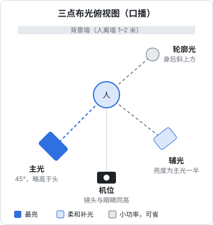
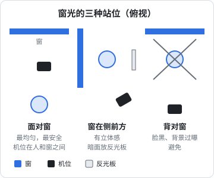

# 灯光：先让脸亮得均匀

同一部手机，光打对和打错，画面看起来像两个价位的设备。灯光是拍摄里投入产出比最高的一项：一块十几元的白板、一个窗户，就能让画面明显变好。

本章先讲几个必须懂的概念，再讲三点布光和自然光两套方案，最后是一张翻车排查表。

## 四个概念

### 软光和硬光

| | 软光 | 硬光 |
|---|---|---|
| 阴影边缘 | 过渡柔和、模糊 | 边缘清晰锐利 |
| 来源 | 大面积光源：阴天、柔光箱、白墙反射 | 小面积光源：正午太阳、裸灯泡、手电筒 |
| 对人脸的效果 | 皮肤显得平滑，瑕疵不明显 | 毛孔、皱纹、黑眼圈都被放大 |

决定软硬的是**光源相对于人的大小**，而不是灯的功率。同一个柔光箱，放在离脸 1 米处是软光，放到 5 米外就变硬了，因为从人的位置看过去它变小了。

所以口播的基本做法是：**灯加柔光箱，并且尽量靠近人**（在不入画的前提下）。

### 距离和亮度：平方反比

光的亮度和距离的平方成反比：

$$
\text{亮度} \propto \frac{1}{\text{距离}^2}
$$

灯离人从 1 米拉到 2 米，亮度变成原来的 1/4，不是 1/2。这条规律有两个实用推论：

- **灯靠近人，背景会显得更暗**：人和背景之间的亮度差变大，画面更有层次。想让背景暗一点，把灯往前挪，不用调灯的功率
- **人前后晃动时，亮度变化很明显**：灯很近时，人往前倾 20 厘米脸就亮一截。坐着口播时固定好椅子位置

### 色温

光有冷暖，用开尔文（K）表示：

| 光源 | 大约色温 |
|---|---|
| 烛光 | 1900K |
| 家用暖光灯泡 | 2700–3000K |
| 卤素灯、摄影钨丝灯 | 3200K |
| 正午日光、摄影日光灯 | 5600K |
| 阴天 | 6500–7500K |
| 晴天的阴影处 | 8000K 以上 |

数字越低越暖（偏橙），越高越冷（偏蓝）。对拍摄最重要的规则是：**打在脸上的光，色温要一致**。窗外是 6000K 的日光，屋里顶灯是 3000K 的暖光，脸一半偏蓝一半偏橙，后期无论怎么调都只能顾一边。

处理办法：要么关掉顶灯只用窗光加同色温的补光灯，要么拉上窗帘只用灯。

### 显色指数

显色指数（CRI，0–100）表示光源还原颜色的能力。廉价 LED 灯的光谱缺一块，肤色会发灰、发绿。拍人脸用 **CRI ≥ 95** 的灯。第一章挑灯时已经提过，这里不再展开。

## 三点布光

这是影视和访谈里最常用的布光法，口播也直接适用。



### 主光

主光决定画面的基调，是最亮的那盏灯。

- **位置**：在机位左侧或右侧，与「人—机位」连线成约 45 度
- **高度**：灯的中心比眼睛高一点，向下约 30 度照向脸。太低会像打手电讲鬼故事，太高眼窝会变成黑洞
- **距离**：柔光箱边缘不入画的前提下尽量近，通常 1–1.5 米
- **判断标准**：看远离主光那一侧的脸颊，眼睛下方会出现一个小小的三角形亮区（伦勃朗光）或者整侧都偏暗但有细节。两种都可以，但不能整侧黑掉

### 辅光

辅光用来补主光造成的阴影，让暗面有细节。

- **位置**：机位另一侧，可以更靠近镜头轴线
- **亮度**：大约是主光的一半。主光亮面和辅光暗面的亮度比叫**光比**，口播常用 2:1 左右；知识类、带货类要显得明亮亲和，可以到 1.5:1；想要有情绪、有质感，可以拉到 4:1
- **没有第二盏灯**：用白色泡沫板或 KT 板代替，放在主光对面、脸的侧前方，把主光反射回暗面

光比在现场可以这样粗测：手机相机里对亮面和暗面分别点测光，看曝光数值的差异；或者直接看监看画面，暗面有清晰的细节、但明显比亮面暗，就差不多了。

### 轮廓光

轮廓光（又叫发光、背光）从人的后上方打过来，在头发和肩膀边缘形成一圈亮边，把人从背景里「剥」出来。

- **位置**：人身后，通常在主光的对角方向，高于头部
- **亮度**：亮边清楚但不刺眼，比主光弱很多
- **注意**：灯不能出现在画面里，也不能直射镜头，否则会有眩光

人和背景颜色接近（深色衣服 + 深色背景、黑头发 + 暗墙）时，轮廓光的作用最明显。背景本身已经比较亮、和人区分清楚时，可以省掉这盏灯。

### 背景光（可选）

在背景上打一点光，或放一盏暖色的台灯、氛围灯入画，让画面有纵深。背景光的亮度应**低于人脸**，眼睛才会落在人身上。

### 一步步搭

按这个顺序搭，每次只动一盏灯：

1. **关掉所有灯和顶灯**，拉上窗帘（或者确认窗光不会直射到人）
2. 人坐到位，机位架好，镜头与眼睛同高
3. **只开主光**，调整位置和高度，在监看画面里看脸的明暗分布
4. **加辅光或反光板**，看暗面，调到暗面有细节为止
5. **加轮廓光**，看头发和肩膀边缘有没有亮边
6. 调整整体曝光：脸部亮度合适、额头和鼻尖没有过曝的白斑
7. **拍 10 秒试拍**，在手机上全屏回放，再在电脑上看一遍

搭好之后，**拍一张现场照片**（灯的位置、高度、功率刻度都要拍到），在地上用胶带标出灯架和椅子的位置。下次拍摄直接复原，每期画面才能保持一致。

### 单灯方案

只有一盏灯时，效果最好的方案是：**灯加大柔光箱放在 45 度、略高处，对面放反光板**。这其实就是「两点布光」，用反光板代替辅光。对绝大多数口播已经足够。

## 自然光

窗光是免费且质量很高的柔光源。



### 用窗光的规则

- **面对窗或让窗在侧前方**，不要背对窗。背对窗时，手机会按窗外的亮度曝光，脸变成剪影
- **避免直射阳光**：阳光直接照在脸上是硬光，而且会随着时间移动。挂一层白色薄纱窗帘，就是一块巨大的柔光布
- **阴天是最好的天气**：整片天空都是柔光源
- **拍同一批内容，尽量在同一时段**：上午和傍晚的光线色温、方向都不同，同一条视频前半段和后半段的画面会对不上

### 窗光的最大问题：会变

云飘过、太阳移动，窗光的亮度和色温一直在变。录一条 3 分钟的口播，中间光线可能就变了几次。应对方法：

- 每段录完回看一下亮度，变化明显时重新锁定曝光
- 一个选题分几段录时，录完一段立刻录下一段，不要中间去吃饭
- 需要每天固定时间、固定画面的账号（例如日更系列），最终还是要靠灯。**窗光适合起步，灯适合稳定**

### 窗光加灯混用

窗光太弱、或需要补暗面时，可以加一盏补光灯，但要把灯的色温调到和窗光一致（白天一般 5000–6000K）。判断方法：把一张白纸放在脸旁边，看纸上被窗照亮和被灯照亮的部分颜色是否一样。

## 晚上在家拍

下班之后才有时间拍，是这本书大多数读者的情况。晚上的问题是：

1. **顶灯是光源里最差的**：从正上方往下照，眼窝、鼻子下方、下巴下方都是阴影，人显得疲惫。拍摄时关掉顶灯
2. **家里的灯色温混杂**：客厅暖光、台灯冷光、显示器的蓝光。只保留你的拍摄灯，其他全关
3. **显示器会在脸上和眼镜上打出蓝光**：拍摄时把显示器关掉或调暗，或者让它在画面外、不照到脸

晚上拍的完整配置就是上面的三点布光或单灯方案。用一个固定的角落、固定的灯位，每次拍摄搭建时间可以控制在 10 分钟以内。

## 常见翻车与排查

| 现象 | 原因 | 处理 |
|---|---|---|
| 画面里有缓慢滚动的横条纹 | 灯光频闪和快门不匹配 | 用 25 fps + 1/50 秒快门；换掉有频闪的灯 |
| 眼镜片上有一块白色反光 | 灯在镜片的反射角上 | 把灯抬高，或往侧面多移一点；头稍微低一点；镜框略向下倾斜 |
| 眼睛里没有神 | 没有光照进眼睛 | 主光高度别太高，眼睛里要能看到一个小亮点（眼神光） |
| 脸一边偏橙一边偏蓝 | 窗光和室内灯混用 | 关掉一种，或把灯色温调到和窗光一致 |
| 脸发灰、发绿 | 灯的显色差 | 换 CRI ≥ 95 的灯 |
| 额头、鼻尖一块白斑 | 过曝，或皮肤出油反光 | 降低曝光、灯往后挪或加柔光；用吸油纸、散粉 |
| 人后面墙上有很重的影子 | 人离墙太近，灯在正前方 | 人离墙 1 米以上；灯抬高，让影子落到画面外 |
| 背景比人还亮 | 背景有窗户、或背景光太强 | 换方向；关背景光；给人加光 |
| 每期画面亮度、颜色不一样 | 灯位、窗光时段、相机设置每次不同 | 拍现场照记录灯位，固定参数，锁定曝光和白平衡 |
| 环形灯在眼睛里有一圈亮圈 | 环形灯本身的形状 | 不想要就换柔光箱，或把环形灯调暗只当补光 |
| 下巴下面一片黑 | 只有顶光或灯太高 | 胸前放一块反光板，往上补光 |

## 布光检查清单

拍之前对着监看画面过一遍：

```text
[ ] 顶灯和多余的光源已关闭
[ ] 打在脸上的光只有一种色温
[ ] 主光在 45 度左右、略高于眼睛
[ ] 暗面有细节，不是死黑
[ ] 眼睛里有眼神光
[ ] 眼镜上没有反光（戴眼镜时）
[ ] 额头、鼻尖没有过曝白斑
[ ] 人身后墙上没有明显影子
[ ] 背景比人脸暗
[ ] 慢动作模式对着灯拍过，没有频闪
[ ] 已拍下灯位照片，地上做了标记
```

## 本章要点

- 软硬取决于光源相对于人的大小：灯加柔光箱，并尽量靠近人
- 亮度和距离平方成反比：灯靠近人，背景自然变暗；人前后动时亮度变化大
- 打在脸上的光只能有一种色温，关掉顶灯和其他杂光
- 三点布光：主光 45 度略高、辅光约主光一半（或用反光板）、轮廓光从身后打出边缘
- 只有一盏灯时：大柔光箱 + 对面反光板，足够大部分口播
- 窗光：面对窗或窗在侧前方，绝不背对窗；窗光会变，适合起步，稳定日更靠灯
- 搭好后拍下灯位照片、地上贴标记，每期画面才一致
