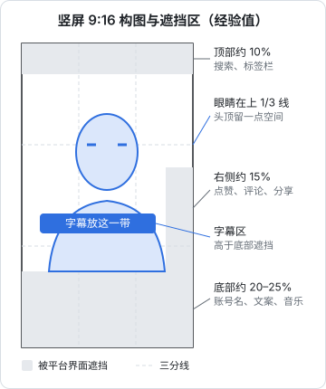

# 构图与机位

光和声音解决了「看得清、听得清」，构图解决「看着舒服、看得懂重点」。本章围绕口播这个最常见的场景展开：镜头放多高、人在画面哪里、背景放什么、竖屏有哪些特殊规则，以及多机位怎么用。

## 景别

景别指画面里人占多大比例。口播主要用三种：

| 景别 | 画面范围 | 用途 | 注意 |
|---|---|---|---|
| 中景 | 腰部以上 | 需要手势、展示物品、站着讲 | 人显得远，竖屏上脸偏小 |
| 近景 | 胸部以上 | **口播默认景别** | 观众能看清表情，又不压迫 |
| 特写 | 肩部以上或只有脸 | 强调关键句、情绪时刻 | 一直用会压迫，适合穿插 |

竖屏口播最常用的是**近景**。一条视频里在近景和特写之间切换（后期放大就能做到，下文讲），是让画面不单调的最便宜的手段。

## 镜头高度和视线

### 镜头和眼睛同高

镜头高度直接影响观众对你的感受：

- **镜头与眼睛同高**：平视，像面对面聊天。口播默认用这个
- **镜头偏低（仰拍）**：显得高大、有压迫感，同时双下巴、鼻孔都很明显。笔记本电脑摄像头就是这个角度，开视频会议时很多人都很难看
- **镜头略高（轻微俯拍）**：显脸小，偏可爱、亲和。高出眼睛几厘米即可，太高会显得人很矮小

三脚架升到眼睛高度，镜头稍微往下压一点点，是最不容易出错的位置。

### 看镜头，不是看屏幕

口播时眼睛要看**镜头**，不是看屏幕上的自己。镜头在手机顶部，屏幕在下方，盯着屏幕看时观众会觉得你在「往下瞟」。

- 用后置摄像头拍，根本看不到屏幕，反而更容易盯住镜头
- 需要看稿时，用提词器（第五章）把文字放在镜头正前方或紧挨镜头
- 在镜头旁贴一个小贴纸或画一个笑脸，提醒自己往这里看

## 焦段和拍摄距离

同样是「胸部以上」的近景，可以用广角镜头靠近拍，也可以用长一点的焦段离远拍。两者的效果差别很大：

| 做法 | 效果 |
|---|---|
| 广角（手机前置、手机 0.5x、等效 24mm 以下）贴近拍 | 离镜头近的部位被放大：鼻子显大、脸显宽，边缘变形；背景显得很远、很多 |
| 标准焦段（手机 1x 主摄，等效约 24–28mm）距离约 1 米 | 可以接受，大部分手机口播都这么拍 |
| 稍长焦段（手机 2x 或 3x，等效约 48–77mm）距离 1.5–2 米 | 五官比例最自然，背景显得更近、更简洁，更容易虚化 |

实用建议：

- 房间够大时，**用手机 2x 档、人离手机 1.5 米左右**拍口播，脸型最好看。注意部分手机的 2x 是主摄裁切，暗光下画质会下降，光线要充足
- 房间小、只能贴近拍时，用 1x 主摄，人尽量不要离镜头少于 60 厘米
- **不要用 0.5x 超广角拍人脸**，除非你想要夸张的搞笑效果

## 竖屏构图规则



### 眼睛在上三分之一线

把画面横竖各分三等份，人的眼睛放在**上方那条三分线附近**。这是人像构图最稳定的位置：

- 眼睛太靠中间，头顶上方空出一大块，显得人往下沉
- 头顶被切掉一点没关系（特写时常这样），但下巴不能被切
- 人在左右方向居中即可，口播不需要刻意偏到三分线上

### 避开平台遮挡区

短视频平台会在画面上叠加按钮和文字：顶部有搜索和标签栏，右侧有头像、点赞、评论、分享按钮，底部有账号名、文案、音乐信息。这些区域里的内容观众看不清或看不到。

各平台的遮挡范围不同，而且会随着 App 改版变化。上图给的是经验值，并非平台官方规格。最可靠的做法是：

1. 把成片导出后，**先发一条「仅自己可见」的测试**，在手机上看哪里被挡住
2. 把截图存下来，做成一张半透明的遮挡模板，导入剪映作为一个最上层的图层，剪辑时对照（导出前删掉或隐藏）

重要内容的放置规则：

- **人脸**：不要被右侧按钮挡住，这也是为什么竖屏人物通常居中或略偏左
- **字幕**：放在底部遮挡区上方，大约在画面高度的 60%–75% 之间，具体见第七章
- **画面里展示的物品、文字**：放在中间区域

### 横拍还是竖拍

| 方案 | 做法 | 适合 |
|---|---|---|
| 直接竖拍 | 手机竖着放，录 9:16 | 只发竖屏平台；手机拍摄 |
| 4K 横拍、后期裁竖屏 | 横着录 3840×2160，在剪映里裁成 9:16 | 同一条素材要同时发横屏（B 站、视频号横版）和竖屏 |

横拍裁竖屏的画质算一下：横向 4K 素材高 2160 像素，按 9:16 裁出来，宽度是

$$
2160 \times \frac{9}{16} = 1215 \text{ 像素}
$$

1215×2160 比竖屏常用的 1080×1920 还大，所以**4K 横拍裁竖屏不损失清晰度**。但横拍 1080p 再裁竖屏，就只剩 608×1080，明显变糊，不要这么做。

横拍时人要站在画面正中间、四周留够空间，确保裁成竖屏后人仍然完整。

## 背景

背景是观众判断「这个人是干什么的」的第一印象。

### 背景的四条规则

1. **人离背景 1–2 米以上**：背景自然虚化一些，人和背景分得开，墙上也不会有人影
2. **背景比人暗**：观众的眼睛会先看最亮的地方
3. **背景要整洁，但不能空**：白墙显得像证件照；乱糟糟的床和衣服显得不专业。放一两样和账号定位相关的东西：书架、绿植、一盏暖色台灯、你的产品
4. **每期保持一致**：固定的背景是账号识别度的一部分

### 按账号类型布置

| 账号类型 | 背景建议 |
|---|---|
| 编程、技术知识 | 书架、机械键盘、显示器（关屏或显示代码，不要显示隐私信息） |
| 职场、个人成长 | 干净的书房角落，一盏暖色台灯 |
| 测评、开箱 | 桌面俯拍，桌面整洁，背景是浅色桌布或深色木纹 |
| 生活 vlog | 真实环境，但入镜前收拾一下 |

### 背景里不能出现的东西

- 有品牌标识的东西（尤其是在接商单时出现竞品）
- 家人、合租室友的照片和身份信息
- 快递单、门牌号、窗外有辨识度的地标（能被人定位住址）
- 电脑屏幕上的聊天记录、密码、公司内部信息——**开发者尤其要检查这一条**
- 受版权保护的海报、画作大面积入镜（偶然入镜一般问题不大，但不要作为画面主体）

## 桌面俯拍

测评、开箱、手作、写字类内容常用俯拍：

- **设备**：带横臂的三脚架或桌夹式支架，让手机悬在桌面正上方
- **画面对正**：手机屏幕和桌面平行，四边不歪。可以在桌面上贴一张 A4 纸，调到纸的四边和画面边缘平行
- **光线**：从桌子的侧前方打光，避免手机和手臂的影子落在桌面上。顶灯在这种场景下最容易出影子
- **手的动作要慢**：俯拍时手的动作在画面里显得很快，刻意放慢一半

## 多机位

### 什么时候需要多机位

单机位口播完全可以靠后期放大来变化景别，大多数账号不需要多机位。下面几种情况才值得加：

- 长视频（5 分钟以上），单一角度太单调
- 两人对谈、采访
- 需要同时拍人和手上的操作（例如边讲边演示）

### 双机位怎么摆

| 机位 | 位置 | 景别 | 作用 |
|---|---|---|---|
| A 机（主机位） | 正对人，与眼睛同高 | 近景 | 大部分时间用这个，人看这个镜头 |
| B 机（侧机位） | 偏离 A 机 30–45 度 | 中景或特写 | 切换时制造变化；讲到重点时切过去 |

规则：

- **人只看 A 机**。看 B 机会让观众觉得你在和别人说话
- **两个机位的角度差至少 30 度**。角度差太小，切换时看起来像画面跳了一下，而不是换了角度
- **两台设备参数统一**：分辨率、帧率、白平衡色温都设成一样，否则两个机位颜色对不上（第九章讲怎么调统一）
- **B 机可以是旧手机**：只要画质别差太远

### 对谈的机位

两个人对谈时，常见的三机位：一台拍两人同框的中景，两台分别拍每个人的近景，位置在对方的肩膀后侧。新手先从两人同框单机位开始，后期靠放大做景别变化。

### 多机位同步

几台设备的素材要在时间线上对齐：

1. **开拍时在镜头前拍一下手**，所有设备都能拍到画面、录到声音
2. 剪辑时把所有素材放进时间线，按拍手那一帧（画面上手掌合拢、波形上的尖峰）对齐
3. 一些剪辑软件支持按音频波形自动同步（例如 DaVinci Resolve 的多机位同步功能），可以省掉手动对齐

## 用后期放大代替机位

单机位最有用的技巧：**用 4K 拍，剪辑时放大到 110%–130% 作为「特写」**。

- 1080p 成片从 4K 素材里放大，到 200% 都还清晰
- 剪映里对某一段素材调整「缩放」即可；也可以加关键帧做缓慢推进
- 讲到关键句时切到放大的画面，下一句切回来。效果接近双机位，而且零成本

第八章讲剪辑节奏时会具体讲在哪里放大。

## 构图检查清单

```text
[ ] 镜头与眼睛同高（或略高），不是仰拍
[ ] 眼睛在画面上三分之一线附近
[ ] 下巴没有被切掉，头顶留白不过多
[ ] 人脸不在右侧按钮区，字幕区不挡脸
[ ] 人离背景 1 米以上，背景比人暗
[ ] 背景整洁，有一两样和定位相关的物品
[ ] 背景里没有隐私信息、品牌标识、屏幕内容
[ ] 横拍裁竖屏时用的是 4K，人在中间、四周留空
[ ] 多机位：人只看 A 机，B 机角度差 ≥ 30 度，参数统一
[ ] 开拍时拍手做同步点
```

## 本章要点

- 口播默认近景（胸部以上），后期放大到特写制造变化
- 镜头与眼睛同高，眼睛看镜头而不是屏幕
- 房间够大时用手机 2x、离 1.5 米左右拍，五官最自然；不要用超广角贴脸拍
- 竖屏：眼睛在上三分线；避开顶部、右侧、底部的平台遮挡区；遮挡范围以实测为准
- 4K 横拍可无损裁出竖屏（1215×2160），1080p 横拍不行
- 背景：离人 1–2 米、比人暗、整洁不空、每期一致，绝不出现隐私信息
- 多机位：人只看主机位，副机位角度差 30 度以上，参数统一，拍手同步
- 大多数账号用单机位 4K + 后期放大就够了
