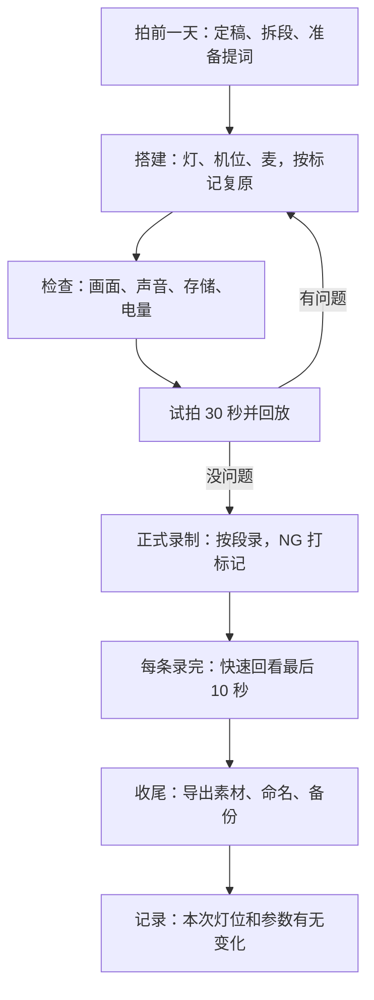

# 拍摄现场流程

前几章讲的是「怎么拍好一个镜头」。这一章讲「怎么高效地拍完一批」。下班后只有两三个小时，如果每次拍摄都要花一个小时搭灯、找设置、重录，账号很难坚持下去。

目标是把一次拍摄变成一套固定流程：**搭建 10 分钟、检查 5 分钟、录制、收尾 10 分钟**，中间不用思考「下一步该做什么」。

## 一次拍摄的全流程



## 拍前准备

### 稿子准备好再开机

**没有定稿就开机，是拍摄效率最大的杀手**。边想边说会产生大量的「嗯」「然后」「就是说」，剪辑时间翻倍。

稿子怎么写见[《短视频脚本与分镜》](../video-script-storyboard/)。拍摄这一步需要做的是：

1. **把稿子拆成段**：每段 2–4 句话、15–40 秒，以一个完整意思为单位。一口气背完 3 分钟的稿子不现实，分段录可以一段一段过
2. **标出重点句**：哪几句要放慢、要加重语气、要切特写
3. **大声读两遍**：读起来拗口的地方当场改。写出来通顺和说出来顺口是两回事
4. **计算时长**：中文口播语速多在每分钟 200–280 字之间，知识类偏慢、带货类偏快。600 字的稿子大约 2.5 分钟

### 衣服和形象

- 纯色或细小花纹，**避免细密条纹和小格子**：在屏幕上会出现闪烁的波纹（摩尔纹）
- 避免纯白和纯黑：纯白容易过曝，纯黑会丢细节。浅灰、米色、深蓝、墨绿都很安全
- 衣服颜色和背景拉开：背景暗就穿亮一点，背景亮就穿深一点
- 一次拍多条、计划分几天发时，**准备两三套衣服换着穿**，避免观众觉得「这人怎么永远一件衣服」
- 男生也可以用一点散粉压油光，比后期修方便得多

## 拍前检查表

搭好设备后，按这张表逐项过。打印出来贴在拍摄角落，比靠记忆可靠：

```text
【设备】
[ ] 手机 / 相机电量 > 80%，或接了外接电源
[ ] 存储空间 > 预计素材量的两倍（4K 每分钟约 300–400MB）
[ ] 无线麦发射器、接收器电量 > 80%
[ ] 镜头已擦干净
[ ] 飞行模式 / 勿扰模式已开启

【画面】
[ ] 分辨率、帧率与上次一致（例如 4K 25fps）
[ ] HDR 视频已关闭
[ ] 白平衡锁定（相机设定色温；手机用拍摄 App 锁定）
[ ] 对焦和曝光已锁定在脸上
[ ] 构图：眼睛在上三分线，镜头与眼睛同高
[ ] 画面四角检查：没有杂物、灯架、电线入画

【灯光】
[ ] 顶灯和杂光已关
[ ] 灯位与上次标记一致
[ ] 眼镜无反光，额头无过曝

【声音】
[ ] 录制 App 的音源选中了外接麦
[ ] 发射器机内录音已开启
[ ] 空调、净化器等噪声源已关
[ ] 戴耳机试录，电平和底噪正常
```

### 试拍 30 秒

正式录之前，说一段完整的稿子，录 30 秒，然后：

1. **手机全屏回放**：看画面亮度、构图、人有没有歪
2. **戴耳机听**：有没有底噪、摩擦声、回声
3. **把这 30 秒导进剪映看一眼**：手机上看着正常的画面，在电脑大屏上可能会发现对焦不实、颜色偏色

这一步最多 3 分钟，能避免「拍完一小时发现全部没声音」这种事故。

## 提词器

背稿很累，而且一紧张就忘词。提词器是口播账号的必备工具，分两种：

| 类型 | 原理 | 优点 | 缺点 |
|---|---|---|---|
| 提词 App（悬浮窗） | 在手机屏幕上显示滚动文字，叠在相机画面上 | 免费或便宜，装上就能用 | 只适合前置摄像头；眼睛看的是屏幕，离镜头有一段距离 |
| 硬件提词器（分光镜） | 镜头前放一块 45 度斜放的半透明镜，下方放一台显示文字的手机或平板，文字反射到镜面上，镜头从镜面后面拍 | 眼睛看文字时正好看着镜头 | 要单独买，几百元起；占地方 |

### 让观众看不出你在读稿

- **提词文字尽量靠近镜头**：悬浮窗放在屏幕最上方、紧挨前置摄像头；文字窗口调窄，每行少一些字，眼球左右移动幅度就小
- **字号放大**：能在拍摄距离上看清，不用眯眼
- **滚动速度比正常语速稍慢**：宁可等文字，不要追文字。很多提词 App 支持语音跟随，按你说话的速度自动滚动
- **不要逐字念**：稿子里写的是要点和关键句，中间的连接词可以自己说。完全逐字念会让语气变成「朗读」
- **熟读两遍再录**：提词器是兜底的，不是让你第一次看到稿子

### 分段录不需要提词器也可以

另一个办法：一段只有 2–4 句话，录之前看一眼、默念两遍，然后看着镜头说。每段都很短，不需要背完整篇。这种方式语气最自然，代价是剪辑时要拼接的段落多。

## 口播 NG 管理

说错是正常的，关键是让剪辑时**能快速找到哪里说错了、哪一遍是好的**。

### 规则一：说错了，从这句开头重说

不要从说错的那个词接着往下说。停顿 2 秒，然后**从这一句的开头**完整地再说一遍。

原因是剪辑时只能在句子之间切。从半句接上，语气、音高都对不上，听起来很突兀。

### 规则二：用声音或动作做标记

说错之后、重说之前，做一个容易在剪辑软件里找到的标记：

| 标记方法 | 在剪辑时怎么找 |
|---|---|
| **拍一下手** | 音频波形上一个很高的尖峰，一眼就能看到 |
| 停顿 2–3 秒 | 波形上一段平线 |
| 说「重来」 | 开启自动字幕后，搜索这两个字 |
| 用手遮一下镜头 | 缩略图里一段黑帧 |

推荐**拍手**：在剪映里放大音频波形，一路往后找尖峰，尖峰前面那段就是要删的。

### 规则三：好的那一遍也做标记

同一句话录了三遍，第三遍最好。录完之后说一句「这遍好」或比个手势，剪辑时直接用这一遍，不用三遍都听一次对比。

### 规则四：每段录完立刻回看最后 10 秒

只看最后 10 秒，确认没有被打断、画面没有跑焦、声音还在。全部录完再发现问题，就要重新搭灯了。

### 规则五：每条留头留尾

开口前先看着镜头停 1 秒，说完最后一句后再停 1–2 秒。这两段空白在剪辑时会被剪掉，但它们让你有余地做转场、加淡入淡出，而不是第一个字就被切掉一半。

## 录制节奏

下班后状态有限，录制要有节奏：

- **一次录 3–5 条**，比每天录一条效率高得多：搭建和收尾的时间是固定的
- **每 30–40 分钟休息 5 分钟**：喝水（不要喝冰的、不要喝牛奶，会影响声音）、活动一下脸部肌肉
- **状态最好的时候录最重要的段落**：通常是开场钩子。观众是否继续看，取决于前 3 秒（详见[《选题与爆款结构》](../topic-and-hooks/)）
- **开场钩子多录几个版本**：同一句开场换两三种说法和语气，剪辑时挑最好的，也可以用来做 A/B 测试
- 录完一条，把提词器切到下一条之前，**先检查这条有没有漏段**：对照稿子的段落编号，一段一段打勾

## 素材命名和整理

拍完不整理，一周后你就分不清哪个文件是哪条视频的。

### 命名规则

推荐格式：

```text
日期_选题编号_机位_段落_序号.扩展名

20261103_T042_A_s03_02.mov
```

| 字段 | 含义 | 示例 |
|---|---|---|
| 日期 | 拍摄日期，YYYYMMDD | `20261103` |
| 选题编号 | 选题库里的编号，和脚本对应 | `T042` |
| 机位 | A 主机位，B 副机位，R 录屏，V 配音 | `A` |
| 段落 | 稿子里的段落编号 | `s03` |
| 序号 | 同一段的第几遍 | `02` |

如果是一段长录制（不分段），段落和序号可以省略，变成 `20261103_T042_A.mov`。

手机拍摄后批量改名很麻烦。开发者可以写一个简单的脚本，按文件的创建时间和你在拍摄时记录的段落顺序批量重命名。最简单的做法是只按「日期_选题编号_机位」建文件夹，文件夹内保留原文件名。

### 文件夹结构

```text
素材库/
├── 2026-11/
│   ├── 20261103_T042_程序员副业该不该做自媒体/
│   │   ├── raw/          # 原始素材，只读，不改
│   │   ├── audio/        # 无线麦机内录音
│   │   ├── broll/        # 补拍的空镜、屏幕录制
│   │   ├── script.md     # 本条的稿子
│   │   └── export/       # 导出的成片和封面
│   └── 20261103_T043_.../
└── _shared/              # 跨视频复用的素材，见第十章
```

### 备份

素材至少有**两份，放在两个不同的设备上**：

- 拍完当天，把手机或存储卡里的素材复制到电脑
- 电脑定期同步到移动硬盘或网盘
- **确认电脑里的文件能正常打开**，再删除手机或存储卡里的原文件

成片发布后，原始素材可以只保留一段时间（例如 3 个月），只把成片、工程文件和稿子长期保存。素材很占空间，一个 4K 口播账号一年可能产生数 TB 的素材。

## 收尾清单

```text
[ ] 所有素材已导入电脑，按命名规则放进对应文件夹
[ ] 无线麦发射器里的机内录音已导出
[ ] 素材已备份到第二个位置
[ ] 设备充电：手机、相机电池、麦克风、灯（如果是电池供电）
[ ] 灯光和机位如果有调整，拍一张新的现场照片
[ ] 在选题库里把这几条的状态改成「已拍摄」
[ ] 记下这次拍摄的问题（例如「s04 有空调声，剪辑时注意」）
```

## 本章要点

- 定稿再开机：稿子拆成 15–40 秒的段落，标出重点句，大声读两遍
- 拍前检查表打印出来逐项过，试拍 30 秒并在电脑上看一眼
- 提词器：文字尽量靠近镜头、窗口调窄、滚动稍慢于语速，不要逐字念
- 说错了停 2 秒、拍一下手、从这句开头重说；好的那一遍也做标记
- 每段留头留尾 1 秒，录完立刻回看最后 10 秒
- 一次录 3–5 条，开场钩子多录几个版本
- 素材按「日期_选题_机位_段落_序号」命名，原始素材至少两份备份
