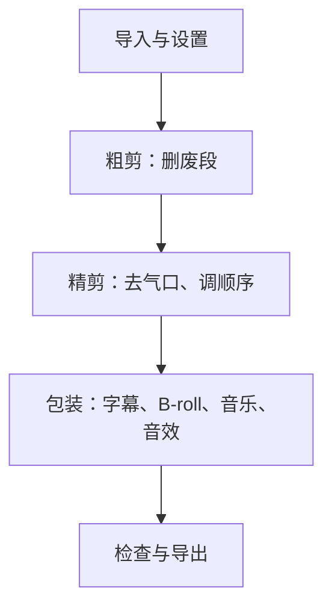

# 剪映工作流

剪映是国内短视频创作者用得最多的剪辑软件：手机版、电脑版（专业版）都有，和抖音打通，模板和素材多，上手快。本章用一条 60 秒口播为例，走一遍从导入到导出的完整流程，再讲什么时候该换桌面专业软件。

剪映版本更新很快，菜单名称和功能位置经常调整，部分功能在免费版和会员之间来回变化。本章讲的是**流程和判断方法**，具体按钮以你手上的版本为准。截至 2026 年 11 月，剪映的会员分为 VIP 和 SVIP，据公开报道，SVIP 的权益在手机端和电脑端通用，而 VIP 仅限手机端；自动识别字幕等功能在中文版中已多被划入会员权益。开通前请在 App 内的会员页确认当前的权益和价格。

## 用手机版还是电脑版

| | 手机版 | 电脑版（专业版） |
|---|---|---|
| 适合 | 短于 1 分钟、剪辑简单的视频；外出时 | 1 分钟以上、多轨道、要精细调整的视频 |
| 优点 | 拍完直接剪，随时随地 | 大屏看细节，鼠标键盘精确操作，快捷键多 |
| 缺点 | 屏幕小，精确到帧的操作很累 | 要把素材传到电脑 |

建议：**正式内容用电脑版剪**。开发者每天对着电脑，用快捷键操作时间线会比手指在手机上拖快得多。两端可以通过剪映的云空间同步草稿，但大素材上传下载很慢，素材本身还是建议通过数据线或局域网传到电脑。

## 剪辑的五个阶段



**顺序不能乱**。最常见的低效做法是一边剪一边加字幕、加音乐，然后发现某一段要删掉，字幕和音乐全部要重新对齐。先把「说什么」定下来，再做「怎么好看」。

## 阶段一：导入与设置

1. **新建草稿**，先改草稿名称，用和素材文件夹一样的名字（例如 `20261103_T042`）。默认名称是日期数字，十几个草稿后就分不清了
2. **设置画布比例**：竖屏选 9:16。如果素材是 4K 横拍，要先把画布设成 9:16 再导入，否则剪映会按第一段素材的比例创建画布
3. **导入素材**：把 `raw/` 里的视频、`audio/` 里的机内录音一起导入
4. **检查项目帧率**：与素材一致（例如 25 fps）。混入了不同帧率的素材时，以主机位的帧率为准

### 外接录音替换机内声音

如果用了无线麦的机内录音（第三章），在这一步替换：

1. 把视频拖到主轨道，把机内录音文件拖到它下方的音频轨道
2. 在开头找到拍手的位置（视频画面上手掌合拢那一帧、两条音频波形上的尖峰），把两条音频的尖峰对齐
3. 播放一段，确认嘴型和声音同步
4. 把视频原声静音（或音量调到 0）

## 阶段二：粗剪

粗剪的目标：**把所有不要的部分删掉，只留下每一段最好的那一遍**。

### 操作方法

1. 把整条素材拖到时间线
2. 放大音频波形，从头往后找你的 NG 标记（拍手的尖峰、停顿的平线）
3. 找到一个 NG 时，在说错的那句开头和重说那句开头之间删除
4. 同一句录了几遍的，听你标记为「这遍好」的那一遍，其余删除

### 常用快捷键（电脑版）

剪辑主要靠「分割」和「删除」两个动作。剪映专业版常用的操作：

| 操作 | 作用 | 说明 |
|---|---|---|
| 分割 | 在播放头位置把片段切成两段 | 常见快捷键是 Ctrl+B（Mac 为 Cmd+B） |
| 向左裁剪 / 向右裁剪 | 一步删掉播放头左侧或右侧的部分 | 常见快捷键是 Q / W |
| 删除 | 删除选中的片段 | Delete / Backspace |
| 空格 | 播放 / 暂停 | |
| ← → | 逐帧移动 | 精确找切点 |
| 撤销 | | Ctrl+Z / Cmd+Z |

快捷键会随版本调整，以设置里的「快捷键」页面为准。花 10 分钟熟悉这几个键，剪辑速度能提高一倍。

### 主轨道磁吸

剪映默认开启「主轨磁吸」：删掉主轨道上的一段，后面的片段自动往前补上，不会留下空隙。粗剪时保持开启，非常省事。

### 用文字剪视频

剪映有基于语音识别的剪辑方式：把语音转成文字后，在文字稿里删掉一句话，对应的视频段也被删除；部分版本还能一键标出并删除「嗯」「啊」等语气词和长停顿。这类功能对口播粗剪提速很明显，但：

- 通常需要先做语音识别，而识别功能可能需要会员
- 自动删除语气词和停顿会删得太狠，把正常的换气、语气停顿也删掉，听起来很急。**用自动功能做完后要从头听一遍**，把删过头的地方补回来

## 阶段三：精剪

粗剪后内容是对的，但节奏还不对。精剪要做的事：

### 去气口

「气口」是句子之间的停顿和换气。口播里保留太多气口会显得拖沓，全部删掉又会急促、喘不过气。

- 句子之间的停顿，保留约 **0.1–0.3 秒**（25 fps 下约 3–8 帧）
- 一个意思讲完、换下一个话题时，停顿可以长一点，0.5 秒左右
- 换气声不需要全部删掉，但很响的吸气声要删
- 删完从头听一遍，感觉「一口气说下来、但没有喘不过气」就对了

第八章会详细讲节奏的判断。

### 调整顺序

剪完发现某一段放在前面更好，直接拖动调整。常见的调整：

- 把最有冲击力的一句话提到最开头，作为钩子
- 把例子放在观点前面（先讲故事再讲道理）

### 景别变化

讲到重点句时，选中这一段，把缩放调到 110%–130%，制造「切特写」的效果。第四章讲过，4K 素材放大不会变糊。

注意：同一句话中间不要突然放大，要在**句子边界**处切。

### 音频淡入淡出

每一个切点处，人声如果出现「咔」的一声，是因为波形在非零点被切断。给切点两边的音频各加 1–3 帧的淡入淡出就能消除。

## 阶段四：包装

内容和节奏定了，再加包装。按这个顺序加：

1. **字幕**：识别字幕，然后逐句校对（第七章详细讲字幕规范）
2. **B-roll**：在人声轨道上方的画中画轨道插入补充画面，见第八章
3. **背景音乐**：放在最下面的音频轨道，音量远低于人声（第七章）
4. **音效**：在转场、重点、数字出现的地方加「叮」「嗖」之类的音效（第七章）
5. **片头片尾**：如果有固定的片头、关注引导，从模板里拖进来（第十章）

### 自动字幕的免费替代：本地语音识别

如果不想为字幕识别开会员，开发者有一个免费的替代：用本地语音识别模型（例如 Whisper 系列）生成 SRT 字幕文件，再导入剪映。

```bash
# 以 whisper.cpp 为例，先把视频的音频轨提取成 16kHz 单声道 wav
ffmpeg -i 20261103_T042_A.mov -ar 16000 -ac 1 -c:a pcm_s16le audio.wav

# 用中文模型识别，输出 SRT 字幕
./build/bin/whisper-cli -m models/ggml-medium.bin -f audio.wav -l zh -osrt
```

whisper.cpp 的编译、模型选择和中文识别的常见问题（同音字、数字、专有名词）在[《多模态应用》](../multimodal-ai/)讲语音识别的部分有详细说明。工具的命令和参数会随版本变化，以项目官方文档为准。

注意两点：

- 如果在精剪之前识别，字幕时间轴会和剪完的视频对不上。**先导出精剪后的音频（或整片），再做识别**
- 本地识别出来的字幕同样要逐句校对

剪映支持导入 SRT 字幕文件（在文本或字幕相关菜单下，具体位置以当前版本为准），导入后可以统一套用字幕样式。

## 阶段五：检查与导出

### 发布前检查

导出前，**全屏、戴耳机、从头到尾看一遍**。对照这张清单：

```text
【内容】
[ ] 前 3 秒有钩子，没有拖沓的开场
[ ] 没有遗漏的 NG 片段、重复的句子
[ ] 结尾没有多余的空白或尴尬的停顿

【字幕】
[ ] 没有错别字、同音字（专有名词逐个检查）
[ ] 字幕和声音同步，没有提前或滞后
[ ] 字幕不被平台界面遮挡

【声音】
[ ] 人声清楚，背景音乐没有盖过人声
[ ] 切点处没有「咔」声
[ ] 整体音量和上一条视频差不多

【画面】
[ ] 没有黑帧、没有突然跳动的画面
[ ] 放大的片段不模糊
[ ] B-roll 和画面里的文字没有错误

【合规】
[ ] 背景音乐、字体、素材都有授权（第七章）
[ ] 画面里没有隐私信息
[ ] 涉及广告、AI 生成内容的已按平台要求标注（见《自媒体与短剧合规财税》）
```

### 导出设置

| 设置项 | 建议值 | 说明 |
|---|---|---|
| 分辨率 | 1080p（竖屏即 1080×1920） | 多数平台会对上传视频重新压缩。素材是 4K、对画质要求高时，可以试 4K 导出对比效果 |
| 帧率 | 与素材相同（25 或 30） | 不要把 25 fps 素材导出成 60 fps，不会更流畅 |
| 码率 | 选「推荐」或「较高」 | 码率太低画面会糊，太高文件大、上传慢且会被平台压缩 |
| 编码 | H.264（兼容性最好）或 HEVC（文件更小） | |
| 格式 | MP4 | |

各平台的具体导出规格表见第十章。

导出后，用手机打开导出的文件再看一遍。**电脑上看着正常，手机上可能字幕太小、细节看不清**。

## 什么时候换桌面专业软件

剪映覆盖了绝大部分短视频需求。出现以下情况时，可以考虑桌面专业软件：

- 需要精细调色（Log 素材、多机位颜色匹配）
- 长视频（10 分钟以上）、多机位剪辑
- 不想依赖会员订阅，想要一次买断或免费
- 需要对音频做专业处理（多轨混音、精细降噪）

| 软件 | 平台 | 收费方式（截至 2026 年 11 月） | 特点 |
|---|---|---|---|
| DaVinci Resolve | Windows / macOS / Linux | 免费版功能完整；Studio 版一次性买断，海外定价 295 美元 | 调色是行业标准；2026 年 6 月发布的 21 版免费版仍可处理不限分辨率的素材，大部分 AI 功能在 Studio 版 |
| Final Cut Pro | 仅 macOS | 在 Mac App Store 购买，价格以商店为准 | 对 Mac 硬件优化好，剪辑流畅 |
| Adobe Premiere Pro | Windows / macOS | 订阅制 | 与 Photoshop、After Effects 等配合；团队协作常见 |

建议：

- **先用剪映，做到发现剪映满足不了你为止**。大多数账号永远不需要换
- 想学专业软件，**首选 DaVinci Resolve 免费版**：免费、跨平台，调色能力强，第九章讲调色时会用它举例
- 专业软件里没有剪映那么丰富的模板、花字和曲库，很多人的做法是「Resolve 剪辑调色，导出后在剪映里加字幕和包装」

### 关于破解版

网上流传很多「剪映破解版」「永久会员版」「专业软件破解版」。不要用：

- 来源不明的安装包可能带木马，开发者的电脑里有代码、密钥、公司资料，风险极高
- 破解软件导出的作品在商业合作中存在版权和合规风险
- 剪映破解版的账号可能被封，云端草稿一起丢失

免费版不够用时，开通会员或换用免费的 DaVinci Resolve，都是更好的选择。

## 本章要点

- 正式内容用剪映电脑版剪，快捷键能让速度翻倍
- 剪辑五个阶段：导入设置 → 粗剪 → 精剪 → 包装 → 检查导出，先定内容再做包装
- 新建草稿先改名、先设 9:16 画布，机内录音按拍手尖峰对齐替换
- 粗剪靠 NG 标记快速定位；用文字剪视频很快，但自动删语气词后要从头听
- 精剪去气口：句间保留 0.1–0.3 秒，换话题时 0.5 秒；切点加 1–3 帧淡入淡出
- 字幕识别可以用本地 Whisper 生成 SRT 代替会员功能，但要在精剪后再识别
- 导出前按清单全屏戴耳机看一遍，导出后在手机上再看一遍
- 想学专业软件首选 DaVinci Resolve 免费版；不要用破解版
