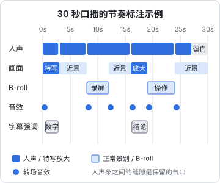

# 剪辑节奏

同样的素材，节奏剪得好，观众觉得「一下就看完了」；剪得拖沓，观众 5 秒就划走。节奏不是玄学，它由几个可以量化、可以练习的东西组成：**停顿的长度、画面变化的频率、信息密度的起伏**。

本章讲口播类视频的节奏手法：跳剪、B-roll、景别变化、留白、卡点，最后给一个完整的节奏标注示例，你可以照着在自己的视频上标一遍。

## 节奏的三个维度

| 维度 | 控制什么 | 主要手段 |
|---|---|---|
| 听觉节奏 | 说话的快慢、停顿 | 去气口、留白、语速 |
| 视觉节奏 | 画面多久变一次 | 跳剪、景别变化、B-roll、字幕动效 |
| 信息节奏 | 观众多久得到一个新信息 | 稿子结构、删掉废话 |

三者里**信息节奏最根本**。稿子本身拖沓，靠剪辑手法硬加画面变化，只会让视频显得「很忙但没内容」。所以剪辑前先问自己：这一段删掉，观众会损失什么？什么都不损失的段落，直接删。

## 跳剪

跳剪（jump cut）是把同一机位、同一景别里的停顿、口误、废话剪掉，画面里人的位置会轻微「跳」一下。

在电影里跳剪被视为不连贯，但在口播短视频里，它已经成了标准语言，观众完全习惯。跳剪的价值是**压缩时间、提高信息密度**。

### 跳剪要注意的事

- **在句子边界剪**，不要在一个词中间剪
- **人的位置跳动太大时**（例如你在两句之间往旁边挪了一下），在切点处用放大一点或换景别来掩盖，第二句放大到 110%，看起来就像换了机位
- **连续跳剪不要太密**：每句都跳会让人觉得不安。一段连续表达的话，中间的小停顿保留，只剪掉明显的废话和口误

### 去气口的标准

第六章给过数字，这里再细化：

| 位置 | 保留的停顿 | 25 fps 下约 |
|---|---|---|
| 同一句话中间的自然停顿 | 不剪，或只剪掉明显的「嗯」 | — |
| 句子与句子之间 | 0.1–0.3 秒 | 3–8 帧 |
| 一个观点讲完，开始下一个 | 0.4–0.6 秒 | 10–15 帧 |
| 抛出问题后、给出答案前 | 0.5–1 秒（故意留白，见下文） | 12–25 帧 |

这些数字是起点，不是规定。语速快、情绪高的账号可以剪得更紧，温和、讲道理的账号要松一些。**判断方法是闭上眼睛只听**：听着像一个人自然地、紧凑地在讲，就对了；听着像机器在念，就剪过头了。

## 画面变化的频率

口播最大的问题是画面单调：一个人对着镜头说一分钟，画面完全不动。经验做法是**每 3–5 秒让画面有一次变化**。变化的手段，从便宜到贵：

| 手段 | 成本 | 效果 |
|---|---|---|
| 字幕关键词强调、花字 | 很低 | 轻微 |
| 景别变化（放大到 110%–130%） | 低 | 明显，像换了机位 |
| 缓慢推近（关键帧做 100% → 110%，持续几秒） | 低 | 营造紧张、强调感 |
| 插入图片、截图、图表 | 中 | 信息量大 |
| B-roll（补充视频画面） | 中到高 | 最丰富 |
| 换机位（多机位拍摄） | 高 | 最自然 |

「3–5 秒」不是死规定。观众正在听一段关键的论述时，画面一直跳反而干扰；讲到列举、数据、操作步骤时，画面变化可以密一些。

### 景别变化放在哪里

- **钩子句**（第一句）：特写，制造冲击
- **关键结论、反常识的观点**：切特写，或者缓慢推近
- **转折句**（「但是」「其实」）：换景别，提示观众这里有变化
- **普通的解释、过渡**：回到近景

## B-roll

B-roll 是相对于「人对着镜头说话」（A-roll）的补充画面。

### B-roll 的作用

- **展示你在说的东西**：说到某个工具，就放这个工具的录屏；说到某个数据，就放图表
- **掩盖跳剪**：A-roll 里有一个很难看的切点，在上面盖一段 B-roll，观众只听到声音连续
- **调节节奏**：画面变化，但声音不断

### B-roll 的类型

| 类型 | 举例 | 怎么得到 |
|---|---|---|
| 录屏 | 软件操作、网页、代码 | 电脑和手机自带录屏，或专门的录屏工具 |
| 截图 / 图片 | 新闻标题、数据图表、评论区 | 自己截图（注意隐去他人隐私信息）；图表自己做 |
| 空镜 | 键盘打字、咖啡杯、窗外、通勤路上 | 自己拍，见下文 |
| 动作镜头 | 你翻书、写字、操作产品 | 自己拍 |
| 文字动画 | 关键数字、步骤列表 | 剪映里用文字和动画做 |

版权问题第七章讲过：**最安全的 B-roll 是自己拍和自己做的**。

### 批量拍 B-roll

不用每期都为 B-roll 单独拍。每个月花一两个小时，批量拍一批通用空镜，存进素材库的 `_shared/broll/`：

```text
[ ] 双手在键盘上打字（俯拍、侧拍各一段）
[ ] 鼠标点击、滚动
[ ] 屏幕上滚动的代码（注意不要有公司代码和密钥）
[ ] 翻书、在笔记本上写字
[ ] 倒咖啡 / 倒水
[ ] 窗外：白天、傍晚、夜晚
[ ] 通勤：地铁、街道（避免拍清他人的脸）
[ ] 台灯开关
[ ] 手机解锁、滑动
[ ] 你的产品或作品的多个角度
```

每段 5–10 秒，横竖屏各拍一份或用 4K 横拍以便裁切。拍的时候动作放慢一些，剪辑时可以截取需要的长度。

### B-roll 的时长

- 单段 B-roll 一般 2–5 秒，太短看不清，太长观众会想念说话的人
- 连续的 B-roll 不超过 10 秒左右，然后回到人脸。口播账号的核心是人，人消失太久会失去信任感

## 留白

留白是故意保留的停顿或空镜头，给观众消化的时间。

- **抛出问题后停 0.5–1 秒**再给答案，观众会在这一瞬间自己想一下，答案的冲击力更大
- **说完一个重要结论后，停半秒**，配合字幕强调，让这句话「落地」
- **结尾留 1–2 秒**：最后一句说完不要马上黑屏，留一点时间给关注引导或者让音乐收尾

留白和拖沓的区别在于：留白之前是**一句有分量的话**。普通句子后面的停顿就是拖沓，要剪掉。

## 卡点

卡点是让画面切换落在音乐的节拍上。口播类视频不需要每个切点都卡，但片头、蒙太奇段落（连续 B-roll）、vlog 用卡点会显得很顺。

### 节拍换算

音乐的速度用 BPM（每分钟拍数）表示。一拍持续的时间和帧数是：

$$
\text{一拍的秒数} = \frac{60}{\text{BPM}}, \qquad \text{一拍的帧数} = \frac{60}{\text{BPM}} \times \text{帧率}
$$

| BPM | 一拍秒数 | 25 fps 下帧数 | 30 fps 下帧数 |
|---|---|---|---|
| 90 | 0.667 | 16.7 | 20 |
| 100 | 0.6 | 15 | 18 |
| 120 | 0.5 | 12.5 | 15 |
| 128 | 0.469 | 11.7 | 14.1 |

画面切换不一定每拍都切：切在每拍上很急促，**每两拍或每四拍（一小节）切一次**更常用。120 BPM 时，每小节 2 秒，正好接近「每 3–5 秒变一次画面」的节奏下限。

### 在剪映里卡点

1. 选中背景音乐，使用「踩点」功能（剪映可以自动识别节拍并打上标记，具体名称以当前版本为准；也可以边播边手动打点）
2. 把 B-roll 的切点对齐到节拍标记上
3. 播放检查：画面切换和鼓点同时发生，就对上了

### 卡点不要做的事

- 人在说话时，为了卡点硬切掉半个字
- 每一拍都换画面，观众看得眼花
- 情绪很重的段落用快节奏卡点，情绪被冲散

## 节奏标注示例

下面是一条 30 秒口播（主题：「程序员下班做视频，第一件该买的不是相机」）的节奏标注。先看时间线示意，再看逐段说明：



| 时间 | 台词 | 画面 | 节奏手法 |
|---|---|---|---|
| 0–3s | 「我花 8000 买的相机，现在在吃灰。」 | 特写（放大 120%） | 钩子句用特写；「8000」字幕强调；开头音效 |
| 3–8s | 「因为我发现，观众根本不在乎画质，在乎的是声音。」 | 近景 | 跳剪去掉句间停顿，保留 0.2 秒气口 |
| 8–12s | 「你看这两段，一段用手机自带麦，一段用 50 块的领夹麦。」 | B-roll：两段对比录屏 | B-roll 进入加转场音效；人声不断 |
| 12–16s | 「差别是不是一下就听出来了？」 | 近景 | 问句后留白约 0.5 秒 |
| 16–19s | 「所以第一件该买的，是麦克风。」 | 放大 125% | 结论句切特写；「麦克风」字幕强调；音效「叮」 |
| 19–24s | 「领夹麦夹在这里，离嘴一个巴掌的距离。」 | B-roll：夹麦的操作镜头 | 展示动作 |
| 24–27s | 「下一条讲灯光，关注别错过。」 | 近景 | 收尾，语速稍慢 |
| 27–30s | （无台词） | 近景，人微笑 | 结尾留白，音乐淡出 |

可以看到这 30 秒里：

- 画面变化了 7 次左右，平均约 4 秒一次
- 两处特写分别给了钩子和结论
- B-roll 都在「展示」具体的东西，而不是为了变化而变化
- 留白只出现在问句后和结尾

### 你的练习

拿你最近发布的一条视频，按上面的表格逐段标注：

```text
时间 | 台词 | 画面 | 节奏手法 | 观众是否可能在这里划走
```

最后一列对照平台后台的完播曲线（具体在创作者后台的数据分析里，见《抖音与快手》《小红书、视频号与 B 站》），曲线明显下跌的地方，往往就是节奏出问题的地方：画面太久没变、一句废话太长、或者钩子之后没有及时兑现。

## 节奏自检清单

```text
[ ] 删掉的段落：每段都问过「删掉观众会损失什么」
[ ] 句间停顿 0.1–0.3 秒，闭眼听不急也不拖
[ ] 画面大约每 3–5 秒有一次变化
[ ] 钩子句和结论句用了特写或推近
[ ] B-roll 都在展示具体的东西，单段 2–5 秒
[ ] 连续 B-roll 不超过 10 秒左右
[ ] 留白只出现在重要的话之后
[ ] 卡点段落的切点落在节拍上，没有为卡点切断人声
[ ] 对照完播曲线，下跌处已分析原因
```

## 本章要点

- 节奏有听觉、视觉、信息三个维度，信息节奏最根本：先删掉不损失信息的段落
- 跳剪在句子边界剪；位置跳动大时用放大掩盖
- 句间停顿 0.1–0.3 秒、换观点 0.4–0.6 秒，闭眼听来判断
- 画面约每 3–5 秒变化一次，手段从便宜到贵：字幕强调、放大、推近、图片、B-roll、换机位
- B-roll 用来展示和掩盖切点，单段 2–5 秒；每月批量拍一批通用空镜
- 留白只放在有分量的话之后
- 卡点：一拍秒数 = 60/BPM，通常每两拍或每小节切一次，不为卡点切断人声
- 用完播曲线对照节奏标注表，找出观众划走的原因
