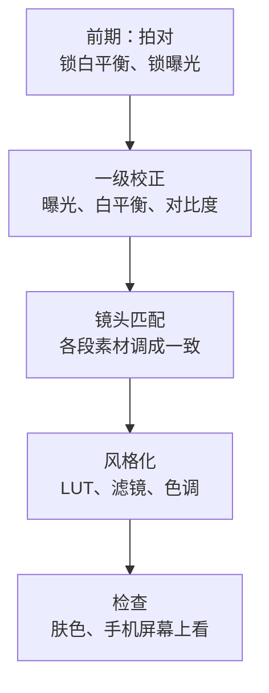
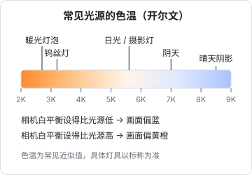

# 调色与画面统一

调色常被理解成「加个滤镜让画面好看」。对短视频账号来说，调色更重要的作用是**统一**：同一条视频里每个镜头颜色一致，同一个账号每期画面风格一致。观众说不出哪里不对，但会觉得「这个号很专业」或者「有点乱」。

本章讲调色的顺序、白平衡、曝光、LUT，以及怎么让多机位、多期视频的画面保持统一。色彩的通用原理（色相、明度、对比度怎么计算）见《写给开发者的设计课》，本章只讲视频的部分。

## 调色的顺序：先校正，后风格



**顺序不能反**。在一段偏蓝、偏暗的素材上直接套一个好看的滤镜，结果只会是「偏蓝偏暗的好看滤镜」。先把每段素材校正到正常、一致，再统一套风格。

还有一条更重要的：**前期拍对，比后期调色省十倍的力气**。第一章和第二章讲的锁白平衡、锁曝光、统一光源色温，就是在为调色省事。

## 白平衡

### 白平衡是什么

不同光源的颜色不同（第二章讲过色温）。人眼会自动适应，觉得白纸在哪种光下都是白的；相机不会，它需要知道「现在的光是什么颜色」，才能把白色还原成白色。这个设置就是白平衡。



### 为什么要手动锁定

自动白平衡会根据画面内容不断猜测光源颜色。你穿一件红衣服走进画面，或者背景里多了一块蓝色，自动白平衡就会调整，结果画面颜色在录制中途悄悄变了。这种变化在剪辑时很难修，因为它是渐变的。

拍摄时的做法：

- **相机**：白平衡设为手动，填入灯的色温（例如 5600K）；或者用相机的「自定义白平衡」功能对着白纸或灰卡测一下
- **手机**：手机自带相机通常不能直接锁白平衡。用支持手动白平衡的拍摄 App（例如第一章提到的 Blackmagic Camera）设定色温；只用自带相机时，至少保证光源单一、画面里颜色不要大幅变化
- **一次拍摄中途不改白平衡**，哪怕你觉得画面有点偏色。偏色是可以后期统一修正的，中途变化不好修

### 后期校正白平衡

画面偏色时，在剪映或 DaVinci Resolve 里调整：

1. **找画面里本应是白色或灰色的东西**：白墙、白纸、灰色衣服、键盘的白色键帽
2. **用白平衡吸管点一下**（剪映的调节面板里有色温、色调滑块，部分版本有吸管工具；Resolve 的一级校色里有白平衡吸管）
3. 没有吸管时，手动调：
   - **色温**滑块：画面偏蓝就往暖（黄）拉，偏黄就往冷（蓝）拉
   - **色调**滑块：画面偏绿就往洋红拉，偏洋红就往绿拉。廉价 LED 灯和荧光灯常常造成偏绿
4. 调完看**肤色**：自然、健康，不发灰、不发绿、不过红

### 用肤色判断

人眼对肤色非常敏感，一点点偏色都能感觉到。DaVinci Resolve 的示波器里有一种叫「矢量示波器」的视图，上面有一条「肤色线」：不论什么肤色的人，正常的肤色都会落在这条线附近。

做法：用遮罩框选脸部，看矢量示波器上的点是否落在肤色线上，偏向哪边就往反方向调色调。这个方法比肉眼判断更客观，尤其在显示器颜色不准时。

## 曝光

### 亮度看哪里

画面的亮度，最重要的是**脸的亮度**。

- **脸亮度合适**：五官清楚，额头和鼻尖没有一片死白，暗面有细节
- **背景比脸暗一些**（第二章讲过）

用波形示波器可以更客观地判断：DaVinci Resolve 和部分剪辑软件可以显示「亮度波形」，纵轴是 0–100 的亮度（单位 IRE）。

| 区域 | 大致范围 |
|---|---|
| 最暗的地方（黑头发、深色衣服） | 不要贴着 0，留一点点细节 |
| 人脸 | 多数肤色大约在 50–70 之间，浅肤色偏上，深肤色偏下 |
| 最亮的地方（白墙、高光） | 不要大面积超过 100，否则过曝成一片白 |

这些是业内常用的参考区间，不是硬标准。

### 调整的顺序

1. **曝光 / 亮度**：先让脸的亮度到位
2. **对比度**：让暗的地方更暗、亮的地方更亮，画面「立」起来。口播加一点点即可，加多了脸上的阴影会很重
3. **高光和阴影**：高光过曝时压高光；暗部太黑时提阴影
4. **饱和度**：最后调，幅度要小

### 饱和度要克制

新手调色最常见的问题是饱和度过高：脸发红发橙、背景的颜色刺眼。

- 饱和度调整幅度一般不超过 ±10–15（以剪映的滑块刻度为参考）
- 只想让画面「更鲜艳」时，优先用「自然饱和度」类的调整（它对已经很饱和的颜色，例如肤色，影响较小）
- 调完一定**在手机上看**：手机屏幕普遍比电脑显示器更鲜艳，电脑上刚好的饱和度在手机上可能就过了

## LUT

### LUT 是什么

LUT（查找表，Look-Up Table）是一个预设的颜色映射：输入一个颜色，输出另一个颜色。套一个 LUT，就是把整个画面的每个颜色按这张表转换一遍。

LUT 分两类，用途完全不同：

| 类型 | 作用 | 什么时候用 |
|---|---|---|
| **技术 LUT**（转换 LUT） | 把 Log 素材转换成正常的颜色（例如 Log → Rec.709） | 用 Log 模式拍摄的素材，必须先套这个 |
| **风格 LUT**（创意 LUT） | 给画面加一种风格：电影感、胶片感、冷调、暖调 | 校正之后，最后一步 |

### Log 是什么，要不要用

Log 是一种「灰蒙蒙」的拍摄模式：画面看起来对比度很低、颜色很淡，但保留了更多的亮部和暗部细节，后期调色空间更大。很多相机有 Log 模式，iPhone 15 Pro 起也支持 Apple Log（iPhone 17 Pro 支持 Apple Log 2）。

对新手的建议是：**不要用 Log**。

- Log 素材必须调色，不调色就是灰的。每条视频多了一步
- Log 对曝光的要求更严格，曝光不准时噪点和色彩断层很明显
- Log 素材文件更大
- 口播类内容的光线是可控的，标准模式的动态范围已经够用

什么时候考虑 Log：有大光比的场景（窗外很亮、室内很暗）、要拍有质感的产品、你已经稳定发了几十条，想在画面上进一步拉开差距。用 Log 时，**先套相机厂商提供的官方技术 LUT**，再做校正和风格化。

### 风格 LUT 怎么用

1. **先完成白平衡和曝光校正**
2. 套 LUT，然后**把强度降到 50%–80%**。几乎所有风格 LUT 在 100% 强度下都太重
3. 看肤色：很多「电影感」LUT 会让肤色偏青或偏橙，脸不好看时降低强度，或者用遮罩让脸部少受影响
4. 同一个账号**固定用一个 LUT、一个强度**，形成风格

### LUT 的版权

LUT 文件也是作品，有授权问题：

- 剪映内置的滤镜，按剪映的授权使用
- 网上购买的 LUT 包，看授权是否允许商用（大多数允许用于你自己的视频作品，但不允许转售 LUT 文件本身）
- 「免费分享」的 LUT 来源不明时，不确定是否是盗版的付费 LUT，谨慎使用
- 相机厂商官方提供的技术 LUT 可以放心用

## 让画面统一

### 同一条视频里的统一

多机位、或者同一机位但光线有变化的素材，要调成一致：

1. **选一段作为参考**，通常是主机位、光线最好的那段，先把它调好
2. 其他片段**和参考片段并排对比**，调白平衡和曝光直到一致
3. 重点对比**肤色和白色物体**：人脸颜色一样、白墙颜色一样，观众就感觉是一致的
4. DaVinci Resolve 有镜头匹配功能可以自动做第一步，再手动微调

两台不同品牌的设备（例如手机加相机）颜色天然不一样，很难完全匹配。尽量用同一品牌、同一型号的设备做多机位，或者把副机位只用作 B-roll。

### 同一个账号每期的统一

- **前期统一**：同样的灯位、色温、相机设置（第二章、第五章的标记和照片就是为这个准备的）
- **后期统一**：调好一条后，把调色参数保存为**预设**（剪映的调节面板可以保存预设；Resolve 可以保存调色节点或导出为 LUT），下一期直接套用，再微调
- **固定参考帧**：截一张你最满意的那一期的画面作为参考图，每次调色时和它对比

### 电脑显示器的颜色不一定准

你在电脑上调好的颜色，在观众的手机上不一定一样。

- 普通显示器出厂颜色偏差可能很大。不需要买专业显示器，但要知道你的显示器偏向哪边
- 最简单的办法：**导出后在手机上看**。大部分观众在手机上看，手机上好看才是真的好看
- 关掉显示器和系统的「护眼模式」「夜览」之类的暖色滤镜再调色

## 调色检查清单

```text
【前期】
[ ] 白平衡手动锁定，一次拍摄中途不改
[ ] 曝光锁定在脸上
[ ] 打在脸上的光只有一种色温

【校正】
[ ] 白色物体是白的，灰色物体是灰的
[ ] 肤色自然：不发灰、不发绿、不过红
[ ] 脸部亮度合适，额头鼻尖不过曝，暗面有细节
[ ] 对比度和饱和度调整幅度克制

【统一】
[ ] 同一条视频里各段素材肤色、白墙颜色一致
[ ] 套用了账号固定的调色预设 / LUT，强度一致
[ ] 和参考帧对比过

【检查】
[ ] 关掉了显示器的护眼 / 夜览模式
[ ] 导出后在手机上看过
[ ] 使用的 LUT 有授权
```

## 本章要点

- 调色顺序：前期拍对 → 校正（曝光、白平衡）→ 镜头匹配 → 风格化 → 检查，顺序不能反
- 拍摄时手动锁定白平衡，中途不改；后期用白色、灰色物体和肤色做校正
- 偏蓝往暖拉，偏绿往洋红拉；矢量示波器的肤色线能客观判断肤色
- 脸的亮度是曝光的核心，多数肤色在波形图 50–70 IRE 附近
- 饱和度要克制，调完在手机上看
- 新手不用 Log；用 Log 时先套官方技术 LUT
- 风格 LUT 在校正之后使用，强度降到 50%–80%，账号固定一个
- 调好的参数存为预设，配合固定灯位，每期画面自然统一
