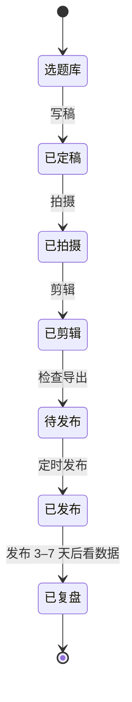

# 模板化与批量生产

前九章讲的是「怎么做好一条」。这一章讲「怎么每周稳定做好三五条，而且一条比一条省时间」。

对下班做副业的人来说，最大的敌人不是技术，而是**每一条都从零开始**：重新找字体、重新调字幕样式、重新找音效、重新想导出设置。这些重复劳动每条可能占掉一个小时，而且容易出错。

开发者对这件事应该很熟悉：**把重复的部分抽象成模板和配置，把流程写成清单，把能自动化的交给脚本**。

## 先算一笔时间账

一条 1 分钟口播，一个刚起步的人大概这样分配时间：

| 环节 | 从零开始 | 模板化之后 |
|---|---|---|
| 写稿 | 60 分钟 | 40 分钟（有选题库和结构模板） |
| 搭建设备 | 30 分钟 | 10 分钟（固定灯位、地上有标记） |
| 拍摄 | 40 分钟 | 20 分钟（批量拍，分摊到每条） |
| 粗剪精剪 | 60 分钟 | 40 分钟（快捷键熟练、NG 有标记） |
| 字幕、包装 | 60 分钟 | 20 分钟（字幕预设、音效库、片尾模板） |
| 调色、导出 | 20 分钟 | 5 分钟（调色预设、导出预设） |
| 合计 | 约 4.5 小时 | 约 2.2 小时 |

这张表的数字是按一个典型口播流程估的，不是实测统计，你的情况会不同。但方向是确定的：**模板化省下的时间，主要来自搭建、包装和导出这些「每次都一样」的环节**。建议你自己记录三条视频每个环节的实际用时，找出最耗时的那个环节优先模板化。

## 工程模板

### 剪映里能做成模板的东西

| 模板项 | 做法 | 下次怎么用 |
|---|---|---|
| 整个工程 | 做好一条标准工程（字幕样式、片尾、背景音乐轨道、调色都在），以后每次**复制这个草稿**再替换素材 | 草稿列表里复制，改名 |
| 字幕样式 | 调好字体、字号、颜色、描边、位置后保存为文字预设 | 新字幕直接套用预设 |
| 调色 | 调节参数保存为预设 | 选中片段套用 |
| 片头片尾 | 做好后导出成一段视频文件，放进素材库 | 拖进时间线 |
| 常用花字、贴纸 | 收藏 | 从收藏里找 |
| 导出设置 | 设一次，下次通常沿用上次设置 | 导出前确认一眼 |

**复制草稿**是最简单也最有效的方式。建一个叫 `_TEMPLATE_口播` 的草稿，里面包含：

```text
_TEMPLATE_口播（9:16，25fps）
├── 视频主轨：一段占位素材（替换成本期 A-roll）
├── 画中画轨：空，留给 B-roll
├── 文字轨：一条示例字幕，已套用字幕预设
├── 文字轨：片尾关注引导文字
├── 音频轨：背景音乐（已设好音量和淡出）
├── 音频轨：常用音效 3–5 个，静音放在时间线末尾备用
├── 调节轨：账号调色预设
└── 最上层：平台遮挡区参考图（导出前隐藏）
```

每次新做一条，复制模板 → 改名 → 替换主轨素材 → 开始剪。

### 不同内容类型各建一个模板

如果账号有几种固定栏目，每种栏目建一个模板：

- `_TEMPLATE_口播`：标准知识口播
- `_TEMPLATE_录屏教程`：画面以录屏为主，人像缩小放在角落
- `_TEMPLATE_对比测评`：左右或上下分屏
- `_TEMPLATE_横版`：16:9，给 B 站、视频号横版

栏目固定的包装（同样的片头、同样的标题样式）也是观众识别你的方式。

## 素材库结构

第五章讲了单条视频的文件夹。跨视频复用的素材放在 `_shared/`：

```text
素材库/
├── _shared/
│   ├── templates/          # 片头片尾、转场、栏目包装的视频文件
│   ├── broll/              # 通用空镜（第八章批量拍的那些）
│   │   ├── keyboard/
│   │   ├── desk/
│   │   ├── commute/
│   │   └── product/
│   ├── music/              # 有授权的背景音乐，按情绪分文件夹
│   │   ├── calm/
│   │   ├── upbeat/
│   │   └── tension/
│   ├── sfx/                # 音效：whoosh / ding / click / error ...
│   ├── fonts/              # 有授权的字体文件
│   ├── luts/               # 调色 LUT
│   ├── overlays/           # 平台遮挡区参考图、水印、边框
│   ├── licenses/           # 所有授权凭证：协议、截图、发票
│   └── license-ledger.csv  # 授权台账（第七章）
├── 2026-11/
│   └── 20261103_T042_.../
└── archive/                # 发布超过 3 个月的旧素材，可以移到移动硬盘
```

几条规则：

- **`_shared/` 里只放有授权的东西**。来源不明的素材不进库，一旦进库就会被反复使用
- 音乐按**情绪**分类，而不是按来源分类。剪辑时你想的是「我要一首轻松的」，不是「我要某某音乐库的」
- 音效文件名用**英文 + 描述**：`whoosh-short-01.wav`、`ding-soft.wav`，方便搜索
- 素材库放在一个固定的路径，剪映导入时常用这个路径

## 导出规格表

各平台都会对上传的视频重新压缩，而且推荐规格会随 App 更新调整。下表是**截至 2026 年 11 月业内常用的工作值**，不是平台官方公布的规格。上传前看一眼各平台上传页或创作者中心的最新提示，发现画质被压得厉害时，用「仅自己可见」发几个不同设置的版本对比。

| 用途 | 分辨率 | 帧率 | 编码 / 格式 | 码率（参考） | 备注 |
|---|---|---|---|---|---|
| 抖音、快手、视频号竖屏 | 1080×1920 | 与素材一致（25 / 30） | H.264，MP4 | 剪映「推荐」或 10–20 Mbps | 竖屏主力规格 |
| 小红书竖屏 | 1080×1920 或 1080×1440（3:4） | 同上 | H.264，MP4 | 同上 | 小红书图文与视频混排，3:4 在信息流里占的面积更大，按账号内容选择 |
| B 站横屏 | 1920×1080 或 3840×2160 | 同上 | H.264 / HEVC，MP4 | 1080p 约 10–20 Mbps；4K 更高 | 横屏长视频，4K 投稿可能获得更高的清晰度档位 |
| 视频号横屏 | 1920×1080 | 同上 | H.264，MP4 | 同上 | |
| 存档母版 | 与素材一致的最高分辨率 | 同上 | 高码率 H.264 / HEVC | 尽量高 | 以后要二次剪辑、换平台时用 |
| 封面图 | 与视频比例一致，或按平台要求 | — | JPG / PNG | — | 封面设计见[《选题与爆款结构》](../topic-and-hooks/) |

几点说明：

- **帧率不要改**：25 fps 的素材导出 60 fps 不会变流畅，只会让文件变大
- **码率不是越高越好**：平台都会重新压缩，几十 Mbps 的文件上传慢，画质也不一定更好
- **音频**：AAC 编码、48kHz 采样率是通用的安全设置
- **同一条视频发多个平台**，每个平台导出一个版本，文件名带上平台标识，例如 `20261103_T042_douyin.mp4`、`20261103_T042_bilibili.mp4`
- **注意平台曲库的范围**：用抖音曲库音乐做的版本，发到别的平台前要换成有多平台授权的音乐（第七章）

## 批量生产的周节奏

把一周的工作按「同类任务放在一起」排，而不是一条做完再做下一条。原因和编程时不频繁切换上下文一样：搭灯、进入拍摄状态、打开剪辑软件进入剪辑状态，都有启动成本。

下面是一个每周 3 条、只用晚上和周末的排法：

| 时间 | 任务 | 产出 |
|---|---|---|
| 周一晚（1 小时） | 复盘上周数据；从选题库挑本周 3 个选题 | 3 个选题 |
| 周二晚（2 小时） | 写 3 条稿子，大声读、改稿、拆段 | 3 份定稿 |
| 周三晚 | 休息，或补充选题库 | — |
| 周四晚（2 小时） | 搭建一次，**连拍 3 条**；顺带补拍 B-roll | 全部素材 |
| 周五晚 | 休息 | — |
| 周六（3–4 小时） | 剪 3 条：先全部粗剪，再全部精剪，再全部包装 | 3 条成片 |
| 周日（1 小时） | 发布前检查、导出多平台版本、排定发布时间 | 定时发布 |

几点说明：

- **「全部粗剪 → 全部精剪 → 全部包装」比「一条剪完再剪下一条」更快**：同一个阶段用同一套操作和心态，不来回切换
- 发布时间可以用平台的定时发布功能，分散到一周的不同日子
- 这是一个起点，不是标准答案。体力和工作安排不允许时，每周 2 条也完全可以。稳定比数量重要

### 用看板管理选题和进度

把每个选题当作一张卡片，在几个状态之间流动：



用什么工具都可以：在线表格、笔记软件的看板、或者一个 Markdown 文件。关键是**一眼能看到每个选题卡在哪个阶段**。开发者也可以把它放在一个 Git 仓库里，每条视频一个目录，稿子和发布记录都在里面。

## 能交给脚本的事

开发者的优势是可以写点小工具。下面几件事值得自动化，每个都只需要几十行代码：

| 任务 | 思路 |
|---|---|
| 新建一期的文件夹结构 | 一个脚本按「日期_选题编号_标题」创建 `raw/ audio/ broll/ export/` 和空的 `script.md` |
| 素材批量改名 | 按文件创建时间排序，按命名规则重命名 |
| 提取音频、生成字幕 | 用 ffmpeg 提取音频，本地语音识别生成 SRT（第六章） |
| 字幕常错词替换 | 读 SRT，按替换表批量替换后再导入剪映 |
| 检查素材授权 | 扫描工程用到的音乐、字体文件名，和授权台账比对，找出不在台账里的 |
| 旧素材归档 | 把发布超过 3 个月的 `raw/` 移到移动硬盘 |

例如新建一期文件夹：

```bash
#!/usr/bin/env bash
# 用法：./new-episode.sh T042 程序员副业该不该做自媒体
set -euo pipefail

id="$1"; title="$2"
root="$HOME/素材库/$(date +%Y-%m)"
dir="$root/$(date +%Y%m%d)_${id}_${title}"

mkdir -p "$dir"/{raw,audio,broll,export}
printf '# %s\n\n选题编号：%s\n\n## 稿子\n\n## 发布记录\n' "$title" "$id" > "$dir/script.md"
echo "已创建：$dir"
```

想做更多（例如自动生成字幕、批量剪辑），会碰到剪映工程文件格式没有公开、平台接口有限制等问题。这些在[《AI 内容生产工具链》](../ai-content-pipeline/)和[《给创作者和短剧团队做工具》](../creator-tools/)里有专门讨论。**本书的建议是：先把手工流程跑顺，再自动化最痛的那一步**，不要一开始就写一套「全自动生产系统」。

## 质量不能被批量牺牲

批量生产最大的风险是质量下滑：模板用久了，每条都长得一样；赶进度时跳过检查。几条底线：

- **发布前检查清单（第六章）每条都要过**，不能因为「这条和上条差不多」就跳过
- **每月换一次小包装**：字幕强调色、片尾、背景音乐，小范围更新，保持新鲜感，但核心样式不变
- **每 10 条视频回头看一次**：把最近 10 条按完播率排序，对比最好和最差的几条在剪辑节奏上的差异（第八章的标注表）
- **模板也要迭代**：发现某个处理方式效果好，更新到模板里；发现模板里某个元素没用，删掉

## 本章要点

- 模板化省下的时间主要来自搭建、包装、导出这些重复环节；先记录用时，找出最耗时的环节
- 剪映里最有效的模板方式是复制一个标准草稿；不同栏目各建一个模板
- `_shared/` 素材库只放有授权的素材，音乐按情绪分类，授权凭证和台账一起保存
- 导出：竖屏 1080×1920、帧率与素材一致、H.264 MP4；表中数值是常用工作值，以平台最新提示和实测为准
- 多平台发布每个平台一个版本，注意平台曲库音乐不能直接跨平台
- 按「同类任务放一起」排一周：一次搭建连拍 3 条，全部粗剪再全部精剪
- 用看板管理选题状态；先把手工流程跑顺，再用脚本自动化最痛的那一步
- 每条都过发布前检查，每 10 条回头复盘一次，模板随之迭代
