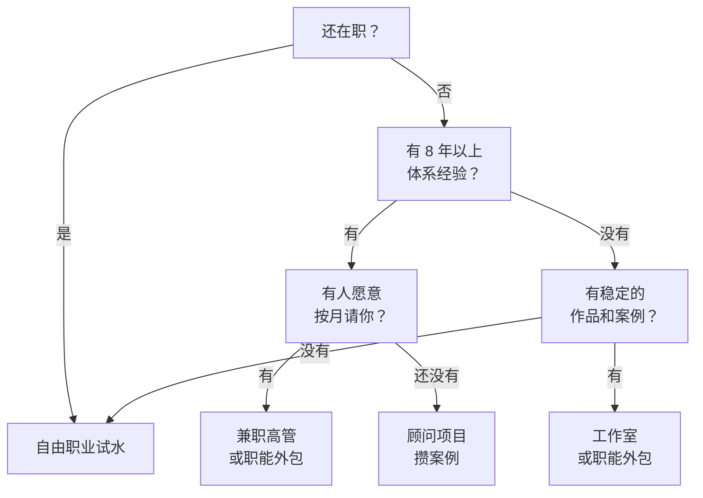

# 服务型一人公司的几种样子

上一章盘出了你能卖的技能。同一项技能，可以用很多种方式卖：同样是做财务的人，有人在网上接零散的做账单，有人开工作室，有人给五家小公司当「每周来两天的财务总监」。这几种做法的收入结构、客户、工作方式和天花板差别很大。

这一章把服务型一人公司常见的五种样子摆在一起比较，帮你选一个起点。这里的「公司」是广义的，指你一个人做的生意，不一定真的注册了公司；要不要注册、注册成什么，本系列的[《公司常识》](../company-basics/)和[《国内合规实务》第 1 章](../opc-compliance-cn/01-entity-choice.md)讲过。

## 五种样子

### 一、自由职业：按单接活

**是什么**：有活就接，一单一结。客户来自熟人介绍、接单平台、社交媒体。每单范围不大，几百到几千元，周期几天到几周。

**典型的人**：接零散设计稿的设计师、按千字收费的译者、帮人改简历的 HR、接短期活动策划的运营。

**收入结构**：完全按单。这个月接了 8 单，收入就是 8 单的钱；下个月只接到 2 单，收入就掉下来。

**好处**：

- 门槛最低，在职期间就能试
- 不需要注册任何主体，大多数以个人身份收劳务报酬（税务处理见[《过渡期收入与个人保障》第 8 章](../opc-transition/08-side-income-tax.md)）
- 什么都可以先试试，试错成本低

**难处**：

- 收入极不稳定，旺季忙到接不过来，淡季没活
- 单价容易被压：客户拿你和平台上报价最低的人比
- 每一单都要重新找客户、重新谈，销售成本高

### 二、个人工作室：有招牌的自由职业

**是什么**：在自由职业的基础上，有了一个固定的名字、明确的服务范围和对外的形象（作品集网站、公众号、小红书账号等）。客户找的是「某某设计工作室」，而不是「那个会做设计的小王」。很多工作室会注册个体工商户或小公司，方便开票。

**典型的人**：品牌设计工作室、婚礼策划工作室、摄影工作室、专做某类文书的翻译工作室。

**收入结构**：项目制为主，单价比自由职业高。有了稳定的招牌之后，回头客和转介绍会占一大半。

**和自由职业的区别**：不在于有没有营业执照，而在于**是不是主动选择了做什么、不做什么**。自由职业是客户要什么做什么；工作室是「我们只做餐饮品牌的视觉」，不在这个范围的活不接。

### 三、职能外包：替客户承担一整块工作

**是什么**：客户把公司里的某一个职能整个交给你，按月付费。最常见的几类：

| 外包的职能 | 你替客户做什么 | 常见收费方式 |
|---|---|---|
| 财务外包 | 整理票据、出报表、做预算、对接代账公司和银行 | 按月固定费用 |
| 人力外包 | 招聘、入离职手续、员工档案、制度维护 | 按月，或按招到的人头 |
| 招聘外包 | 只负责招人 | 按岗位或按人头，常按候选人年薪的比例 |
| 代运营 | 运营客户的社交媒体账号、店铺、社群 | 按月固定费用，有时加效果提成 |
| 设计外包 | 承包客户日常的设计需求 | 按月包一定数量的设计，或按件 |
| 行政外包 | 处理日常采购、合同归档、办公事务 | 按月 |

**典型客户**：10–100 人的公司。这些公司需要这个职能，但工作量撑不起一个全职员工，或者老板不想为此专门招人、交社保、管人。

**收入结构**：月度续费为主，这是它最大的好处。签下 5 个客户，每个月就有 5 份可以预期的收入。

**难处**：

- 你实际上要同时为好几家公司「上班」，每家都有自己的习惯和节奏
- 客户容易把你当员工使唤，范围不断扩大（第 6 章专门讲）
- 客户流失时，一次少一整份收入

> [!WARNING]
> 有些职能外包需要行政许可或备案，个人或刚注册的小公司不一定能做。按 2024 年前后的规定整理，以官方最新规定为准：
>
> - **代理记账**：按《代理记账管理办法》，从事代理记账业务需要设立机构并取得财政部门的许可，对专职从业人员等有条件要求。个人做财务的，可以做财务顾问、报表分析、预算这类不属于代理记账的工作，记账报税部分和有资质的代账公司合作
> - **职业中介（招聘）**：按《人力资源市场暂行条例》，经营性人力资源服务机构从事职业中介活动需要向人社部门申请许可（人力资源服务许可证）；人力资源管理咨询、人力资源服务外包等则实行备案
> - **劳务派遣**：按《劳动合同法》，经营劳务派遣业务需要取得劳务派遣经营许可，注册资本等门槛较高，一人公司基本不适合
>
> 动手前到当地财政、人社部门的官网或政务服务平台核对现行要求，条文可在国家法律法规数据库（flk.npc.gov.cn）查询。

### 四、顾问：卖判断，不卖执行

**是什么**：你不动手做，或者只做很少一部分，主要给建议、诊断问题、设计方案，由客户自己的团队去执行。

**典型的人**：给企业做薪酬体系诊断的 HR 顾问、帮门店梳理经营数据的财务顾问、帮品牌定内容策略的营销顾问。

**收入结构**：项目制或按天、按次收费，单价是五种里最高的。比如一个为期一个月的「招聘流程诊断」，可能只需要你实际投入五六天，收费却按项目算。

**难处**：

- 需要客户相信你的判断，这通常要有较长的经验和看得见的成功案例
- 结果依赖客户自己执行，执行得不好，客户可能觉得是你的方案不行
- 单个项目做完就结束，要不断找新项目

1 对 1 咨询和陪跑作为一种知识产品，怎么设计流程、怎么收费，[《知识付费与私域变现》第 5 章](../knowledge-products/05-consulting-coaching.md)讲过；开发者做咨询的经验见[《过渡期收入与个人保障》第 3 章](../opc-transition/03-consulting-training.md)。这里只把它当作一种生意形态来比较。

### 五、兼职高管：每周买你一两天

**是什么**：小公司请不起全职的财务总监、人力总监、市场总监，于是按月付费，让你每周固定投入一到两天，承担这个角色的职责：参加管理会、做决策、带公司里的初级员工。英文里叫 fractional executive（「部分时间」的高管），国内常说「兼职 CFO」「外部 HRD」。

**典型的人**：在大中型公司做过部门负责人、有完整体系搭建经验的人。

**收入结构**：按月固定费用，期限通常是半年到一年起。一个人一般同时服务两到四家。

**和职能外包的区别**：职能外包是替客户**干活**（出报表、招人），兼职高管是替客户**负责**（定预算、定招聘计划、带人）。前者靠执行力，后者靠判断力和信任。

**难处**：

- 对资历要求高，客户要信得过你才会让你参与决策
- 同时服务几家公司，要处理好保密和利益冲突（比如两家客户是竞争对手）
- 角色边界容易模糊：你既不是员工，又要像员工一样投入

## 放在一起比较

| | 自由职业 | 工作室 | 职能外包 | 顾问 | 兼职高管 |
|---|---|---|---|---|---|
| 卖什么 | 单件活 | 某类项目 | 一整块职能 | 判断和方案 | 一个角色 |
| 典型收费 | 按件 | 按项目 | 按月 | 按项目、按天 | 按月 |
| 典型客户 | 个人、小商户 | 小商户、中小公司 | 10–100 人公司 | 中小公司 | 20–200 人、在成长的公司 |
| 收入稳定性 | 低 | 中 | 高 | 中 | 高 |
| 销售难度 | 低（单小），但要一直卖 | 中 | 中 | 高 | 高 |
| 对资历要求 | 低 | 中 | 中 | 高 | 高 |
| 一个人能服务的客户数 | 很多，但都很小 | 同时几个项目 | 4–8 家 | 同时 2–3 个项目 | 2–4 家 |
| 主要瓶颈 | 单价和找单 | 招牌和口碑 | 范围蔓延、同时应对多个客户 | 信任和案例 | 资历和时间 |

几点观察：

- **越往右，单价越高，但对资历和信任的要求也越高**。刚出来的人直接做顾问或兼职高管，很难拿到第一个客户
- **按月收费的形态（职能外包、兼职高管）收入最稳**，对一人公司来说，稳比高更重要。收入稳了，你才敢拒绝不合适的客户
- **自由职业的起步最容易，也最容易困住人**。很多人做了好几年自由职业，收入一直没上去，原因不是能力，而是一直在按件卖、按件找客户

## 收入天花板粗看

这里先用一组假设的数字感受一下差别，第 4 章会把产能和天花板算细。

假设一位做了八年财务的读者，用不同的形态卖同样的能力：

| 形态 | 假设的价格 | 一年能做多少 | 年收入（未扣成本和税） |
|---|---|---|---|
| 自由职业：帮人做报表 | 每单 1500 元 | 每月约 8 单，一年 96 单 | 14.4 万 |
| 职能外包：小公司月度财务服务 | 每家每月 4000 元 | 同时 6 家 | 28.8 万 |
| 顾问：财务体系诊断项目 | 每个 3 万元 | 一年 8 个 | 24 万 |
| 兼职财务负责人 | 每家每月 1.5 万元 | 同时 2 家 | 36 万 |

这些数字都是假设，用来说明结构，不是行情。实际价格因城市、行业、客户规模和你的资历差别很大。

能看出来的是：形态的差别带来的收入差距，常常比技能水平的差别还大。同一个人，从按件卖换成按月卖，收入可能翻倍——不是因为他突然变强了，而是因为销售成本降低了，客户也愿意为「持续有人负责」付更多钱。

## 怎么选第一种形态

没有最好的形态，只有适合你现在处境的。几个判断问题：

几个补充：

- **在职期间，从自由职业起步最稳妥**。小单、短周期，下班和周末能做完，不需要注册主体，也不容易和雇主冲突（在职期间的边界见第 5 章）
- **离职时如果已经有一两个愿意按月合作的客户，直接从职能外包或兼职高管起步**。很多人的第一个按月客户就是前雇主或前雇主的合作方
- **形态可以组合**。常见的组合是「两三个按月客户打底 + 偶尔接顾问项目」，前者保证生活，后者带来更高的单价和新的案例
- **形态会随时间变化**。典型的路径是：自由职业 → 发现某类单子特别多 → 收窄成工作室 → 把常做的活打包成月度服务 → 资历够了以后接顾问和兼职高管

## 国外的几个参照

服务型一人公司在海外有一些被反复讨论的例子：把设计做成按月订阅、不限需求数量的 DesignJoy；从按小时收费转向按价值收费的顾问 Jonathan Stark 等。它们的模式、收入和局限，[《一人公司案例库》第 6 章](../opc-cases/06-service-opc.md)整理过，这里不再重复。看的时候注意两点：这些案例多数是开发和设计领域、面向海外客户的，价格水平和国内差得很多；而且公开讲自己经历的，大多是做成了的人。

## 本章要点

- 服务型一人公司常见五种样子：自由职业、个人工作室、职能外包、顾问、兼职高管
- 它们的区别在于卖什么（单件活、项目、一整块职能、判断、一个角色）和怎么收费（按件、按项目、按月）
- 越往右单价越高，对资历和信任的要求也越高；按月收费的形态收入最稳
- 部分职能外包（代理记账、职业中介、劳务派遣）需要许可，动手前先核对
- 在职期间从自由职业试水；离职时已有按月客户的，可以直接从职能外包或兼职高管起步；形态可以组合，也会随时间变化
