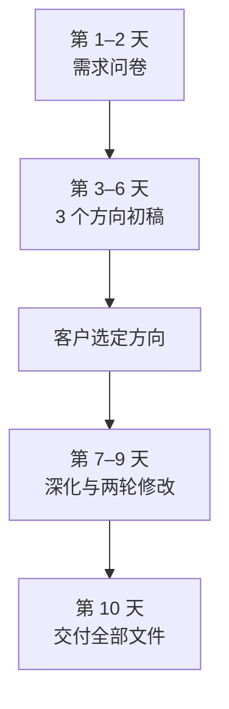

# 从岗位到服务包

「我可以帮你做设计。」「有需要随时找我。」这是很多人刚开始接活时的说法。听起来很灵活，实际上给自己挖了好几个坑：客户不知道该找你做什么，不知道要花多少钱，你也不知道一单要干多久、干到什么程度算完。

这一章讲一个简单但很有用的做法：把模糊的「我能帮你做 X」，打包成**固定范围、固定价格、固定周期**的服务。这种做法叫**产品化服务**——服务还是你亲手做，但卖的时候像卖一件商品一样清楚。

## 为什么要打包

先看两段对话的区别。

不打包的时候：

```text
客户：我新开了个店，想做个 logo，你这边怎么收费？
你：看具体需求哈，你想要什么风格？大概什么用途？
客户：就简单点的，好看就行。大概多少钱？
你：简单的话几百到几千都有，要看改几次……
客户：那你先出几个看看？
```

打包以后：

```text
客户：我新开了个店，想做个 logo，你这边怎么收费？
你：我有一个「小店品牌起步包」，3800 元，10 个工作日交付：
    logo 一套（3 个方向选 1 个深化，两轮修改），
    门头、名片、外卖平台头像三个落地尺寸。
    付一半开工，交付后付另一半。这是之前做的几个案例。
客户：门头的效果图也包含吗？
你：包含一张效果图，施工图需要找门头制作方出。
```

第二段对话里，客户一次就知道了价格、能得到什么、多久能拿到、怎么付钱。你也不用每次重新想怎么报价。

打包带来的好处可以归成四条：

| | 不打包 | 打包以后 |
|---|---|---|
| 客户决策 | 要来回问好几轮，容易问着问着就没下文 | 一次看懂，能直接决定买不买 |
| 报价 | 每单重新估，容易报低或报高 | 价格固定，不用每次纠结 |
| 交付 | 范围边做边扩，干到哪算完说不清 | 范围写在前面，做完就是做完 |
| 自己的效率 | 每单都是新活 | 同样的事做很多遍，越做越快，可以做模板 |

最后一条最重要。服务生意的利润，很大程度来自**重复**：第 20 次做同一种服务，比第 1 次快一倍，质量还更稳。不打包，就很难积累这种重复。

## 服务包的四个要素

一个服务包至少要写清四件事：

1. **范围**：包含什么，**不包含什么**
2. **价格**：多少钱，怎么付
3. **周期**：多久交付，分几个阶段
4. **客户要配合什么**：提供哪些资料、多久内给反馈

### 范围：先写「不包含」

范围里最容易出问题的不是「包含什么」，而是**没写的东西**。客户会自然地认为没写的东西也包含在内。所以写范围时，「不包含」一栏和「包含」一样重要。

以「月度经营报表」为例：

| 包含 | 不包含 |
|---|---|
| 每月一张经营报表：收入、成本、毛利、费用、现金余额 | 记账和报税（由客户的代账公司负责） |
| 每月一次 30 分钟线上解读 | 临时增加的专项分析（另行报价） |
| 报表中异常项目的说明（如某项费用比上月高出很多） | 银行、税务的现场办理 |
| 工作日内消息 24 小时内回复 | 周末和节假日的即时回复 |

「不包含」这一栏还有一个用处：它给了你一个**加价的接口**。客户需要专项分析，你不是拒绝，而是说「这个不在月度服务里，单独做的话是多少钱」。

### 修改次数和反馈时限

设计、文案、翻译、方案类服务，最消耗时间的是修改。不写清楚，客户会一直改下去。常见写法：

- 「包含两轮修改。一轮修改指客户一次性汇总提出的意见；第三轮起每轮另收 X 元」
- 「方向确定后，不再更换方向；更换方向视为新项目」

另一面是客户的反馈时限。你承诺 10 个工作日交付，前提是客户按时给资料、按时反馈。所以要写：

- 「交付周期从收到全部资料和首付款起算」
- 「客户每次反馈时间超过 5 个工作日，交付时间相应顺延」

### 价格：一个数字，不是区间

服务包的价格是一个确定的数字。「3000–8000 元」这种区间等于没打包，客户还是要问「那我这个是多少」。

如果确实有几种不同的需求，做成**两到三个档位**，每个档位都是一个确定的价格：

| | 基础版 | 标准版 | 完整版 |
|---|---|---|---|
| 价格 | 1800 元 | 3800 元 | 7800 元 |
| logo 方向 | 2 个选 1 | 3 个选 1 | 3 个选 1 |
| 修改轮数 | 1 轮 | 2 轮 | 3 轮 |
| 落地物料 | 外卖平台头像 | 头像 + 门头 + 名片 | 标准版 + 菜单 + 包装贴纸 + 简易品牌规范 |
| 周期 | 5 个工作日 | 10 个工作日 | 20 个工作日 |

三个档位的心理作用（为什么中间那档最好卖）在[《定价与商业模式》第 3 章](../pricing-monetization/03-pricing-psychology.md)讲过。价格本身怎么定，见第 4 章。

付款方式也写在服务包里：小额（几千元以内）可以全额预付或五五分；大一些的分阶段付，比如 40% / 40% / 20%。原则是**尾款不超过总额的三成**，就算最后有争议，你的损失也有限。

### 周期：分阶段，每个阶段有交付物

周期不只是一个截止日期，而是几个阶段，每个阶段结束时客户能看到东西、能确认：



分阶段的好处是：每一步都有客户的确认，后面就不会推翻前面。客户选定了方向，你就有理由拒绝「我还是想看看别的风格」。

## 服务说明书怎么写

把上面四个要素写成一页纸，就是一份**服务说明书**。它用在三个地方：发给潜在客户看、放在你的作品集或社交媒体主页上、作为签约时附件的基础。

一个通用的结构：

```text
【服务名称】一个能让客户看懂的名字，不用行话

适合谁：
- 什么样的客户、处在什么阶段、遇到什么问题

你会得到：
- 交付物 1（具体到数量、格式）
- 交付物 2
- ……

不包含：
- 容易被误以为包含、但实际不包含的东西

流程和周期：
- 第 1 步：……（第几天）
- 第 2 步：……
- 总周期：X 个工作日，从收到资料和首付款起算

需要你配合：
- 提供哪些资料
- 每次反馈在几个工作日内

价格和付款：
- X 元；付款节点
- 超出范围的部分怎么计费

过往案例：
- 2–3 个案例，脱敏后展示（见第 5 章）
```

写的时候注意：

- **服务名称说结果，不说过程**。「小店开业招聘包」比「招聘服务」好，「老板看得懂的月度报表」比「财务分析服务」好
- **「适合谁」也是在说「不适合谁」**。写明「适合 20–100 人、没有专职 HR 的公司」，200 人的公司看到会自己判断，不用你去拒绝
- **一页纸写得下**。写不下，说明服务太复杂，拆成两个服务包

## 四个不同岗位的服务包

下面四个例子都是假设的，价格只用来示意结构，不代表行情（各岗位的价格参考见第 8 章）。

### 例一：HR —— 小公司招聘包

```text
【小公司关键岗位招聘包】

适合谁：
- 20–100 人、没有专职招聘的公司
- 需要招聘一线销售、客服、运营、行政类岗位

你会得到：
- 岗位需求访谈 1 次（60 分钟），输出岗位说明和面试评分表
- 招聘渠道的职位发布和简历筛选
- 电话初筛，每周推荐通过初筛的候选人
- 30 天内推荐不少于 3 位通过客户面试的候选人
- 录用通知和入职材料清单模板

不包含：
- 中高层管理岗位、技术岗位（单独报价）
- 招聘网站的付费账号费用（由客户承担）
- 背景调查（可另行购买）

流程和周期：
- 第 1 周：需求访谈、岗位说明、发布职位
- 第 2–4 周：筛选、初面、每周推荐
- 30 天为一个服务周期

价格和付款：
- 每个岗位 6000 元；签约付 50%，候选人入职后付 50%
- 候选人 30 天内主动离职，免费补招一次
```

注意最后一条「免费补招」：它把风险分担的规则提前说清楚了，客户更容易下决定，你也知道自己最多要多做多少。

另外，按「推荐成功一人」收费属于职业中介，可能需要许可（见第 2 章的 WARNING）。这个例子里收费按「岗位服务」而不是「人头」，并且只是示意。真正开展业务前，按当地人社部门的要求确认你的业务属于许可还是备案范围。

### 例二：财务 —— 老板月报

```text
【老板看得懂的月度经营报表】

适合谁：
- 年营业额 300 万–3000 万、已有代账公司但老板看不懂账的小公司

你会得到：
- 每月 10 日前，一张一页纸的经营报表：收入、毛利、主要费用、现金余额、应收应付
- 每月一次 30 分钟解读会
- 每季度一份简短的趋势对比

不包含：
- 记账、报税、开票（由代账公司负责）
- 融资材料、审计配合（单独报价）

需要你配合：
- 授权代账公司每月 5 日前把账套数据和银行流水发来

价格和付款：
- 每月 3000 元，按季度预付；首次合作需一次性梳理费 3000 元
- 合作以 6 个月起
```

这个服务包故意避开了「记账报税」，而和代账公司合作。它卖的是代账公司通常不做、但老板真正需要的东西：看懂钱去哪了。

### 例三：设计 —— 电商详情页套餐

```text
【新品上架视觉包】

适合谁：
- 淘宝、拼多多、抖音小店的中小商家，单个新品上架

你会得到：
- 主图 5 张（含 1 张白底图）
- 详情页 1 套（不超过 12 屏）
- 两轮修改

不包含：
- 产品拍摄（可推荐合作摄影师）
- 字体和图片素材的商用授权费（如需购买，由客户承担，我方提供清单）
- 视频制作

流程和周期：
- 收到产品资料、卖点和样品照片后 7 个工作日交付
- 每次反馈超过 3 个工作日，交付时间顺延

价格和付款：
- 每个产品 2800 元；同一店铺一次下单 3 个以上，每个 2400 元
- 全额预付
```

「字体和图片素材的商用授权」这一条，很多刚出来的设计师会漏掉。在公司里，这些授权是公司买的；自己接活时，用了没有授权的字体，客户可能被追责，回头再找你。

### 例四：运营 —— 小红书账号起步包

```text
【小红书账号起步陪跑（8 周）】

适合谁：
- 本地生活商家（餐饮、美业、健身、教育机构）、刚开始做小红书

你会得到：
- 第 1 周：账号定位诊断，输出定位、人设、主页文案
- 第 2 周：选题库 30 条，内容模板 3 套
- 第 3–8 周：每周审改客户自己写的 3 篇笔记，每周一次 30 分钟复盘
- 结束时：一份运营手册，客户团队可以自己继续

不包含：
- 代写、代发笔记（代运营另行报价）
- 投放费用和投放操作
- 粉丝数、曝光量、成交额的承诺

价格和付款：
- 8 周 6800 元；开始前付 60%，第 4 周付 40%
```

注意「不包含」里的最后一条：**不承诺粉丝数和成交额**。运营效果受平台规则、行业、客户自身产品的影响太大，承诺结果等于给自己埋雷。你能承诺的是你做的事：诊断、选题、审改、复盘。

## 怎么从零设计第一个服务包

如果你还没有一个具体的服务包，可以按这个顺序来：

1. **从第 1 章的那句话出发**：「我帮【谁】解决【什么问题】，交付【什么结果】」
2. **回想你在公司里做这件事的完整过程**：从接到需求到交付，经过哪几步、每步多久、要哪些资料
3. **砍掉一半**。第一个服务包宁小勿大。公司里那套完整流程，对小客户来说太重了，挑出最核心、客户最痛的那一段
4. **写「不包含」**。把你砍掉的部分、容易被误会的部分写进去
5. **定一个周期**，按你下班或全职时的实际产能估，再加两成余量
6. **定一个价格**，方法见第 4 章
7. **找三个人看**：一个是潜在客户，一个是同行，一个是完全不懂的朋友。潜在客户看值不值，同行看漏了什么，外行看能不能看懂

做完以后，服务包不是定死的。前五单做完，几乎一定要改：有的步骤比预想慢、有的东西客户根本不需要、有的问题每个客户都会问。每改一次，把改的原因记下来。

## 什么时候不适合打包

产品化不是万能的。下面几种情况，按项目单独报价更合适：

- **需求差别非常大**：比如企业的组织架构调整，每家情况都不同，强行打包会让价格和范围都失真
- **单价很高、客户很少**：一年只做三四个大项目的顾问，每个项目单独谈更合理
- **你还没做过几次**：做过不到三次的服务，你自己都不知道它要花多少时间。这时可以先按项目报价，做几次以后再总结成服务包

即便是按项目报价，「写清楚不包含什么、分阶段确认、尾款不超过三成」这几条原则也同样适用。

## 本章要点

- 产品化服务就是把「我能帮你做 X」打包成固定范围、固定价格、固定周期的服务，让客户一次看懂、你也能反复做
- 服务包至少写清四件事：范围（尤其是不包含什么）、价格（确定的数字，可分两三档）、周期（分阶段，每阶段有交付物）、客户要配合什么
- 修改次数和客户反馈时限要提前写进去；尾款不超过总额的三成
- 服务说明书一页纸，名称说结果、写清适合谁、附上案例
- 第一个服务包宁小勿大，做完前五单再改；需求差别大、单价很高或还没做熟的，先按项目报价
