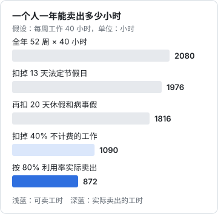
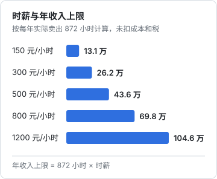

# 产能与收入天花板

刚开始做服务的人，最常犯的计算错误是这样的：「我按 300 元一小时收费，一天 8 小时就是 2400 元，一个月 22 天就是 5 万多，一年 60 多万。」

这个算法错在把「工作的时间」都当成了「能卖的时间」。一个人做服务生意，大量时间花在找客户、谈需求、开发票、学新东西上，这些都没人付钱。还有一部分时间，你想卖也卖不出去——客户没那么多。

这一章把这笔账算清楚：一年真正能卖出多少小时，收入的天花板在哪，你的报价至少要多少才能达到目标。报价的具体方法（按天、按项目、按价值）[《过渡期收入与个人保障》第 2 章](../opc-transition/02-outsourcing.md#报价三种方法)讲过，商业模式和价值度量在[《定价与商业模式》第 1 章](../pricing-monetization/01-business-models.md)，这里只讲产能和价格之间的关系。

## 一年有多少小时可以卖

从最大的数字开始，一层层往下扣。

### 第一层：工作时间

一年 52 周，每周工作 40 小时，一共 2080 小时。这是上限，前提是你从不休息。

扣掉节假日和休息：

- 法定节假日按 13 天算（2025 年起全体公民放假的天数，以国务院当年的放假安排为准），共 104 小时
- 自己给自己放的年假，按 15 天算，120 小时。自己做生意没有带薪年假，但不休假的人通常撑不过两年
- 病假、家里有事、孩子生病，按 5 天算，40 小时

$$
2080 - 104 - 120 - 40 = 1816 \text{ 小时}
$$

这 1816 小时是你一年实际在工作的时间。

### 第二层：可卖工时

工作时间里，有很大一部分是做生意必须做、但客户不会付钱的事：

| 不计费的工作 | 包括什么 | 大致占比（假设） |
|---|---|---|
| 销售和市场 | 写内容、维护社交媒体、见潜在客户、写方案、报价、跟进 | 20% |
| 行政和财务 | 开票、记账、报税、合同、催款、回消息 | 10% |
| 学习和准备 | 学新工具、看行业动态、整理模板 | 10% |
| 合计 | | 40% |

这个比例因人而异。刚起步时，销售占比会更高，常常一半时间都在找客户；做了几年、转介绍稳定以后，可以降到 15% 以下。这里按 40% 算：

$$
1816 \times (1 - 40\%) \approx 1090 \text{ 小时}
$$

这 1090 小时叫**可卖工时**：如果客户足够多，你最多能卖出这么多。

### 第三层：利用率

可卖工时不一定都能卖出去。项目之间有空档，有的客户中途暂停，有的月份就是没人找。实际卖出的工时占可卖工时的比例，叫**利用率**。

对一人服务生意来说，利用率能长期保持在 70%–80% 已经相当不错。这里按 80% 算：

$$
1090 \times 80\% = 872 \text{ 小时}
$$



872 小时，大约是全年总工时的四成多。换算到每周，平均每周只有 17 小时左右是在为客户干活并且收到了钱。

这个数字第一次算出来，很多人会觉得太低。但如果回想自己在公司的一周：开会、回消息、写周报、等审批，真正产出成果的时间又有多少？区别只在于，在公司里这些时间也有工资；自己做生意时，只有那 17 小时有收入。

## 收入天花板公式

把上面三层合起来，就是一人服务生意的收入天花板：

$$
\text{年收入上限} = \text{工作时间} \times (1 - \text{非计费占比}) \times \text{利用率} \times \text{时薪}
$$

在上面的假设下，前三项相乘是 872 小时，所以：

$$
\text{年收入上限} = 872 \times \text{时薪}
$$



这里的「时薪」不是你对外报的每小时价格，而是**你实际收到的钱除以实际干活的时间**。如果你按项目报价 6000 元，实际做了 30 小时，你的时薪是 200 元；如果做了 15 小时，就是 400 元。

### 为什么一个人卖时间很难超过某个数

从这个公式可以看出，要提高收入，只有四个办法：

1. **多工作**：每周干 60 小时。短期可以，长期会累垮，也会挤掉找客户和学习的时间
2. **少做不计费的事**：把销售、行政的时间压下去。有用，但压到一定程度就压不动了，你总得找客户、开发票
3. **提高利用率**：从 80% 提到 90% 以上，意味着几乎没有空档，任何一个客户暂停都会让你措手不及
4. **提高时薪**：这是唯一没有明显上限的一项，但它受市场行情、你的资历和客户的承受能力限制

前三项都有天然的上限，最终能拉开差距的只有时薪。而对大多数岗位技能来说，国内中小客户能接受的时薪是有范围的。设计、文案、行政、基础运营这类服务，时薪长期在两三百元以上的人已经不多；财务、HR 的体系搭建和顾问类工作可以更高，但客户也更少。

结论很直接：**单纯卖自己的时间，年收入有一个看得见的天花板**。在上面的假设下，要做到 50 万元以上的收入（未扣成本），时薪要接近 600 元；要做到 100 万元，时薪要超过 1100 元。能长期稳定收到这个价格的人很少。

这不是说卖时间不好。对很多人来说，一年二三十万、时间自己安排、不用通勤，已经是想要的生活。但如果你的目标更高，就必须在某个时候摆脱「收入 = 时间 × 时薪」这个公式，这是第 7 章的内容。

## 有效时薪：扣掉成本以后

上面算的是收入，不是到手的钱。自己做生意，有一些在公司时由公司承担的成本，现在要自己出：

| 成本 | 说明 |
|---|---|
| 社保和医保 | 离职后以灵活就业人员身份缴纳，或者通过自己的公司缴纳（见[《过渡期收入与个人保障》第 5 章](../opc-transition/05-social-insurance.md)） |
| 设备和软件 | 电脑、设计软件、办公软件、云盘的订阅费 |
| 财税服务 | 注册了公司或个体户以后的代账费 |
| 场地 | 在家工作可以省掉；租共享办公位要算进来 |
| 获客 | 平台会员费、推广费、请潜在客户吃饭 |
| 商业保险 | 公司里的补充医疗没了，自己补（见[《过渡期收入与个人保障》第 7 章](../opc-transition/07-commercial-insurance.md)） |

假设这些加起来每年 3.5 万元。那么按 300 元时薪、卖出 872 小时：

$$
\text{收入} = 872 \times 300 = 261600 \text{ 元}
$$

$$
\text{扣成本后} = 261600 - 35000 = 226600 \text{ 元}
$$

这笔钱还没交税。税怎么算取决于你是以个人身份收劳务报酬，还是通过个体户、公司收经营所得，见[《财务与税务》第 2 章](../opc-finance/02-taxes.md)，这里先不展开。

再算一个**有效时薪**：扣掉成本以后的收入，除以你**全部的工作时间**（包括不计费的时间）：

$$
\text{有效时薪} = \frac{226600}{1816} \approx 125 \text{ 元 / 小时}
$$

对外报 300 元一小时，实际每工作一小时只挣到约 125 元（税前）。差了一半多。

有效时薪是判断这门生意值不值得做的关键数字。拿它和你上班时的时薪比较：

- 如果你原来月薪 1.5 万元，一年 18 万元，工作约 1960 小时（假设一年工作 245 天），时薪大约 92 元
- 但别忘了公司还替你交了社保公积金、提供了设备和办公室，这些折算进去，公司为你付出的每小时成本还要再高一截（逐项怎么算见[《商业常识》公司为一个人花的钱，远不止工资](../business-basics/01-see-like-owner.md#公司为一个人花的钱远不止工资)）

所以，有效时薪 125 元和上班时的 92 元比，只是略高一些，而你多承担了收入不稳定的风险。这就是为什么很多人出来做了一年，发现「收入差不多，但累多了」。

## 用产能倒推价格

前面是从价格算收入，反过来，也可以从你想要的收入倒推最低价格：

$$
\text{最低时薪} = \frac{\text{目标年收入} + \text{年成本}}{\text{实际卖出工时}}
$$

例子：一位读者希望扣掉成本后每年 30 万元（税前），年成本 3.5 万元，按 872 小时算：

$$
\frac{300000 + 35000}{872} \approx 384 \text{ 元 / 小时}
$$

这是底线，取整到 400 元。按天报价的话，一天 8 小时约 3200 元。

如果利用率只有 60%（刚起步时很常见），实际卖出 $1090 \times 60\% = 654$ 小时，同样的目标需要：

$$
\frac{335000}{654} \approx 512 \text{ 元 / 小时}
$$

利用率从 80% 掉到 60%，要达到同样的收入，价格得提高三成多。这也说明了第一年为什么最难：客户少、利用率低，你却最不敢报高价。

### 换算到服务包

大多数服务按项目或按月收费，不直接按小时报。换算方法是：估出一个服务包要花的总时间（包括沟通、修改、交付后的答疑），乘以你的最低时薪。

以第 3 章的「老板月报」为例，假设每家客户每月要花：

| 工作 | 小时 |
|---|---|
| 收数据、核对 | 4 |
| 做报表 | 4 |
| 解读会（含准备） | 2 |
| 日常答疑 | 2 |
| 合计 | 12 |

按每月 3000 元收费，时薪是 $3000 \div 12 = 250$ 元。离 400 元的底线还差不少。这时有三个选择：

- **提价**到 4800 元左右（$12 \times 400$）
- **压缩时间**：用模板把报表时间从 4 小时压到 2 小时，总时间降到 10 小时，时薪 300 元
- **接受它**，但用其他更高单价的服务把平均时薪拉上来

不管选哪个，先要知道这个数字。很多人做了一年才发现，自己最主力的服务其实是亏时间的。

### 按月服务能接几家

月度服务还要算一个数：你同时能接几家。每月可卖工时是 $872 \div 12 \approx 73$ 小时。

- 每家每月 12 小时，最多 6 家
- 每家每月 20 小时，最多 3 家

第 2 章里「同时服务 6 家、每家每月 4000 元」的假设，对应的就是每家每月约 12 小时、时薪约 333 元。要接第 7 家，就得压缩每家的时间，或者接受利用率超过 80% 带来的压力。

## 记下你的真实时间

上面所有的数字都是假设。你自己的非计费占比、利用率、每个服务包的实际耗时，只有记录下来才知道。

最简单的做法是：从第一单开始，每天花两分钟，把时间按三类记下来。

```text
2026-11-12
客户 A｜月报｜做报表          2.5h
客户 B｜招聘包｜电话初筛      1.5h
非计费｜销售｜给潜在客户写方案  1.0h
非计费｜行政｜开票、对账       0.5h
非计费｜学习｜看新的报表模板    0.5h
```

记满一个月，就能算出：

- 每个客户、每个服务包的实际耗时，以及对应的时薪
- 非计费工作占了多少
- 利用率是多少

很多人记了以后会吃一惊：某个看起来很赚的客户，因为反复改需求、半夜发消息，时薪其实是最低的。这时候才有依据去调价或者放手（第 6 章）。

用表格、笔记软件、专门的计时工具都可以，关键是坚持记，而且**非计费的时间也要记**。

## 本章要点

- 一年 2080 小时，扣掉节假日、休假、病事假后约 1816 小时；再扣掉约四成的销售、行政、学习时间，可卖工时约 1090 小时；按八成利用率，实际卖出约 872 小时
- 年收入上限 = 工作时间 ×（1 − 非计费占比）× 利用率 × 时薪；四项里只有时薪没有明显上限，所以单纯卖时间有一个看得见的天花板
- 有效时薪 = 扣成本后的收入 ÷ 全部工作时间，它通常只有对外报价的一半左右，要拿它和上班时的时薪比
- 用「（目标收入 + 成本）÷ 实际卖出工时」倒推最低时薪；利用率越低，需要的价格越高
- 每个服务包都要估出实际耗时、算出对应时薪；从第一单开始记时间，非计费的时间也要记
