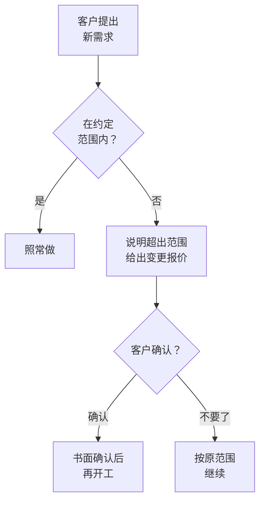

# 交付与客户管理

在公司里，你的工作有人分配、有人验收，做得好不好有绩效来评。自己做服务以后，这些都要你自己管：什么时候开始、做到什么程度、谁说了算、做完了怎么确认、客户不满意怎么办。

服务生意里，大多数的不愉快不是因为能力不够，而是因为**双方对「做什么、做到哪」的理解不一样**。这一章讲怎么用几份简单的文件和几个固定的节奏，把这种分歧提前消掉。

合同本身怎么写（服务范围、知识产权、违约责任、验收和付款条款），[《合同与法律文书》第 4 章](../contracts-legal/04-outsourcing-dev.md)讲过，虽然它以软件外包为例，但原理对设计、咨询、运营等服务都适用。尾款收不回来怎么办，见同一本书的[第 8 章](../contracts-legal/08-collections-disputes.md)。这一章讲合同之外的日常操作。

## 交付的节奏

### 开工前：启动会

每一单，哪怕只有几千元，开工前都约一次 30 分钟的启动会（线上即可）。启动会要做三件事：

1. **对一遍范围**：把服务说明书里「包含」和「不包含」逐条念一遍。这一步看起来多余，但很多误会就是在这时候发现的（「啊，我以为拍摄也包含的」）
2. **确认谁说了算**：客户那边谁提需求、谁给反馈、谁最终拍板。如果老板说「你跟我们运营对接就行」，要追问一句「运营确认的东西，你那边还需要再看吗？」，避免运营确认了、老板又推翻
3. **约好沟通方式**：用什么渠道（微信、邮件、飞书）、多久同步一次进度、工作时间以外怎么处理

### 进行中：固定节奏的进度同步

不要等客户来问「做得怎么样了」。按固定节奏主动同步，周期长的项目每周一次，周期短的在每个阶段结束时一次。内容很短：

```text
【XX 项目】第 2 周进度（11 月 15 日）

已完成：
- 岗位说明和面试评分表（已确认）
- 三个招聘渠道已发布职位，收到简历 46 份，初筛通过 9 份

本周计划：
- 完成 9 位候选人的电话初筛
- 周五前推荐第一批候选人

需要你配合：
- 周三前确认面试官的空闲时间

风险：
- 无
```

这个格式的好处是：客户扫一眼就知道进度；「需要你配合」一栏让客户的拖延变得可见；「风险」一栏让你有机会提前说坏消息，而不是到截止日才说。

### 结束时：交付和收尾

交付不只是把文件发过去。一个完整的收尾包括：

- **交付清单**：列出交付了什么，每一项是什么格式、放在哪里
- **验收确认**：请客户书面确认（下面细讲）
- **收尾款**
- **一次简短的回顾**：问客户哪里满意、哪里可以更好。这既是改进服务，也是开口请转介绍的时机（第 5 章）
- **归档**：把这个项目的文件、沟通记录、时间记录整理好放在一起

## 需求确认书

需求确认书是开工前的一份短文件，把启动会上谈定的内容写下来，请客户确认。它和服务说明书的区别是：服务说明书是通用的，需求确认书是**这一个客户、这一单**的具体情况。

一个模板：

```text
【需求确认书】XX 公司 · 新品上架视觉包

一、服务内容
- 产品：XX 保温杯（3 个颜色）
- 交付物：主图 5 张（含白底图 1 张），详情页 1 套（不超过 12 屏）
- 修改：两轮，每轮由客户方汇总后一次性提出

二、不包含
- 产品拍摄（客户已有实拍图 30 张）
- 字体和图片素材授权费（如需购买，提供清单，由客户承担）

三、客户方提供
- 产品实拍图、卖点文案、竞品参考链接，11 月 8 日前提供
- 对接人：运营 王某；最终确认人：老板 李某

四、时间
- 11 月 8 日收齐资料后起算，7 个工作日交付初稿
- 每次反馈超过 3 个工作日，交付时间相应顺延

五、价格和付款
- 2800 元，已全额预付

六、验收
- 第二轮修改完成后，客户在 3 个工作日内确认；
  逾期未提出意见的，视为验收通过

确认人：________　日期：________
```

小额的单子，需求确认书可以直接作为合同的附件，或者用聊天软件发过去让对方回复「确认」。金额较大的，正式签合同，把它作为附件。聊天记录作为证据要注意什么，[《合同与法律文书》第 7 章](../contracts-legal/07-esign-evidence.md)讲过。

最后一条「逾期未提出意见视为验收通过」很重要。没有这一条，有的客户会一直不确认，你的尾款也就一直收不回来。

## 范围蔓延与变更

**范围蔓延**是指项目做着做着，需求越来越多，而价格和时间没变。它几乎发生在每一个服务项目里，很少是因为客户有恶意，更多是因为：

- 客户看到初稿以后，才想清楚自己真正要什么
- 客户觉得「顺手改一下」不费事
- 你不好意思拒绝，觉得多做一点能让客户更满意

一次两次没关系，累积起来，一个原本 20 小时的活变成了 40 小时，时薪直接减半。

### 识别范围蔓延

客户说这些话的时候，要警觉：

| 客户说 | 实际意思 |
|---|---|
| 「顺便帮我把 XX 也做一下吧」 | 新增需求 |
| 「这个能不能再出几个方向看看」 | 超出约定的方案数量 |
| 「我们老板看了，想换个风格」 | 推翻已确认的方向 |
| 「能不能把交付时间提前到下周」 | 压缩周期，等于增加你的工作强度 |
| 「你帮我们开个会讲讲吧」 | 新增服务 |

### 变更流程

处理范围变化，不是拒绝，而是**让变化有价格**。一个简单的流程：



回复客户的话术可以很平和：

```text
这个需求不在这次的服务范围里（原范围是 XX）。
可以做，需要额外 X 个工作日，费用是 X 元。
你确认的话我就排进去；如果这次先不加，我们按原计划推进。
```

几个要点：

- **先报价，再动手**。做完了再说要加钱，客户会觉得被坑
- **书面确认**。哪怕只是聊天软件里回一句「确认，加上吧」
- **小的可以送，但要说出来**：「这个改动很小，这次就不另收费了」。说出来，客户知道这是额外的；不说，下次他会认为这是理所当然的

## 阶段验收

第 3 章说过，服务要分阶段，每个阶段有交付物。阶段验收就是在每个阶段结束时，请客户确认这一阶段的成果，再进入下一阶段。

阶段验收的价值在于**锁定**：确认过的东西，后面就不再推翻。设计确定了方向就不再换方向，招聘确定了岗位画像就不再改画像，报表确定了格式就不再改格式。如果客户后来想推翻，那属于变更，按变更流程处理。

验收的方式要简单，客户才愿意配合：

- 发一条消息：「第一阶段的 XX 已完成，附件是交付物。请在 X 月 X 日前确认，或者提出修改意见」
- 客户回复「确认」或者给出意见
- 如果到期没有回复，再提醒一次；仍然没有回复，按需求确认书的约定视为通过

和付款节点挂钩的验收（比如「方向确认后付第二笔款」），确认后当天就发付款提醒。

## 难缠的客户

大多数客户是讲道理的。但做服务久了，总会遇到一些让你身心俱疲的客户。早点认出来，能省很多事。

### 签单前就能看出来的信号

| 信号 | 可能意味着 |
|---|---|
| 反复压价，压完还要加内容 | 合作中会一直讨价还价 |
| 说不清要什么，但说「做出来我看了就知道」 | 会反复修改、推翻 |
| 不愿意付预付款 | 尾款很可能也难收 |
| 抱怨之前合作的人都不行 | 你很可能是下一个被抱怨的 |
| 要求先免费做一版看看 | 比稿，或者拿你的方案去找更便宜的人做 |
| 对接人做不了主，每次都要「再问问老板」 | 决策慢，反复推翻 |

有两三个信号的，可以接，但要把价格报高一些、预付比例提高、范围写得更死。有四个以上的，礼貌拒绝：「这段时间排期比较满，这次可能接不了，祝顺利。」不需要解释。

### 合作中的问题

**深夜和周末的消息**。启动会上约定了工作时间，就按约定来。工作时间以外的消息，第二天工作时间再回。前几次你也许会不安，但多数客户很快就会适应。如果第一次就半夜秒回，客户会默认你随时在线。

**一直不给反馈，又催进度**。用进度同步里的「需要你配合」一栏把卡点记下来。到了截止日，按约定顺延，并书面说明：「由于 XX 资料在 X 日才收到，交付时间相应顺延到 X 日。」

**对结果不满意**。先分清是哪一种不满意：

- 是你没有按约定做到？那就改，改到符合约定为止
- 是约定的内容做到了，但客户现在想要别的？那是变更
- 是客户期望的结果（比如销量、粉丝数）没有实现，而你没有承诺过这个结果？解释清楚你承诺的是什么、你做了什么，可以给一些改进建议，但不为你没承诺过的结果负责

所以第 3 章强调，服务包里要写清楚「不承诺什么」。

### 及时止损

有时候，一个客户已经明显不值得继续：时薪被压到很低、沟通让你焦虑、或者对方开始拖欠付款。这时继续做下去，损失的不只是这一单，还有被它挤掉的其他机会和你的精力。

止损的几种方式，从轻到重：

1. **按原约定做完这一阶段，不再续约**。最体面的方式，适合按月合作的客户：「这期合作结束后，我这边的排期有调整，下期就不继续了。」
2. **提价**。给出一个让你觉得「做也值得」的价格，对方接受就继续，不接受就自然结束
3. **提前终止**。按合同的终止条款处理：结清已完成部分的费用，交付已完成的成果，停止后续工作。如果合同里没写终止条款，协商处理，把沟通过程保留好

决定止损时，有几件事要做好：

- **把已完成的部分交付清楚**，不要因为不愉快就扣着成果不给，这会让你在后续纠纷里处于不利地位
- **结清钱**。已完成部分对应的费用要收回来，收不回来的按[《合同与法律文书》第 8 章](../contracts-legal/08-collections-disputes.md)的升级路径处理
- **不在任何公开场合说客户的坏话**。行业圈子小，说了对你没有好处
- **记下这次学到了什么**，下一次在签单前就能认出来

一个可以参考的原则：**如果一个客户占用了你超过三成的精力，却只带来不到一成的收入，就该考虑放手了**。

## 一张客户台账

客户多了以后，靠脑子记不住每家的情况。用一张表格记录每个客户，每家一行。下面是平时最常看的五列：

| 客户 | 服务 | 状态 | 下次动作 | 时薪 |
|---|---|---|---|---|
| A 公司 | 老板月报 | 进行中 | 12-10 交 11 月报表 | 273 |
| B 店 | 新品视觉包 | 第一轮修改 | 11-20 交二稿 | 200 |
| C 公司 | 招聘包 | 推荐中 | 11-18 推荐第二批 | — |

完整的十列模板（含开始日期、金额、已收、本月耗时、备注），复制到表格软件里用：

```csv
客户,服务,开始日期,状态,金额,已收,下次动作,本月耗时,时薪,备注
A 公司,老板月报,2026-09,进行中,3000/月,已收至 11 月,12-10 交 11 月报表,11h,273,数据常晚到
B 店,新品视觉包,2026-11-08,第一轮修改,2800,2800,11-20 交二稿,14h,200,修改意见较多
C 公司,招聘包,2026-11-01,推荐中,6000,3000,11-18 推荐第二批,9h,—,尾款入职后付
```

「本月耗时」和「时薪」两列来自第 4 章的时间记录。每月看一次，时薪最低的那个客户，就是下一个要调整的对象。

## 本章要点

- 每一单都按「启动会 → 固定节奏的进度同步 → 交付收尾」走；启动会对一遍范围、确认谁说了算、约好沟通方式
- 需求确认书把这一单的具体内容写下来，包含「逾期未提意见视为验收通过」
- 范围蔓延是最常见的利润杀手；超出范围的需求先报价、书面确认再动手，小的可以送但要说出来
- 每个阶段验收后锁定成果，后续推翻按变更处理
- 签单前留意难缠客户的信号；合作中守住工作时间；需要止损时交付已完成部分、结清费用、不公开抱怨
- 用一张客户台账记录每个客户的进度、收款、耗时和时薪
